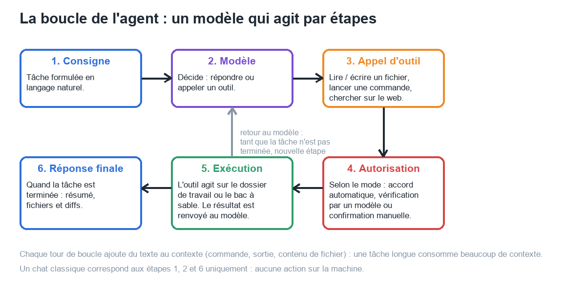
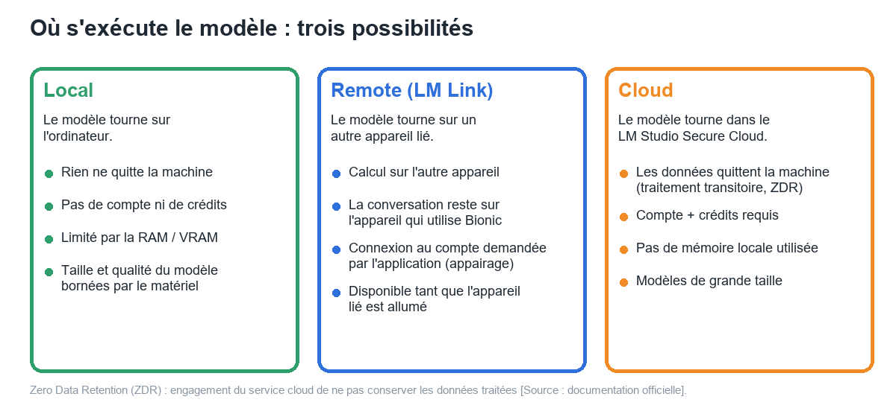
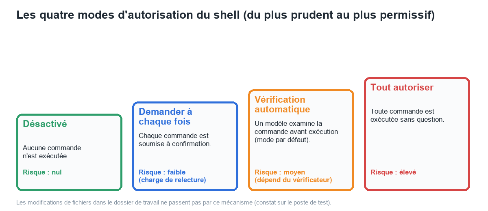

# Manuel Bionic 00 — Notions fondamentales de l'agent

> **Objet** : expliquer, sans prérequis, ce qu'est un agent IA, en quoi il diffère d'un chat, et les notions qui conditionnent tous les réglages de Bionic (outils, autorisations, contexte, lieu d'exécution, compétences).
> **Public** : novices (sections « Essentiel ») et utilisateurs expérimentés (sections « Pour aller plus loin »).
> **Prérequis** : aucun. Les notions de modèle, de quantification et de contexte sont détaillées dans le [Manuel LM Studio 00](../lmstudio/00-notions-fondamentales.md).
> **Statut des informations** : [Vérifié] observé sur le poste de test ; [Source] documentation officielle ; [Estimation] déduction à confirmer ; [À tester] non documenté.

---

## Sommaire

1. [Chat et agent](#1-chat-et-agent)
2. [La boucle de l'agent](#2-la-boucle-de-lagent)
3. [Le harnais](#3-le-harnais)
4. [Où s'exécute le modèle](#4-où-sexécute-le-modèle)
5. [Dossier de travail, fichiers du projet, fichiers externes](#5-dossier-de-travail-fichiers-du-projet-fichiers-externes)
6. [Autorisations et niveaux de risque](#6-autorisations-et-niveaux-de-risque)
7. [Contexte et compaction](#7-contexte-et-compaction)
8. [Compétences, MCP, sous-agents](#8-compétences-mcp-sous-agents)
9. [Ce que la taille du modèle change](#9-ce-que-la-taille-du-modèle-change)
10. [Lexique rapide](#10-lexique-rapide)

---

## 1. Chat et agent

### Essentiel

Un **chat** échange du texte : une question est posée, une réponse est produite. Rien d'autre ne se passe sur l'ordinateur.

Un **agent** reçoit une **tâche** (« corriger ce bogue », « rédiger un mémo et l'enregistrer ») et dispose d'**outils** : lire et écrire des fichiers, lancer des commandes, chercher sur le web. Il enchaîne plusieurs actions, observe le résultat de chacune, puis décide de la suite jusqu'à ce que la tâche soit terminée.

| | Chat | Agent |
|---|---|---|
| Entrée | Question | Tâche avec un livrable |
| Actions sur la machine | Aucune | Fichiers, commandes, navigateur |
| Durée | Quelques secondes | Quelques minutes, parfois davantage |
| Contrôle humain | Relire la réponse | Autoriser les actions, relire les modifications |
| Risque principal | Réponse fausse | Action fausse **appliquée** (fichier modifié, commande exécutée) |

> **Exemple (poste de test)** — consigne confiée à un agent : « Exécuter les tests, trouver la cause de l'échec dans `tarifs.py`, la corriger puis relancer les tests ». Un chat aurait proposé une correction en texte. L'agent a lu le fichier, remplacé la ligne fautive, puis proposé de lancer `pytest`, le tout en 6 min 22 s avec un modèle de 4 milliards de paramètres.

### Pour aller plus loin

Techniquement, un agent est un modèle de langage utilisé en mode **appel d'outils** (*tool calling*) : le modèle ne produit pas seulement du texte, mais aussi des appels structurés (nom de l'outil + arguments). Une application tierce, le **harnais** ([section 3](#3-le-harnais)), exécute l'appel et renvoie le résultat au modèle. Un modèle qui ne gère pas l'appel d'outils ne peut pas servir d'agent, même s'il converse correctement.

---

## 2. La boucle de l'agent

*Figure 1 — Boucle de l'agent.*

### Essentiel

1. La consigne est envoyée au modèle.
2. Le modèle répond soit par du texte (tâche terminée), soit par un **appel d'outil**.
3. L'appel passe par une étape d'**autorisation** (voir [section 6](#6-autorisations-et-niveaux-de-risque)).
4. L'outil s'exécute ; son résultat est ajouté à la conversation.
5. Le modèle reprend la main : étape suivante ou réponse finale.

Dans l'interface, cette boucle apparaît sous la forme d'une ligne repliable **« Travail effectué en 6min 22s »** : en la dépliant, chaque réflexion, appel d'outil et résultat est visible. Les fichiers touchés sont résumés dans un bloc **« Fichiers modifiés »** avec le nombre de lignes ajoutées (vert) et supprimées (rouge).

### Pour aller plus loin

- **Chaque tour de boucle ajoute du texte au contexte** : sorties de commandes, contenu des fichiers lus, raisonnement du modèle. Une tâche de 20 étapes peut consommer plusieurs dizaines de milliers de tokens ([section 7](#7-contexte-et-compaction)).
- **Les erreurs se propagent** : une mauvaise hypothèse à l'étape 2 (mauvais chemin, mauvais fichier) entraîne des étapes inutiles. Un petit modèle y est plus sensible ([section 9](#9-ce-que-la-taille-du-modèle-change)).
- **La durée dépend du nombre d'étapes** autant que de la vitesse du modèle.

> **Exemple (poste de test)** — deux tâches, même modèle (*Gemma 4 E4B*, GPU intégré) :
>
> | Tâche | Étapes principales | Durée |
> |---|---|---|
> | Rédiger un mémo de 6 lignes et l'enregistrer | 1 appel d'outil (écriture de fichier) | 2 min 4 s |
> | Corriger un bogue et relancer les tests | lecture, recherche, modification, tentative de test | 6 min 22 s |
>
> **Même modèle sur GPU dédié** (RTX 4060 Ti, 7 octobre 2026) : mémo **29 s** (2 min 4 s), bogue **1 min 38 s** (6 min 22 s) ; avec *Gemma 4 26B A4B*, le bogue est corrigé et les tests relancés en **43 s**. La vitesse du matériel raccourcit les tâches, mais **le nombre d'étapes et la fiabilité des appels d'outils** dépendent du modèle ([Manuel 04](04-modeles.md#6-comparaison-mesurée)).

---

## 3. Le harnais

### Essentiel

Le **harnais** désigne le logiciel qui entoure le modèle : il fournit les outils, applique les autorisations, affiche les modifications et conserve l'historique. **Bionic est un harnais** : le modèle (Gemma, Qwen, etc.) est interchangeable ; le comportement (autorisations, projets, aperçu des modifications) vient de l'application.

Conséquence pratique : un même modèle peut donner des résultats différents dans LM Studio (chat) et dans Bionic (agent), et deux modèles dans Bionic ne se valent pas pour une même tâche.

### Pour aller plus loin

Le harnais fixe notamment : la liste des outils proposés au modèle, le format des appels, la manière de présenter les résultats, la politique d'approbation, la gestion du contexte (compaction), le stockage des sessions. Ces éléments sont décrits dans les manuels [02](02-interface.md), [03](03-reglages.md) et [07](07-code-et-shell.md).

---

## 4. Où s'exécute le modèle

*Figure 2 — Local, Remote, Cloud.*

### Essentiel

Trois emplacements sont possibles pour le modèle d'une session :

| Emplacement | Principe | Ce qui sort de la machine |
|---|---|---|
| **Local** | Le modèle est téléchargé et tourne sur l'ordinateur. | Rien. |
| **Remote** | Le modèle tourne sur un autre appareil relié par **LM Link**. | Les requêtes transitent entre appareils liés (chiffrement de bout en bout annoncé dans l'application). |
| **Cloud** | Le modèle tourne dans le **LM Studio Secure Cloud**. | Le contenu des échanges, traité de façon transitoire (*Zero Data Retention*). |

Le choix dépend de la **sensibilité des données**, de la **puissance disponible** et du **budget** :

- Données confidentielles → **Local** (ou **Remote** sur un appareil maîtrisé).
- Tâche lourde, modèle trop gros pour le poste, données non sensibles → **Cloud** (compte et crédits requis).

> **Exemple (poste de test)** — seul le mode **Local** a été utilisé : aucun compte n'est connecté (« Non connecté. » dans Réglages → Général). Le modèle *Gemma 4 E4B* est partagé avec LM Studio (même dossier de modèles).

### Pour aller plus loin

- **Zero Data Retention (ZDR)** : engagement de ne pas conserver les données traitées par le cloud [Source]. C'est un engagement contractuel, non une garantie technique vérifiable depuis le poste.
- **Remote** : la conversation reste sur l'appareil qui utilise Bionic, seul le calcul est délégué [Source].
- Les modèles cloud consomment des **crédits** selon le modèle et le nombre de tokens traités ; les modèles locaux et distants n'en consomment pas [Source].

---

## 5. Dossier de travail, fichiers du projet, fichiers externes

### Essentiel

Un agent n'agit que sur ce qui lui est ouvert. Bionic distingue trois zones :

| Zone | Définition | Où se trouve le fichier | Modification |
|---|---|---|---|
| **Dossier de travail** (*working directory*) | Dossier réel de l'ordinateur choisi à la création du projet (code, documents). | À son emplacement d'origine. | Directe, sur les fichiers réels. |
| **Fichiers du projet** (*Project files*) | Espace géré par Bionic : fichiers joints ou créés pendant les sessions. | Dossier interne de l'application. | Dans l'espace du projet. |
| **Fichiers externes** (*External files*) | Fichiers ou dossiers « connectés » au projet. | À leur emplacement d'origine. | **Directe sur l'original, sans copie** [Source]. |

> **Point d'attention** — « connecter » un dossier ne signifie pas que le shell s'y exécute. Sur le poste de test, un agent travaillant dans un projet à dossier **connecté** n'a pas retrouvé le dossier au premier essai ; la même tâche a réussi lorsque le dossier était défini comme **dossier de travail** du projet. Pour le code, le dossier de travail est le choix adapté ([Manuel 07](07-code-et-shell.md)).

### Pour aller plus loin

Les données internes de Bionic résident dans deux emplacements [Vérifié] : `%APPDATA%\Bionic` (application) et `~\.lmstudio\apps\bionic` (projets, journaux du serveur). Les **fichiers du projet** d'un projet sans dossier de travail sont stockés dans `…\apps\bionic\projects\<identifiant>\workspace`. Les modèles sont partagés avec LM Studio dans `~\.lmstudio\models`.

---

## 6. Autorisations et niveaux de risque

*Figure 3 — Quatre modes d'autorisation du shell.*

### Essentiel

Le **shell** (invite de commandes) permet de lancer n'importe quel programme : installer, supprimer, lire, envoyer sur le réseau. C'est l'outil le plus puissant, donc le plus encadré. Quatre modes existent :

| Mode | Comportement | Quand l'utiliser |
|---|---|---|
| **Désactivé** | Aucune commande. | Travail purement documentaire, données sensibles. |
| **Demander à chaque fois** | Confirmation manuelle de chaque commande. | Découverte, dossiers importants, modèles peu fiables. |
| **Vérification automatique** | Les commandes reconnues comme sûres sont approuvées automatiquement ; les autres sont examinées par un agent de vérification distinct. **Mode par défaut** [Vérifié]. | Usage courant avec un modèle fiable. |
| **Tout autoriser** | Aucune question. | Environnement jetable uniquement (machine virtuelle, dossier de test). |

La confirmation manuelle affiche la commande, le **dossier d'exécution** et trois issues : **Yes** (exécuter), **Non, demander autre chose à l'agent** (avec une instruction libre) et **Annuler**.

### Pour aller plus loin

- Les **modifications de fichiers** dans le dossier de travail **ne déclenchent pas de confirmation** dans la configuration testée [Vérifié] : un fichier du dossier réel a été modifié directement. La protection consiste donc à relire les **diffs** et, pour le code, à utiliser un dépôt **Git** (retour arrière possible).
- Une **vérification automatique** réduit les interruptions mais déplace la confiance vers la liste de commandes « sûres » et l'agent vérificateur ; des **instructions personnalisées** peuvent être ajoutées (Réglages → Agent) [Vérifié].
- La documentation signale des invites supplémentaires pour les opérations de fichiers dépassant les limites de *checkpoint* et des règles d'accès aux sites web [Source : changelog].

---

## 7. Contexte et compaction

### Essentiel

Le **contexte** est la mémoire de travail du modèle : consigne, historique, résultats d'outils. Elle est limitée (en tokens). Bionic affiche en bas à droite de la zone de saisie un compteur, par exemple **« Contexte : 9,2 k »** (9 200 tokens utilisés dans la session).

Quand le contexte approche de sa limite, Bionic peut **compacter** automatiquement les échanges anciens (résumé) pour continuer [Source : journal des modifications, cas des sessions riches en images]. Une session très longue peut ainsi perdre des détails anciens.

### Pour aller plus loin

- Sur un modèle local, la **taille de contexte chargée** conditionne la mémoire consommée (≈ 50 Ko par token pour *Gemma 4 E4B*, voir [Manuel LM Studio 00](../lmstudio/00-notions-fondamentales.md)). Un agent a besoin de **beaucoup** de contexte : une valeur minimale est imposée par Réglages → Paramètres par défaut des modèles locaux (« Longueur de contexte minimale pour AutoFit »).
- Fractionner : une session par sujet évite de saturer le contexte et de mélanger les consignes ([Manuel 05](05-projets-et-sessions.md)).

---

## 8. Compétences, MCP, sous-agents

### Essentiel

| Notion | Définition | Exemple |
|---|---|---|
| **Compétence** (*skill*) | Instructions réutilisables dans un fichier `SKILL.md` : procédure, format, normes. | « Relire un contrat selon une check-list ». |
| **MCP** (*Model Context Protocol*) | Standard pour brancher des **outils externes** (GitHub, Notion, Linear, base de données…). | Lire les tickets d'un projet. |
| **Sous-agent** | Agent auxiliaire lancé par l'agent principal pour une sous-tâche. | Recherche parallèle dans les fichiers ; analyse d'images par un modèle de vision. |

Les compétences se déclenchent automatiquement ou par la palette `@`. Les serveurs MCP se configurent dans Réglages → MCP. Détails : [Manuel 08](08-competences-et-mcp.md).

### Pour aller plus loin

Un MCP **étend les capacités** de l'agent, donc sa surface de risque : un serveur MCP tiers peut lire des données ou agir sur un service distant. Les compétences et MCP installés doivent être relus avant de s'y fier [Source].

---

## 9. Ce que la taille du modèle change

### Essentiel

Un agent exige plus d'un modèle qu'un chat : suivre un plan, tenir compte des chemins de fichiers, respecter le format des outils, rester cohérent sur plusieurs étapes.

| Taille du modèle | Comportement attendu en agent |
|---|---|
| Très petit (≈ 4 Md de paramètres) | Tâches courtes et cadrées (un fichier, une action). Erreurs de chemin et de langue possibles. |
| Moyen (≈ 12 à 30 Md) | Tâches de code ou de documents de taille raisonnable. |
| Grand (cloud) | Tâches longues, multi-fichiers. |

> **Exemple (poste de test)** — avec *Gemma 4 E4B* (≈ 4 Md), la tâche documentaire a réussi du premier coup. La tâche de code a échoué une première fois (dossier « connecté » non retrouvé), puis réussi avec le dossier de travail ; la réponse a été donnée en français mais a proposé `pytest` alors que le projet utilise `unittest`, et un chemin de dossier erroné s'est glissé dans une commande. **Conséquence** : relire systématiquement les commandes et les diffs, et privilégier un modèle plus grand pour le code.

### Pour aller plus loin

Le raisonnement (*thinking*) améliore souvent la fiabilité mais allonge la durée. Bionic propose un réglage **Effort de raisonnement** (Désactivé / Activé pour le modèle testé) dans le sélecteur de modèle ([Manuel 04](04-modeles.md#4-effort-de-raisonnement)).

---

## 10. Lexique rapide

| Terme | Définition |
|---|---|
| Agent | Modèle + outils + boucle d'actions. |
| Harnais | Application qui fournit outils, autorisations et affichage (ici Bionic). |
| Outil | Capacité exposée au modèle : lire, écrire, exécuter, chercher. |
| Session | Une conversation et son fil de tâche, dans un projet. |
| Projet | Regroupement de sessions et de fichiers autour d'un objectif. |
| Shell | Interpréteur de commandes (PowerShell sous Windows). |
| Diff | Comparaison avant/après d'un fichier (lignes ajoutées / supprimées). |
| Checkpoint | Point de sauvegarde automatique des fichiers avant modification [Source]. |
| ZDR | *Zero Data Retention* : absence de conservation des données par le service cloud. |
| MCP | Protocole de connexion à des outils externes. |

Termes complémentaires : [glossaire](annexe-glossaire.md).
