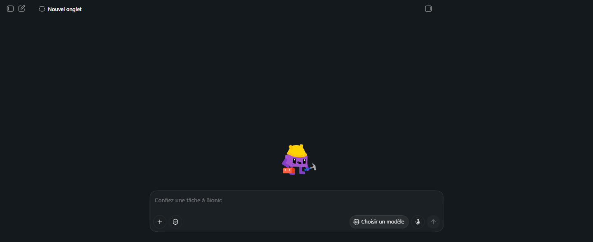
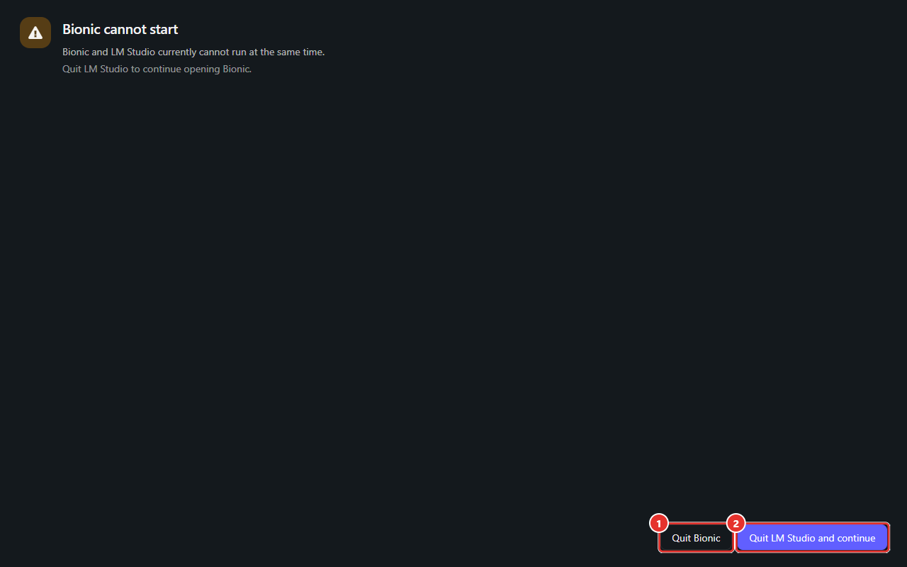

# Manuel Bionic 01 — Présentation, installation et premier lancement

> **Objet** : situer Bionic par rapport à LM Studio, l'installer, le lancer, comprendre le conflit entre les deux applications et les emplacements de données.
> **Prérequis** : [Manuel Bionic 00](00-notions-agent.md) (notion d'agent).
> **Version décrite** : Bionic 1.1.7, Windows 11, interface en français.
> **Statut des informations** : [Vérifié] observé sur le poste de test ; [Source] documentation officielle ; [Estimation] ; [À tester].

---

## Sommaire

1. [Qu'est-ce que Bionic](#1-quest-ce-que-bionic)
2. [Bionic et LM Studio : différences](#2-bionic-et-lm-studio--différences)
3. [Installation](#3-installation)
4. [Premier lancement](#4-premier-lancement)
5. [Conflit avec LM Studio](#5-conflit-avec-lm-studio)
6. [Emplacements des données](#6-emplacements-des-données)
7. [Mises à jour](#7-mises-à-jour)
8. [Ce qui fonctionne sans compte](#8-ce-qui-fonctionne-sans-compte)
9. [Désinstallation et nettoyage](#9-désinstallation-et-nettoyage)

---

## 1. Qu'est-ce que Bionic

### Essentiel

**LM Studio Bionic** est une application de bureau de type **agent** : elle confie des tâches (code, recherche, documents) à un modèle de langage qui peut agir sur des fichiers et des commandes. Le modèle peut être **local** (sur l'ordinateur), **distant** (autre appareil via LM Link) ou **cloud** [Source].

Cas d'usage principaux [Source] :

| Domaine | Exemples |
|---|---|
| **Code** | Comprendre un dépôt, déboguer, refactoriser, ajouter des tests, lancer des commandes. |
| **Documents** | Rédiger, résumer, comparer des sources, produire des documents, tableurs, présentations. |
| **Recherche** | Synthèse de sources, avec recherche web (compte requis, voir [Manuel 10](10-securite-compte-api.md)). |
| **Voix** | Dictée transcrite localement ([Manuel 09](09-voix.md)). |

### Pour aller plus loin

Bionic s'appuie sur le moteur d'exécution de LM Studio (llama.cpp, MLX) [Source] : les modèles GGUF déjà téléchargés pour LM Studio sont **directement visibles** dans Bionic [Vérifié : *Gemma 4 E4B* apparaît sans nouveau téléchargement].

---

## 2. Bionic et LM Studio : différences

| | **LM Studio** | **Bionic** |
|---|---|---|
| Finalité | Charger, régler et servir des modèles ; chat | Confier des **tâches** à un agent |
| Réglages du modèle | Détaillés (offload GPU, contexte, KV cache, échantillonnage…) | Minimaux (modèle, effort de raisonnement) ; valeurs par défaut globales |
| Actions sur la machine | Aucune (chat) | Fichiers, shell, navigateur intégré |
| Organisation | Conversations | Projets → sessions |
| Serveur API | Page *Developer*, démarrage manuel ou automatique | Démarré automatiquement, réglages dans l'application |
| Langue de l'interface | Anglais (poste de test) | Français (langue du système) |

**Répartition conseillée** : LM Studio pour le réglage fin d'un modèle et l'exposition d'une API configurée avec précision ([Manuels LM Studio 03 et 06](../lmstudio/03-charger-un-modele.md)) ; Bionic pour le travail agentique.

> Les deux applications **ne peuvent pas fonctionner simultanément** : voir [section 5](#5-conflit-avec-lm-studio).

---

## 3. Installation

### Essentiel

1. Télécharger l'installateur Windows depuis le site officiel (`lmstudio.ai/bionic`) [Source].
2. Lancer l'installateur ; une fenêtre **« Installation de Bionic »** s'affiche brièvement [Vérifié].
3. L'application s'installe pour l'utilisateur courant : `%LOCALAPPDATA%\Programs\Bionic\Bionic.exe` [Vérifié], sans droits d'administrateur nécessaires [Estimation].
4. Raccourci et démarrage automatique en fin d'installation : [À tester] (l'installation a été effectuée par l'utilisateur, hors observation).

| Plateforme | Disponibilité |
|---|---|
| Windows (x64) | Oui [Vérifié] |
| macOS (Apple Silicon) | Oui [Source] |
| Linux (x64, ARM64) | Oui [Source] |

### Pour aller plus loin

**Configuration minimale** : aucune page officielle propre à Bionic n'a été trouvée [À tester]. Les exigences de LM Studio sont probablement valables (Windows x64 avec AVX2, 16 Go de RAM recommandés, 4 Go de VRAM pour l'accélération GPU) [Estimation]. Un agent consomme plus de contexte qu'un chat : la RAM disponible détermine surtout la taille de modèle utilisable ([Manuel LM Studio 00](../lmstudio/00-notions-fondamentales.md)).

---

## 4. Premier lancement


*Figure 1 — Écran initial : zone de saisie, sélecteur « Choisir un modèle », bouton d'envoi inactif.*

### Essentiel

- Aucun compte n'est demandé pour démarrer [Vérifié].
- Le bouton d'envoi reste **inactif** tant qu'aucun modèle n'est choisi.
- Le sélecteur **« Choisir un modèle »** liste les modèles déjà présents sur la machine (dossier partagé avec LM Studio).
- Si aucun modèle n'est présent : Réglages → **Explorer** pour en télécharger un ([Manuel 04](04-modeles.md#3-télécharger-un-modèle)).

### Pour aller plus loin

- **Modèle par défaut** : Réglages → Agent → *Modèle racine* évite de choisir le modèle à chaque nouvelle session ([Manuel 03](03-reglages.md#3-agent)).
- **Serveur local** : au démarrage, Bionic lance un serveur API sur `127.0.0.1:1234` (journal : « Server started. », « Just-in-time model loading active. ») [Vérifié]. Ce serveur est décrit dans le [Manuel 10](10-securite-compte-api.md#5-api-locale).

---

## 5. Conflit avec LM Studio


*Figure 2 — Écran « Bionic cannot start » lorsque LM Studio est ouvert.*

| N° | Élément | Effet |
|---|---|---|
| ① | **Quit Bionic** | Ferme Bionic. LM Studio reste ouvert. |
| ② | **Quit LM Studio and continue** | Ferme LM Studio puis démarre Bionic. |

### Essentiel

Bionic et LM Studio **ne peuvent pas tourner en même temps** [Vérifié]. Le message affiché est : « Bionic and LM Studio currently cannot run at the same time. Quit LM Studio to continue opening Bionic. ». L'écran est en **anglais** même si le reste de l'interface est en français.

- Pour passer de l'un à l'autre : **quitter complètement** l'application en cours (le bouton de l'écran de conflit, ou le Gestionnaire des tâches si le processus reste actif), pas seulement fermer la fenêtre [Estimation : comportement de la fermeture de fenêtre non testé].
- Un script ou un outil qui appelle l'API sur le port 1234 fonctionne avec **l'une ou l'autre** des applications, pas avec les deux.

### Pour aller plus loin

> **Divergence avec la documentation** — La documentation officielle présente LM Studio comme utilisable « à côté » de Bionic **[Source]**. Sur le poste de test, Bionic 1.1.7 refuse de démarrer tant que LM Studio est ouvert **[Vérifié]**. Le constat de terrain prévaut ici ; le comportement peut dépendre de la version, à revérifier après chaque mise à jour **[À tester]**.
>
> **Constat du 7 octobre 2026 (poste à GPU dédié)** — Mêmes versions (Bionic 1.1.7, LM Studio 0.4.25). Le conflit **n'a pas été rejoué** : LM Studio est resté fermé pendant toute la série d'essais. Constat nouveau : pendant que Bionic tourne, la commande `lms` de LM Studio (`lms ps`, `lms unload --all`) **répond sur le port 1234** et pilote les modèles chargés par **Bionic** ; c'est le moyen utilisé pour relever le contexte et la mémoire chargés par AutoFit ([Manuel 04, section 5](04-modeles.md#5-mémoire-chargement-et-déchargement)) **[Vérifié]**.

Les deux applications utilisent le même port d'API par défaut (1234) et les mêmes dossiers de modèles [Vérifié] ; le blocage évite les conflits d'accès [Estimation, cause exacte non documentée]. Le serveur démarré par LM Studio se **relance automatiquement** à l'ouverture de l'application ([Manuel LM Studio 06](../lmstudio/06-serveur-local-et-api.md#2-démarrer-et-arrêter-le-serveur)) ; Bionic fait de même. Vérifier quelle application sert le port :

```powershell
Get-NetTCPConnection -LocalPort 1234 -State Listen | Select-Object LocalAddress, OwningProcess
Get-Process -Id (Get-NetTCPConnection -LocalPort 1234 -State Listen).OwningProcess | Select-Object ProcessName
```

---

## 6. Emplacements des données

| Donnée | Emplacement | Statut |
|---|---|---|
| Application | `%LOCALAPPDATA%\Programs\Bionic\` | [Vérifié] |
| Configuration et état de l'application | `%APPDATA%\Bionic` | [Vérifié] |
| Projets, fichiers du projet | `~\.lmstudio\apps\bionic\projects\<identifiant>\workspace` | [Vérifié] |
| Journaux du serveur local | `~\.lmstudio\apps\bionic\server-logs` | [Vérifié] |
| Modèles (partagés avec LM Studio) | `~\.lmstudio\models` | [Vérifié] |
| Compétences d'autres applications (lecture) | `~\.claude\skills` (Claude Code) | [Vérifié] |

> **Exemple (poste de test)** — le dossier des modèles est modifiable dans Réglages → **Bibliothèque** (« Dossier des modèles », bouton *Modifier*). La valeur observée est `C:\Users\<utilisateur>\.lmstudio\models`.

**Sauvegarde** : les projets de type « dossier de travail » vivent dans le dossier choisi (donc sauvegardé avec lui) ; seuls les *fichiers du projet* et l'historique des sessions résident dans les dossiers de l'application [À tester pour l'export de l'historique].

---

## 7. Mises à jour

Réglages → **Général** → *Application et mises à jour* [Vérifié] :

| Champ | Rôle | Valeur observée |
|---|---|---|
| **Version** | Numéro de build | 1.1.7 (build 7) |
| **Canal** | Flux de mises à jour | Stable |
| **Rechercher des mises à jour** | Contrôle manuel | — |
| **Mises à jour automatiques** | Téléchargement en arrière-plan ; bouton **Mettre à jour** quand prêt | Activées |

> **Point d'attention (poste d'entreprise)** — les mises à jour automatiques sont **activées par défaut** : pour maîtriser la version déployée, désactiver ce réglage et mettre à jour manuellement. Sur un poste d'entreprise soumis à une politique de versions, ce réglage doit être validé avec l'équipe informatique.

---

## 8. Ce qui fonctionne sans compte

| Fonction | Sans compte |
|---|---|
| Modèles **locaux** (agent, code, documents) | Oui [Source, Vérifié] |
| Saisie vocale locale | Oui (modèle vocal à télécharger) [Source] |
| Compétences, MCP locaux | Oui [Vérifié pour l'ajout] |
| Recherche web | **Non** (« Connectez-vous pour utiliser les outils de recherche web ») [Vérifié] |
| Modèles **cloud**, facturation | **Non** (connexion + crédits) [Vérifié] |
| **LM Link** | **Non** dans l'interface observée (« Se connecter pour utiliser LM Link ») [Vérifié] |

Aucune connexion ni création de compte n'a été effectuée pendant les tests : les fonctions « compte » sont décrites d'après l'interface et la documentation ([Manuel 10](10-securite-compte-api.md)).

---

## 9. Désinstallation et nettoyage

1. Quitter Bionic complètement (vérifier dans le Gestionnaire des tâches qu'aucun processus *Bionic* ne reste actif).
2. Désinstaller depuis **Paramètres Windows → Applications** [Estimation : entrée « Bionic »].
3. Supprimer manuellement, si les données ne sont plus utiles : `%APPDATA%\Bionic` et `~\.lmstudio\apps\bionic` (**attention** : ce dernier dossier contient les projets et leurs fichiers).
4. Ne **pas** supprimer `~\.lmstudio\models` si LM Studio est conservé.
