# Manuel Bionic 03 — Les réglages de l'application

> **Objet** : documenter chaque page de **Paramètres**, chaque champ, sa valeur par défaut observée, son effet et la manière de le régler selon le cas.
> **Prérequis** : [Manuel Bionic 02](02-interface.md).
> **Version décrite** : Bionic 1.1.7, Windows 11, interface en français.
> **Statut des informations** : [Vérifié] observé et lu dans l'application ; [Source] documentation officielle ; [Estimation] ; [À tester].

---

## Sommaire

1. [Accès et organisation](#1-accès-et-organisation)
2. [Général](#2-général)
3. [Agent](#3-agent)
4. [Voix](#4-voix)
5. [Facturation et utilisation](#5-facturation-et-utilisation)
6. [Apparence](#6-apparence)
7. [Sessions](#7-sessions)
8. [Intégrations : MCP et Compétences](#8-intégrations--mcp-et-compétences)
9. [Appareils : LM Link](#9-appareils--lm-link)
10. [Modèles locaux](#10-modèles-locaux)
11. [Tableau récapitulatif des valeurs par défaut](#11-tableau-récapitulatif-des-valeurs-par-défaut)

---

## 1. Accès et organisation

Bouton **Paramètres** (bas de la barre latérale). Le bouton **Revenir à l'application** (en haut) ferme les réglages.

La navigation est divisée en cinq groupes [Vérifié] :

| Groupe | Pages |
|---|---|
| **Paramètres** | Général · Agent · Voix · Facturation et utilisation · Apparence · Sessions |
| **Intégrations** | MCP · Compétences |
| **Appareils** | LM Link |
| **Modèles locaux** | Explorer · Bibliothèque · Instances chargées · API des modèles locaux · Paramètres par défaut des modèles locaux · Moteur d'exécution |

> Les réglages s'appliquent **à l'application entière** (tous les projets), sauf mention contraire.

---

## 2. Général

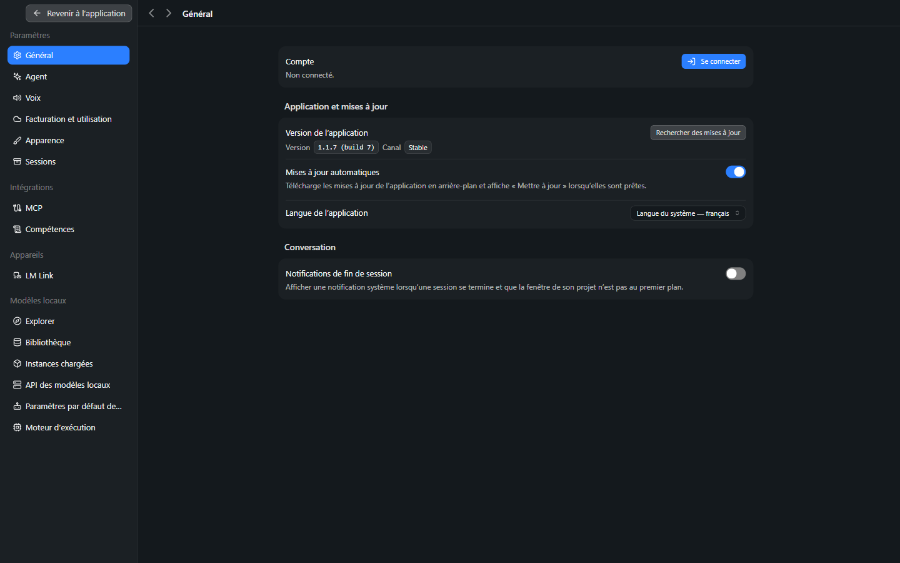
*Figure 1 — Réglages → Général.*

| Champ | Rôle | Valeurs | Défaut observé | Conseil |
|---|---|---|---|---|
| **Compte** | État de connexion au compte LM Studio | *Non connecté.* / **Se connecter** (ouvre le navigateur) | Non connecté | Nécessaire uniquement pour le cloud, la recherche web et LM Link ([Manuel 10](10-securite-compte-api.md)). |
| **Version** | Numéro de version | — | 1.1.7 (build 7) | Information. |
| **Canal** | Flux de mises à jour | Stable | Stable | Rester sur *Stable* pour un usage professionnel. |
| **Rechercher des mises à jour** | Contrôle immédiat | Bouton | — | — |
| **Mises à jour automatiques** | Télécharge en arrière-plan et affiche **Mettre à jour** | Activé / Désactivé | **Activé** | Désactiver sur un poste dont la version est maîtrisée. |
| **Langue de l'application** | Langue de l'interface | Langue du système · English · 日本語 · 한국어 · Deutsch · español latinoamericano · italiano · português (Brasil) · Indonesia · 简体中文 · 繁體中文 | Langue du système — français | Un changement de langue peut nécessiter un redémarrage [À tester]. |
| **Notifications de fin de session** | Notification Windows quand une session se termine alors que la fenêtre du projet n'est pas au premier plan | Activé / Désactivé | **Désactivé** | Activer pour les tâches longues (plusieurs minutes). |

---

## 3. Agent

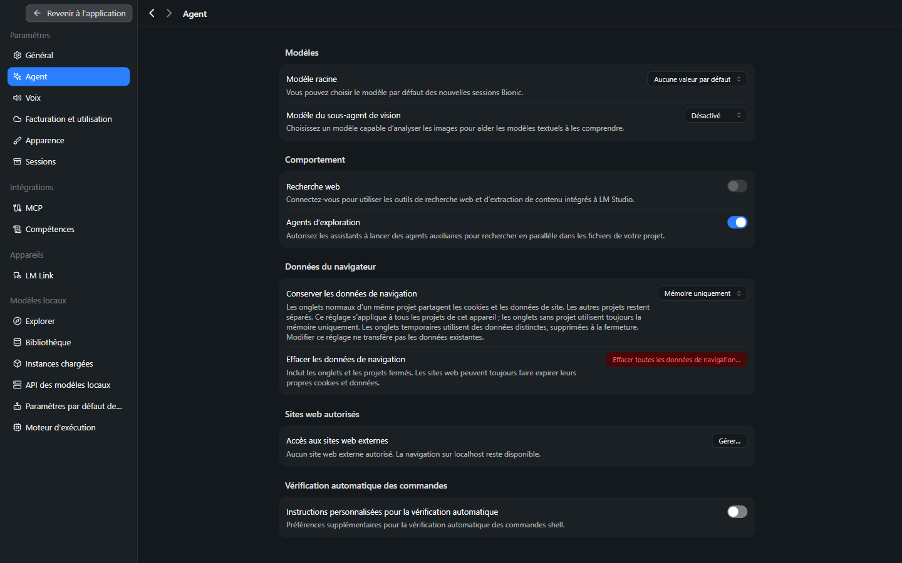
*Figure 2 — Réglages → Agent.*

### Modèles

| Champ | Rôle | Valeurs | Défaut | Conseil |
|---|---|---|---|---|
| **Modèle racine** | Modèle utilisé par défaut par **les nouvelles sessions** | Aucune valeur par défaut · *Local · Gemma 4 E4B* (liste des modèles disponibles) | Aucune valeur par défaut | Définir le modèle habituel pour éviter le choix à chaque session. Un modèle de session existante se change dans son sélecteur. |
| **Modèle du sous-agent de vision** | Modèle capable d'analyser des **images** pour aider un modèle texte seul | Désactivé · liste de modèles | Désactivé | À renseigner si le modèle racine ne gère pas les images ; un modèle de vision local ou cloud peut être désigné [Source]. |

> **Exemple** — le modèle racine est un modèle texte performant mais sans vision : définir un petit modèle de vision comme sous-agent permet de joindre une capture d'écran ou un scan sans changer de modèle principal.

### Comportement

| Champ | Rôle | Défaut | Conseil |
|---|---|---|---|
| **Recherche web** | Outils intégrés de recherche et d'extraction de contenu web | **Désactivé** (« Connectez-vous pour utiliser… » : compte requis) | Laisser désactivé pour un travail strictement local. |
| **Agents d'exploration** | Permet aux assistants de lancer des **agents auxiliaires** pour chercher en parallèle dans les fichiers du projet | **Activé** | Garder activé pour les gros dépôts ; désactiver pour réduire la charge sur un petit modèle local [Estimation]. |

### Données du navigateur

| Champ | Rôle | Valeurs | Défaut |
|---|---|---|---|
| **Conserver les données de navigation** | Persistance des cookies et données de site du navigateur intégré | **Mémoire uniquement** · **Conserver jusqu'à effacement** | Mémoire uniquement |
| **Effacer toutes les données de navigation…** | Supprime les données conservées (onglets et projets fermés inclus) | Bouton | — |

Règles [Vérifié, texte d'aide] : les onglets normaux d'un même projet partagent cookies et données ; les autres projets restent séparés ; les onglets sans projet n'utilisent que la mémoire ; les onglets temporaires utilisent des données distinctes supprimées à la fermeture ; modifier le réglage ne transfère pas les données existantes.

### Sites web autorisés

| Champ | Rôle | Défaut |
|---|---|---|
| **Accès aux sites web externes** | Liste blanche des sites que l'agent peut consulter | **Aucun** site externe autorisé ; la navigation sur `localhost` reste disponible |
| **Gérer…** | Ouvre la gestion de la liste | — |

> **Point de sécurité** — la liste vide par défaut empêche l'agent de naviguer sur Internet. Chaque domaine ajouté élargit la surface d'exposition (le contenu d'une page web peut contenir des instructions destinées à manipuler le modèle : *injection de prompt*). N'ajouter que des domaines nécessaires.

### Vérification automatique des commandes

| Champ | Rôle | Défaut |
|---|---|---|
| **Instructions personnalisées pour la vérification automatique** | Préférences supplémentaires que le modèle vérificateur applique avant d'autoriser une commande shell | **Désactivé** |

> **Exemple d'instructions** : « Refuser toute commande qui supprime, déplace ou renomme des fichiers, même si l'utilisateur la demande explicitement. » [Vérifié : la suppression demandée a alors été soumise à confirmation avec le motif du conflit ; voir le [Manuel Bionic 12, section 6](12-auto-review.md#6-instructions-personnalisées)].

---

## 4. Voix

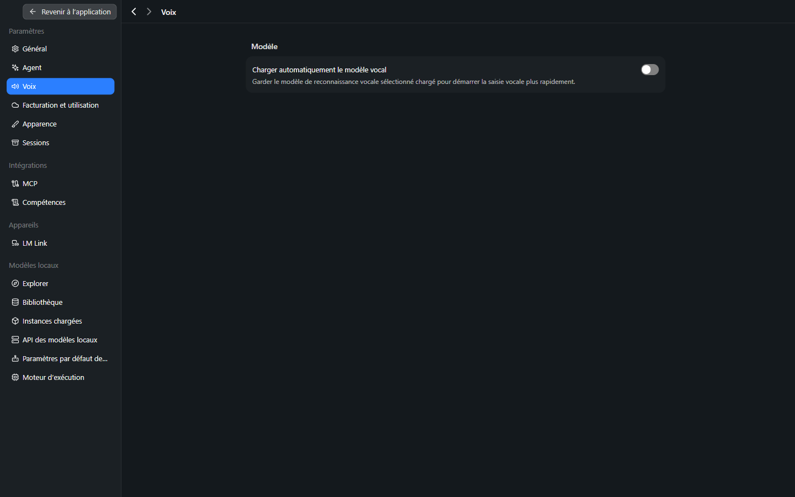
*Figure 3 — Réglages → Voix.*

La page ne comporte qu'une section **Modèle** (modèle de reconnaissance vocale, Voxtral [Source]) avec un seul réglage. Fonctionnement : [Manuel 09](09-voix.md).

| Champ | Rôle | Défaut | Conseil |
|---|---|---|---|
| **Charger automatiquement le modèle vocal** | Garde le modèle chargé pour démarrer la dictée plus vite | **Désactivé** | Activer si la dictée est utilisée quotidiennement et que la RAM le permet : le modèle reste en mémoire en permanence. |

---

## 5. Facturation et utilisation

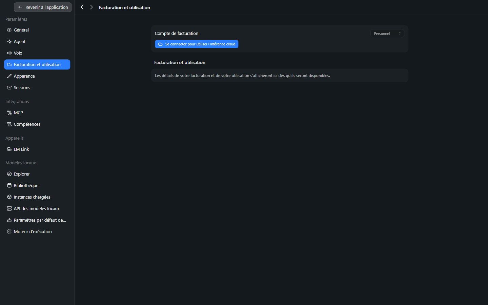
*Figure 4 — Réglages → Facturation et utilisation (non connecté).*

| Champ | Rôle |
|---|---|
| **Compte de facturation** | Compte facturé : *Personnel* (équipe non documentée) |
| **Se connecter pour utiliser l'inférence cloud** | Lien vers la connexion |
| **Facturation et utilisation** | Crédits consommés sur les 30 derniers jours, actualisables [Source] ; vide tant que non connecté |

Seuls les **modèles cloud** consomment des crédits. Détails : [Manuel 10](10-securite-compte-api.md#3-compte-crédits-et-facturation).

---

## 6. Apparence

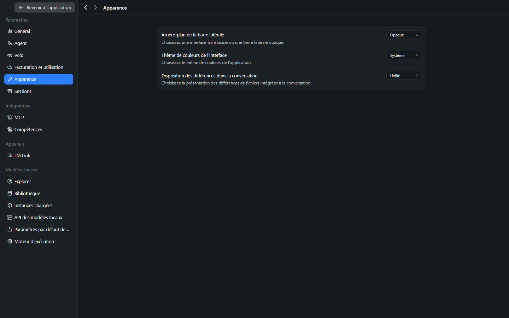
*Figure 5 — Réglages → Apparence.*

| Champ | Valeurs | Défaut |
|---|---|---|
| **Arrière-plan de la barre latérale** | **Opaque** (seule option proposée sur le poste de test ; l'option translucide n'apparaît pas) | Opaque |
| **Thème de couleurs de l'interface** | Système · Classic · Clair · Sépia · Sombre · Deep Dark · Solarized Dark | Système |
| **Disposition des différences dans la conversation** | **Unifié** (une colonne, lignes supprimées puis ajoutées) · **Côte à côte** (avant à gauche, après à droite) | Unifié |

**Conseil** : *Côte à côte* convient aux écrans larges et aux diffs courts ; *Unifié* aux fenêtres étroites ou aux diffs longs.

---

## 7. Sessions

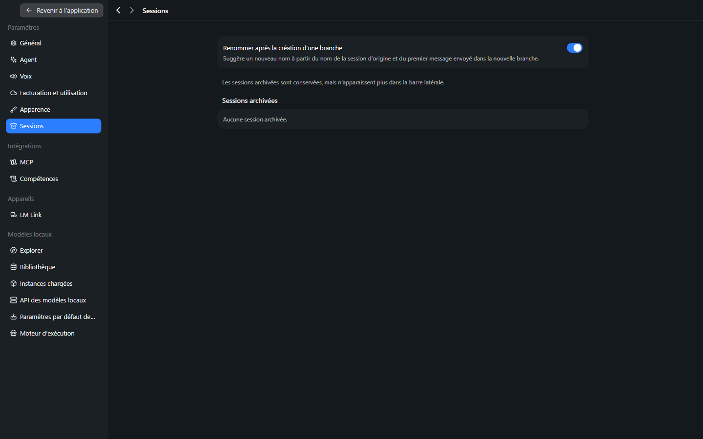
*Figure 6 — Réglages → Sessions.*

| Champ | Rôle | Défaut |
|---|---|---|
| **Renommer après la création d'une branche** | Propose un nouveau nom à partir de la session d'origine et du premier message de la branche (*fork*) | **Activé** |
| **Sessions archivées** | Liste des sessions archivées (conservées, masquées de la barre latérale) | « Aucune session archivée. » |

---

## 8. Intégrations : MCP et Compétences

### MCP

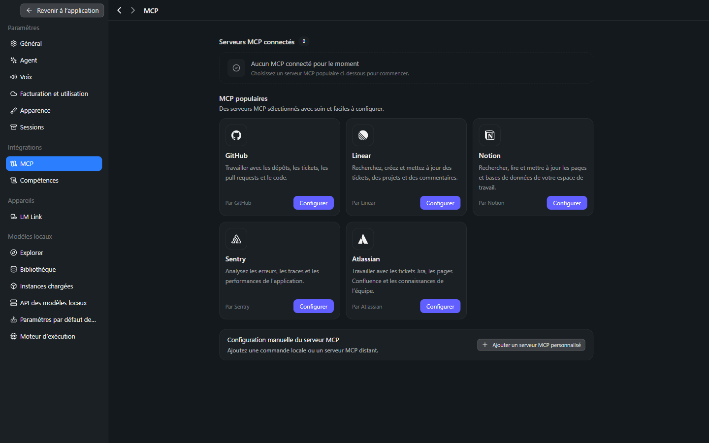
*Figure 7 — Réglages → MCP.*

La page affiche le nombre de **serveurs MCP connectés** (0), un catalogue de serveurs « populaires » (**GitHub**, **Linear**, **Notion**, **Sentry**, **Atlassian**, bouton **Configurer**) et **Ajouter un serveur MCP personnalisé**. Détail des champs : [Manuel 08](08-competences-et-mcp.md#5-serveurs-mcp).

### Compétences

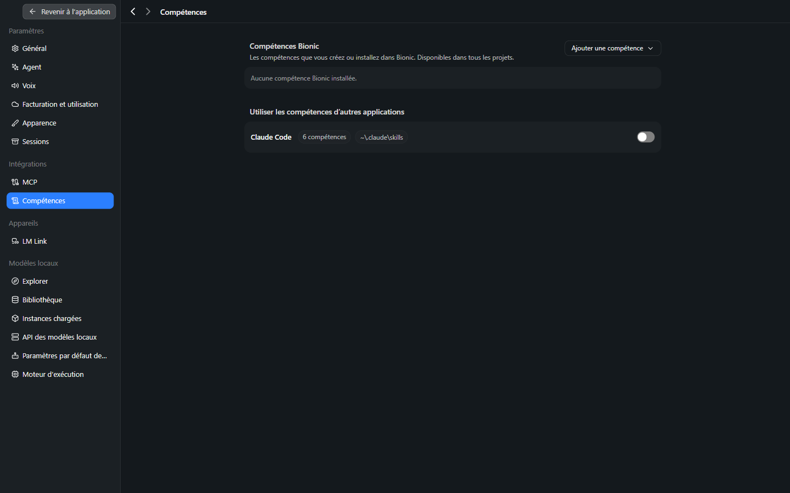
*Figure 8 — Réglages → Compétences.*

Deux blocs : **Compétences Bionic** (créées ou installées dans Bionic, disponibles dans tous les projets ; bouton **Ajouter une compétence**) et **Utiliser les compétences d'autres applications** (ex. *Claude Code*, 6 compétences détectées dans `~\.claude\skills`, interrupteur **désactivé** par défaut). Détail : [Manuel 08](08-competences-et-mcp.md#2-gérer-les-compétences).

---

## 9. Appareils : LM Link

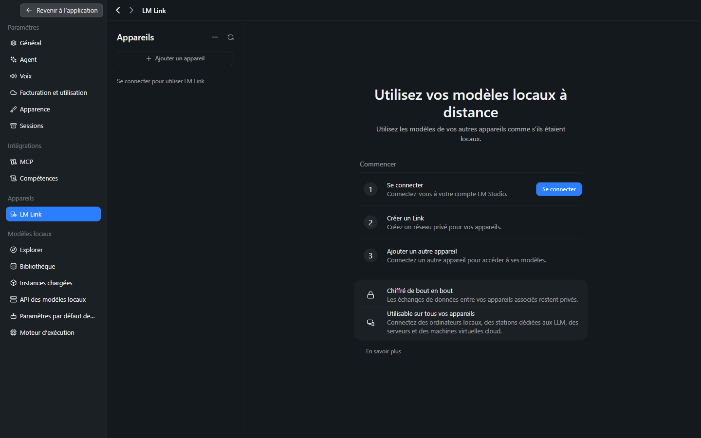
*Figure 9 — Réglages → LM Link (non connecté).*

**LM Link** relie plusieurs appareils pour utiliser les modèles de l'un depuis l'autre « comme s'ils étaient locaux ». L'interface annonce un chiffrement de bout en bout. Trois étapes : **Se connecter** (compte LM Studio) → **Créer un Link** (réseau privé) → **Ajouter un autre appareil**. Non testé (compte requis) [À tester]. Détails, commandes et protocole de vérification : [Manuel LM Studio 17](../lmstudio/17-lm-link.md). La formule gratuite comprend LM Link pour 5 appareils ([Manuel 10, offres et prix](10-securite-compte-api.md#offres-et-prix)).

---

## 10. Modèles locaux

### Explorer

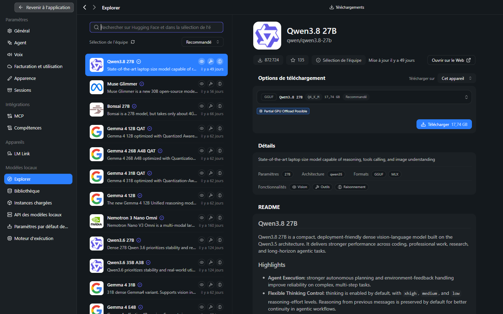
*Figure 10 — Réglages → Explorer : catalogue et options de téléchargement.*

Catalogue de modèles (sélection de l'équipe), avec par modèle : nombre de paramètres, architecture, formats (GGUF, MLX), fonctionnalités (**Vision**, **Outils**, **Raisonnement**), options de téléchargement (format, quantification, taille, mention **Recommandé**, **Partial GPU Offload Possible**). Détail : [Manuel 04](04-modeles.md#3-télécharger-un-modèle).

### Bibliothèque

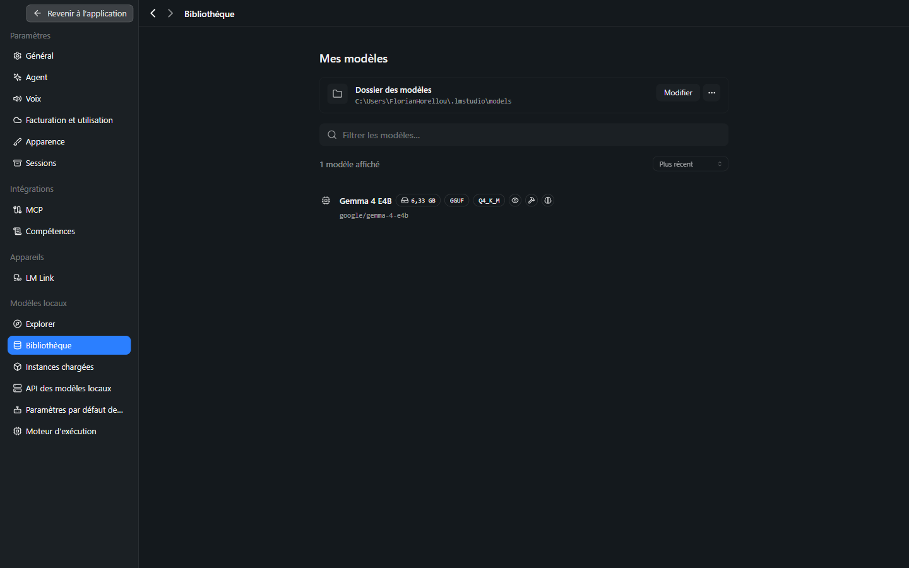
*Figure 11 — Réglages → Bibliothèque.*

| Champ | Rôle |
|---|---|
| **Dossier des modèles** | Emplacement des modèles (`~\.lmstudio\models`, partagé avec LM Studio) ; bouton **Modifier** |
| **Mes modèles** | Modèles présents : nom, taille (ex. 6,33 Go), format (GGUF), quantification (Q4_K_M), identifiant (`google/gemma-4-e4b`) |

### Instances chargées

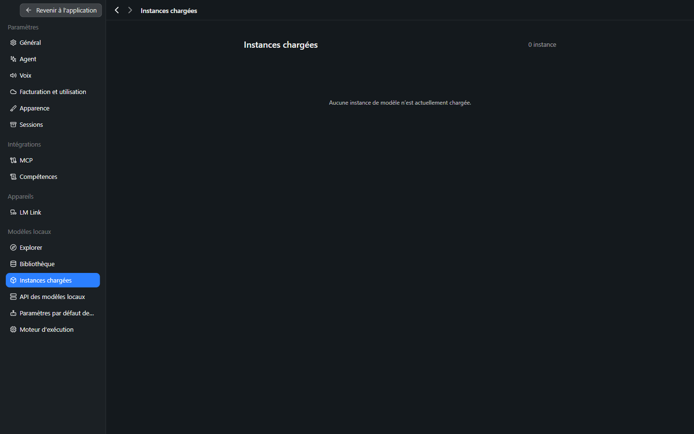
*Figure 12 — Réglages → Instances chargées.*

Liste des modèles actuellement **chargés en mémoire** (« 0 instance » tant qu'aucune session n'a démarré), avec pour chacun la taille, le format, la quantification, le **contexte chargé** (262 144 tokens pour *Gemma 4 12B QAT* sur le poste à GPU intégré ; **131 072** pour *Gemma 4 E4B* Q8_0 de 9,02 Go sur le poste à GPU dédié, état « Chargé », bouton **Décharger**), l'état et le bouton **Décharger** ([Manuel 04](04-modeles.md#5-mémoire-chargement-et-déchargement)). Un modèle se charge au premier message d'une session et peut être déchargé ici pour libérer la RAM [Estimation pour le déchargement manuel].

### API des modèles locaux

> **Journaux du serveur** [Vérifié, 7 octobre 2026, GPU dédié] — le bas de la page affiche les **derniers événements du serveur local** (niveau `DEBUG` quand *Journaux détaillés* est activé), dont une ligne par tranche de 130 jetons générés et par emplacement : `slot print_timing: id 2 | task 3149 | n_gen = 1140, tg = 42.00 t/s`. C'est un moyen simple de **lire la vitesse de génération réelle** d'une session en cours (≈ 40 à 43 tok/s par emplacement avec 4 sessions simultanées sur *Gemma 4 E4B*) sans outil externe. Boutons **Ouvrir le dossier des journaux** et **Effacer**.

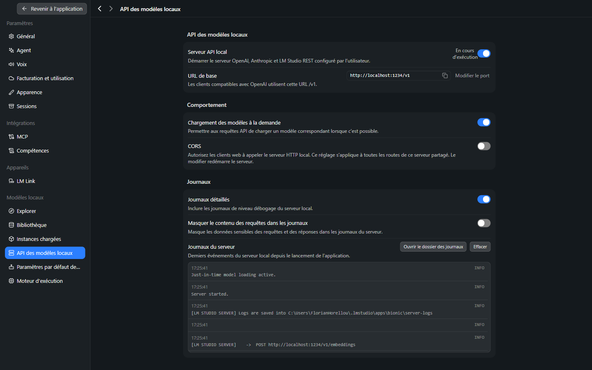
*Figure 13 — Réglages → API des modèles locaux.*

| Champ | Rôle | Défaut observé |
|---|---|---|
| **Serveur API local** | Démarre le serveur OpenAI / Anthropic / LM Studio REST | **Activé** (« En cours d'exécution ») |
| **URL de base** | Adresse pour les clients compatibles OpenAI | `http://localhost:1234/v1` ; bouton **Modifier le port** |
| **Chargement des modèles à la demande** | Une requête API peut charger le modèle correspondant | **Activé** |
| **CORS** | Autorise les clients web à appeler le serveur (redémarre le serveur) | **Désactivé** |
| **Journaux détaillés** | Journaux de niveau débogage | **Activé** |
| **Masquer le contenu des requêtes dans les journaux** | Masque les données sensibles des requêtes/réponses | **Désactivé** |
| **Journaux du serveur** | Derniers événements ; **Ouvrir le dossier des journaux** ; **Effacer** | — |

Voir [Manuel 10](10-securite-compte-api.md#5-api-locale) pour l'usage et la sécurité.

### Paramètres par défaut des modèles locaux

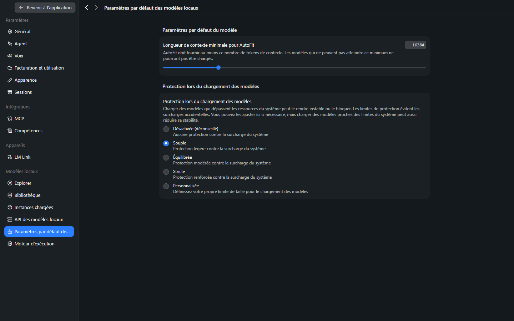
*Figure 14 — Réglages → Paramètres par défaut des modèles locaux.*

| Champ | Rôle |
|---|---|
| **Longueur de contexte minimale pour AutoFit** | Nombre minimal de tokens de contexte que l'ajustement automatique doit fournir ; un modèle qui ne peut pas l'atteindre **ne se charge pas** |
| **Protection lors du chargement des modèles** | Niveaux : *Désactivée (déconseillé)* · *Souple* · *Équilibrée* · *Stricte* · *Personnalisée* (limite de taille définie) |

> **Valeurs relevées sur le poste à GPU dédié** [Vérifié, 7 octobre 2026] : minimum AutoFit **16 384** ; protection **Souple**. Les modèles de 26 à 27 Md reçoivent **exactement ce minimum** (le petit modèle *Gemma 4 E4B* : 131 072) : cette valeur **explique** le contexte de 16 384 jetons des gros modèles dans Bionic. La relever à 32 768, 65 536, 131 072 ou 262 144 a été essayé avec le 26B (mémoire et vitesse quasi inchangées) et avec Qwen3.8 27B (RAM en hausse) : tableau et recommandations au [Manuel 04, section 5](04-modeles.md#5-mémoire-chargement-et-déchargement).
>
> **Exemple** — un agent doit disposer de plusieurs milliers de tokens de contexte : relever la valeur minimale évite qu'un modèle se charge avec un contexte trop court pour travailler, au prix d'un refus de chargement si la mémoire manque. La protection *Équilibrée* ou *Stricte* limite le risque de blocage du système lorsque la taille du modèle approche la RAM disponible.

### Moteur d'exécution

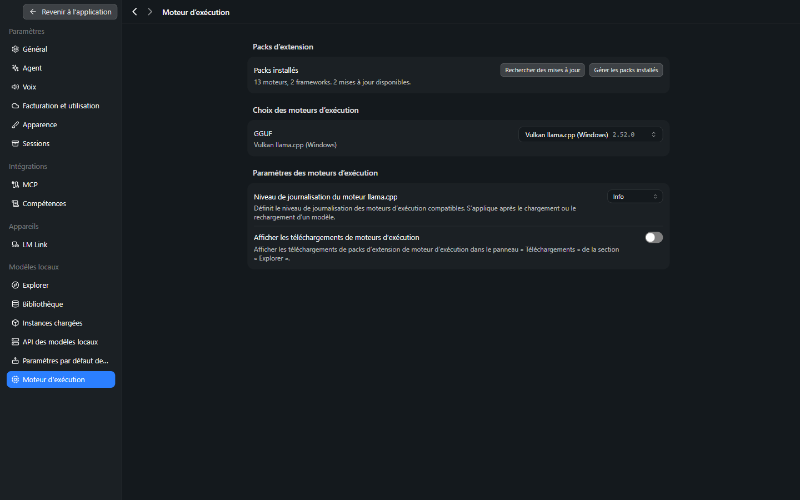
*Figure 15 — Réglages → Moteur d'exécution.*

| Champ | Rôle | Observé |
|---|---|---|
| **Packs installés** | Moteurs et frameworks installés ; **Rechercher des mises à jour** ; **Gérer les packs installés** | 13 moteurs, 2 frameworks, 2 mises à jour disponibles |
| **Choix des moteurs d'exécution (GGUF)** | Moteur utilisé pour les modèles GGUF | **Vulkan llama.cpp (Windows) 2.52.0** (alternatives : CPU, CUDA ; versions précédentes) ; **GPU dédié : CUDA 12 llama.cpp (Windows) 2.54.0** (« 23 moteurs, 7 frameworks. 3 mises à jour disponibles »), plus le pack « ExecuTorch ASR (CUDA) 0.0.8 » |
| **Niveau de journalisation du moteur llama.cpp** | Verbosité des journaux du moteur | **Info** (Error · Warning · Info · Trace · Debug) |
| **Afficher les téléchargements de moteurs d'exécution** | Montre les téléchargements de packs dans Explorer → Téléchargements | Désactivé |

Notions (CPU, CUDA, Vulkan) : [Manuel LM Studio 00](../lmstudio/00-notions-fondamentales.md). Sur le poste à GPU intégré Intel, Vulkan est le moteur adapté ; sur le poste à GPU Nvidia, **CUDA 12** est sélectionné : Bionic utilise sa **propre** version du moteur (2.54.0), distincte de celle choisie dans LM Studio (2.53.0 le même jour) **[Vérifié]**.

---

## 11. Tableau récapitulatif des valeurs par défaut

| Réglage | Valeur par défaut observée |
|---|---|
| Mises à jour automatiques | Activé |
| Notifications de fin de session | Désactivé |
| Modèle racine | Aucune valeur par défaut |
| Sous-agent de vision | Désactivé |
| Recherche web | Désactivé (compte requis) |
| Agents d'exploration | Activé |
| Données du navigateur | Mémoire uniquement |
| Sites web externes autorisés | Aucun |
| Mode shell | Vérification automatique |
| Instructions personnalisées (vérification) | Désactivé |
| Chargement automatique du modèle vocal | Désactivé |
| Thème / disposition des diffs | Système / Unifié |
| Renommer après un *fork* | Activé |
| Compétences d'autres applications | Désactivé |
| Serveur API local | Activé, port 1234 |
| Chargement à la demande (JIT) | Activé |
| CORS | Désactivé |
| Journaux détaillés | Activé |
| Moteur GGUF | Vulkan llama.cpp (GPU intégré) ; CUDA 12 llama.cpp (GPU dédié Nvidia) |
| Longueur de contexte minimale AutoFit / protection du chargement | 16 384 / Souple |

### Profils de réglage proposés

| Profil | Réglages |
|---|---|
| **Confidentialité maximale** | Recherche web désactivée ; aucun site autorisé ; mode shell *Demander à chaque fois* ; CORS désactivé ; *Masquer le contenu des requêtes* activé ; modèles locaux uniquement. |
| **Usage quotidien** | Modèle racine défini ; mode *Vérification automatique* ; notifications de fin activées ; chargement automatique du modèle vocal si dictée régulière. |
| **Poste partagé / serveur local** | Serveur API local activé uniquement si nécessaire ; adresse d'écoute vérifiée ([Manuel 10](10-securite-compte-api.md#5-api-locale)) ; mises à jour automatiques selon la politique informatique. |
