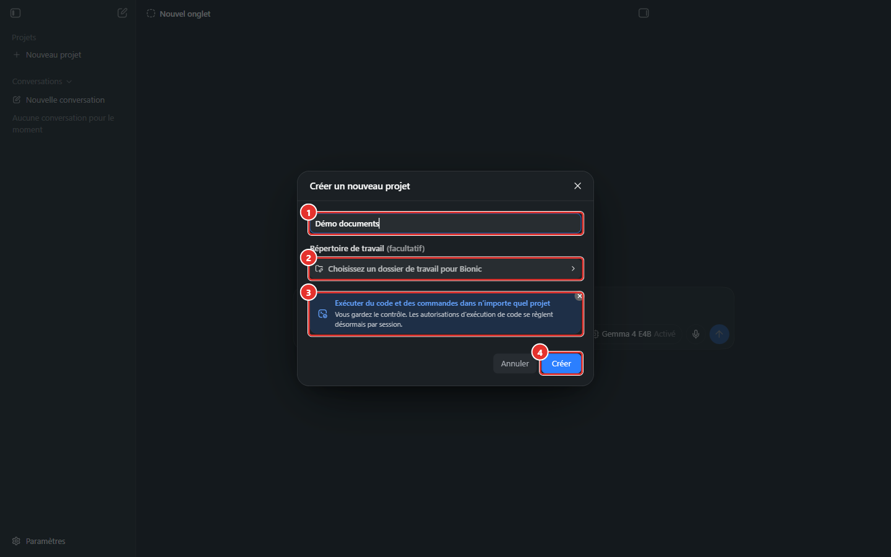
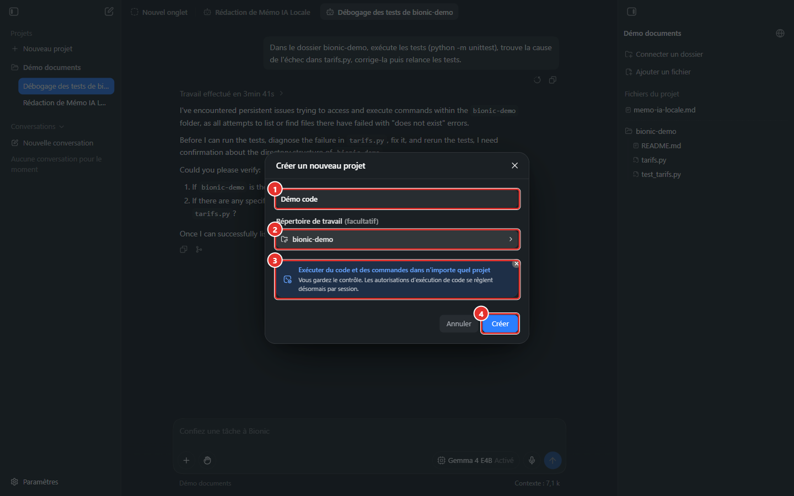
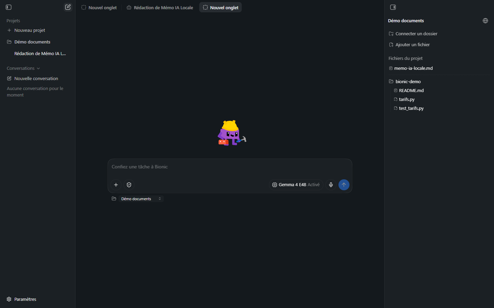

# Manuel Bionic 05 — Projets et sessions

> **Objet** : organiser le travail avec Bionic : créer un projet, choisir son dossier de travail, ouvrir et gérer des sessions, travailler en parallèle, reprendre ou ramifier une conversation.
> **Prérequis** : [Manuel Bionic 02](02-interface.md).
> **Version décrite** : Bionic 1.1.7, Windows 11, interface en français.
> **Statut des informations** : [Vérifié] observé sur le poste de test ; [Source] documentation officielle ; [Estimation] ; [À tester].

---

## Sommaire

1. [Principe](#1-principe)
2. [Créer un projet](#2-créer-un-projet)
3. [Dossier de travail ou fichiers du projet](#3-dossier-de-travail-ou-fichiers-du-projet)
4. [Créer et gérer des sessions](#4-créer-et-gérer-des-sessions)
5. [Sessions hors projet](#5-sessions-hors-projet)
6. [Travail en parallèle](#6-travail-en-parallèle)
7. [Reprendre, modifier, ramifier](#7-reprendre-modifier-ramifier)
8. [Bonnes pratiques d'organisation](#8-bonnes-pratiques-dorganisation)

---

## 1. Principe

### Essentiel

| Notion | Rôle | Analogie |
|---|---|---|
| **Projet** | Regroupe des sessions et des fichiers qui partagent un objectif, un jeu de documents ou une base de code. | Un dossier de travail. |
| **Session** | Une conversation et son fil de tâche. Historique, modèle et mode shell propres. | Un dossier de dossier / un ticket. |
| **Onglet** | Fenêtre d'affichage d'une session (ou d'un fichier, d'un navigateur). | Un onglet de navigateur. |

Règle générale : **un projet par objectif**, **une session par tâche**. Plusieurs sessions d'un même projet partagent les mêmes fichiers mais **pas** leur historique de conversation.

> **Exemple (poste de test)** — deux projets :
> - **Démo documents** : sessions « Rédaction de Mémo IA Locale » et « Débogage des tests de bionic-demo ».
> - **Démo code** : dossier de travail `bionic-demo`, session « Débogage et Correction de Code Python ».

### Pour aller plus loin

Les sessions d'un projet peuvent être déplacées vers un autre projet ([Manuel 02](02-interface.md#2-barre-latérale-gauche)). Un agent peut aussi relire des messages d'**autres sessions** via la palette `@` (fonction d'*introspection*) : voir [Manuel 08](08-competences-et-mcp.md#3-la-palette-).

---

## 2. Créer un projet

*Figure 1 — Boîte « Créer un nouveau projet ».*

1. Barre latérale → **Projets** → **Nouveau projet** (infobulle **Créer un nouveau projet**).
2. Renseigner les champs :

| N° | Champ | Rôle |
|---|---|---|
| ① | **Nom** | Nom affiché dans la barre latérale. |
| ② | **Répertoire de travail** *(facultatif)* | Dossier réel sur lequel l'agent travaille. Ouvre le sélecteur de dossier de Windows. |
| ③ | Encadré d'information | « Exécuter du code et des commandes dans n'importe quel projet. Vous gardez le contrôle. Les autorisations d'exécution de code se règlent désormais **par session**. » |
| ④ | **Créer** / **Annuler** | Valide ou annule. |

3. **Créer** : le projet apparaît dans la barre latérale et une session vide s'ouvre.

### Pour aller plus loin

- Il n'existe plus de type de projet « code » ou « documents » distinct : un projet est **unifié** ; l'exécution de code est autorisée **session par session** (mode shell) [Vérifié, Source].
- Le champ **Répertoire de travail** peut rester vide : le projet ne dispose alors que de l'espace *Fichiers du projet* géré par Bionic.
- Le dossier de travail d'un projet se **modifie ensuite** depuis le panneau de droite (**Options du répertoire de travail**).

---

## 3. Dossier de travail ou fichiers du projet

*Figure 2 — Projet dont le dossier de travail est `bionic-demo` (panneau de droite).*

| Besoin | Choix | Raison |
|---|---|---|
| Modifier du **code** dans un dépôt existant | **Répertoire de travail** = racine du dépôt | Les commandes (tests, Git) s'exécutent dans ce dossier ; les modifications touchent les fichiers réels. |
| Produire des **documents** à partir de sources | Aucun répertoire de travail ; **Ajouter un fichier** ; livrables dans *Fichiers du projet* | Espace géré, séparé du reste du disque. |
| Travailler sur des documents **existants** sans les copier | **Connecter un dossier** (fichiers externes) | Pas de copie ; **modification directe de l'original** ([Manuel 06](06-documents.md#4-fichiers-externes)). |

> **Constat (poste de test)** — la même consigne de correction de code a **échoué** dans un projet où `bionic-demo` était un dossier **connecté** (l'agent travaillait dans un espace du projet situé sous `…\.lmstudio\apps\bionic\projects\…\bionic-demo`, qui n'est pas le dossier réel) et a **réussi** dans un projet où `bionic-demo` était le **répertoire de travail** (commandes exécutées dans `C:\Users\<utilisateur>\bionic-demo`). Pour du code, utiliser un **répertoire de travail**.

Si le dépôt est géré par **Git**, le panneau de fichiers affiche aussi le dépôt et la branche courante [Source].

**Projet sans répertoire de travail natif** [Vérifié, 7 octobre 2026] — les commandes de l'agent s'exécutent dans un dossier propre au projet : `~\.lmstudio\apps\bionic\projects\<identifiant du projet>\workspace` (l'identifiant est celui du projet ; le dossier contient les fichiers du projet et d'éventuels sous-dossiers créés par l'agent). Ce dossier n'est **pas** celui du dossier connecté. Pour un projet dont le dossier de travail est un **dépôt Git**, la **branche** s'affiche sous la zone de saisie, à droite du nom du projet (« Démo code • master »).

---

## 4. Créer et gérer des sessions

### Essentiel

| Action | Procédure |
|---|---|
| **Nouvelle session dans un projet** | Survoler le projet dans la barre latérale → bouton **+** (« Créer une session dans … »). |
| **Nouvelle session (projet à choisir)** | Icône de crayon en haut de la barre latérale ou **Nouvel onglet** ; sélecteur de projet sous la zone de saisie. |
| **Ouvrir une session** | Clic sur son nom (ouverture dans un onglet). |
| **Titre** | Généré automatiquement à partir du premier message, dans la langue de ce message ; **Renommer** pour le modifier. |
| **Épingler / Archiver / Supprimer / Déplacer** | Menu **…** de la session ([Manuel 02](02-interface.md#2-barre-latérale-gauche)). |

*Figure 3 — Nouvel onglet rattaché au projet « Démo documents » (sélecteur de projet en bas à gauche de la zone de saisie).*

Chaque session possède son propre **modèle**, son **mode shell** et son **compteur de contexte**.

### Pour aller plus loin

- **Archiver** retire la session de la barre latérale sans la supprimer ; Réglages → Sessions → **Sessions archivées** permet de la retrouver.
- Les sessions se retrouvent dans l'**ouverture rapide** (`Ctrl + P`) [Source].

---

## 5. Sessions hors projet

La section **Conversations** de la barre latérale contient des sessions **sans projet** : discussion libre, sans dossier de travail ni fichiers de projet. Le lien **Nouvelle conversation** ouvre une zone de saisie **sans nom de projet** ; essai avec *Gemma 4 E4B* : question simple, réponse en quelques secondes, compteur de contexte affiché [Vérifié, 7 octobre 2026]. Convient aux questions rapides ; pas aux tâches qui produisent des fichiers à conserver. Le déplacement d'une session hors projet vers un projet n'a pas été testé (les déplacements entre projets sont documentés) [À tester].

---

## 6. Travail en parallèle

### Essentiel

- Plusieurs sessions peuvent **tourner en même temps**, y compris dans des projets différents. Changer d'onglet ou de projet **n'interrompt pas** la tâche en cours [Source, Vérifié].
- Une session qui **attend une confirmation** est signalée par la pastille **Action requise** dans la barre latérale.
- Une session terminée en arrière-plan est signalée par une icône ; une **notification système** peut aussi être activée (Réglages → Général).

### Pour aller plus loin

- **Affichage côte à côte** : glisser un onglet sur la moitié gauche ou droite de la zone d'affichage [Source].
- Sur un **modèle local**, deux sessions simultanées se partagent la même machine : chaque requête ralentit l'autre. Sur le poste de test (GPU intégré), une seule tâche à la fois est recommandée [Estimation].
- **Mesure dans Bionic sur GPU dédié** [Vérifié, 7 octobre 2026 ; durées lues dans la base de sessions ; tâche : texte d'environ 1 500 mots en dix parties ; sessions lancées toutes les 15 s, durée par session) :

  | Modèle | Sessions simultanées | Durée par session | Durée totale | Équivalent séquentiel |
  |---|---|---|---|---|
  | *Gemma 4 E4B* | 1 | **49,0 s** | 49,0 s | — |
  | *Gemma 4 E4B* | 2 | **49,2 s** et **44,8 s** | **59,8 s** | 98 s |
  | *Gemma 4 E4B* | 4 | **67,1 / 60,2 / 59,8 / 62,2 s** (+ 22 à 37 %) | **107,2 s** | 196 s |
  | *Gemma 4 26B A4B* | 1 | **73,3 s** | 73,3 s | — |
  | *Gemma 4 26B A4B* | 2 | **69,9 s** et **73,9 s** | **88,9 s** | 146,6 s |

  **Deux sessions** ne ralentissent **pas** chacune, et **quatre** sessions d'E4B ne ralentissent chacune que de **22 à 37 %** pour une durée totale **près de deux fois plus courte** que l'enchaînement. Même résultat avec le 26B, partiellement en RAM, à deux sessions. La règle « une seule tâche à la fois » du GPU intégré **ne s'applique pas** à ce matériel (limite de chargement : `parallel = 4` ; comportement au-delà de quatre sessions non mesuré [À tester]). Les sessions ne sont **pas** réellement simultanées au démarrage (15 s de manipulation d'interface entre deux envois) : la mesure sous-estime l'effet d'un démarrage groupé. Le journal du serveur ([Manuel 03](03-reglages.md#api-des-modèles-locaux)) montre ≈ 40 à 43 tok/s par emplacement pendant la mesure à 4 sessions.
- **GPU dédié** : Bionic charge les modèles avec **4 requêtes parallèles** (`parallel = 4`, relevé par `lms ps`) ; mesuré dans LM Studio sur ce poste, 4 requêtes simultanées donnent **152 tok/s au total** contre 45 tok/s pour une seule ([Manuel LM Studio 03, section 5.5](../lmstudio/03-charger-un-modele.md#55-concurrence-selon-le-matériel)). Deux sessions en parallèle sont donc **raisonnables** sur ce matériel avec un modèle entièrement sur la carte ; le cas d'un modèle partiellement en RAM (26B, Qwen) n'a pas été mesuré dans Bionic [À tester].
- **Affichage en colonnes** [Vérifié] : ouvrir une nouvelle session pendant qu'une autre est affichée peut la placer dans une **seconde colonne** (gauche ou droite). Chaque colonne a **sa** zone de saisie, **son** sélecteur de modèle et **son** compteur de contexte : contrôler la colonne avant de saisir ou de changer de modèle. Les sessions en attente d'une réponse restent signalées « Action requise » dans la barre latérale, y compris celles d'autres projets.
- Un modèle chargé est vraisemblablement **commun** aux sessions qui l'utilisent (Réglages → Instances chargées) [Estimation].

---

## 7. Reprendre, modifier, ramifier

| Fonction | Où | Effet |
|---|---|---|
| **Revenir en arrière et modifier** | Survol de la bulle de consigne | Reprend la session à ce message avec un texte modifié. |
| **Créer une branche** (*fork*) | Sous une réponse | Nouvelle session qui part de ce point ; l'originale reste intacte. Nom proposé automatiquement (Réglages → Sessions). |
| **Message complémentaire en cours de tâche** | Champ « Envoyez un autre message » | Ajoute une instruction pendant l'exécution. |
| **Arrêter** | Bouton carré de la zone de saisie | Interrompt l'agent. |

**Usage du fork** : essayer deux approches d'une même tâche (ex. refactoriser avec deux stratégies différentes) sans perdre l'état initial.

> **Attention** — un *fork* ou un retour arrière **n'annule pas** les fichiers déjà modifiés dans le dossier de travail : seule la conversation est ramifiée. Pour annuler une modification de fichier, utiliser **Git** (`git diff`, `git restore`) ou les points de sauvegarde automatiques de Bionic [Source : *checkpoints* ; procédure de restauration non testée].

---

## 8. Bonnes pratiques d'organisation

| Situation | Recommandation |
|---|---|
| Un même dépôt, plusieurs chantiers | Un projet, une session par chantier (correctif, test, documentation). |
| Recherche longue sur un corpus | Un projet avec les sources en **Fichiers du projet**, une session par question. |
| Tâche volumineuse | Demander d'abord une **investigation** (explication, plan), puis l'**implémentation** dans la même session [Source]. |
| Contexte qui grossit (compteur élevé) | Ouvrir une **nouvelle session** pour un sujet distinct, en reprenant la consigne utile. |
| Informations sensibles | Projet dédié, mode shell restrictif, modèle local ([Manuel 10](10-securite-compte-api.md)). |
