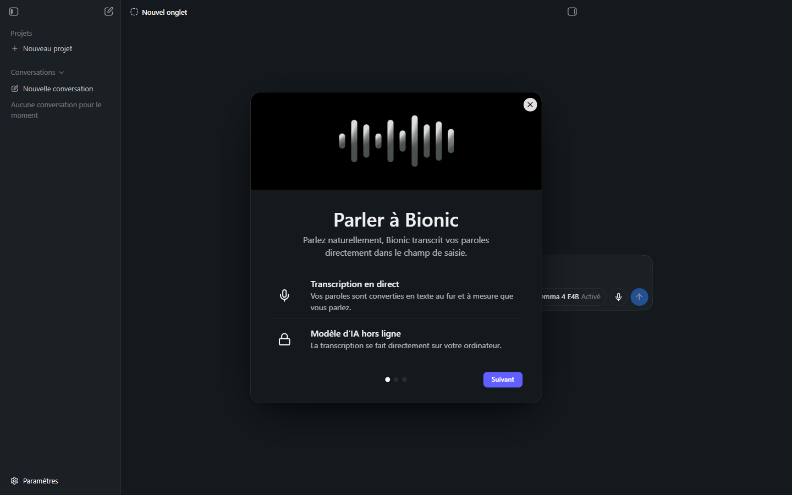

# Manuel Bionic 09 — Saisie vocale

> **Objet** : dicter ses consignes à Bionic avec une transcription **locale** : principe, mise en route, réglage du chargement du modèle, limites.
> **Prérequis** : [Manuel Bionic 02](02-interface.md#5-zone-de-saisie).
> **Version décrite** : Bionic 1.1.7, Windows 11, interface en français.
> **Statut des informations** : [Vérifié] observé ; [Source] documentation officielle ; [Estimation] ; [À tester]. **La dictée n'a pas été exécutée de bout en bout** (aucun microphone utilisé, aucun modèle vocal téléchargé) : les parties non observées sont signalées.

---

## Sommaire

1. [Principe](#1-principe)
2. [Mise en route](#2-mise-en-route)
3. [Réglage : chargement automatique du modèle](#3-réglage--chargement-automatique-du-modèle)
4. [Confidentialité](#4-confidentialité)
5. [Dépannage](#5-dépannage)

---

## 1. Principe

### Essentiel

La **saisie vocale** transforme la parole en texte et place ce texte dans la zone de saisie : la consigne est dictée au lieu d'être tapée. La transcription est effectuée **sur l'ordinateur**, par un modèle de reconnaissance vocale (actuellement **Voxtral**, de Mistral AI) [Source].

Annonces de l'écran d'accueil de la fonction [Vérifié] :

*Figure 1 — « Parler à Bionic » (première des trois pages de présentation).*

| Avantage annoncé | Explication |
|---|---|
| **Transcription en direct** | Les paroles sont converties en texte au fur et à mesure. |
| **Modèle d'IA hors ligne** | La transcription se fait directement sur l'ordinateur. |

### Pour aller plus loin

- Voxtral est un modèle de transcription **multilingue** [Source]. La liste précise des langues n'est pas documentée [À tester].
- Le modèle vocal est un modèle **distinct** du modèle de conversation : il occupe de la mémoire en plus de lui. Les sources tierces divergent sur son poids (**environ 3 Go** pour l'une, **environ 10 Go** pour une autre) [Estimation, sources non officielles] : relever la taille réelle dans le dossier des modèles après le premier téléchargement [À tester].

---

## 2. Mise en route

1. Dans la zone de saisie, cliquer sur le bouton **microphone** (infobulle **Configurer la transcription vocale**).
2. Lors de la première utilisation, la présentation **Parler à Bionic** s'affiche (3 pages, bouton **Suivant**, croix de fermeture).
3. Suivre l'assistant : préparation du modèle vocal (téléchargement initial) [Estimation : étapes 2 et 3 non consultées].
4. Autoriser l'accès au **microphone** si Windows le demande.
5. Parler : le texte apparaît dans la zone de saisie ; relire et corriger avant envoi.

> **Point d'attention** — la dictée alimente la zone de saisie, mais l'envoi reste **manuel** : relire la transcription (noms propres, chiffres, chemins de fichiers) avant d'appuyer sur la flèche d'envoi. Une erreur de reconnaissance se transforme sinon en consigne erronée pour l'agent.

### Pour aller plus loin

Le raccourci clavier d'activation, le choix du microphone et la dictée « dans n'importe quelle application » mentionnée dans le billet de présentation ne sont pas décrits dans la documentation consultée [À tester].

---

## 3. Réglage : chargement automatique du modèle

Réglages → **Voix** : un seul réglage, **Charger automatiquement le modèle vocal** (désactivé par défaut) [Vérifié].

| Réglage | Effet | Quand l'utiliser |
|---|---|---|
| **Désactivé** (défaut) | Le modèle vocal est chargé à la première dictée ; **délai** avant la première transcription | Dictée occasionnelle ; mémoire limitée |
| **Activé** | Le modèle de reconnaissance reste **chargé en mémoire** ; démarrage plus rapide | Dictée quotidienne ; mémoire suffisante |

> **Exemple (poste de test, 31 Go de RAM)** — avec un modèle de conversation de 6,3 Go, un modèle vocal supplémentaire de quelques gigaoctets reste raisonnable. Avec un modèle de 12 Md de paramètres (≈ 7 à 8 Go chargé), le total reste sous la RAM disponible, mais l'espace pour le contexte diminue : conserver le chargement automatique désactivé si la machine est juste en mémoire.

Voir la mémoire consommée : Réglages → **Instances chargées** ([Manuel 03](03-reglages.md#10-modèles-locaux)).

---

## 4. Confidentialité

- La transcription étant **locale**, l'audio n'est pas envoyé à un service externe pour cette étape [Source].
- Le **texte** transcrit devient une consigne ordinaire : il est traité comme toute consigne (modèle local, distant ou cloud selon le modèle de la session).
- Pour une confidentialité maximale, associer dictée locale et **modèle local** ([Manuel 10](10-securite-compte-api.md)).

---

## 5. Dépannage

| Symptôme | Cause probable | Action |
|---|---|---|
| Aucun texte ne s'affiche | Microphone non autorisé ou non sélectionné | Vérifier Paramètres Windows → Confidentialité → Microphone. |
| Premier démarrage long | Modèle vocal en chargement ou en téléchargement | Patienter ; activer le chargement automatique ([section 3](#3-réglage--chargement-automatique-du-modèle)). |
| Ralentissement général pendant la dictée | Mémoire saturée (modèle de conversation + modèle vocal) | Décharger un modèle (Réglages → Instances chargées) ; réduire la taille de contexte. |
| Mots erronés | Bruit, accent, vocabulaire technique | Parler près du micro ; relire avant envoi ; corriger au clavier. |
