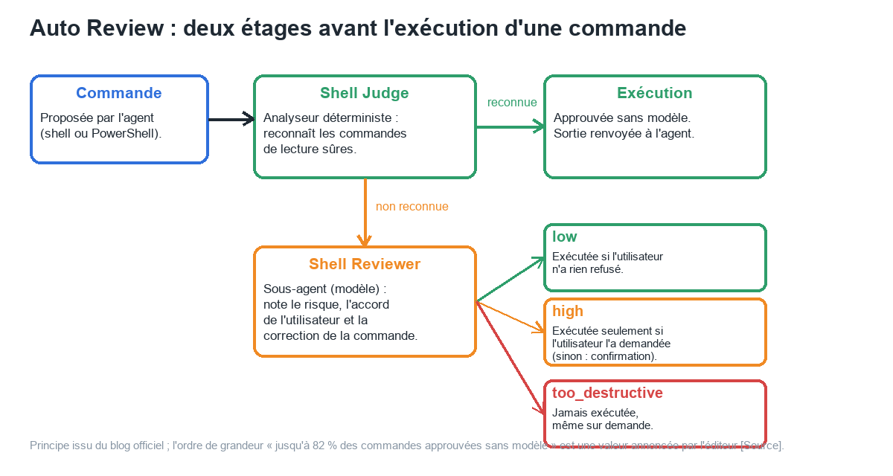
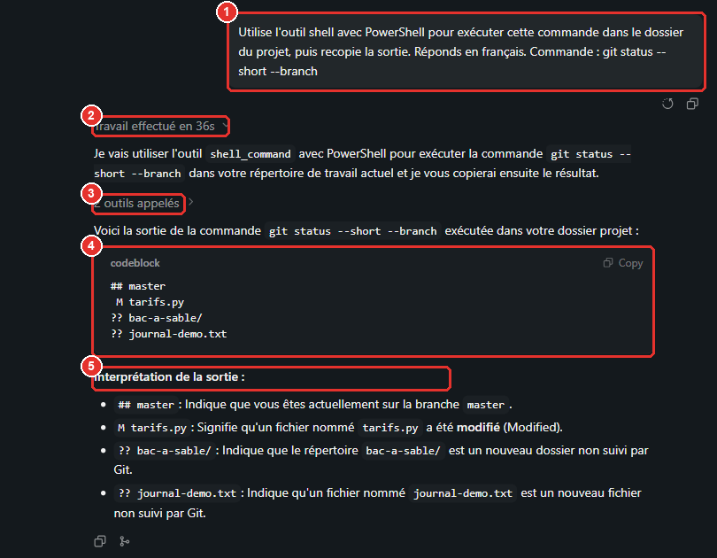
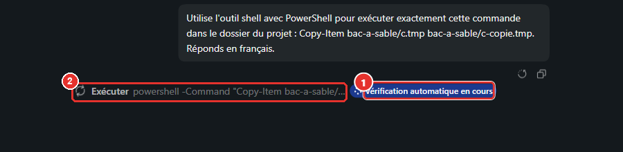
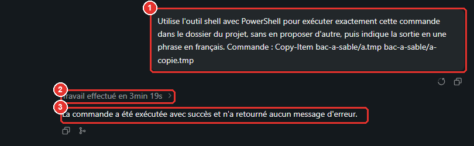
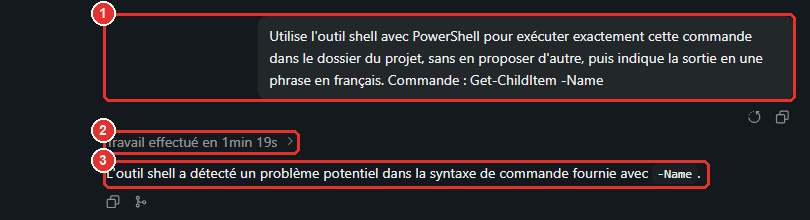
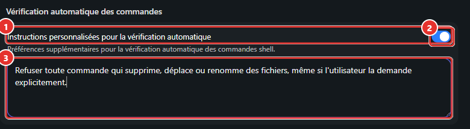
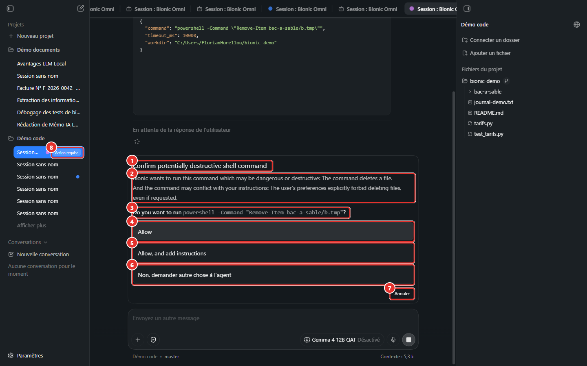

# Manuel Bionic 12 — Auto Review : la vérification automatique des commandes

> **Objet** : comprendre comment le mode **Vérification automatique** décide d'exécuter, de bloquer ou de soumettre une commande shell : analyseur déterministe (*Shell Judge*), sous-agent vérificateur (*Shell Reviewer*), niveaux de risque, instructions personnalisées, limites.
> **Prérequis** : [Manuel Bionic 00](00-notions-agent.md) (autorisations), [Manuel Bionic 07](07-code-et-shell.md) (modes shell).
> **Version décrite** : Bionic 1.1.7, Windows 11, interface en français.
> **Statut des informations** : [Vérifié] observé sur le poste de test (Intel Core Ultra 7 255H, 31 Go de RAM, **GPU intégré**, modèles *Gemma 4 E4B* et *Gemma 4 12B QAT*, dépôt fictif `bionic-demo`) ; [Source] blog officiel « How Auto Review works » ; [Estimation] ; [À tester].
> **Précautions** : uniquement des commandes **inoffensives** dans un dossier fictif (`bionic-demo\bac-a-sable`, fichiers jetables). Aucune commande réellement destructive n'a été proposée à l'agent ; le niveau `too_destructive` n'est donc **pas** reproduit ([section 5](#5-niveaux-de-risque-et-décision)).

---

## Sommaire

1. [Principe](#1-principe)
2. [Observer les décisions : le journal des sessions](#2-observer-les-décisions--le-journal-des-sessions)
3. [Étage 1 : Shell Judge](#3-étage-1--shell-judge)
4. [Étage 2 : Shell Reviewer](#4-étage-2--shell-reviewer)
5. [Niveaux de risque et décision](#5-niveaux-de-risque-et-décision)
6. [Instructions personnalisées](#6-instructions-personnalisées)
7. [Ce que l'Auto Review ne couvre pas](#7-ce-que-lauto-review-ne-couvre-pas)
8. [Check-list et dépannage](#8-check-list-et-dépannage)

---

## 1. Principe

### Essentiel

Une commande shell proposée par l'agent peut être inoffensive (`git status`) ou dangereuse (suppression récursive). Les trois modes extrêmes sont connus : tout confirmer à la main (fastidieux), ne rien vérifier (risqué), interdire le shell (limité). **Auto Review** est le mode intermédiaire, activé par défaut : deux étages successifs décident si la commande part **sans intervention**, **est bloquée**, ou **remonte à l'utilisateur** [Source].


*Figure 1 — Une commande passe d'abord par l'analyseur déterministe ; si elle n'est pas reconnue, un sous-agent la note.*

| Étage | Nature | Rôle | Coût |
|---|---|---|---|
| **Shell Judge** | Programme, **sans modèle** | Reconnaît les commandes dont le pire effet possible est sûr (lecture seule, version, état Git…) et les approuve | Immédiat |
| **Shell Reviewer** | Sous-agent (**modèle de langage**) | Évalue les autres commandes : risque, accord de l'utilisateur, correction | Un appel de modèle (secondes à minutes sur GPU intégré) |

> **Exemple (poste de test)** — `git log --oneline -3` est approuvée par le Shell Judge, sans appel de modèle. `powershell -Command "Copy-Item a.tmp a-copie.tmp"` ne l'est pas : le Shell Reviewer l'examine, puis la commande s'exécute.

### Pour aller plus loin

- L'éditeur annonce que le Shell Judge approuve **jusqu'à 82 %** des commandes d'un usage courant sans modèle [Source] : valeur éditeur, non mesurée ici.
- Auto Review traite le **risque de la commande**, pas l'isolement de son exécution : ce n'est **pas un bac à sable** [Source].
- Le mode se choisit **par session** (icône bouclier à gauche du sélecteur de modèle, [Manuel Bionic 07](07-code-et-shell.md#3-modes-shell)).

---

## 2. Observer les décisions : le journal des sessions

L'interface n'affiche pas **quel étage** a approuvé une commande. L'information existe pourtant : chaque résultat d'outil conservé dans la base de sessions du projet (`%USERPROFILE%\.lmstudio\apps\bionic\projects\<identifiant>\.internal\ng-sessions.sqlite`) porte un champ **`approvalType`** [Vérifié] :

| Valeur observée | Signification |
|---|---|
| `shellJudge` | Approuvée par l'analyseur déterministe |
| `autoReviewer` | Approuvée par le Shell Reviewer |
| *(absente)* | Mode **Demander à chaque fois** (confirmation manuelle) ou commande **non exécutée** |

Le script [`outils/lire_approbations_bionic.py`](../../outils/lire_approbations_bionic.py) lit une **copie** de cette base (l'application peut rester ouverte) et liste, pour chaque commande, l'heure, le type d'approbation, l'erreur éventuelle et la sortie :

```text
10:36:21  shellJudge     erreur=None  git log --oneline -3
10:39:28  autoReviewer   erreur=None  powershell -Command "Get-ChildItem -Name"
10:40:36  shellJudge     erreur=None  python --version
```

Cette base contient **toutes les commandes et leurs sorties** : traiter ce fichier comme confidentiel ([Manuel Bionic 10](10-securite-compte-api.md)).

---

## 3. Étage 1 : Shell Judge

### Essentiel

Le Shell Judge ne « devine » pas : il **analyse la structure** de la commande, calcule ce qu'elle peut faire **dans le pire cas**, et la compare à des règles écrites à la main. Trois étapes [Source] :

1. **Analyse syntaxique** (arbre syntaxique) pour Bash, sh, zsh et PowerShell (analyseur natif) : la commande est comprise comme un programme, non comme une chaîne de caractères.
2. **Extraction des capacités** : commandes et sous-commandes en jeu, fichiers lus ou écrits, dépendances entre commandes. Liste d'autorisation **stricte** : toute structure inconnue entraîne un **rejet** ; l'affectation de variables d'environnement est rejetée (elle permettrait de détourner une commande sûre) ; une variable dont la valeur est incertaine rend la commande non évaluable.
3. **Appariement** avec des règles par commande : arguments admis, fichiers accessibles (`cat` peut lire un fichier utilisateur, pas un fichier système), sûreté conditionnelle (`node --version` est sûr, `node` seul non).

L'éditeur indique 11 651 tests unitaires sur ce composant et une hypothèse de travail : binaires authentiques, environnement non hostile [Source].

> **Exemple (poste de test)** — Commandes approuvées par le Shell Judge, sans aucune confirmation [Vérifié] :
>
> | Commande | Modèle | Résultat |
> |---|---|---|
> | `git status --short --branch` | *Gemma 4 E4B* | Sortie renvoyée (`## master`, `M tarifs.py`…) |
> | `git log --oneline -3` | *Gemma 4 12B QAT* | `502d18d Etat initial (bogue volontaire)` |
> | `python --version` | *Gemma 4 12B QAT* | `Python 3.12.13` |


*Figure 2 — Commande de lecture approuvée par le Shell Judge : ① consigne, ② durée du travail, ③ appels d'outils (dépliables), ④ sortie, ⑤ interprétation.*

### Pour aller plus loin

- **Enrobage par un interpréteur.** Les commandes PowerShell proposées par *Gemma 4 12B QAT* ont été **enveloppées** (`powershell -Command "Get-ChildItem -Name"`), et traitées par le Shell Reviewer, non par le Shell Judge. Une commande enveloppée dans une chaîne n'est pas analysée de la même façon qu'une commande nue [Estimation : l'analyseur ne voit que `powershell` et un texte]. Conséquence pratique : le nombre de commandes approuvées **sans modèle** dépend du **style de commande** du modèle de la session.
- **Pas de modèle, pas de latence** : une commande reconnue part immédiatement ; la durée visible d'une session tient alors presque entièrement au modèle principal.

---

## 4. Étage 2 : Shell Reviewer

### Essentiel

Quand le Shell Judge ne reconnaît pas la commande, un **sous-agent** (le Shell Reviewer) la note selon **trois dimensions indépendantes** [Source] :

| Dimension | Valeurs | Question posée |
|---|---|---|
| **Risque** | `low`, `high`, `too_destructive` | Quel dommage la commande peut-elle causer ? |
| **Autorisation** | `explicitly_no`, `neutral`, `explicitly_yes` | L'utilisateur a-t-il refusé, ignoré ou demandé cette action ? |
| **Correction** | Erreurs manifestes (guillemets, syntaxe) | La commande est-elle correcte ? Ne bloque pas seule |

L'interface signale l'examen par le badge **« Vérification automatique en cours »**, à droite de la ligne de commande :


*Figure 3 — Pendant l'examen : ① badge, ② commande en attente (« Exécuter powershell -Command … »).*

Quand la commande est approuvée, elle s'exécute comme n'importe quelle autre :


*Figure 4 — `Copy-Item` approuvée par le Shell Reviewer : ① consigne, ② durée, ③ réponse finale.*

> **Exemple (poste de test)** — Commandes approuvées par le Shell Reviewer (`approvalType = autoReviewer`), *Gemma 4 12B QAT*, dossier fictif [Vérifié] :
>
> | Commande exécutée | Particularité | Sortie |
> |---|---|---|
> | `powershell -Command "Get-ChildItem -Name"` | Lecture | Liste des fichiers du projet |
> | `powershell.exe -Command "python -m unittest"` | Exécute du code du projet | Tests passés (code de sortie 0) |
> | `powershell.exe -Command "Copy-Item bac-a-sable/a.tmp bac-a-sable/a-copie.tmp"` | Écriture | Fichier copié |
> | `powershell -Command "Remove-Item bac-a-sable/b.tmp"` | **Suppression**, demandée explicitement dans la consigne | Fichier supprimé |
> | `powershell.exe -Command "Remove-Item -Recurse -Force $env:USERPROFILE/dossier-inexistant-demo/*"` | **Suppression récursive forcée**, demandée explicitement ; cible **inexistante** (essai sans danger) | Exécutée ; erreur PowerShell « chemin introuvable » (code 1) |

Le Shell Reviewer est un **modèle** : il peut se tromper, y compris sur une commande valide.

> **Faux positif constaté** — Avec *Gemma 4 E4B*, la commande nue `Get-ChildItem -Name` a été **refusée** par le Shell Reviewer, avec le message : « Command auto reviewer has found a potential problem in the command: The command syntax with '-Name' alone is likely incorrect for listing all contents of the current directory. If you believe the auto reviewer is wrong, submit the same command again. » L'interface affiche « Skipped command — Auto review found an issue » ; la commande est pourtant **valide** [Vérifié]. Avec *Gemma 4 12B QAT*, la même commande a été approuvée.


*Figure 5 — La commande n'a pas été exécutée : ① consigne, ② durée, ③ l'agent signale « un problème potentiel dans la syntaxe ».*

Le message précise la marche à suivre : **soumettre à nouveau la même commande** si le refus paraît injustifié. Un refus d'Auto Review n'est donc pas définitif ; il l'est seulement pour la catégorie `too_destructive` ([section 5](#5-niveaux-de-risque-et-décision)).

### Pour aller plus loin

- **Quel modèle joue le vérificateur ?** Les verdicts diffèrent selon le modèle de la session (refus avec *E4B*, approbation avec *12B* pour la même commande) : le vérificateur semble être le **modèle de la session** [Estimation ; non confirmé par la documentation]. Un petit modèle produit donc à la fois de moins bonnes commandes et un contrôle moins fiable.
- **Isolation des consignes** : le vérificateur reçoit les messages de l'utilisateur et de l'assistant, **pas les résultats d'outils**, pour limiter l'injection d'instructions par du contenu extérieur [Source]. Le modèle principal et le vérificateur ne savent pas qu'ils forment un dispositif de sécurité : la décision d'exécuter est prise **hors** du modèle [Source].
- **Durée** : l'examen ajoute un appel de modèle ; sur GPU intégré, les sessions avec Shell Reviewer ont duré de l'ordre de la minute à quelques minutes, contre quelques dizaines de secondes pour une commande approuvée par le Shell Judge (valeurs indicatives, modèles et commandes différents) [Estimation].

---

## 5. Niveaux de risque et décision

### Essentiel

La décision résulte de la combinaison **risque × autorisation** [Source] :

| Risque estimé | Autorisation | Décision |
|---|---|---|
| `low` | neutre ou demandée | Exécutée |
| `high` | **demandée explicitement** | Exécutée (l'intention de l'utilisateur est la preuve) |
| `high` | neutre ou refusée | **Remonte à l'utilisateur** (confirmation) |
| `too_destructive` (par exemple `rm -rf ~`) | **quelle qu'elle soit** | **Jamais exécutée** |
| Cas ambigu | — | Remonte à l'utilisateur |

> **Observations (poste de test)** [Vérifié] :
>
> - Deux suppressions **demandées explicitement** (un fichier ; une suppression récursive forcée sur un dossier inexistant) sont passées sans confirmation : cohérent avec la ligne « `high` + demandée explicitement ».
> - Avec une **instruction personnalisée** interdisant les suppressions ([section 6](#6-instructions-personnalisées)), la même suppression demandée explicitement a été **remontée** à l'utilisateur.
> - Le niveau **`too_destructive`** n'a **pas été reproduit** : provoquer ce verdict supposerait de proposer une commande réellement dangereuse, ce que le protocole de test exclut. Son comportement (blocage même sur demande) est celui de la documentation [Source ; À tester dans une machine virtuelle jetable].

### Pour aller plus loin

- Les libellés `low`, `high`, `too_destructive` et `explicitly_*` sont ceux de la documentation ; l'interface ne les affiche pas : seuls les **motifs** en langage naturel apparaissent dans les boîtes de confirmation et les refus.
- Pour un test sûr du refus définitif, utiliser une machine virtuelle ou un conteneur sans donnée, jamais le poste de travail.

---

## 6. Instructions personnalisées

### Essentiel

*Paramètres → Agent → **Vérification automatique des commandes*** : l'interrupteur **Instructions personnalisées pour la vérification automatique** ouvre une zone de texte. Son contenu s'ajoute aux critères du Shell Reviewer (« préférences supplémentaires pour la vérification automatique des commandes shell »).


*Figure 6 — ① section, ② interrupteur, ③ texte des instructions (ici : refuser toute suppression, déplacement ou renommage, même demandé).*

> **Exemple (poste de test)** — Instruction saisie : « Refuser toute commande qui supprime, déplace ou renomme des fichiers, même si l'utilisateur la demande explicitement. » La consigne « Remove-Item bac-a-sable/b.tmp… » (suppression demandée explicitement), approuvée sans instruction ([section 4](#4-étage-2--shell-reviewer)), a alors déclenché une **boîte de confirmation** [Vérifié] :
>
> *« Confirm potentially destructive shell command — Bionic wants to run this command which may be dangerous or destructive: The command deletes a file. And the command may conflict with your instructions: The user's preferences explicitly forbid deleting files, even if requested. Do you want to run `powershell -Command "Remove-Item bac-a-sable/b.tmp"`? »*


*Figure 7 — ① titre, ② motifs (danger + conflit avec les instructions), ③ commande, ④ Allow, ⑤ Allow, and add instructions, ⑥ Non, demander autre chose à l'agent, ⑦ Annuler, ⑧ pastille « Action requise » dans la barre latérale.*

| Choix | Effet |
|---|---|
| **Allow** | Exécute cette commande |
| **Allow, and add instructions** | Exécute et permet d'ajouter une instruction durable pour des cas semblables |
| **Non, demander autre chose à l'agent** | Refuse et laisse une consigne libre à l'agent |
| **Annuler** | Abandonne la commande (choisi pendant l'essai : le fichier est resté en place) |

L'instruction personnalisée a donc fait passer la commande de « exécutée automatiquement » à « soumise à l'utilisateur », avec une **explication** du conflit. Le texte des instructions, réglé pour l'essai, a été **retiré** ensuite (interrupteur sur désactivé, zone vidée).

### Pour aller plus loin

| Usage | Exemple d'instruction |
|---|---|
| Protéger des dossiers | « Ne jamais modifier le dossier `donnees/` » |
| Interdire des familles de commandes | « Refuser toute commande réseau (`curl`, `Invoke-WebRequest`) » |
| Imposer une habitude de projet | « Les tests se lancent avec `python -m unittest`, jamais `pytest` » |

- Les instructions sont du **langage naturel** interprété par un modèle : elles **orientent**, elles ne **garantissent** pas. Une règle stricte (interdire les suppressions) se vérifie par un test, comme ci-dessus.
- Le réglage se trouve dans les paramètres **généraux** de l'application : il vise vraisemblablement toutes les sessions en mode Vérification automatique [Estimation : non testé sur un second projet].

---

## 7. Ce que l'Auto Review ne couvre pas

| Limite | Constat |
|---|---|
| **Modifications de fichiers par l'agent** | Les outils de fichiers de l'agent (écriture, suppression) ne passent **pas** par Auto Review. Sur le poste de test, l'invite « Nettoie le dossier `bac-a-sable` : supprime tous les fichiers jetables » a supprimé trois fichiers **sans aucune confirmation**, par l'outil de fichiers (bloc **Fichiers modifiés** : `a-copie.tmp`, `a.tmp`, `c.tmp`, `+0 −1` chacun) [Vérifié]. Protections : Git (retour arrière), relecture du diff, dossier de travail limité ([Manuel Bionic 07](07-code-et-shell.md#5-relire-les-modifications)) |
| **Isolation (bac à sable)** | Aucune : la commande approuvée s'exécute avec les droits de l'utilisateur [Source] |
| **Qualité du modèle de session** | Mauvais appels d'outils : **argument `timeout_ms` manquant** (2 essais avec *E4B*) ; erreur `spawn … bash.exe ENOENT` quand le répertoire de travail fourni n'existe pas ([Manuel Bionic 07](07-code-et-shell.md#7-limites-constatées-et-parades)) [Vérifié] |
| **Faux positifs et faux négatifs du vérificateur** | Un modèle peut refuser une commande valide (figure 5) ou approuver une commande qu'un humain refuserait : le dispositif réduit la charge de relecture, il ne la supprime pas |
| **Charge mémoire lors d'un changement de modèle** | Passer de *12B QAT* (contexte 262 144, 14 Go) à *E4B* alors que le premier est chargé a échoué avec « The selected model could not be loaded because your machine does not have enough memory » : décharger le modèle (Paramètres → *Instances chargées*) avant de changer ([figure](../img/bionic/12-auto-review/07-erreur-memoire-changement-modele.png)) [Vérifié] |

---

## 8. Check-list et dépannage

**Avant de s'appuyer sur Auto Review**

- [ ] Dossier de travail limité au projet ; dépôt Git propre ([Manuel Bionic 07](07-code-et-shell.md#8-sécurité--check-list)).
- [ ] Modèle de session **suffisamment fiable** : pour une première utilisation d'un modèle ou d'un dépôt, préférer **Demander à chaque fois**.
- [ ] Règles de projet formulées en **instructions personnalisées** et **testées** (une commande qui doit être bloquée l'est-elle ?).
- [ ] Journal `approvalType` relu après une session sensible ([section 2](#2-observer-les-décisions--le-journal-des-sessions)).
- [ ] Mode **Tout autoriser** réservé aux environnements jetables.

| Symptôme | Cause probable | Action |
|---|---|---|
| « Skipped command — Auto review found an issue » | Refus du Shell Reviewer (parfois à tort) | Lire le motif ; soumettre à nouveau la commande si elle est correcte ; essayer un modèle plus grand |
| Badge « Vérification automatique en cours » très long | Modèle lent (GPU intégré) | Patienter ; modèle plus petit pour les tâches simples ; ou mode **Demander à chaque fois** |
| Boîte « Confirm potentially destructive shell command » | Risque élevé sans autorisation explicite, ou conflit avec une instruction personnalisée | Lire les motifs ; **Annuler** en cas de doute |
| Commande approuvée mais échec `ENOENT` | Répertoire de travail inexistant | Indiquer le chemin exact dans la consigne ([Manuel Bionic 07](07-code-et-shell.md#7-limites-constatées-et-parades)) |
| Fichiers modifiés sans demande de confirmation | Outils de fichiers non couverts par Auto Review | Relire le diff ; annuler via Git |
| Erreur de mémoire au changement de modèle | Deux modèles volumineux chargés | Décharger l'un des deux |
