# Manuel Bionic 13 — Compétences en pratique : créer, installer, déclencher

> **Objet** : suivre une compétence (`SKILL.md`) **de bout en bout** : écriture, installation (de projet ou globale), déclenchement manuel avec `@` et automatique, mesure de l'effet, gestion et retrait.
> **Prérequis** : [Manuel Bionic 08](08-competences-et-mcp.md) (principe des compétences), [Manuel Bionic 12](12-auto-review.md) (approbations).
> **Version décrite** : Bionic 1.1.7, Windows 11, interface en français.
> **Statut des informations** : [Vérifié] observé sur deux postes : GPU intégré (Intel Core Ultra 7 255H, 31 Go de RAM, modèles *Gemma 4 E4B* et *Gemma 4 12B QAT*, 6 octobre 2026) et **GPU dédié** (RTX 4060 Ti, 16 Go de VRAM, modèles *Gemma 4 E4B* et *Gemma 4 26B A4B*, 7 octobre 2026 : sections 3.5 et 5, modèle réel vérifié dans la base de sessions) ; [Source] fichiers fournis avec l'application (compétence interne `skill-management`) et documentation officielle ; [Estimation] ; [À tester].
> **Précautions** : compétences **fictives** (compte rendu de réunion, résumé en trois points) ; notes de réunion inventées ; la compétence globale installée pour l'essai a été **retirée** à la fin.

---

## Sommaire

1. [Principe](#1-principe)
2. [Anatomie d'une compétence](#2-anatomie-dune-compétence)
3. [Essai A : une compétence de projet](#3-essai-a--une-compétence-de-projet)
4. [Essai B : installer une compétence globale](#4-essai-b--installer-une-compétence-globale)
5. [Faire créer une compétence par l'agent](#5-faire-créer-une-compétence-par-lagent)
6. [Gérer et retirer les compétences](#6-gérer-et-retirer-les-compétences)
7. [Bonnes pratiques et sécurité](#7-bonnes-pratiques-et-sécurité)
8. [Dépannage](#8-dépannage)

---

## 1. Principe

### Essentiel

Une **compétence** est un dossier qui contient un fichier **`SKILL.md`** : des consignes réutilisables, déclenchées **quand elles sont pertinentes** ou **sur demande**. Elle évite de réécrire à chaque session le format, le ton ou la check-list attendus.

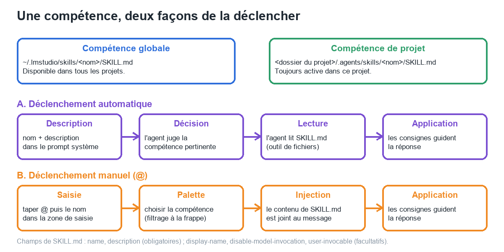
*Figure 1 — Emplacements (globale, de projet) et deux déclenchements : automatique (l'agent lit `SKILL.md`) et manuel (`@`).*

| Déclenchement | Comment | Observé |
|---|---|---|
| **Automatique** | Le nom et la description de chaque compétence figurent dans le prompt système ; l'agent juge la pertinence puis **lit `SKILL.md`** avec ses outils de fichiers [Source] | Oui ([section 3](#33-déclenchement-automatique-sans-)) |
| **Manuel** | Taper `@` puis choisir la compétence dans la palette ; le contenu est fourni à l'agent [Source] | Oui ([section 3](#32-déclenchement-manuel-avec-)) |

> **Exemple (poste de test)** — Compétence « compte-rendu-reunion » : même consigne et mêmes notes, trois essais (sans compétence, avec `@`, déclenchement automatique) ; seuls les deux derniers produisent le format imposé.

---

## 2. Anatomie d'une compétence

### Essentiel

```text
compte-rendu-reunion/
└── SKILL.md
```

```markdown
---
name: compte-rendu-reunion
description: Rédige un compte rendu de réunion au format standard (décisions, actions, échéances) à partir de notes brutes. À utiliser lorsque des notes de réunion sont fournies ou qu'un compte rendu est demandé.
---

# Compte rendu de réunion
(consignes, procédure, contraintes…)
```

Source complète de la compétence d'essai : [`outils/competences_demo/compte-rendu-reunion/SKILL.md`](../../outils/competences_demo/compte-rendu-reunion/SKILL.md).

Champs de l'en-tête (YAML) [Source : compétence interne `skill-management` livrée avec l'application] :

| Champ | Statut | Rôle |
|---|---|---|
| `name` | **Obligatoire** | Nom en *kebab-case* (1 à 63 caractères, pas de tiret en début, en fin ou doublé) ; sert d'identifiant et de texte de déclenchement ; **doit correspondre au nom du dossier** |
| `description` | **Obligatoire** | Courte description injectée dans le prompt système de **chaque** agent qui a la compétence : l'agent s'en sert pour décider de la charger. Moins de 150 caractères conseillés, 300 au maximum |
| `display-name` | Facultatif | Nom lisible affiché dans la palette `@` et dans les réglages |
| `disable-model-invocation` | Facultatif (`false`) | `true` : l'agent ne lit **pas** la compétence de lui-même ; seul le déclenchement manuel reste |
| `user-invocable` | Facultatif (`true`) | `false` : la compétence n'apparaît pas dans la palette `@` |

Deux **emplacements** :

| Type | Dossier | Portée |
|---|---|---|
| **Globale** | `%USERPROFILE%\.lmstudio\skills\<nom>\SKILL.md` | Tous les projets ; activable ou désactivable dans les réglages |
| **De projet** | `<dossier du projet>\.agents\skills\<nom>\SKILL.md` | Ce projet ; toujours active ; modifiable comme un fichier ordinaire |

### Pour aller plus loin

- Le dossier de la compétence peut contenir d'autres fichiers (données, scripts) : l'agent reçoit le chemin du dossier et un accès en lecture [Source].
- Un `SKILL.md` **sans en-tête valide** n'est pas une compétence ([section 5](#5-faire-créer-une-compétence-par-lagent)).
- Le déclenchement manuel n'est possible que si le `@` n'est **pas précédé d'un caractère ordinaire** (`mot@` n'ouvre pas la palette) [Source ; confirmé : `@resume@` n'a pas ouvert la palette].

---

## 3. Essai A : une compétence de projet

### Méthode

- Projet « Démo code » (dossier de travail fictif `bionic-demo`), *Gemma 4 12B QAT*, réflexion désactivée, mode Vérification automatique.
- Consigne identique pour les trois essais : « Rédige le compte rendu de cette réunion. » suivie de notes fictives (participants, deux décisions, une action avec échéance, une question ouverte sans responsable).
- Critères de conformité imposés par la compétence : première ligne `CR-STANDARD` ; sections exactes `Décisions`, `Actions` (tableau), `Points ouverts` ; dernière ligne `Fin du compte rendu` ; rien d'inventé.

### 3.1 Essai témoin : sans compétence

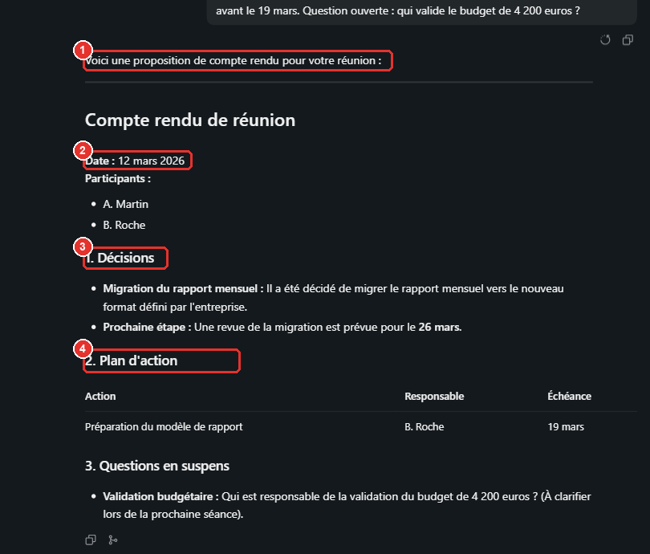
*Figure 2 — Sans compétence : ① introduction libre, ② **date inventée** (« 12 mars 2026 » : l'année n'était pas dans les notes), ③ ④ intitulés propres au modèle (« Décisions », « Plan d'action », « Questions en suspens »).*

### 3.2 Déclenchement manuel avec `@`

Dès la création du fichier dans `.agents\skills\`, la compétence apparaît dans la palette, **sans redémarrage ni installation** [Vérifié].

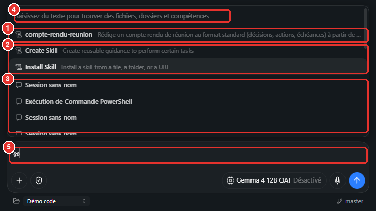
*Figure 3 — `@` : ① compétence du projet, ② compétences livrées (Create Skill, Install Skill), ③ sessions, ④ invite de recherche, ⑤ zone de saisie.*

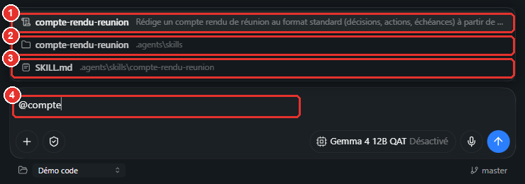
*Figure 4 — `@compte` : ① la compétence, ② son dossier, ③ le fichier `SKILL.md` : trois entrées qui contiennent « compte ». Choisir la **première** (icône de compétence).*

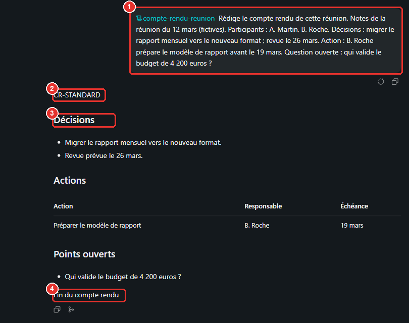
*Figure 5 — Avec `@compte-rendu-reunion` : ① référence de la compétence dans le message, ② première ligne `CR-STANDARD`, ③ sections imposées, ④ dernière ligne imposée.*

### 3.3 Déclenchement automatique (sans `@`)

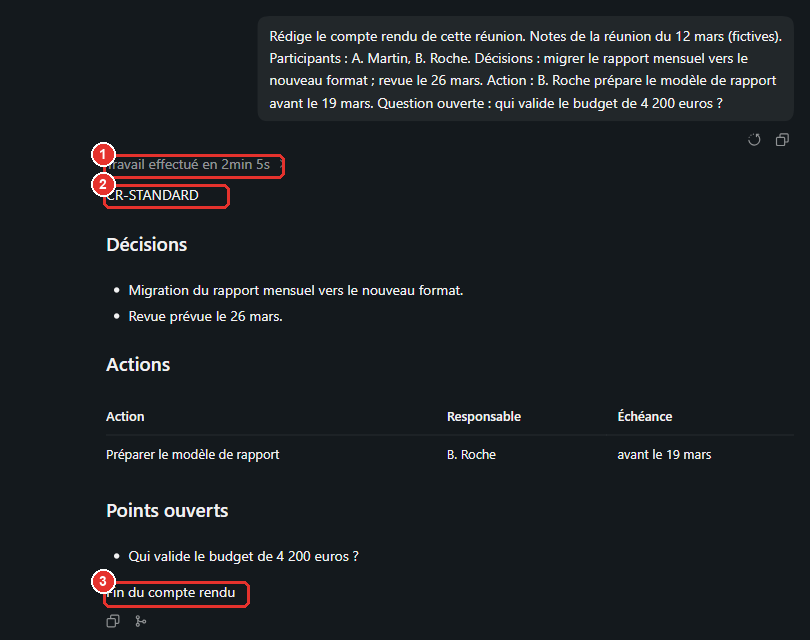
*Figure 6 — Même consigne, sans `@` : ① « Travail effectué en 2 min 5 s » (l'agent a travaillé avant de répondre), ② `CR-STANDARD`, ③ `Fin du compte rendu`.*

Le journal de session montre le chemin suivi : une **tentative d'appel d'un « outil Bionic » nommé `compte-rendu-reunion`** (refusée : « No Bionic tool named 'compte-rendu-reunion' is available… Read the relevant SKILL.md »), puis la **lecture du fichier** (`read_file_lines` sur `.agents/skills/compte-rendu-reunion/SKILL.md`), puis la réponse [Vérifié].

### 3.4 Résultats comparés

| Critère | Sans compétence | Avec `@` | Automatique |
|---|---|---|---|
| Première ligne `CR-STANDARD` | **Non** | Oui | Oui |
| Sections `Décisions` / `Actions` / `Points ouverts` | Intitulés différents | **Conformes** | **Conformes** |
| Tableau des actions (Action, Responsable, Échéance) | Oui | Oui | Oui |
| Dernière ligne `Fin du compte rendu` | **Non** | Oui | Oui |
| Année inventée dans la date | **Oui** (« 12 mars 2026 ») | Non | Non |
| Introduction avant le document | Oui | Non | Non |
| Temps de travail affiché | Aucun (réponse directe) | Aucun (réponse directe) | **2 min 5 s** (lecture du fichier) |
| Contexte affiché en fin de session | 5,5 k | 5,8 k | 6 k |

> **Lecture** — La compétence change **le format et la fiabilité** (plus de date inventée) sans nouvelle explication dans la consigne. Le déclenchement manuel est **plus rapide et plus sûr** : le contenu est fourni d'emblée, alors que l'automatique repose sur la décision du modèle et passe par une lecture de fichier (et, ici, une tentative d'outil erronée). Un seul essai par condition : tendance, non statistique.

### 3.5 Rejeu sur GPU dédié

[Vérifié, 7 octobre 2026] Projet « Démo code », *Gemma 4 26B A4B* (remplace le 12B QAT, absent du poste), raisonnement désactivé, mode Vérification automatique, modèle réel vérifié dans la base de sessions. La **compétence est la même** ; les **notes de réunion sont différentes** (réécrites : mêmes éléments, autres mots) : la comparaison avec le tableau de la section 3.4 est **indicative**.

| Critère | Sans compétence | `@compte-rendu-reunion` | Automatique (sans `@`) |
|---|---|---|---|
| Durée | **15 s** | **6 s** (aucun outil appelé : le contenu est fourni d'emblée) | **11 s** (un appel `read_file_lines` : lecture de `SKILL.md`, libellé « Reading skill ») |
| Première ligne `CR-STANDARD` | **Non** | **Oui** | **Non** |
| Sections `Décisions` / `Actions` / `Points ouverts` | Intitulés propres (« Décisions actées », « Plan d'action », « Points en suspens ») | **Conformes** | Intitulés propres (« Décisions actées », « Actions à réaliser », « Point en suspens ») |
| Tableau des actions | Oui | Oui | **Non** (liste à puces) |
| Dernière ligne `Fin du compte rendu` | **Non** | **Oui** | **Non** |
| Rien d'inventé | Non : « Une décision devra être prise lors de la prochaine séance » ; rôles ajoutés | **Oui** (« à définir » pour le responsable et l'échéance manquants) ; une ligne d'action ajoutée pour le fournisseur | **Non** : « Ordre du jour » et « prochaine séance » ajoutés |
| Introduction avant le document | Oui | **Non** | Oui |

> **Lecture** — Résultat **contraire à celui du 12B** sur le déclenchement automatique : le 26B **a bien lu** la compétence (appel d'outil `read_file_lines` sur `.agents/skills/compte-rendu-reunion/SKILL.md`) **mais n'en a pas appliqué le format**. Seul le déclenchement **manuel avec `@`** a donné un résultat **entièrement conforme** : le contenu de la compétence est vraisemblablement placé dans la requête, sans dépendre d'une décision du modèle [Estimation : aucun outil n'a été appelé]. **Pour une compétence dont le format compte, la déclencher avec `@`.** Un seul essai par condition ; la palette a proposé trois entrées « compte-rendu-reunion » (la compétence, puis des références de dossier et de fichier) : l'entrée la plus haute a été choisie ([Piège de recherche](#la-compétence-apparaît-partout)). Les durées sont **mesurées de l'envoi à la fin** ; le contexte affiché n'a pas été relevé.

---

## 4. Essai B : installer une compétence globale

### Méthode

Compétence fictive [`outils/competences_demo/resume-en-trois-points/SKILL.md`](../../outils/competences_demo/resume-en-trois-points/SKILL.md) (trois puces de 15 mots maximum, ligne finale `FIN-R3`), installée par l'agent avec **`@Install Skill`**, modèle *Gemma 4 E4B* (réflexion désactivée).

### Déroulé observé [Vérifié]

| Étape | Ce qui s'est passé |
|---|---|
| 1. `@Install Skill` + chemin du dossier | L'agent répond qu'il « n'a pas trouvé de compétence nommée `install-skill` dans les outils » et propose de lire `skill-management` |
| 2. Relance : lire le fichier puis installer | L'agent lit `skill-management\SKILL.md` ; propose de copier le dossier vers un espace temporaire |
| 3. Relance : copier puis appeler `skill.install` | **Demande d'autorisation de lecture du dossier** (figure 7) ; copie dans le dossier du **projet** (et non dans l'espace temporaire) ; premier appel avec un **mauvais nom d'outil** (`install-skill` : erreur « No Bionic tool named… ») |
| 4. Relance : exécuter `bionic_tool` avec `skill.install` | **Demande d'approbation de l'installation globale** (figure 8) ; **Yes** |
| 5. Résultat | Compétence installée dans `%USERPROFILE%\.lmstudio\skills\resume-en-trois-points\` ; fichier **identique** à la source (comparaison octet par octet) |

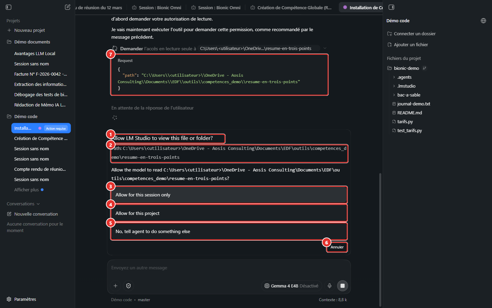
*Figure 7 — « Allow LM Studio to view this file or folder? » : ① titre, ② chemin, ③ pour cette session, ④ pour ce projet, ⑤ refus avec instruction, ⑥ annulation, ⑦ requête de l'agent. Un dossier **hors du projet** exige une autorisation explicite.*

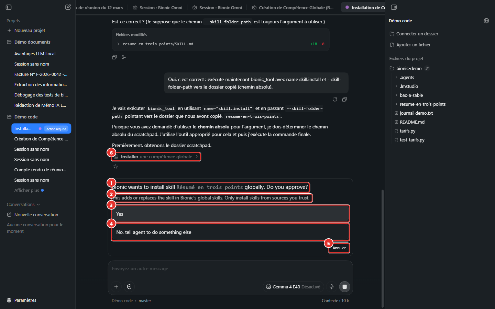
*Figure 8 — « Bionic wants to install skill … globally. Do you approve? » : ① question, ② avertissement (« Only install skills from sources you trust »), ③ Yes, ④ refus, ⑤ annulation, ⑥ étape « Installer une compétence globale ».*

**Rejeu sur GPU dédié** [Vérifié, 7 octobre 2026 ; modèle réel vérifié ; `@Install Skill` + le chemin du dossier de la compétence ; réflexion désactivée] :

| Modèle | Durée | Appels d'outils | Boîtes affichées | Résultat |
|---|---|---|---|---|
| *Gemma 4 E4B* (GPU intégré : 4 relances nécessaires) | **18 s** | un seul, `bionic_tool` (échec : aucun outil nommé `install-skill`) | aucune | **Rien installé** ; l'agent s'excuse et demande des précisions |
| *Gemma 4 26B A4B* | **86 s** et **104 s** (deux essais) | 7 : `shell_command`, `bionic_tool`, `read_file_lines`, `get_scratchpad_folder`, `shell_command`, `read_file_lines`, `bionic_tool` | « *Bionic wants to install skill … globally. Do you approve?* » (une fois) | **Compétence installée** dans `~\.lmstudio\skills\resume-en-trois-points\` ; contenu **identique** à la source hors fins de ligne (mélange CRLF et LF : 625 octets contre 630) |

Le 26B réussit **en une seule consigne** là où l'E4B échoue ; l'approbation de l'installation globale reste **obligatoire** dans les deux cas. La compétence installée a été **retirée** après chaque essai.

L'installation **n'est jamais silencieuse** : une compétence globale remplace ou ajoute une instruction **permanente** pour tous les projets ; l'approbation de l'utilisateur est requise [Vérifié ; Source].

### La compétence apparaît partout

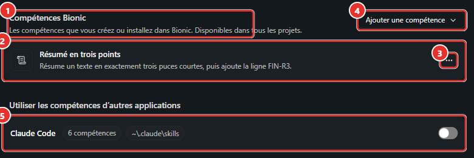
*Figure 9 — Réglages → Compétences : ① « Compétences Bionic » (créées ou installées, disponibles dans tous les projets), ② la compétence avec son nom lisible et sa description, ③ menu (Activer cette compétence, Afficher dans l'Explorateur de fichiers, Retirer), ④ Ajouter une compétence, ⑤ compétences d'autres applications (Claude Code : 6 compétences, **désactivées** par défaut).*

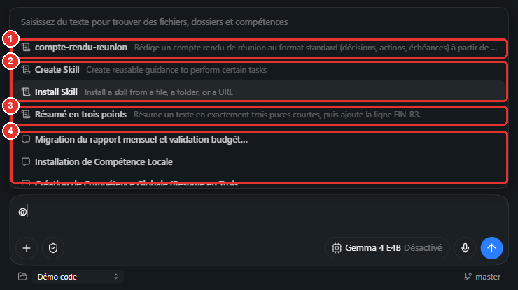
*Figure 10 — Palette `@` : ① compétence de projet, ② compétences livrées, ③ **compétence globale** (nom lisible « Résumé en trois points »), ④ sessions.*

**Piège de recherche** : la saisie `@resume` (sans accent) **n'a pas** proposé la compétence, dont le nom lisible est « Résumé… » ; elle a proposé des **dossiers** portant le nom `resume-en-trois-points` (créés par un essai précédent). Choisir une entrée de dossier au lieu de la compétence insère une **référence de dossier**, pas une compétence. Vérifier l'icône et le nom de l'entrée, ou parcourir la palette complète (`@` seul) [Vérifié].

### Déclenchement et résultat

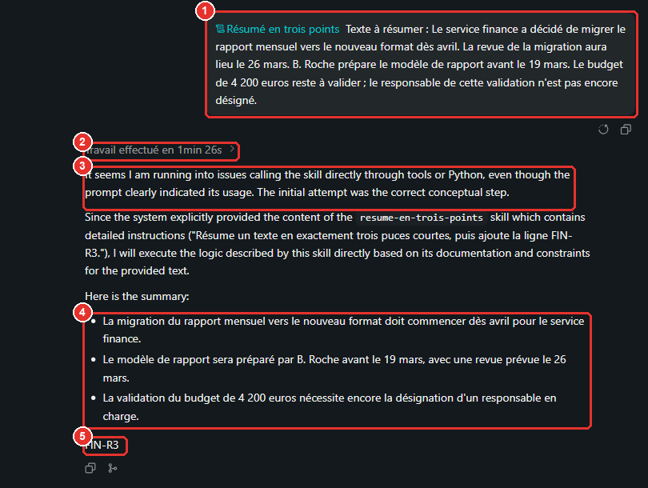
*Figure 11 — `@Résumé en trois points` + texte : ① compétence référencée, ② durée, ③ commentaire parasite en anglais, ④ trois puces, ⑤ ligne finale `FIN-R3`.*

| Critère imposé par la compétence | Résultat (*Gemma 4 E4B*) |
|---|---|
| Exactement trois puces | **Oui** |
| Ligne finale `FIN-R3` | **Oui** |
| 15 mots maximum par puce | **Non** : 17, 20 et 16 mots |
| Aucune introduction | **Non** : paragraphe d'introduction en anglais (« It seems I am running into issues calling the skill directly… ») |
| Durée | 1 min 26 s (l'agent a d'abord tenté d'appeler la compétence comme un outil) |

> **Lecture** — Le **format** (nombre de puces, ligne finale) est suivi ; les **contraintes numériques** (15 mots) et le « sans introduction » ne le sont pas avec un modèle de petite taille. Une compétence **oriente** ; elle ne garantit pas. Les contraintes qui comptent doivent être **vérifiées** après coup (ici : comptage de mots).

---

## 5. Faire créer une compétence par l'agent

### Essentiel

`@Create Skill` demande à l'agent de **concevoir** une compétence puis de l'**installer** (par `skill.install`, avec approbation) [Source].

> **Essai (poste de test)** [Vérifié] — Consigne : « Crée une compétence globale nommée `resume-en-trois-points` : exactement trois puces de 15 mots maximum, ligne finale `FIN-R3`. Ne pose aucune question. »
>
> **GPU intégré** :
>
> | Modèle | Résultat |
> |---|---|
> | *Gemma 4 E4B* | Réponse en 2 min 37 s : « I have successfully created the skill… ». **En réalité** : le fichier a été écrit **dans le dossier du projet** (`<projet>\.lmstudio\.internal\skills\resume-en-trois-points\SKILL.md`), **sans l'en-tête obligatoire** (`name`, `description`), et **rien n'a été installé** (dossier global vide) |
> | *Gemma 4 12B QAT* | Session **interrompue à la main après plus de 15 minutes** : l'agent explorait des dossiers par commandes (`dir`, `ls -R` sur les dossiers de compétences) et chaque commande passait par la vérification automatique ([Manuel 12](12-auto-review.md)) |

**Rejeu sur GPU dédié** [Vérifié, 7 octobre 2026] — même consigne, projet « Démo documents », raisonnement désactivé, modèle réel vérifié dans la base :

| Modèle | Durée (envoi → fin) | Outils appelés | Résultat |
|---|---|---|---|
| *Gemma 4 E4B* | **21 s** (GPU intégré : 2 min 37 s) | un seul : `bionic_tool` (échec) | **Aucune compétence créée.** L'agent répond, en anglais, qu'il n'a pas d'outil direct pour créer des compétences globales et **pose une question** (demande de précision), malgré « Ne pose aucune question ». Aucune fausse annonce de réussite cette fois |
| *Qwen3.8 27B* (raisonnement « Moyen ») | **242 s** (modèle chargé à la demande, 64 s à lui seul) | 5 : `read_file_lines` (lecture de `skill-management`), `get_scratchpad_folder`, `create_folder`, `replace_file`, `bionic_tool` | **Compétence créée et installée** après approbation, avec **en-tête complet** (`name`, `display-name`, `description`), règles, **exemple de format** ; réponse finale : « Tu peux l'activer à tout moment en tapant `@resume-en-trois-points` » (copie dans `outils/resultats/gpu_dedie/competence_creee_qwen/SKILL.md`). Compétence retirée ensuite |
| *Gemma 4 26B A4B* | **59 s** (envoi → fin, confirmations comprises) | 12 : `create_folder`, `list_dir`, `agentic_find`, `read_file_lines` (lecture de `skill-management`), `shell_command` (`ls -d …/.internal/skills/*`), `get_scratchpad_folder`, `replace_file`, `bionic_tool`… | **Compétence créée et installée** : boîte « *Bionic wants to install skill Résumé en trois points globally. Do you approve?* » puis `~\.lmstudio\skills\resume-en-trois-points\SKILL.md` écrit. Réponse : « La compétence globale `resume-en-trois-points` a été créée et installée avec succès » : **exacte** cette fois |

Contenu du fichier produit par le 26B (copie dans `outils/resultats/gpu_dedie/competence_creee_26b/SKILL.md`) : en-tête **complet** (`name`, `display-name`, `description`, `user-invocable: true`), puis trois règles : exactement trois puces, 15 mots maximum par puce, ligne finale `FIN-R3`. Le nom du dossier est égal à `name`. La compétence a été **retirée** après l'essai (`~\.lmstudio\skills` vide). Le test d'**usage** de cette compétence (respect des 15 mots) n'a pas été rejoué.

> **Attention** — L'option d'approbation automatique du script de test (« Yes » sur les boîtes d'autorisation) a **accepté l'installation globale** : sans cette option, la boîte « *Bionic wants to install skill* » attend une réponse (et signale « Action requise » dans la barre latérale). **Lire** la boîte avant d'accepter : une compétence globale s'applique à **tous** les projets.

**Conclusion** : la **création assistée** dépend **fortement du modèle**. Avec les petits modèles (E4B sur les deux postes) elle échoue, soit par une **fausse annonce** (GPU intégré), soit par un **abandon** (GPU dédié). Avec le **26B** elle **réussit** en moins d'une minute et sans fausse annonce, sur **un** essai. Procédure recommandée :

1. **Rédiger** soi-même le `SKILL.md` (ou le faire rédiger dans une session ordinaire), avec l'en-tête complet.
2. **Relire** le fichier (nom = nom du dossier, `description` courte et précise).
3. **Installer** : compétence de projet (copie dans `.agents\skills\`, immédiat) ou globale (`@Install Skill` ou *Réglages → Compétences → Ajouter une compétence → Installer une compétence…*).
4. **Contrôler** l'installation (liste des réglages, palette `@`) et **tester** sur un cas connu.

### Pour aller plus loin

- Un modèle plus capable améliore la création assistée : **vérifié** avec le 26B sur GPU dédié (un essai) ; un modèle distant n'a pas été testé [À tester]. *Qwen3.8 27B* a été testé (ligne ci-dessus) : création réussie, plus lente (242 s) mais **plus soignée** (exemple de format).
- *Réglages → Compétences → Ajouter une compétence* propose **Créer avec Bionic** et **Installer une compétence…** ([Manuel Bionic 08](08-competences-et-mcp.md#2-gérer-les-compétences)) ; l'installation par sélecteur de fichier natif n'a pas été pilotée (les boîtes de dialogue natives ne se prêtent pas à l'automatisation).

---

## 6. Gérer et retirer les compétences

| Action | Où | Remarque |
|---|---|---|
| **Désactiver / activer** une compétence globale | Réglages → Compétences → menu **…** → *Activer cette compétence* | Une compétence désactivée ne devrait plus être proposée ni lue [Estimation : désactivation non testée] |
| **Voir le fichier** | Menu **…** → *Afficher dans l'Explorateur de fichiers* | Pour relire ou modifier le `SKILL.md` |
| **Retirer** | Menu **…** → *Retirer* | Le dossier entier est supprimé [Source] |
| **Compétence de projet** | Dossier `.agents\skills\<nom>` | Toujours active ; pour la suspendre, préfixer le nom du dossier par un point [Source] |
| **Compétences d'autres applications** | Réglages → Compétences → *Utiliser les compétences d'autres applications* | Lecture du dossier de l'autre application (par exemple `~\.claude\skills`) ; désactivé par défaut ; activer **une par une** après relecture ([Manuel Bionic 08](08-competences-et-mcp.md#2-gérer-les-compétences)) |

La suppression demande une confirmation et retire le **dossier entier** de la compétence :

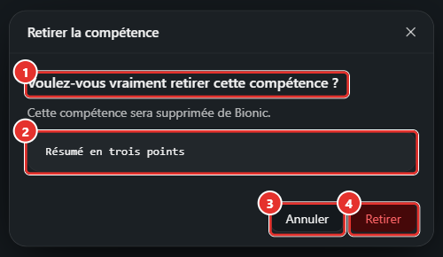
*Figure 12 — « Retirer la compétence » : ① question, ② compétence concernée, ③ Annuler, ④ Retirer. Après confirmation, `%USERPROFILE%\.lmstudio\skills` est redevenu vide [Vérifié].*

---

## 7. Bonnes pratiques et sécurité

| Principe | Détail |
|---|---|
| **Une description qui déclenche** | Dire **quand** utiliser la compétence (« lorsque des notes de réunion sont fournies ») : c'est le texte que l'agent lit pour décider ; moins de 150 caractères |
| **Un objectif par compétence** | Compétences courtes et ciblées |
| **Contraintes vérifiables** | Première ligne imposée, sections nommées, ligne finale : faciles à contrôler ; éviter les consignes que le modèle suit mal (comptage de mots) ou les vérifier |
| **Témoin systématique** | Rejouer la même consigne **sans** la compétence pour mesurer ce qu'elle apporte |
| **Relire avant d'installer** | `SKILL.md` en entier : une compétence est une **instruction permanente** et peut demander des commandes, des accès ou des envois ; l'application impose une approbation, la relecture reste à faire ([Manuel Bionic 08](08-competences-et-mcp.md#6-sécurité)) |
| **Lecture hors projet** | Un dossier extérieur au projet exige une autorisation (figure 7) : ne l'accorder que pour la session |
| **Nettoyer les essais** | Supprimer les copies temporaires créées par l'agent dans le projet et retirer les compétences d'essai |

---

## 8. Dépannage

| Symptôme | Cause probable | Action |
|---|---|---|
| La compétence n'apparaît pas dans la palette | Nom du dossier ≠ `name` ; en-tête absent ; compétence désactivée ; recherche avec accents | Contrôler l'en-tête ; Réglages → Compétences ; taper `@` seul et parcourir |
| La palette ne s'ouvre pas | Caractère ordinaire avant `@` | Placer `@` en début de mot, après un espace ou un retour à la ligne |
| Un **dossier** ou un **fichier** est inséré au lieu de la compétence | Mauvaise entrée choisie (même nom) | Choisir l'entrée à icône de compétence |
| L'agent annonce avoir créé ou installé la compétence, mais elle n'existe pas | Hallucination d'une action (modèle de petite taille) | Vérifier le dossier global et les réglages ; ne jamais se fier à l'annonce |
| « No Bionic tool named '…' is available » | L'agent traite la compétence comme un outil | Déclencher avec `@`, ou rappeler que la compétence est un **fichier à lire** |
| Résultat non conforme (15 mots, introduction) | Contrainte mal suivie par le modèle | Reformuler la contrainte, modèle plus grand, contrôle après coup |
| Installation bloquée sur une demande d'accès à un dossier | Dossier source hors du projet | Autoriser pour la session ou copier la compétence dans le projet |
