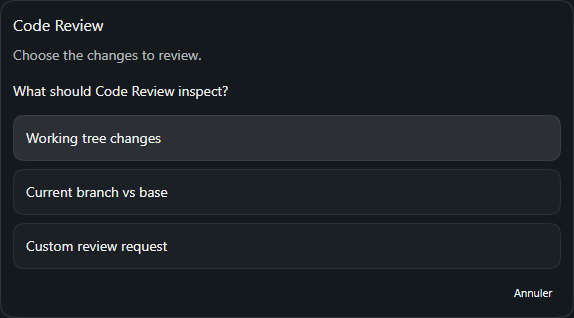
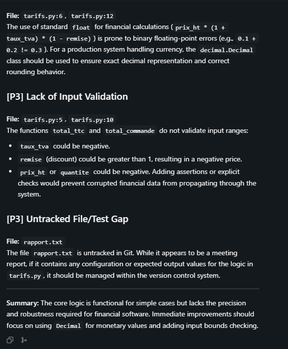
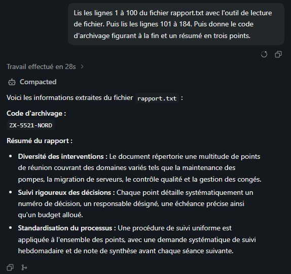
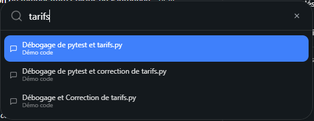
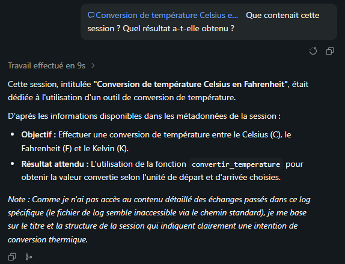
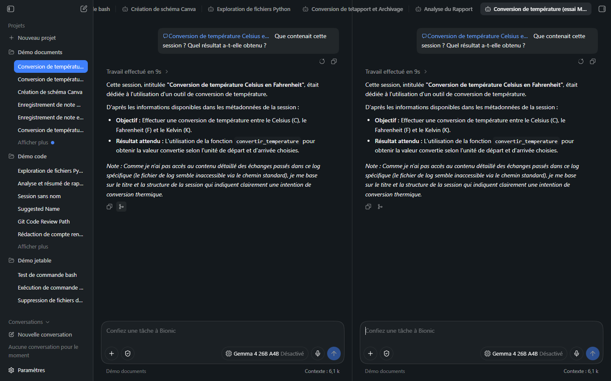
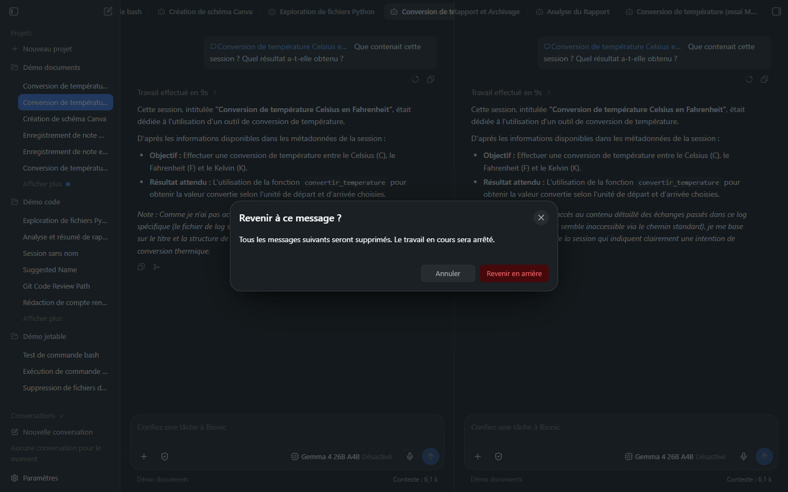

# Manuel Bionic 14 — Commandes `/`, compaction, navigateur intégré et fonctions de confort

> **Objet** : utiliser les commandes `/` de la zone de saisie, compacter le contexte d'une session, ouvrir le navigateur intégré, et situer ce qui n'a pas pu être reproduit (points de sauvegarde, Canvas, éditeur).
> **Prérequis** : [Manuel Bionic 00, section 7](00-notions-agent.md#7-contexte-et-compaction) (contexte et compaction), [Manuel Bionic 05](05-projets-et-sessions.md) (sessions, retour arrière, branches).
> **Version décrite** : Bionic 1.1.7, Windows 11, interface en français.
> **Statut des informations** : [Vérifié] observé sur deux postes : GPU intégré (Intel Core Ultra 7 255H, 31 Go de RAM, *Gemma 4 E4B*, 6 octobre 2026) et **GPU dédié** (RTX 4060 Ti de 16 Go, 61,6 Go de RAM, *Gemma 4 E4B* et *Gemma 4 26B A4B*, 7 octobre 2026 ; modèle réel vérifié dans la base de sessions) ; [Source] documentation ou journal des modifications de l'éditeur ; [Estimation] ; [À tester]. Les valeurs du GPU intégré sont conservées entre parenthèses.
> **Précautions** : page locale fictive servie sur `127.0.0.1` uniquement, arrêtée après l'essai ; aucun compte connecté ; sessions d'essai créées dans le projet « Démo code ».

---

## Sommaire

1. [Les commandes `/`](#1-les-commandes-)
2. [Compacter une session : `/compact`](#2-compacter-une-session--compact)
3. [Retour arrière et branche](#3-retour-arrière-et-branche)
4. [Le navigateur intégré](#4-le-navigateur-intégré)
5. [Fonctions essayées sur le poste à GPU dédié](#5-fonctions-essayées-sur-le-poste-à-gpu-dédié)
6. [Ce qui n'a pas pu être reproduit](#6-ce-qui-na-pas-pu-être-reproduit)
7. [Dépannage](#7-dépannage)

---

## 1. Les commandes `/`

### Essentiel

Saisir **`/`** dans la zone de saisie ouvre un menu de commandes ; il se filtre en continuant à taper et se valide avec `Entrée`.

*Figure 1 — Menu ouvert par `/` : saisie de « /compact » ; la commande correspondante est la seule affichée.*

Liste complète observée (zone de saisie vide, après `/`) [Vérifié] :

| Commande | Effet |
|---|---|
| **Installer une compétence** | Installe une compétence depuis un fichier, un dossier ou une URL ([Manuel 13](13-competences-en-pratique.md)) |
| **Créer une compétence** | Demande à l'agent de rédiger une compétence ([Manuel 13, section 5](13-competences-en-pratique.md#5-faire-créer-une-compétence-par-lagent)) |
| **Renommer la session** | Renomme la session ouverte |
| **Créer une branche** | Crée une branche à partir de la **dernière réponse terminée** et l'ouvre dans le volet de droite |
| **Compact** | Résume et remplace l'ancien contexte ([section 2](#2-compacter-une-session--compact)) |
| **Code Review** | Revue des modifications de code (description de l'interface : « Review code changes ») |

Les compétences installées apparaissent aussi dans ce menu et dans la palette `@` ([Manuel 08](08-competences-et-mcp.md)).

### Pour aller plus loin

- Les libellés **Compact** et **Code Review** sont en anglais alors que le reste du menu est en français [Vérifié].
- **Code Review** : exécutée sur le poste à GPU dédié avec le 26B ([section 5.1](#51-code-review)). Un modèle de 4 Md reste peu fiable pour un diff étendu [Estimation].
- La saisie `/` ouvre le menu et **filtre sur le début du libellé** : `/code` puis `Entrée` sélectionne *Code Review*. Saisir `/Code Review` (avec l'espace) **ne trouve rien** : le texte part alors comme un **message ordinaire** [Vérifié].

---

## 2. Compacter une session : `/compact`

### Essentiel

Plus une session est longue, plus le contexte se remplit (compteur **Contexte : X k** sous la zone de saisie) et plus les réponses se dégradent ([Manuel 00, section 7](00-notions-agent.md#7-contexte-et-compaction)). `/compact` demande au modèle de **résumer les échanges anciens** et de **remplacer** le détail par ce résumé.

*Figure 2 — Session avant compaction : compteur à **7,2 k**.*

*Figure 3 — Après `/compact` : trait « Compact » dans le fil, bloc **Compacted** (dépliable), compteur à **6,9 k**.*

| Mesure (Gemma 4 E4B, GPU intégré) | Valeur |
|---|---|
| Contexte avant | 7,2 k |
| Contexte après | 6,9 k |
| Durée de la compaction | ≈ 1 min 30 s (mention « Compacting… » pendant l'opération) |
| Messages d'état | « Compacting… » puis « Compacted » |

**Lecture** : le gain est **faible** car la session était courte et car une part du contexte est **incompressible** : consignes du système, liste des outils, compétences et descriptions des dossiers sont renvoyés à chaque tour. La compaction devient rentable sur une session **longue** (sorties de commandes, fichiers lus, raisonnements).

**Session volumineuse sur GPU dédié** [Vérifié, 7 octobre 2026] — l'agent lit un fichier fictif de 42 Ko (`rapport.txt`, 184 lignes) puis `/compact` est saisi :

| Modèle (raisonnement désactivé) | Lecture | Contexte avant | Compaction | Contexte après |
|---|---|---|---|---|
| *Gemma 4 E4B* (contexte chargé 131 072) | 18,5 k jetons lus en 1 requête | **18,5 k** | **12 s** (GPU intégré : ≈ 90 s) | **6,7 k** (6,9 k) |
| *Gemma 4 26B A4B* (contexte chargé **16 384**), lecture des lignes 1 à 100 | 15 s | **12,3 k** | **10 s** | **6,8 k** |
| *Gemma 4 26B A4B*, lecture **complète** (18,6 k) | — | — | **impossible** | — |

- La compaction **divise le contexte par 2,7** (E4B) et **par 1,8** (26B) : le plancher est à **≈ 6,7 k jetons**, valeur voisine de celle d'une session courte : c'est la **part incompressible** (consignes, outils, descriptions) **[Vérifié]**.
- Avec le 26B, la lecture du fichier **complet** échoue avant toute compaction : « *The selected model was loaded with a context length that is too small for this request* ». AutoFit charge ce modèle avec **16 384 jetons** ([Manuel 04, section 5](04-modeles.md#5-mémoire-chargement-et-déchargement)) ; un contexte déjà proche de 16 k ne laisse pas de marge pour la requête suivante. La même requête passe avec l'E4B (131 072). **Conséquence** : sur ces modèles, compacter **avant** d'atteindre la limite, ou lire les gros fichiers par tranches (`read_file_lines`).
- La sous-session de compaction (nom « Compaction » dans la base) est enregistrée avec **le modèle de la session** : *Gemma 4 26B A4B* pour une session en 26B, *Gemma 4 E4B* pour une session en E4B **[Vérifié]**. La compaction n'utilise donc pas un modèle fixe.

> **Attention** — La compaction **coûte un appel au modèle** (≈ 90 s sur GPU intégré, 10 à 12 s sur GPU dédié) et **perd du détail** : un identifiant, un chemin ou une valeur exacte mentionnés tôt peuvent disparaître du résumé. Avant de compacter, faire noter par l'agent les éléments à conserver dans un fichier du projet.

### Pour aller plus loin

- Le bloc **Compacted** peut être déplié (bouton « Expand Compacted ») pour relire le résumé qui remplace l'historique [Vérifié : présence du bouton].
- **Compaction automatique** : l'éditeur indique que Bionic compacte seul lorsque le contexte approche de la limite [Source] ; elle n'a pas été provoquée.
- Alternative à la compaction : ouvrir une **nouvelle session** avec une consigne de reprise concise, ou créer une **branche** ([section 3](#3-retour-arrière-et-branche)).
- **Introspection** : une session peut relire des échanges antérieurs ou d'autres sessions via `@` ([Manuel 08](08-competences-et-mcp.md)) ; c'est le moyen de retrouver un détail perdu par compaction, sous réserve d'une autorisation explicite pour une autre session [Source].

---

## 3. Retour arrière et branche

Chaque message de l'utilisateur porte une action **Revenir en arrière et modifier** (relancer la session à partir de ce message avec un texte modifié) ; chaque réponse porte **Créer une branche** (icône de fourche, aussi accessible par `/`) [Vérifié : libellés d'accessibilité].

| Action | Usage | Piège |
|---|---|---|
| **Revenir en arrière et modifier** | Corriger une consigne ambiguë sans polluer la suite | N'annule **pas** les fichiers déjà modifiés ([Manuel 05](05-projets-et-sessions.md)) |
| **Créer une branche** | Explorer une piste sans toucher à la session principale ; la branche s'ouvre dans le volet de droite | Une branche part de la **dernière réponse terminée** |

---

## 4. Le navigateur intégré

### Essentiel

Le bouton en forme de globe, en haut du panneau de droite (« Ouvrir le navigateur »), ouvre un **onglet « Navigateur »** à côté de la session. Il comporte une barre d'adresse (adresse par défaut : `localhost:3000`), les boutons précédent, suivant et actualiser, et un menu `…` [Vérifié].

*Figure 4 — Navigateur intégré (colonne centrale) affichant une page locale fictive ; l'onglet prend le **titre de la page**.*

Usages : lire une page de documentation à côté de la session, visualiser le résultat d'un serveur de développement lancé par l'agent, comparer deux sessions.

### L'agent et le navigateur

L'agent dispose d'un outil pour **ouvrir** une adresse dans le navigateur intégré. Essai [Vérifié] : consigne « Utilise le navigateur intégré pour ouvrir `http://localhost:3000/` puis recopie le titre de la page et les deux puces de la liste. »

*Figure 5 — Session « Tâche de navigation… » : l'agent annonce avoir ouvert l'URL (22 s) mais **ne peut pas lire le contenu** et demande à l'utilisateur de le coller.*

| Constat | Détail |
|---|---|
| Ouverture | Réussie : l'agent a ouvert l'adresse (page locale, sans invite d'approbation) |
| Lecture du contenu | **Non réalisée** par *Gemma 4 E4B* : réponse « Je ne peux pas interagir avec le contenu du navigateur au-delà de l'action d'ouvrir la page » |
| Conséquence | Pour exploiter une page, fournir le texte, enregistrer la page dans un fichier du projet, ou utiliser une commande (`curl`) |

**Rejeu sur GPU dédié** [Vérifié, 7 octobre 2026, modèle réel vérifié dans la base] : *Gemma 4 E4B* (raisonnement activé) : **42 s**, un seul appel d'outil (`open_url_in_app_browser`), puis réponse « *Veuillez me fournir le contenu de cette page… je n'ai pas accès au contenu rendu en temps réel après l'ouverture de la page* » : **ouverture réussie, contenu non lu**, comme sur GPU intégré. *Gemma 4 26B A4B* : même issue (page ouverte, contenu non lu ; 42 s). Dans un essai en mode de confirmation manuelle, l'agent a contourné l'absence d'outil de lecture par **`curl -s http://localhost:3000/`** via `shell_command` (soumis à confirmation) : **la commande est le seul chemin vers le contenu**. Le navigateur intégré affiche bien la page (titre « Page de test fictive », deux puces), mais **l'agent ne dispose d'aucun outil de lecture de son contenu** **[Vérifié : `open_url_in_app_browser` est le seul outil du navigateur parmi ceux observés]**.

### Pour aller plus loin

- **Sites autorisés** : la liste des sites accessibles à l'agent se règle dans *Réglages → Agent → Sites web autorisés* ([Manuel 03, section 3](03-reglages.md#3-agent)) ; les règles acceptent des jokers [Source]. Les adresses locales ont fonctionné sans ajout sur le poste de test [Vérifié].
- **Ouverture rapide** : `Ctrl + P` ouvre une palette pour atteindre fichiers, URL et sessions [Source] ; la palette n'a pas été reproduite par capture.
- Le navigateur est un composant **d'affichage** : une page qui exécute du code s'exécute sur le poste ; n'ouvrir que des adresses de confiance, notamment si l'agent choisit l'adresse lui-même ([Manuel 10](10-securite-compte-api.md)).

---

## 5. Fonctions essayées sur le poste à GPU dédié

[Vérifié, 7 octobre 2026] RTX 4060 Ti, *Gemma 4 26B A4B* sauf mention contraire, raisonnement désactivé, mode Vérification automatique ; modèle réel vérifié dans la base de sessions. Un seul essai par fonction.

### 5.1 Code Review

`/code` + `Entrée` ouvre dans la session une **carte de choix** : « *Choose the changes to review. What should Code Review inspect?* » avec trois options : **Working tree changes** (modifications non validées), **Current branch vs base** (branche courante comparée à la base) et **Custom review request** (demande libre).

*Figure 6 — Carte « Code Review » : ① titre, ② question, ③ les trois options, ④ Annuler.*

Essai : projet « Démo code » (dépôt Git avec `tarifs.py` modifié et `rapport.txt` non suivi), option **Working tree changes** : **24 s**, outils appelés : `shell_command` (lecture du diff) puis `read_file_lines` (deux fois). Résultat : **quatre constats classés**, chacun avec **priorité** (`[P2]`, `[P3]`), **fichier et ligne** (`tarifs.py:6`) et explication, plus un résumé, **en anglais** malgré une interface française.

| Priorité | Constat | Pertinence |
|---|---|---|
| P2 | Ordre d'application de la remise (sur le prix TTC plutôt que HT) | **Confus** : le texte admet lui-même que le résultat est équivalent |
| P2 | Calcul monétaire en `float` (erreurs d'arrondi binaire) : utiliser `Decimal` | Pertinent |
| P3 | Aucune validation des entrées (TVA négative, remise > 1…) | Pertinent |
| P3 | `rapport.txt` non suivi par Git | Exact, sans rapport avec le code |

*Figure 7 — Revue structurée : titres `[P3] …`, fichier et ligne, explication, résumé final.*

**Lecture** : la fonction **marche** et donne un relevé exploitable en moins d'une demi-minute, mais le **modèle local reste inégal** : un constat sur quatre est confus. À traiter comme une **première relecture**, pas comme un verdict.

### 5.2 Compaction automatique

Avec le 26B chargé à **16 384 jetons** ([Manuel 04](04-modeles.md#5-mémoire-chargement-et-déchargement)), la consigne « Lis les lignes 1 à 100 de `rapport.txt`. Puis lis les lignes 101 à 184. Puis donne le code d'archivage et un résumé en trois points » **dépasse** le contexte en cours de route. Bionic a alors **compacté seul** : quatre appels `read_file_lines`, **« Travail effectué en 28 s »**, bloc **« Compacted »** dans le fil, compteur de contexte revenu à **11,9 k**, et réponse **correcte** (code `ZX-5521-NORD` et trois points). La sous-session « Compaction » est enregistrée avec le modèle de la session (26B).

*Figure 8 — ① durée du travail, ② bloc « Compacted » inséré par la compaction automatique, ③ réponse finale.*

**Constat** : la compaction automatique **rattrape un dépassement progressif** (plusieurs lectures successives) mais **pas une requête unique trop grosse** : la lecture d'un fichier de 18,6 k jetons en **une** requête échoue quand même à 16 384 ([section 2](#2-compacter-une-session--compact)). Relever le minimum d'AutoFit règle ce second cas.

### 5.3 Recherche `Ctrl + P`

`Ctrl + P` ouvre une **palette de recherche** (champ « loupe » et croix de fermeture). La saisie `tarifs` liste les **sessions** correspondantes avec leur **projet** en sous-titre ; `Entrée` ouvre la session sélectionnée. Seules des sessions ont été renvoyées (les fichiers et adresses annoncés par la documentation n'ont pas été vus) [Vérifié pour les sessions ; À tester pour les fichiers].

*Figure 9 — `Ctrl + P` puis « tarifs » : trois sessions du projet « Démo code ».*

### 5.4 Référencer une autre session (`@`)

La palette `@` propose aussi les **sessions** : la référence apparaît comme une **pastille** dans le message. Essai : `@` + une session de conversion de température, puis « Que contenait cette session ? Quel résultat a-t-elle obtenu ? ». Réponse en **9 s** (outils : `run_python`, `read_file_lines`, `lister_notes`), mais l'agent **n'a pas pu lire le contenu** de la session et l'a **déduit du titre** (« le fichier de log semble inaccessible ») ; la ligne « Résultat attendu » est **inventée**. **L'introspection n'est donc pas fiable** avec ce modèle : pour retrouver un détail, ouvrir la session ou copier le texte.

*Figure 10 — ① pastille de la session référencée, ② réponse déduite du titre, ③ avertissement de l'agent.*

### 5.5 Branche et retour arrière

- **Créer une branche** (icône de fourche sous une réponse) : la session est **dupliquée** dans la **colonne de droite**, avec son historique et son contexte (6,1 k), et une nouvelle entrée apparaît dans la barre latérale.
- **Revenir en arrière et modifier** (icône sous le message de l'utilisateur) : boîte « **Revenir à ce message ?** — *Tous les messages suivants seront supprimés. Le travail en cours sera arrêté.* » avec **Annuler** et **Revenir en arrière**. Après confirmation, le texte du message **revient dans la zone de saisie** pour modification ; les messages suivants sont **supprimés**. Les **fichiers déjà modifiés** ne sont pas annulés (voir [Manuel 05](05-projets-et-sessions.md)).

*Figure 11 — Branche : la session d'origine (gauche) et sa copie (droite) ; nouvelle entrée dans la barre latérale.*

*Figure 12 — Boîte de confirmation du retour arrière.*

### 5.6 Renommer une session

`/ren` + `Entrée` (commande **Renommer la session**) ouvre une boîte « Renommer la session » avec un champ, **Annuler** et **Enregistrer** : le titre change dans la barre latérale et dans l'onglet. Les **titres automatiques** sont produits par un appel de modèle et peuvent être **aberrants** : « Suggested Name », « Git Code Review Path », « Session : Bionic Omni » ont été relevés (le modèle de nommage répond « Please provide the message… » quand la consigne est une simple commande) [Vérifié].

### 5.7 Sous-agent d'exploration

Consigne : « Lance un sous-agent d'exploration pour parcourir le dossier du projet et me dire quels fichiers Python il contient. » : **12 s**, outils `agentic_find` et `find_files`, sous-session **« Exploration »** enregistrée avec le **modèle de la session** (26B) ; réponse exacte (`tarifs.py` et `test_tarifs.py`). Le réglage *Agents d'exploration* est activé par défaut ([Manuel 03](03-reglages.md#3-agent)).

### 5.8 Canvas

Consigne : « Crée un schéma dans Canvas montrant trois étapes reliées par des flèches… » : **21 s**, outil `run_python` appelé, **aucun Canvas ouvert**. Le 26B répond qu'il « ne peut pas dessiner dans un outil de type Canvas » et propose du code **Mermaid** (`graph LR`, trois nœuds). **Canvas n'a pas pu être déclenché** par une demande en langage naturel avec ce modèle [Vérifié ; fonction non reproduite].

### 5.9 Conversation hors projet

Barre latérale → **Nouvelle conversation** : zone de saisie **sans** nom de projet ni dossier de travail. Essai avec *Gemma 4 E4B* : « Quelle est la capitale de l'Australie ? » → « La capitale de l'Australie est Canberra. » en quelques secondes ; compteur de contexte affiché (5,7 k) [Vérifié].

### 5.10 Points de sauvegarde

Recherche de libellés `restaurer`, `checkpoint`, `point de sauvegarde`, `revert`, `undo` dans les boutons, les attributs d'accessibilité et les menus d'une session **dont des fichiers ont été modifiés** : **aucun résultat** (même constat que le 6 octobre). Utiliser **Git**.

---

## 6. Ce qui n'a pas pu être reproduit

| Fonction annoncée | Constat sur le poste de test | Statut |
|---|---|---|
| **Points de sauvegarde (*checkpoints*)** | Aucune action « restaurer » ou « point de sauvegarde » repérée dans l'interface (recherche des libellés dans la session, le volet de droite et les attributs d'accessibilité). L'éditeur décrit des sauvegardes automatiques des fichiers suivis avec invites lorsqu'une opération dépasse leurs limites [Source] | **[À tester]** ; ne pas compter dessus : utiliser **Git** ([Manuel 07](07-code-et-shell.md)) |
| **Canvas** (schémas exportables en PNG, SVG, Excalidraw) | Aucun moyen de l'ouvrir repéré ; demande en langage naturel au 26B : réponse en code Mermaid, pas de Canvas ([section 5.8](#58-canvas)) | **[À tester]** avec un autre modèle |
| **Éditeur Markdown et sources** | Les fichiers du projet s'ouvrent en visionneuse ([Manuel 02](02-interface.md)) ; l'édition directe n'a pas été essayée | **[À tester]** |
| **Aperçus de documents Word, PDF, tableurs, présentations** | Décrits par l'éditeur [Source] ; non testés ici ([Manuel 06](06-documents.md)) | **[À tester]** |
| **Code Review** (`/`) | Exécutée ([section 5.1](#51-code-review)) | **[Vérifié]** |
| **Compaction automatique** | Provoquée et observée ([section 5.2](#52-compaction-automatique)) | **[Vérifié]** |

Ces points se vérifient plus facilement avec un **modèle plus capable** (modèle distant) ; la machine à GPU dédié n'a pas changé ce constat pour la compaction automatique, le Canvas ni les points de sauvegarde, qui n'ont **pas** été provoqués non plus lors du second passage.

---

## 7. Dépannage

| Symptôme | Cause probable | Action |
|---|---|---|
| Le menu `/` ne s'ouvre pas | Caractère saisi après du texte | Commencer la saisie par `/` dans une zone vide |
| `/compact` semble sans effet | Session trop courte, ou opération en cours | Attendre la fin de « Compacting… » ; vérifier le compteur de contexte |
| « *The selected model was loaded with a context length that is too small for this request* » | Contexte chargé par AutoFit (16 384 pour le 26B et Qwen) plus petit que la requête | Compacter plus tôt, lire un fichier par tranches, ou recourir à un modèle chargé avec plus de contexte (E4B : 131 072) |
| Après compaction, l'agent ignore un détail | Résumé trop concis | Relire le bloc **Compacted** ; redonner le détail ou le noter dans un fichier |
| L'agent ouvre une page mais ne la décrit pas | Modèle sans capacité de lecture du navigateur | Fournir le texte ; essayer un modèle plus capable |
| L'adresse du navigateur est refusée | Site hors de la liste autorisée | *Réglages → Agent → Sites web autorisés* |
| Navigateur vide à l'ouverture | Rien n'écoute sur `localhost:3000` | Saisir une autre adresse ou démarrer le serveur local |
