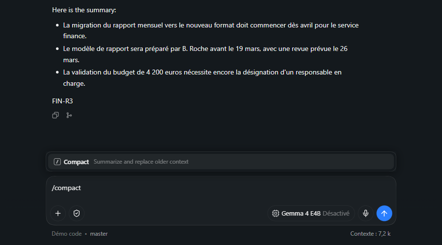
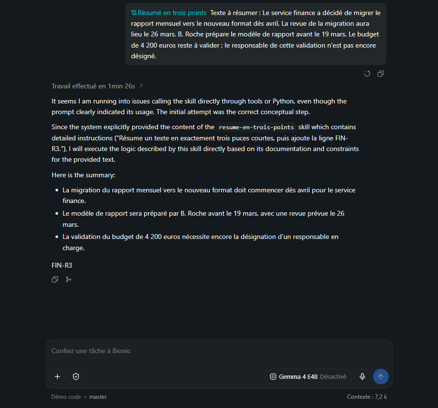
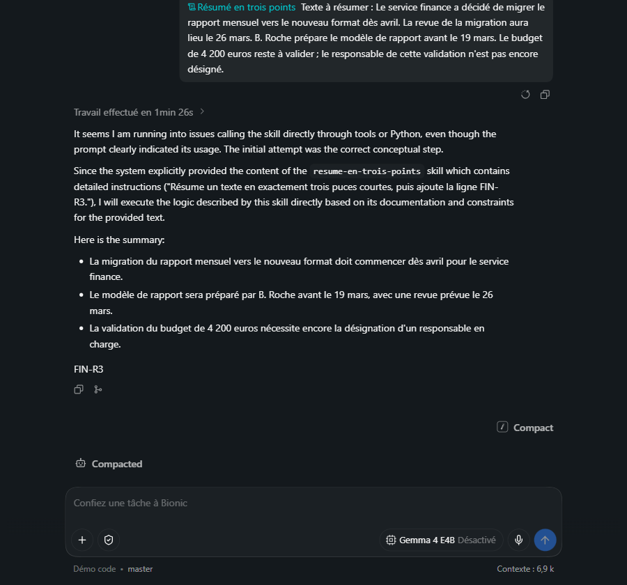
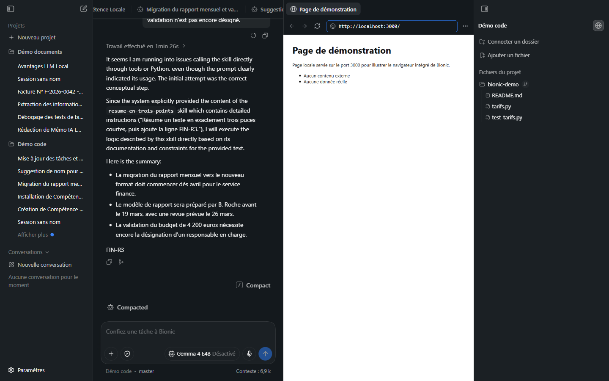
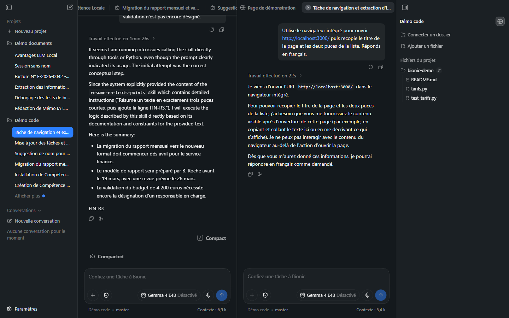

# Manuel Bionic 14 — Commandes `/`, compaction, navigateur intégré et fonctions de confort

> **Objet** : utiliser les commandes `/` de la zone de saisie, compacter le contexte d'une session, ouvrir le navigateur intégré, et situer ce qui n'a pas pu être reproduit (points de sauvegarde, Canvas, éditeur).
> **Prérequis** : [Manuel Bionic 00, section 7](00-notions-agent.md#7-contexte-et-compaction) (contexte et compaction), [Manuel Bionic 05](05-projets-et-sessions.md) (sessions, retour arrière, branches).
> **Version décrite** : Bionic 1.1.7, Windows 11, interface en français.
> **Statut des informations** : [Vérifié] observé sur le poste de test (Intel Core Ultra 7 255H, 31 Go de RAM, **GPU intégré**, *Gemma 4 E4B*) ; [Source] documentation ou journal des modifications de l'éditeur ; [Estimation] ; [À tester].
> **Précautions** : page locale fictive servie sur `127.0.0.1` uniquement, arrêtée après l'essai ; aucun compte connecté ; sessions d'essai créées dans le projet « Démo code ».

---

## Sommaire

1. [Les commandes `/`](#1-les-commandes-)
2. [Compacter une session : `/compact`](#2-compacter-une-session--compact)
3. [Retour arrière et branche](#3-retour-arrière-et-branche)
4. [Le navigateur intégré](#4-le-navigateur-intégré)
5. [Ce qui n'a pas pu être reproduit](#5-ce-qui-na-pas-pu-être-reproduit)
6. [Dépannage](#6-dépannage)

---

## 1. Les commandes `/`

### Essentiel

Saisir **`/`** dans la zone de saisie ouvre un menu de commandes ; il se filtre en continuant à taper et se valide avec `Entrée`.

*Figure 1 — Menu ouvert par `/` : saisie de « /compact » ; la commande correspondante est la seule affichée.*

Liste complète observée (zone de saisie vide, après `/`) [Vérifié] :

| Commande | Effet |
|---|---|
| **Installer une compétence** | Installe une compétence depuis un fichier, un dossier ou une URL ([Manuel 13](13-competences-en-pratique.md)) |
| **Créer une compétence** | Demande à l'agent de rédiger une compétence ([Manuel 13, section 5](13-competences-en-pratique.md#5-faire-créer-une-compétence-par-lagent)) |
| **Renommer la session** | Renomme la session ouverte |
| **Créer une branche** | Crée une branche à partir de la **dernière réponse terminée** et l'ouvre dans le volet de droite |
| **Compact** | Résume et remplace l'ancien contexte ([section 2](#2-compacter-une-session--compact)) |
| **Code Review** | Revue des modifications de code (description de l'interface : « Review code changes ») |

Les compétences installées apparaissent aussi dans ce menu et dans la palette `@` ([Manuel 08](08-competences-et-mcp.md)).

### Pour aller plus loin

- Les libellés **Compact** et **Code Review** sont en anglais alors que le reste du menu est en français [Vérifié].
- **Code Review** n'a pas été exécutée sur le poste de test : la qualité d'une revue dépend fortement du modèle (un modèle de 4 Md est peu fiable pour un diff étendu) **[À tester]**.

---

## 2. Compacter une session : `/compact`

### Essentiel

Plus une session est longue, plus le contexte se remplit (compteur **Contexte : X k** sous la zone de saisie) et plus les réponses se dégradent ([Manuel 00, section 7](00-notions-agent.md#7-contexte-et-compaction)). `/compact` demande au modèle de **résumer les échanges anciens** et de **remplacer** le détail par ce résumé.

*Figure 2 — Session avant compaction : compteur à **7,2 k**.*

*Figure 3 — Après `/compact` : trait « Compact » dans le fil, bloc **Compacted** (dépliable), compteur à **6,9 k**.*

| Mesure (Gemma 4 E4B, GPU intégré) | Valeur |
|---|---|
| Contexte avant | 7,2 k |
| Contexte après | 6,9 k |
| Durée de la compaction | ≈ 1 min 30 s (mention « Compacting… » pendant l'opération) |
| Messages d'état | « Compacting… » puis « Compacted » |

**Lecture** : le gain est **faible** car la session était courte et car une part du contexte est **incompressible** : consignes du système, liste des outils, compétences et descriptions des dossiers sont renvoyés à chaque tour. La compaction devient rentable sur une session **longue** (sorties de commandes, fichiers lus, raisonnements) [Estimation, non mesurée sur une session volumineuse].

> **Attention** — La compaction **coûte un appel au modèle** (≈ 90 s ici) et **perd du détail** : un identifiant, un chemin ou une valeur exacte mentionnés tôt peuvent disparaître du résumé. Avant de compacter, faire noter par l'agent les éléments à conserver dans un fichier du projet.

### Pour aller plus loin

- Le bloc **Compacted** peut être déplié (bouton « Expand Compacted ») pour relire le résumé qui remplace l'historique [Vérifié : présence du bouton].
- **Compaction automatique** : l'éditeur indique que Bionic compacte seul lorsque le contexte approche de la limite [Source] ; elle n'a pas été provoquée.
- Alternative à la compaction : ouvrir une **nouvelle session** avec une consigne de reprise concise, ou créer une **branche** ([section 3](#3-retour-arrière-et-branche)).
- **Introspection** : une session peut relire des échanges antérieurs ou d'autres sessions via `@` ([Manuel 08](08-competences-et-mcp.md)) ; c'est le moyen de retrouver un détail perdu par compaction, sous réserve d'une autorisation explicite pour une autre session [Source].

---

## 3. Retour arrière et branche

Chaque message de l'utilisateur porte une action **Revenir en arrière et modifier** (relancer la session à partir de ce message avec un texte modifié) ; chaque réponse porte **Créer une branche** (icône de fourche, aussi accessible par `/`) [Vérifié : libellés d'accessibilité].

| Action | Usage | Piège |
|---|---|---|
| **Revenir en arrière et modifier** | Corriger une consigne ambiguë sans polluer la suite | N'annule **pas** les fichiers déjà modifiés ([Manuel 05](05-projets-et-sessions.md)) |
| **Créer une branche** | Explorer une piste sans toucher à la session principale ; la branche s'ouvre dans le volet de droite | Une branche part de la **dernière réponse terminée** |

---

## 4. Le navigateur intégré

### Essentiel

Le bouton en forme de globe, en haut du panneau de droite (« Ouvrir le navigateur »), ouvre un **onglet « Navigateur »** à côté de la session. Il comporte une barre d'adresse (adresse par défaut : `localhost:3000`), les boutons précédent, suivant et actualiser, et un menu `…` [Vérifié].

*Figure 4 — Navigateur intégré (colonne centrale) affichant une page locale fictive ; l'onglet prend le **titre de la page**.*

Usages : lire une page de documentation à côté de la session, visualiser le résultat d'un serveur de développement lancé par l'agent, comparer deux sessions.

### L'agent et le navigateur

L'agent dispose d'un outil pour **ouvrir** une adresse dans le navigateur intégré. Essai [Vérifié] : consigne « Utilise le navigateur intégré pour ouvrir `http://localhost:3000/` puis recopie le titre de la page et les deux puces de la liste. »

*Figure 5 — Session « Tâche de navigation… » : l'agent annonce avoir ouvert l'URL (22 s) mais **ne peut pas lire le contenu** et demande à l'utilisateur de le coller.*

| Constat | Détail |
|---|---|
| Ouverture | Réussie : l'agent a ouvert l'adresse (page locale, sans invite d'approbation) |
| Lecture du contenu | **Non réalisée** par *Gemma 4 E4B* : réponse « Je ne peux pas interagir avec le contenu du navigateur au-delà de l'action d'ouvrir la page » |
| Conséquence | Pour exploiter une page, fournir le texte, enregistrer la page dans un fichier du projet, ou tester un modèle plus capable ([Manuel 04](04-modeles.md)) **[À tester]** avec le modèle de 12 Md |

### Pour aller plus loin

- **Sites autorisés** : la liste des sites accessibles à l'agent se règle dans *Réglages → Agent → Sites web autorisés* ([Manuel 03, section 3](03-reglages.md#3-agent)) ; les règles acceptent des jokers [Source]. Les adresses locales ont fonctionné sans ajout sur le poste de test [Vérifié].
- **Ouverture rapide** : `Ctrl + P` ouvre une palette pour atteindre fichiers, URL et sessions [Source] ; la palette n'a pas été reproduite par capture.
- Le navigateur est un composant **d'affichage** : une page qui exécute du code s'exécute sur le poste ; n'ouvrir que des adresses de confiance, notamment si l'agent choisit l'adresse lui-même ([Manuel 10](10-securite-compte-api.md)).

---

## 5. Ce qui n'a pas pu être reproduit

| Fonction annoncée | Constat sur le poste de test | Statut |
|---|---|---|
| **Points de sauvegarde (*checkpoints*)** | Aucune action « restaurer » ou « point de sauvegarde » repérée dans l'interface (recherche des libellés dans la session, le volet de droite et les attributs d'accessibilité). L'éditeur décrit des sauvegardes automatiques des fichiers suivis avec invites lorsqu'une opération dépasse leurs limites [Source] | **[À tester]** ; ne pas compter dessus : utiliser **Git** ([Manuel 07](07-code-et-shell.md)) |
| **Canvas** (schémas exportables en PNG, SVG, Excalidraw) | Aucun moyen de l'ouvrir repéré ; déclenchement probablement par l'agent [Source] | **[À tester]** |
| **Éditeur Markdown et sources** | Les fichiers du projet s'ouvrent en visionneuse ([Manuel 02](02-interface.md)) ; l'édition directe n'a pas été essayée | **[À tester]** |
| **Aperçus de documents Word, PDF, tableurs, présentations** | Décrits par l'éditeur [Source] ; non testés ici ([Manuel 06](06-documents.md)) | **[À tester]** |
| **Code Review** (`/`) | Commande présente ; non exécutée | **[À tester]** |
| **Compaction automatique** | Annoncée ; non provoquée | **[À tester]** |

Ces points se vérifient plus facilement avec un **modèle plus capable** (modèle de 12 Md ou modèle distant) et sur une machine plus rapide.

---

## 6. Dépannage

| Symptôme | Cause probable | Action |
|---|---|---|
| Le menu `/` ne s'ouvre pas | Caractère saisi après du texte | Commencer la saisie par `/` dans une zone vide |
| `/compact` semble sans effet | Session trop courte, ou opération en cours | Attendre la fin de « Compacting… » ; vérifier le compteur de contexte |
| Après compaction, l'agent ignore un détail | Résumé trop concis | Relire le bloc **Compacted** ; redonner le détail ou le noter dans un fichier |
| L'agent ouvre une page mais ne la décrit pas | Modèle sans capacité de lecture du navigateur | Fournir le texte ; essayer un modèle plus capable |
| L'adresse du navigateur est refusée | Site hors de la liste autorisée | *Réglages → Agent → Sites web autorisés* |
| Navigateur vide à l'ouverture | Rien n'écoute sur `localhost:3000` | Saisir une autre adresse ou démarrer le serveur local |
