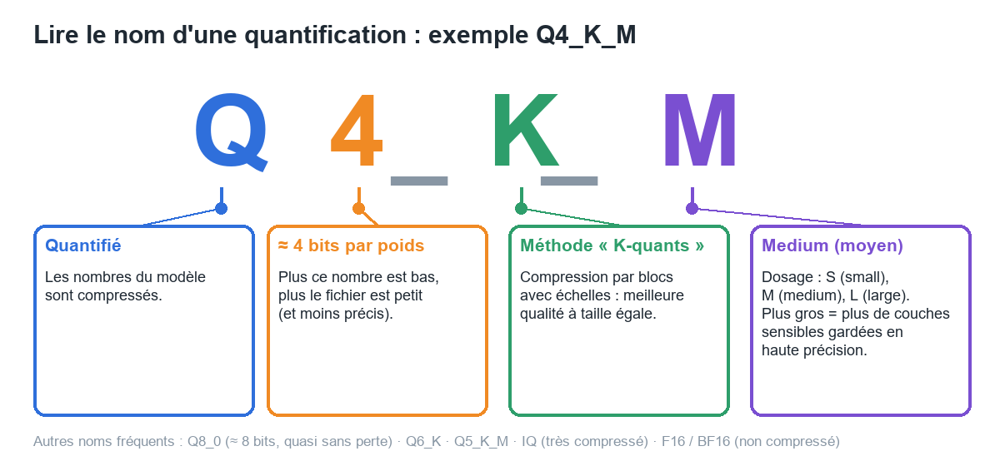
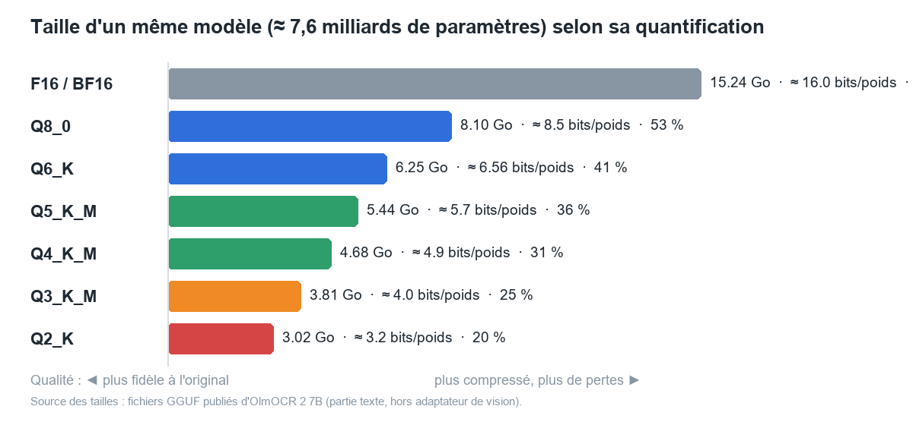
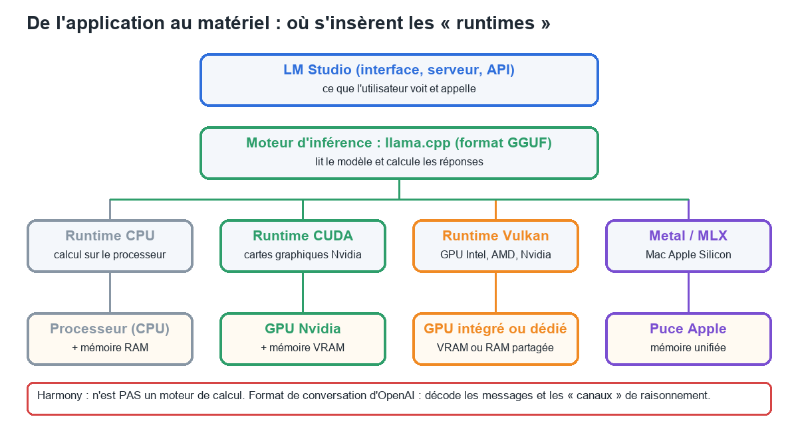
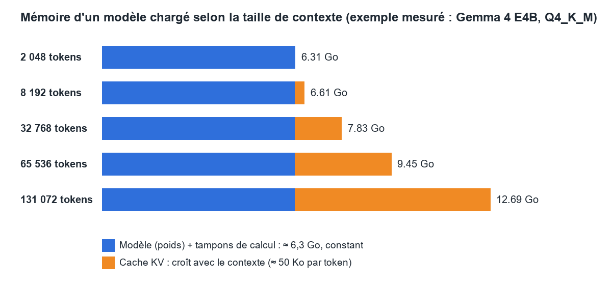
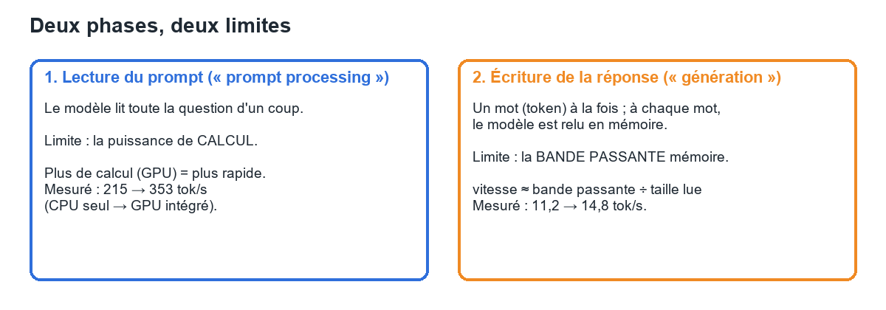

# Manuel 00 — Notions fondamentales : comprendre ce que fait LM Studio

> **Objet** : expliquer simplement les notions techniques rencontrées dans LM Studio — taille d'un modèle, quantification (`Q4_K_M`), CPU, GPU, CUDA, Vulkan, mémoire (RAM, VRAM), contexte, vitesse — et apprendre à **calculer la mémoire nécessaire**.
> **Public** : novices comme utilisateurs expérimentés. Chaque section commence par l'**Essentiel** (lisible sans prérequis), puis propose **Pour aller plus loin**.
> **Lecture** : 40 minutes. À lire avant ou en parallèle des manuels 01 à 10.
> **Exemples** : valeurs mesurées sur le poste de test (Core Ultra 7 255H, 31 Go de RAM, GPU intégré Intel Arc) ; les principes valent pour toute machine.
> **Volontairement absent** : numéros de versions de logiciels. Seuls les **rôles** sont expliqués.

---

## Sommaire

1. [Ce que fait un modèle de langage](#1-ce-que-fait-un-modèle-de-langage)
2. [La taille d'un modèle](#2-la-taille-dun-modèle)
3. [Le fichier du modèle : GGUF, MLX, mmproj](#3-le-fichier-du-modèle--gguf-mlx-mmproj)
4. [La quantification : décoder `Q4_K_M`](#4-la-quantification--décoder-q4_k_m)
5. [Le matériel : CPU, GPU, RAM, VRAM](#5-le-matériel--cpu-gpu-ram-vram)
6. [Les moteurs (runtimes) : CPU, CUDA, Vulkan, Metal, Harmony](#6-les-moteurs-runtimes--cpu-cuda-vulkan-metal-harmony)
7. [Calculer la RAM nécessaire](#7-calculer-la-ram-nécessaire)
8. [Le contexte et le cache KV](#8-le-contexte-et-le-cache-kv)
9. [La vitesse : tokens par seconde](#9-la-vitesse--tokens-par-seconde)
10. [Capacités : raisonnement, vision, outils, embeddings](#10-capacités--raisonnement-vision-outils-embeddings)
11. [Le choix du mot suivant : température et échantillonnage](#11-le-choix-du-mot-suivant--température-et-échantillonnage)
12. [Lexique express](#12-lexique-express)
13. [Parcours selon le profil](#13-parcours-selon-le-profil)

---

## 1. Ce que fait un modèle de langage

**Essentiel**

Un modèle de langage (*LLM*, *Large Language Model*) est un programme qui **prédit le mot suivant**. À partir d'un texte (la question, l'historique, les documents), il calcule quel mot a le plus de chances de venir ensuite, l'écrit, puis recommence avec ce mot ajouté, jusqu'à avoir écrit toute la réponse. C'est une « saisie semi-automatique » extrêmement perfectionnée.

Ce que le modèle « sait » est enregistré dans un très grand tableau de nombres appelés **poids** (ou **paramètres**), obtenus pendant l'**entraînement**. Le fichier d'un modèle **est** ce tableau de nombres.

| Étape | Qui la réalise | Ressources |
|---|---|---|
| **Entraînement** : fabriquer le modèle | L'éditeur du modèle (Google, Allen AI…) | Des milliers de GPU pendant des semaines |
| **Inférence** : utiliser le modèle | **LM Studio**, sur le poste | Un ordinateur ordinaire |

LM Studio ne fait **que de l'inférence** : il ne modifie jamais le modèle et n'apprend rien de nouveau des conversations.

**Pour aller plus loin**

- Le texte est découpé en **tokens** (morceaux de mots). Un token vaut environ 3 à 4 caractères ; en français, 100 mots représentent environ 150 tokens. Tout se compte en tokens : taille du contexte, longueur de réponse, vitesse.
- À chaque token, le modèle calcule une **probabilité pour chaque token possible** (plus de 100 000 candidats) ; un réglage (température, Top P…) décide du choix ([section 11](#11-le-choix-du-mot-suivant--température-et-échantillonnage)).
- Un modèle **ne cherche pas dans une base de données** : il génère à partir de ses poids. Il peut donc produire des erreurs plausibles (« hallucinations »). Les documents fournis dans le chat servent à lui donner la bonne information.

---

## 2. La taille d'un modèle

**Essentiel**

La taille d'un modèle s'exprime en **milliards de paramètres**, notés **B** (*billion*). « 7B » = 7 milliards de nombres. Plus le nombre est grand, plus le modèle est capable en général, mais plus il est **lourd en mémoire** et **lent**.

| Nom du modèle | Lecture |
|---|---|
| `7B`, `27B`, `70B` | 7, 27 ou 70 milliards de paramètres |
| `E4B` (ex. *Gemma 4 E4B*) | **E**ffective 4B : calcule comme un modèle de ≈ 4 milliards, mais le fichier est plus gros (tables supplémentaires) — affiché « 7.5B » dans LM Studio |
| `26B A4B` | **Mixture of Experts** (MoE) : 26 milliards au total, dont **4 milliards actifs** à chaque token |

**Pour aller plus loin — modèle dense ou MoE**

- **Dense** : tous les paramètres travaillent à chaque token. Mémoire et vitesse suivent la taille totale.
- **MoE** (*Mixture of Experts*) : le modèle contient de nombreux « experts » spécialisés, dont seuls quelques-uns travaillent à chaque token. **La mémoire dépend de la taille totale** (tous les experts doivent être en mémoire) ; **la vitesse dépend de la taille active**. Un « 26B A4B » exige la mémoire d'un 26B mais génère presque aussi vite qu'un 4B.
- Les versions **QAT** (*Quantization-Aware Training*) ont été entraînées en tenant compte de la compression ([section 4](#4-la-quantification--décoder-q4_k_m)) : elles perdent moins de qualité une fois compressées.

---

## 3. Le fichier du modèle : GGUF, MLX, mmproj

**Essentiel**

| Terme | Définition |
|---|---|
| **GGUF** | Format de fichier unique (extension `.gguf`) qui contient les poids du modèle **et** les informations pour l'utiliser (vocabulaire, gabarit de conversation, réglages). **Format de ces manuels.** |
| **MLX** | Format réservé aux Mac à puce Apple. |
| **`mmproj`** | Second fichier GGUF qui donne la **vue** au modèle (adaptateur de vision, « projecteur multimodal »). Sans lui, un modèle de vision ne lit pas les images. |

**Pour aller plus loin**

- Les modèles sont publiés par leurs auteurs au format d'entraînement (*safetensors*, non utilisable tel quel dans LM Studio). Des tiers (**lmstudio-community**, **bartowski**…) les **convertissent en GGUF** et en proposent plusieurs quantifications.
- Un même modèle existe donc en plusieurs fichiers : `…-Q4_K_M.gguf`, `…-Q8_0.gguf`, etc. Le nom indique la quantification.

---

## 4. La quantification : décoder `Q4_K_M`

**Essentiel**

Les poids d'un modèle sont des nombres décimaux. Stockés avec une précision maximale (16 bits chacun), un modèle de 7 milliards de paramètres occupe **≈ 15 Go**. La **quantification** consiste à **arrondir ces nombres** pour les stocker sur moins de bits : le fichier devient plus petit et plus rapide à lire, au prix d'une **légère perte de précision**.

> **Analogie** — C'est la compression d'une photo en JPEG : le fichier est bien plus léger, l'image reste reconnaissable, mais une compression excessive laisse apparaître des défauts. Il en va de même pour un modèle : Q8 est presque indiscernable de l'original, Q4 reste très bon, Q2 se dégrade nettement.

### 4.1 Lire un nom de quantification


*Figure 1 — Décodage du nom `Q4_K_M`.*

| Partie | Signification | Détail |
|---|---|---|
| **Q** | **Q**uantifié | Les poids sont compressés |
| **4** | **≈ 4 bits** par poids (en réalité ≈ 4,9 bits en moyenne, car certaines parties restent plus précises) | Plus le nombre est petit, plus le fichier est petit et moins il est précis |
| **K** | Famille de méthodes **« K-quants »** | Compression **par blocs**, chaque bloc ayant sa propre échelle : meilleure qualité qu'une compression uniforme à taille égale |
| **M** | **M**edium (moyen) | Dosage de la qualité : **S** (*small*) = le plus compact, **M** = équilibré, **L** (*large*) = le plus précis. Les variantes M et L conservent en haute précision les couches les plus sensibles |

### 4.2 Les autres noms rencontrés

| Nom | Signification | Usage |
|---|---|---|
| **F32**, **F16**, **BF16** | Nombres sur 32 ou 16 bits : **non compressé** | Référence ; fichiers très lourds |
| **Q8_0** | 8 bits, méthode simple (suffixe `_0`) | Quasi sans perte ; gros fichier |
| **Q6_K**, **Q5_K_M**, **Q4_K_M**, **Q3_K_M**, **Q2_K** | K-quants à ≈ 6, 5, 4, 3, 2 bits | Du plus fidèle au plus compressé |
| **Q4_0**, **Q4_1**, **Q5_0**, **Q5_1** | Anciennes méthodes (suffixes `_0`, `_1`) | Moins efficaces que les K-quants à taille égale |
| **Q3_K_S**, **Q3_K_L**, **Q4_K_S**, **Q5_K_S** | Les autres dosages **S** (compact) et **L** (précis) d'une même famille K | Quelques centaines de Mo d'écart avec la version M |
| **IQ1**, **IQ2**, **IQ3**, **IQ4** (« i-quants ») | Compression très poussée, guidée par une **matrice d'importance** (*imatrix*) | Très petites tailles ; dans les dépôts, les fichiers **« i1 »** utilisent cette méthode |
| **XXS**, **XS**, **S**, **M**, **NL** (ex. `IQ2_XXS`, `IQ4_NL`) | Sous-variantes d'une famille i-quant, de la plus petite (`XXS`) à la plus grande ; `NL` = table de valeurs non linéaire | À taille égale, souvent plus fidèles qu'une `Q` classique |
| **UD** et **XL** (ex. `UD-Q4_K_XL`) | Variantes d'éditeur (*Unsloth Dynamic*) : précision variable couche par couche ; `XL` au-dessus de `L` | Un peu plus grosses que la version standard ; gain à vérifier par essai |
| **TQ1_0**, **TQ2_0** | Quantifications ternaires | Seulement pour les modèles entraînés en ternaire |
| **MXFP4**, **NVFP4** | Flottants 4 bits à échelle partagée par blocs | Format d'origine de certains modèles (*gpt-oss*) ; NVFP4 accéléré sur GPU récents |
| **MLX 4 bits / 8 bits** | Quantification par groupes de poids du format MLX | Mac Apple Silicon uniquement |
| **QAT** | Modèle **entraîné** pour être compressé | Meilleure qualité à 4 bits que la compression après coup |

> **Formats non chargeables** — **AWQ** et **GPTQ** sont des formats de quantification propres à d'autres moteurs : LM Studio ne les charge pas. Le catalogue complet des noms, avec les bits par poids et la lecture d'une liste réelle (*Download Options*), figure au [Manuel 02, section 5](02-selectionner-et-telecharger-un-modele.md#5-les-quantifications).

### 4.3 Effet sur la taille


*Figure 2 — Taille d'un même modèle (≈ 7,6 milliards de paramètres) selon sa quantification. Valeurs réelles des fichiers publiés d'OlmOCR 2 7B.*

| Quantification | Bits par poids (≈) | Taille / BF16 | Qualité (règle empirique) |
|---|---|---|---|
| BF16 / F16 | 16 | 100 % | Référence |
| Q8_0 | 8,5 | 53 % | Indiscernable de la référence |
| Q6_K | 6,6 | 41 % | Quasi indiscernable |
| Q5_K_M | 5,7 | 36 % | Très proche |
| **Q4_K_M** | **4,9** | **31 %** | **Perte faible : compromis standard** |
| Q3_K_M | 4,0 | 25 % | Perte sensible |
| Q2_K | 3,2 | 20 % | Perte nette ; dernier recours |

**Pour aller plus loin**

- **Taille du fichier ≈ paramètres × bits par poids ÷ 8.** Exemple : 7,6 milliards × 4,9 ÷ 8 ≈ **4,7 Go** (Q4_K_M).
- **Vitesse** : la génération est limitée par la quantité de mémoire lue à chaque token ([section 9](#9-la-vitesse--tokens-par-seconde)). Un fichier deux fois plus petit se lit deux fois plus vite : **Q4 génère environ deux fois plus vite que Q8** sur un même matériel.
- **Petits modèles** : plus un modèle est petit, plus la compression se paie en qualité. Un modèle de 3 B en Q4 se dégrade davantage qu'un 70 B en Q4.
- **Tâches sensibles** (chiffres, OCR, code) : monter en Q6_K ou Q8_0 si la mémoire le permet.
- **Cache KV** : il peut être quantifié séparément (types `F16`, `Q8_0`, `Q4_0`…, [Manuel 03](03-charger-un-modele.md)) ; c'est un autre réglage que la quantification des poids.

---

## 5. Le matériel : CPU, GPU, RAM, VRAM

**Essentiel**

| Composant | Rôle | Analogie |
|---|---|---|
| **CPU** (processeur) | Cerveau généraliste de l'ordinateur ; peut faire tourner un modèle, mais **lentement** | Un ouvrier très polyvalent |
| **GPU** (carte graphique) | Spécialisé dans les calculs massivement parallèles : **fait tourner les modèles bien plus vite** | Une équipe de milliers d'ouvriers spécialisés |
| **RAM** | Mémoire principale de l'ordinateur ; le modèle y est chargé | L'établi |
| **VRAM** | Mémoire propre à une carte graphique dédiée ; très rapide | L'établi réservé à l'équipe spécialisée |

Un modèle doit **tenir en mémoire** pour fonctionner : il est copié depuis le disque dans la RAM et/ou la VRAM au chargement.

**Deux types de GPU**

| Type | Mémoire | Conséquence |
|---|---|---|
| **GPU dédié** (carte séparée) | **VRAM** propre, très rapide (de 8 à plus de 24 Go) | Rapide ; le modèle doit tenir dans la VRAM pour tirer pleinement parti de la carte |
| **GPU intégré** (dans le processeur) | **Partage la RAM** de l'ordinateur | Aucune VRAM supplémentaire ; accélération modeste ; toute la RAM est utilisable |

> **Exemple (poste de test)** — GPU intégré Intel Arc : LM Studio affiche « VRAM 17,9 Go » pour 31,4 Go de RAM : ce n'est pas de la mémoire en plus, mais la part de la RAM que le GPU peut utiliser.

Sur les **Mac Apple Silicon**, une **mémoire unifiée** est partagée entre processeur et GPU, avec un débit élevé.

**Pour aller plus loin**

- **GPU Offload** (LM Studio) : le modèle est composé de **couches** empilées ; le curseur indique combien sont placées sur le GPU. Toutes sur le GPU = plus rapide ; une partie seulement = le reste est calculé par le CPU, plus lent. Dans l'exemple mesuré, la part de mémoire sur le GPU est proportionnelle au nombre de couches choisies ([Manuel 03](03-charger-un-modele.md#52-effet-des-autres-paramètres-sur-lestimation-contexte-8-192)).
- **Bande passante mémoire** : débit (en Go/s) avec lequel le processeur ou le GPU lit la mémoire. Ordres de grandeur : RAM de PC portable ou de bureau (double canal) ≈ 50 à 100 Go/s ; GPU dédié grand public ≈ 250 à 1 000 Go/s ; Mac Apple Silicon ≈ 100 à 800 Go/s. **C'est elle, bien plus que la puissance de calcul, qui limite la vitesse de génération** ([section 9](#9-la-vitesse--tokens-par-seconde)). C'est pourquoi un GPU dédié est nettement plus rapide qu'un GPU intégré.
- **Jeux d'instructions CPU** : **AVX2** est le jeu d'instructions que les moteurs de LM Studio exigent pour calculer sur processeur ; la page *Hardware* de LM Studio indique s'il est présent.

---

## 6. Les moteurs (runtimes) : CPU, CUDA, Vulkan, Metal, Harmony

**Essentiel**

Le fichier du modèle n'est qu'une liste de nombres : il faut un **moteur d'inférence** pour calculer avec. LM Studio s'appuie sur **llama.cpp**, un moteur libre. Ce moteur existe en **plusieurs variantes**, appelées **runtimes** ou *backends*, chacune adaptée à un **type de matériel**. LM Studio choisit celle qui est **sélectionnée** dans *Settings → Runtime* ([Manuel 01](01-prise-en-main.md#68-runtime-ctrl--maj--r)).


*Figure 3 — Du logiciel au matériel. Sur Mac, llama.cpp utilise Metal ; MLX est un autre moteur, propre aux Mac.*

| Runtime | Pour quel matériel | Rôle |
|---|---|---|
| **CPU** | Tout ordinateur (processeur compatible AVX2) | Calcule sur le processeur. Fonctionne partout, **le plus lent** |
| **CUDA** | Cartes graphiques **Nvidia** | Utilise la plateforme de calcul propre à Nvidia (**CUDA**). **Le plus rapide sur une carte Nvidia**. Inutilisable sans carte Nvidia (le runtime apparaît « Non compatible ») |
| **Vulkan** | GPU **Intel, AMD** et **Nvidia** (dédiés ou intégrés) | Utilise **Vulkan**, une interface graphique et de calcul standard compatible avec la plupart des cartes. **Choix universel** quand CUDA n'est pas disponible, notamment pour les GPU **intégrés** Intel et AMD |
| **Metal / MLX** | **Mac** Apple Silicon | Moteurs optimisés pour les puces Apple (MLX : format de modèle spécifique) |
| **Harmony** | — | **N'est pas un moteur de calcul.** Format de conversation défini par OpenAI : il **décode et reconstruit** les messages d'une conversation (rôles, étapes de raisonnement, appels d'outils) pour les modèles qui l'utilisent. Il ne fait aucun calcul |

**Choisir un runtime**

| Machine | Runtime recommandé |
|---|---|
| Carte graphique **Nvidia** | **CUDA** |
| GPU intégré ou carte **Intel / AMD** | **Vulkan** |
| Aucun GPU exploitable | **CPU** |
| **Mac** Apple Silicon | Metal ou MLX |

**Pour aller plus loin**

- **Pourquoi plusieurs paquets de moteur ?** Les moteurs sont distribués **séparément de l'application** et se mettent à jour indépendamment : de nouveaux modèles ou de nouvelles optimisations arrivent par une mise à jour de moteur, sans changer LM Studio. Une mise à jour télécharge un paquet (de quelques Mo à plus de 200 Mo) : à éviter en connexion limitée ([Manuel 01](01-prise-en-main.md#8-points-de-vigilance)).
- **« GPU survey unsuccessful »** : LM Studio n'a pas trouvé de matériel compatible avec ce runtime (ex. aucun GPU Nvidia pour CUDA) ; le runtime est alors marqué non compatible, sans conséquence si un autre convient.
- **Comparer les runtimes** sur une même machine est possible avec la même quantification et le même contexte : mesurer vitesse de lecture du prompt et vitesse de génération ([Manuel 03](03-charger-un-modele.md#54-vitesse-selon-le-déchargement-gpu)).
- **Mesure sur carte Nvidia (RTX 4060 Ti)**, Gemma 4 E4B Q8_0 entièrement sur le GPU : **CUDA** 3 746 tok/s en lecture du prompt et 45 tok/s en génération ; **Vulkan** 2 659 et 46 tok/s ; **CPU** (AVX2) 49 et 8,8 tok/s. La génération est la même pour CUDA et Vulkan (limitée par la mémoire) ; la lecture du prompt est 41 % plus rapide en CUDA. Le moteur CUDA accélère aussi la lecture du prompt quand **aucune** couche n'est sur le GPU (700 tok/s) ([Manuel 15, section 2](15-performances-gpu-dedie.md#2-moteurs-et-nombre-de-couches-sur-le-gpu)).

---

## 7. Calculer la RAM nécessaire

**Essentiel**

La mémoire nécessaire se compose de **trois parties** :

```text
Mémoire nécessaire  ≈  poids du modèle  +  cache KV (dépend du contexte)  +  tampons de calcul (≈ 0,5 Go)
```

| Partie | Signification | Se calcule |
|---|---|---|
| **Poids du modèle** | Le fichier GGUF chargé en mémoire | Taille du fichier, ou paramètres × bits ÷ 8 |
| **Cache KV** | Mémoire de travail qui grandit avec la **longueur du contexte** ([section 8](#8-le-contexte-et-le-cache-kv)) | Contexte × coût par token |
| **Tampons de calcul** | Zones temporaires du moteur | ≈ 0,3 à 0,5 Go |

**Règle pratique** : prévoir **fichier + 20 à 30 %**, puis laisser **20 % de la RAM libre** pour Windows et les autres applications.

### 7.1 Exemple pas à pas

*Modèle de 7,6 milliards de paramètres en Q6_K, contexte de 16 384 tokens* (cas d'OlmOCR 2) :

| Étape | Calcul | Résultat |
|---|---|---|
| 1. Poids | 7,62 Md × 6,56 bits ÷ 8 | **6,25 Go** (vérifié : fichier publié de 6,25 Go) |
| 2. Cache KV par token | 2 (K et V) × 28 couches × 4 têtes × 128 dimensions × 2 octets | **57 Ko** |
| 3. Cache KV total | 57 Ko × 16 384 tokens | **0,94 Go** |
| 4. Tampons | forfait | **0,5 Go** |
| **Total** | 6,25 + 0,94 + 0,5 | **≈ 7,7 Go** |
| **RAM conseillée** | 7,7 ÷ 0,8 | **≈ 9,6 Go** |

Le script [`exemples/09_calculateur_memoire.py`](../../exemples/09_calculateur_memoire.py) automatise ce calcul :

```powershell
python exemples\09_calculateur_memoire.py --params 7.62 --quant Q6_K --couches 28 --tetes-kv 4 --dim-tete 128 --contexte 16384
```

```text
Poids du modèle    :   6.25 Go  (7.62 Md de paramètres × 6.56 bits / 8)
Cache KV           :   0.94 Go  (57 Ko/token × 16384 tokens)
Tampons de calcul  :   0.50 Go
TOTAL estimé       :   7.69 Go  (7.16 Gio)
RAM conseillée     :   9.61 Go  (marge de 20 % pour le système)
```

### 7.2 Où trouver les chiffres de l'architecture

| Donnée | Où la lire |
|---|---|
| Nombre de paramètres, taille du fichier | Page du modèle (*Model Search*), *My Models → Info* |
| Couches, têtes KV, dimension d'une tête | Fiche du modèle (fichier `config.json` : `num_hidden_layers`, `num_key_value_heads`, `head_dim`) |
| Estimation toute faite | **Estimated Memory Usage** dans la fenêtre de chargement ; `lms load <modèle> -c <contexte> --estimate-only` ([Manuel 07](07-cli-lms.md)) |

**L'estimation de LM Studio fait toujours foi** : elle tient compte de l'architecture réelle.

### 7.3 Tableau d'ordres de grandeur

Mémoire approximative pour des modèles denses, contexte 8 192 tokens (valeurs arrondies) :

| Taille du modèle | Q4_K_M | Q6_K | Q8_0 | RAM conseillée (Q4_K_M) |
|---|---|---|---|---|
| **3 B** | ≈ 2,3 Go | ≈ 3,0 Go | ≈ 3,7 Go | 8 Go |
| **7 – 8 B** | ≈ 5,7 Go | ≈ 7,2 Go | ≈ 9,1 Go | 16 Go |
| **14 B** | ≈ 10 Go | ≈ 13 Go | ≈ 16 Go | 16 Go (juste) à 24 Go |
| **32 B** | ≈ 22 Go | ≈ 28 Go | ≈ 36 Go | 32 Go (juste) à 48 Go |
| **70 B** | ≈ 45 Go | ≈ 60 Go | ≈ 77 Go | 64 Go et plus |

*Calcul : poids (paramètres × bits par poids ÷ 8, avec 4,9 / 6,56 / 8,5 bits) + cache KV et tampons forfaitaires (0,5 Go pour 3 B ; 1 Go pour 7-8 B ; 1,5 Go pour 14 B ; 2 Go pour 32 B ; 2,5 Go pour 70 B). La colonne « RAM conseillée » est la RAM **totale** de la machine, marge de 20 % pour le système comprise. **[Estimation]** : valeurs indicatives, à vérifier avec l'estimation de LM Studio.*

### 7.4 Pour aller plus loin

- **Mémoire GPU et RAM** : avec un GPU **dédié**, le déchargement complet exige que poids + cache KV tiennent dans la **VRAM** ; sinon une partie reste en RAM et la vitesse chute (modèle dense de 27 Md sur 16 Go : 3 à 19 tok/s selon la répartition). Avec un GPU **intégré**, seule la RAM compte. **Mesuré** : l'estimation de LM Studio **surestime** la VRAM réellement occupée (jusqu'à × 2 à 131 072 jetons) et la RAM reste mobilisée (≈ 8 Go) même modèle entièrement sur la carte ([Manuel 15, section 5](15-performances-gpu-dedie.md#5-mémoire-réelle-et-estimation)).
- **Écarts avec la formule** : certains modèles (attention à *fenêtre glissante*, architectures hybrides) ont un cache KV **bien plus petit** que la formule ; la mesure est alors plus fiable. *Exemple mesuré : Gemma 4 E4B ≈ 50 Ko par token en F16, cache réel à 8 192 tokens ≈ 0,4 Go.*
- **Quantifier le cache KV** (Q8_0, Q4_0) divise son coût par ≈ 2 ou ≈ 3 : utile pour les très longs contextes ([Manuel 03](03-charger-un-modele.md#53-quantification-du-cache-kv-contexte-32-768)).
- **Modèles MoE** : la mémoire suit la **taille totale** (section 2).
- **Garde-fous** : LM Studio refuse de charger un modèle dont l'estimation dépasse la limite choisie ([Manuel 01](01-prise-en-main.md#65-model-defaults)).


*Figure 4 — Mémoire estimée par LM Studio selon la taille de contexte (mesure sur le poste de test).*

---

## 8. Le contexte et le cache KV

**Essentiel**

Le **contexte** est la **mémoire de travail** du modèle : tout ce qu'il peut « avoir sous les yeux » en même temps — consigne, historique de la conversation, documents joints, images et réponse en cours d'écriture. Il se mesure en tokens.

- Contexte trop **petit** : le modèle oublie le début de la conversation ou refuse un long document.
- Contexte trop **grand** : mémoire gaspillée, chargement plus lourd.

Le **cache KV** (*Key-Value cache*) est la zone de mémoire où le modèle garde ses « notes » sur chaque token déjà lu pour ne pas les recalculer. Sa taille **croît proportionnellement** au contexte : doubler le contexte double ce poste.

**Pour aller plus loin**

- Chaque modèle annonce un **contexte maximal** (ex. 131 072 tokens). Ce maximum n'est **pas** une valeur à utiliser par défaut : il coûte autant de mémoire que le modèle lui-même (exemple de la figure 4 : 12,7 Go au lieu de 6,6 Go).
- **Flash Attention** : méthode de calcul qui réduit la mémoire et accélère l'attention ; à laisser activée.
- **Attention à fenêtre glissante** : certains modèles ne gardent en détail que les derniers tokens (la « fenêtre ») pour une partie de leurs couches, ce qui réduit le cache.
- Quand le contexte est plein, LM Studio applique la règle *Context Overflow* ([Manuel 04](04-parametrer-l-inference.md#71-section-settings)).

---

## 9. La vitesse : tokens par seconde

**Essentiel**

La vitesse se mesure en **tokens par seconde** (**tok/s**). Environ 10 tok/s ≈ 7 mots par seconde ≈ vitesse de lecture rapide ; en dessous de 5 tok/s, l'attente devient perceptible.

Deux phases, deux vitesses :


*Figure 5 — Lecture du prompt (limitée par le calcul) et génération (limitée par la mémoire).*

| Mesure | Définition | Limitée par |
|---|---|---|
| **Traitement du prompt** (*prompt processing*, pp) | Vitesse de **lecture** de la question et des documents | La puissance de **calcul** |
| **Génération** (*token generation*, tg) | Vitesse d'**écriture** de la réponse | La **bande passante mémoire** |
| **TTFT** (*Time To First Token*) | Délai avant le premier mot de la réponse | Lecture du prompt + éventuelle réflexion |

> **Exemple (poste de test, modèle 7,5 B en Q4_K_M)** — Lecture du prompt : 215 tok/s (CPU seul) → 353 tok/s (GPU intégré). Génération : 11,2 → 14,8 tok/s.
>
> **Exemple (GPU dédié RTX 4060 Ti 16 Go, même modèle en Q8_0)** — Lecture du prompt : 49 tok/s (moteur CPU) → **3 746 tok/s** (CUDA). Génération : 8,8 → **45 tok/s**. Le gain du GPU dédié est **bien plus grand** que celui du GPU intégré ([Manuel 15](15-performances-gpu-dedie.md)).

**Pour aller plus loin**

- **Plafond théorique de génération ≈ bande passante ÷ taille lue par token.** Un modèle dense de 4,7 Go sur une mémoire de 80 Go/s ne dépassera pas ≈ 17 tok/s. Pour aller plus vite : modèle **plus petit**, **quantification plus basse**, ou **mémoire plus rapide** (GPU dédié).
- **Plusieurs requêtes simultanées** partagent cette même bande passante : sur un **GPU intégré**, le débit total ne croît pas ; sur un **GPU dédié**, il croît presque linéairement (45 → 264 tok/s avec 8 requêtes) ([Manuel 03](03-charger-un-modele.md#55-concurrence-selon-le-matériel)).
- **La première requête** après un chargement est plus lente (initialisation du moteur) : l'ignorer dans les mesures.
- **Leviers de vitesse** : GPU offload maximal, quantification plus basse, contexte réduit, thinking désactivé, un seul utilisateur à la fois.

---

## 10. Capacités : raisonnement, vision, outils, embeddings

| Capacité (pastille) | Principe | Où approfondir |
|---|---|---|
| **Reasoning** (raisonnement, *thinking*) | Le modèle écrit d'abord une **réflexion** (brouillon) puis la réponse. Plus fiable sur la logique et le calcul, mais **plus lent** et plus coûteux en tokens | [Manuel 04](04-parametrer-l-inference.md#6-raisonnement-thinking) |
| **Vision** | Le modèle lit des **images** (via le fichier `mmproj`). Une image est convertie en jetons visuels qui occupent du contexte | [Manuel 05](05-vision-images-et-ocr.md) |
| **Tool Use** (appel d'outils) | Le modèle peut **demander l'exécution d'une fonction** (météo, calcul, recherche…) ; c'est l'application qui l'exécute et lui renvoie le résultat | [Manuel 06](06-serveur-local-et-api.md) |
| **Embeddings** (modèles *Text Embedding*) | Transforment un texte en une **liste de nombres** qui représente son sens : deux textes de sens proche ont des listes proches. Base de la **recherche sémantique** | [Manuel 06](06-serveur-local-et-api.md) |
| **RAG** (*Retrieval-Augmented Generation*) | Technique : retrouver (par embeddings) les passages utiles dans des documents et les fournir au modèle pour qu'il réponde **à partir d'eux** | [Manuel 05](05-vision-images-et-ocr.md#8-joindre-un-document-texte-pdf) |

---

## 11. Le choix du mot suivant : température et échantillonnage

**Essentiel**

À chaque étape, le modèle dresse la liste des mots possibles avec leur probabilité. Les réglages d'**échantillonnage** décident **comment choisir** dans cette liste.

| Réglage | Image | Effet |
|---|---|---|
| **Température** | Le « niveau d'audace » | 0 = toujours le mot le plus probable (réponse identique à chaque fois) ; élevée = choix plus variés et plus risqués |
| **Top K** | Ne regarder que les K meilleurs candidats | Écarte les mots très improbables |
| **Top P** | Ne garder que les mots qui totalisent P % de probabilité | S'adapte à la certitude du modèle |
| **Min P** | Écarter les mots trop peu probables par rapport au meilleur | Filtre adaptatif |
| **Pénalité de répétition** | Décourager les redites | À désactiver pour copier fidèlement (OCR, tableaux) |

**Règle simple** : tâche factuelle ou d'extraction → **température 0 à 0,3** ; rédaction créative → **0,7 à 1,0**. Détail et réglages par cas d'usage : [Manuel 04](04-parametrer-l-inference.md#7-paramètres-de-génération-et-déchantillonnage).

---

## 12. Lexique express

| Terme | En une phrase |
|---|---|
| **Paramètre / poids** | Un nombre appris par le modèle ; « 7B » = 7 milliards |
| **Token** | Morceau de mot ; unité de compte de tout |
| **Inférence** | Utiliser un modèle (par opposition à l'entraîner) |
| **Quantification** | Arrondir les poids pour réduire la taille du fichier |
| **Q4_K_M** | Quantifié ≈ 4 bits, méthode K-quants, dosage Medium |
| **GGUF** | Format de fichier de modèle utilisé par LM Studio |
| **Contexte** | Mémoire de travail du modèle, en tokens |
| **Cache KV** | Notes du modèle sur les tokens déjà lus ; grandit avec le contexte |
| **RAM** | Mémoire de l'ordinateur |
| **VRAM** | Mémoire d'une carte graphique dédiée |
| **GPU intégré** | GPU qui partage la RAM de l'ordinateur |
| **GPU offload** | Part du modèle calculée par le GPU |
| **Bande passante** | Débit de lecture de la mémoire ; limite la vitesse de génération |
| **CPU / CUDA / Vulkan / Metal** | Variantes du moteur selon le matériel : processeur / Nvidia / GPU universels / Apple |
| **Harmony** | Format de conversation d'OpenAI ; pas un moteur de calcul |
| **Runtime** | Variante du moteur d'inférence pour un type de matériel |
| **llama.cpp** | Moteur d'inférence libre utilisé par LM Studio |
| **MoE** | Modèle à « experts » : seule une partie des paramètres travaille à chaque token |
| **tok/s** | Tokens par seconde : vitesse |
| **TTFT** | Délai avant le premier token |
| **Hallucination** | Réponse plausible mais fausse |
| **RAG** | Fournir au modèle des passages de documents pour qu'il y réponde |
| **Preset** | Jeu de réglages enregistré |

Glossaire complet : [annexe](annexe-glossaire.md).

---

## 13. Parcours selon le profil

| Profil | Lecture conseillée |
|---|---|
| **Novice** | Ce manuel (sections « Essentiel ») → [01](01-prise-en-main.md) → [02](02-selectionner-et-telecharger-un-modele.md) → [04](04-parametrer-l-inference.md) |
| **Utilisateur régulier** | Ce manuel (sections 4, 7 et 9) → [03](03-charger-un-modele.md) → [08](08-recettes-par-cas-usage.md) |
| **Intégrateur / développeur** | [06](06-serveur-local-et-api.md) → [07](07-cli-lms.md) → [05](05-vision-images-et-ocr.md) |
| **Administrateur / sécurité** | [01 (section 8)](01-prise-en-main.md#8-points-de-vigilance) → [06 (section 5)](06-serveur-local-et-api.md#5-sécurité) → [09](09-depannage-faq.md) |
