# Manuel 01 — Prise en main de LM Studio

> **Objet** : présenter LM Studio, son interface, ses réglages et ses points de vigilance, pour permettre une première configuration maîtrisée.
> **Durée** : 30 minutes de lecture et de mise en pratique.
> **Version décrite** : LM Studio **0.4.25 (Build 1)**, Windows 11.
> **Exemples** : poste de test — Intel Core Ultra 7 255H (16 cœurs), 31 Go de RAM, GPU intégré Intel Arc 140T (mémoire partagée), moteur *Vulkan llama.cpp 2.52.0*. Captures du 6 octobre 2026. Les valeurs « observées » sont celles de ce poste ; elles diffèrent d'une installation à l'autre.

---

## Sommaire

1. [Présentation](#1-présentation)
2. [Installation et emplacement des fichiers](#2-installation-et-emplacement-des-fichiers)
3. [Interface](#3-interface)
4. [Raccourcis clavier](#4-raccourcis-clavier)
5. [Developer Mode](#5-developer-mode)
6. [Réglages de l'application](#6-réglages-de-lapplication)
7. [Stockage des données](#7-stockage-des-données)
8. [Points de vigilance](#8-points-de-vigilance)
9. [Check-list de première configuration](#9-check-list-de-première-configuration)

---

## 1. Présentation

**LM Studio** est une application de bureau qui permet de **télécharger, charger et utiliser des modèles de langage (LLM) en local**, sans envoyer de données à un service distant. Elle couvre trois usages :

| Usage | Emplacement | Public |
|---|---|---|
| **Converser** avec un modèle (texte, images, documents) | Onglet *Chat* | Tous |
| **Servir** un modèle par une API HTTP locale compatible OpenAI | Onglet *Developer* | Développeurs, intégrateurs |
| **Gérer** modèles, moteurs et matériel | *My Models*, *Model Search*, *Runtime*, *Hardware* | Administrateurs, utilisateurs avancés |

Les noms suivants coexistent dans la documentation officielle :

| Nom | Définition |
|---|---|
| **LM Studio** | Application graphique décrite dans ces manuels. |
| **`lms`** | Programme en ligne de commande livré avec LM Studio ([Manuel 07](07-cli-lms.md)). |
| **`llmster`** | Cœur de LM Studio **sans interface graphique**, pour serveurs. |
| **LM Studio Bionic** | **Application distincte**, éditée par la même société : un agent IA (code, documents) pouvant s'appuyer sur un modèle local. Ce n'est pas une version de LM Studio ; elle fait l'objet de manuels séparés. |

> **Principe fondamental** — Un modèle chargé s'exécute entièrement sur le poste. La qualité et la vitesse dépendent du **matériel** (RAM, GPU) et du **modèle** choisi, non d'un abonnement.

---

## 2. Installation et emplacement des fichiers

| Élément | Valeur constatée (poste de test) |
|---|---|
| Programme | `C:\Program Files\LM Studio\LM Studio.exe` (installation pour tous les utilisateurs) |
| Version | 0.4.25 (Build 1), canal de mise à jour *Stable* |
| Données utilisateur (« App home directory ») | `C:\Users\<utilisateur>\.lmstudio\` |
| Modèles | `C:\Users\<utilisateur>\.lmstudio\models\` |
| CLI `lms` | `C:\Users\<utilisateur>\.lmstudio\bin\lms.exe` (ajouté au `PATH`) |

**Procédure standard** : télécharger l'installateur Windows depuis le site officiel, l'exécuter, lancer LM Studio. Un écran d'accueil s'affiche au premier lancement. Aucun compte n'est requis pour l'utilisation locale (le champ *Account* reste « Signed out »). *Procédure d'installation non rejouée : LM Studio était déjà installé sur le poste de test.*

**Prérequis matériel** : processeur gérant **AVX2** (vérifiable dans *Hardware*, [section 6.9](#69-hardware-ctrl--maj--h)). La quantité de RAM et de mémoire graphique détermine la taille des modèles utilisables ([Manuel 03](03-charger-un-modele.md#2-composition-de-la-mémoire)).

---

## 3. Interface

LM Studio s'ouvre sur l'onglet **Chat**.

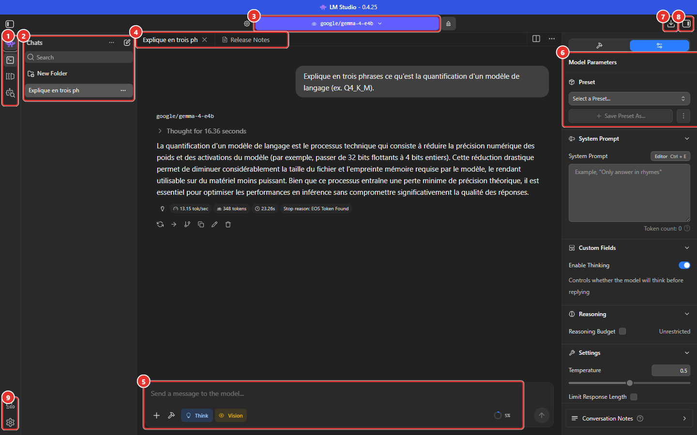
*Figure 1 — Interface principale (onglet Chat).*

| N° | Zone | Rôle |
|---|---|---|
| **1** | **Barre de navigation** | De haut en bas : **Chat**, **Developer** (serveur local et documentation de l'API), **My Models** (modèles installés), **Model Search** (recherche et téléchargement). |
| **2** | **Liste des conversations** | Recherche (`Search`), classement en dossiers (`New Folder`), création (`New`). |
| **3** | **Sélecteur de modèle** (`Ctrl + L`) | Choisir et charger un modèle. L'identifiant du modèle chargé s'affiche (ici `google/gemma-4-e4b`) ; le bouton d'éjection à droite le décharge. |
| **4** | **Onglets** | Plusieurs conversations ou documents (ex. *Release Notes*) ouverts simultanément ; le bouton « split view » les affiche côte à côte. |
| **5** | **Zone de saisie** | Message. Dessous : `+` (joindre un fichier ou une image), icône « outils » (plugins), pastilles **Think** et **Vision** (capacités du modèle), indicateur de remplissage du contexte (%), bouton d'envoi. |
| **6** | **Panneau de droite** | Deux onglets : *Integrations* (outils, serveurs MCP) et *Configuration* (« Model Parameters » : preset, prompt système, température…). Voir le [Manuel 04](04-parametrer-l-inference.md). |
| **7** | **Downloads** | Suivi des téléchargements (modèles et moteurs). |
| **8** | **Afficher / masquer le panneau de droite** | Gagner de la place pour la conversation. |
| **9** | **LM Link** et **App Settings** | Accès à LM Link (instances distantes, compte requis) et aux réglages (`Ctrl + ,`). |

Sous chaque réponse, LM Studio affiche des **statistiques de génération** : vitesse (`tok/sec`), nombre de tokens, **délai avant le premier token** (icône d'horloge, *Time To First Token*) et motif d'arrêt (`Stop reason: EOS Token Found` = réponse terminée). Elles servent à comparer des réglages ([Manuel 04](04-parametrer-l-inference.md#2-premier-échange-et-lecture-de-linterface)).

> **Astuce** — « Hide sidebar » (en haut à gauche) masque la liste des conversations ; avec le panneau de droite fermé, la conversation occupe toute la fenêtre.

---

## 4. Raccourcis clavier

| Raccourci | Action |
|---|---|
| `Ctrl + L` | Ouvrir le sélecteur de modèle |
| `Ctrl + Entrée` | Valider **Load Model** dans la fenêtre de chargement |
| `Ctrl + ,` | Ouvrir les réglages |
| `Ctrl + Maj + R` | Page **Runtime** (moteurs d'inférence) |
| `Ctrl + Maj + H` | Page **Hardware** (matériel) |
| `Ctrl + E` | Éditeur du prompt système |
| `Ctrl + R` | Régénérer la dernière réponse (option activée par défaut) |
| `Maj + Entrée` | Envoyer le message, à la place d'`Entrée` (option désactivée par défaut) |
| `Alt` + clic sur un modèle | Ouvrir la fenêtre de chargement complète au lieu du chargement rapide |

---

## 5. Developer Mode

Par défaut, LM Studio masque les réglages avancés. L'interrupteur **Settings → Developer → Developer mode** (`OFF` / `ON`) les affiche. Il remplace l'ancien sélecteur « User / Power User / Developer » des versions 0.3.x.

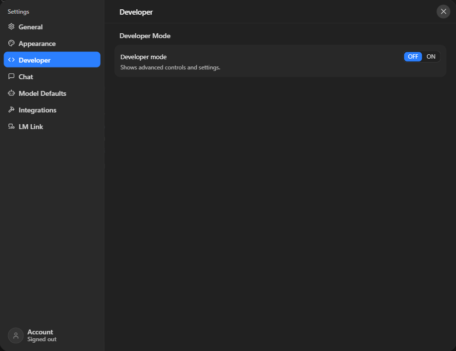
*Figure 2 — Settings → Developer : mode `OFF` (valeur par défaut).*

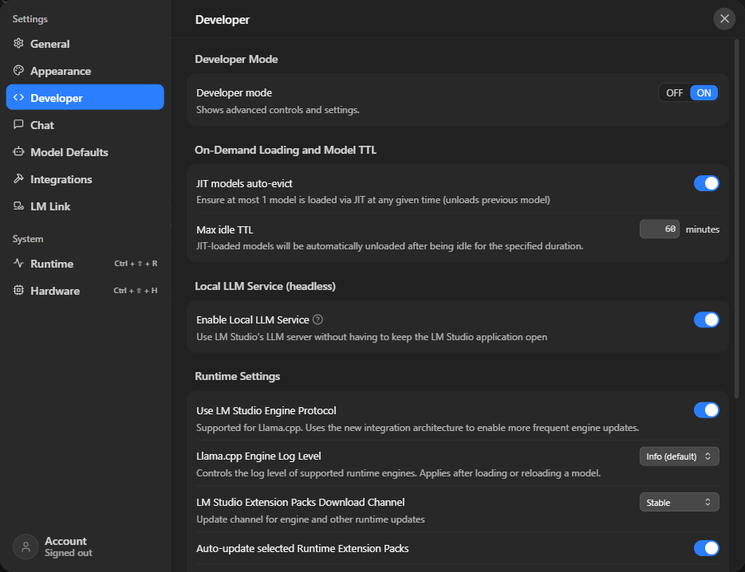
*Figure 2 bis — Developer mode sur ON.*

Effet sur le panneau de paramètres du chat :

| Mode OFF | Mode ON |
|---|---|
| 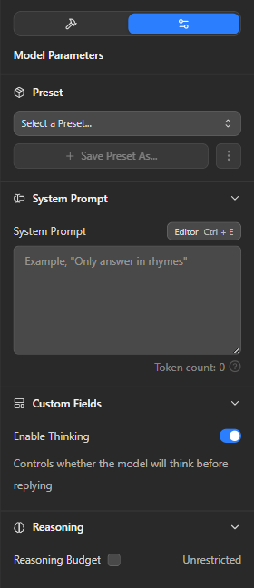 | 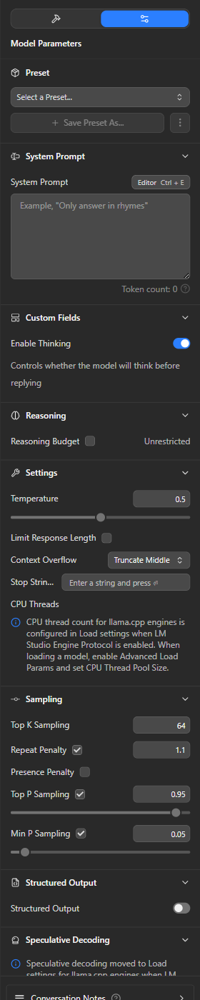 |

Le mode `ON` ajoute : **Settings** (température, limite de réponse, dépassement de contexte, chaînes d'arrêt), **Sampling** (Top K, Top P, Min P, pénalités), **Structured Output** et **Speculative Decoding** ; dans la fenêtre de chargement, le bouton **Show advanced settings** ([Manuel 03](03-charger-un-modele.md)) ; dans les réglages généraux, plusieurs options supplémentaires.

> **Recommandation** — Activer le Developer mode pour disposer de l'ensemble des champs décrits dans les manuels.

---

## 6. Réglages de l'application

Ouverture : `Ctrl + ,` ou roue crantée en bas à gauche. *Runtime* et *Hardware* se trouvent dans la section **System**. Lorsqu'une page dépasse la fenêtre, une seconde capture « suite » montre le bas de page.

### 6.1 General

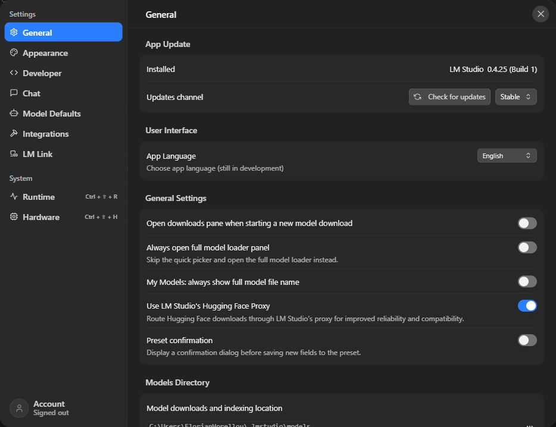
*Figure 3 — Settings → General (début).*

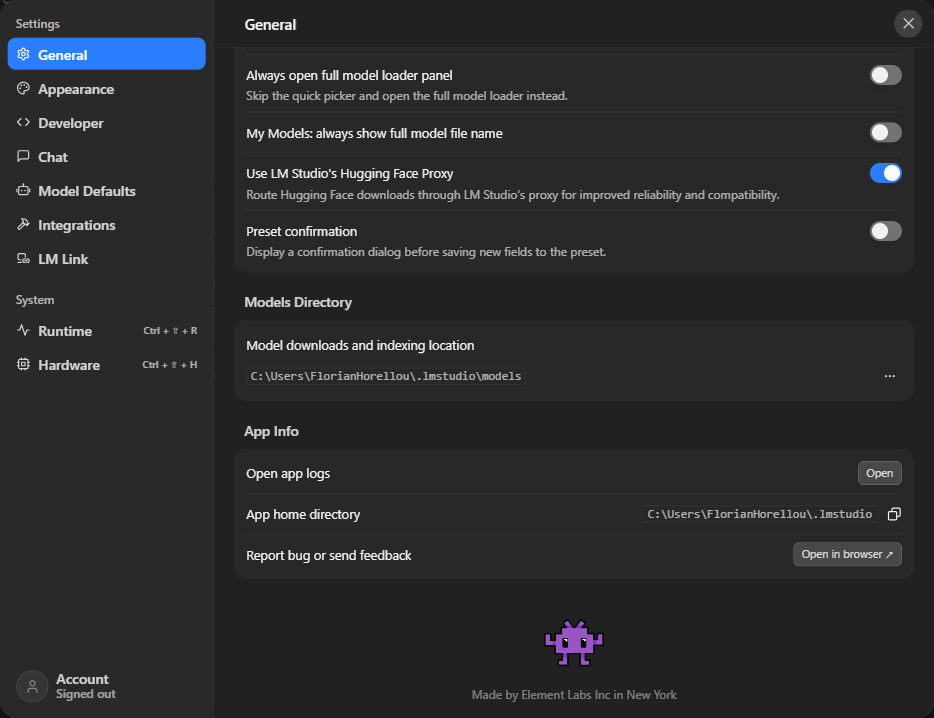
*Figure 4 — Settings → General (bas de page).*

| Champ | Rôle | Valeur observée |
|---|---|---|
| **Installed** / **Updates channel** | Version installée ; canal de mise à jour (*Stable* ou bêta). `Check for updates` interroge le serveur de mise à jour. | 0.4.25 (Build 1), *Stable* |
| **App Language** | Langue de l'interface (fonction « en développement »). | English |
| **Open downloads pane when starting a new model download** | Ouvre automatiquement le panneau des téléchargements. | Désactivé |
| **Always open full model loader panel** | Ouvre toujours la fenêtre de chargement complète au lieu du sélecteur rapide. | Désactivé |
| **My Models: always show full model file name** *(Developer mode)* | Nom de fichier complet dans la liste des modèles. | Désactivé |
| **Use LM Studio's Hugging Face Proxy** *(Developer mode)* | Fait passer les téléchargements Hugging Face par un proxy de LM Studio. | **Activé** |
| **Preset confirmation** *(Developer mode)* | Demande confirmation avant d'enregistrer de nouveaux champs dans un preset. | Désactivé |
| **Models Directory** | Dossier de téléchargement et d'indexation des modèles (bouton `…` pour le changer). | `C:\Users\<utilisateur>\.lmstudio\models` |
| **Open app logs** | Ouvre les journaux de l'application. | — |
| **App home directory** | Dossier de données (bouton « copier »). | `C:\Users\<utilisateur>\.lmstudio` |

### 6.2 Appearance

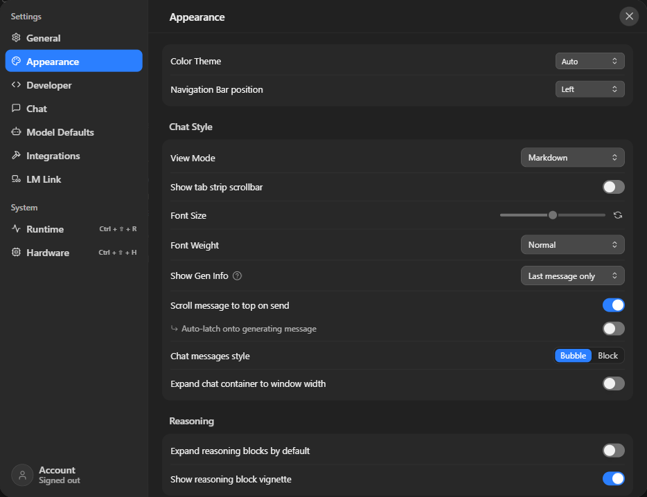
*Figure 5 — Settings → Appearance.*

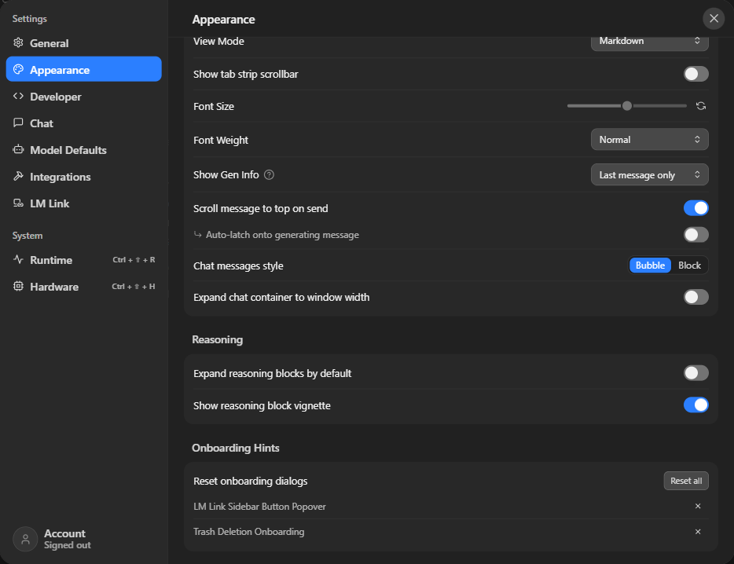
*Figure 5 bis — Settings → Appearance (bas de page).*

| Champ | Rôle | Valeur observée |
|---|---|---|
| **Color Theme** | *Auto* (suit le système), *Classic*, *Light*, *Sepia*, *Dark*, *Deep Dark*, *Solarized Dark*. | Auto |
| **Navigation Bar position** | Barre de navigation à gauche (*Left*) ou en haut (*Top*). | Left |
| **View Mode** | Messages en *Markdown* (rendu), *Plaintext* ou *Monospace*. | Markdown |
| **Font Size / Font Weight** | Taille (curseur et bouton de remise à zéro) et graisse (*Light* ou *Normal*). | Normal |
| **Show Gen Info** | Statistiques de génération : *Last message only*, *In tooltip only* (au survol) ou *Always show*. | Last message only |
| **Scroll message to top on send** / **Auto-latch onto generating message** | Défilement pendant la génération. | Activé / désactivé |
| **Chat messages style** | Bulles (*Bubble*) ou blocs (*Block*). | Bubble |
| **Expand chat container to window width** | Utilise toute la largeur de la fenêtre. | Désactivé |
| **Expand reasoning blocks by default** | Déplie le bloc « Thought for … » des modèles raisonneurs. | Désactivé |
| **Show reasoning block vignette** | Dégradé sur le bloc de raisonnement. | Activé |

> **Pour comparer plusieurs réponses** : *Show Gen Info* sur *Always show* et *Expand reasoning blocks by default* activé.

### 6.3 Developer

Voir la [section 5](#5-developer-mode) : une seule option (*Developer mode*).

### 6.4 Chat

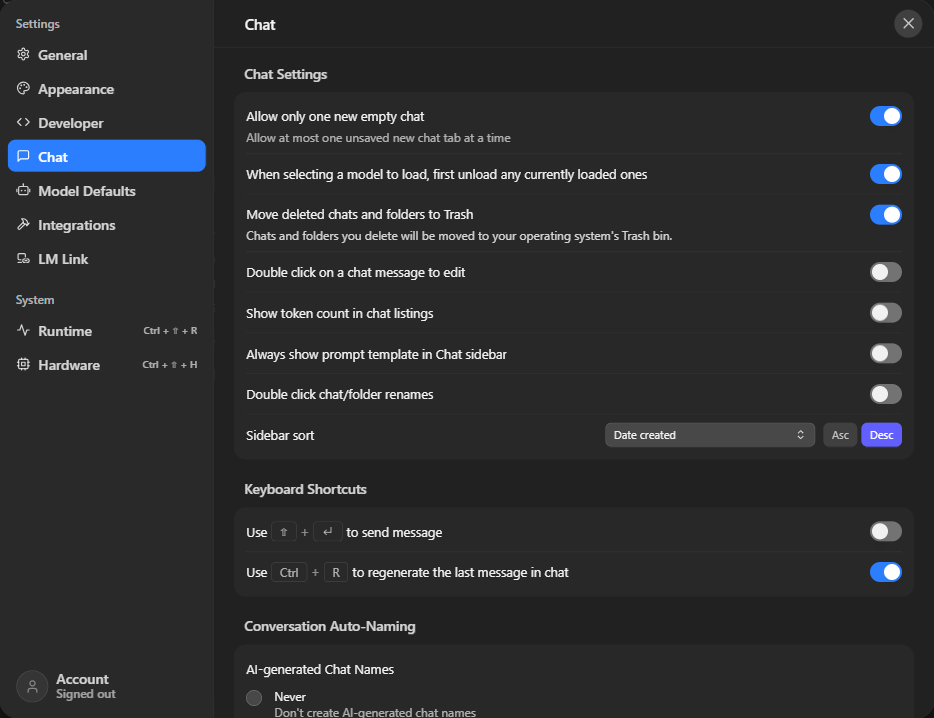
*Figure 6 — Settings → Chat.*

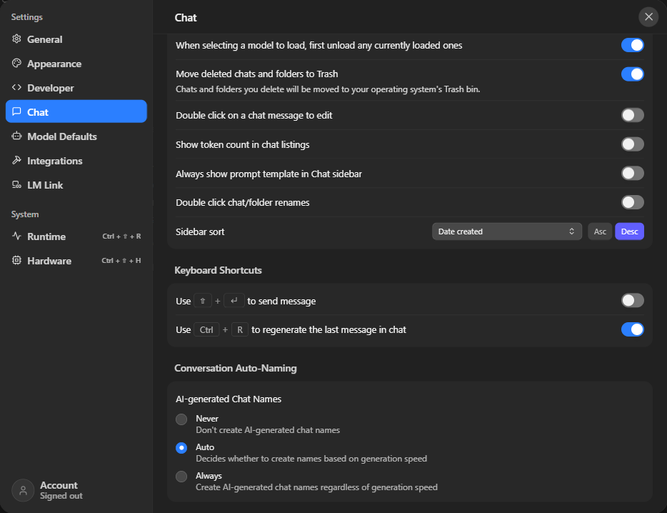
*Figure 6 bis — Settings → Chat (bas de page).*

| Champ | Rôle | Valeur observée |
|---|---|---|
| **Allow only one new empty chat** | Évite la multiplication d'onglets « Unnamed Chat » vides. | Activé |
| **When selecting a model to load, first unload any currently loaded ones** | Décharge le modèle en cours avant d'en charger un autre : **protège la RAM**. | Activé |
| **Move deleted chats and folders to Trash** | Les conversations supprimées vont à la corbeille Windows. | Activé |
| **Double click on a chat message to edit** | Édition par double-clic. | Désactivé |
| **Show token count in chat listings** *(Developer mode)* | Nombre de tokens de chaque conversation dans la liste. | Désactivé |
| **Always show prompt template in Chat sidebar** *(Developer mode)* | Affiche le *chat template* dans le panneau de droite. | Désactivé |
| **Double click chat/folder renames** | Renommer par double-clic. | Désactivé |
| **Sidebar sort** | Tri de la liste (date de création, croissant / décroissant). | Date created, Desc |
| **Use ⇧ + ↵ to send message** | Envoi par Maj+Entrée plutôt qu'Entrée. | Désactivé |
| **Use Ctrl + R to regenerate the last message** | Raccourci de régénération. | Activé |
| **AI-generated Chat Names** | Nommage des conversations par le modèle : *Never*, *Auto* (selon la vitesse), *Always*. | Auto |

### 6.5 Model Defaults

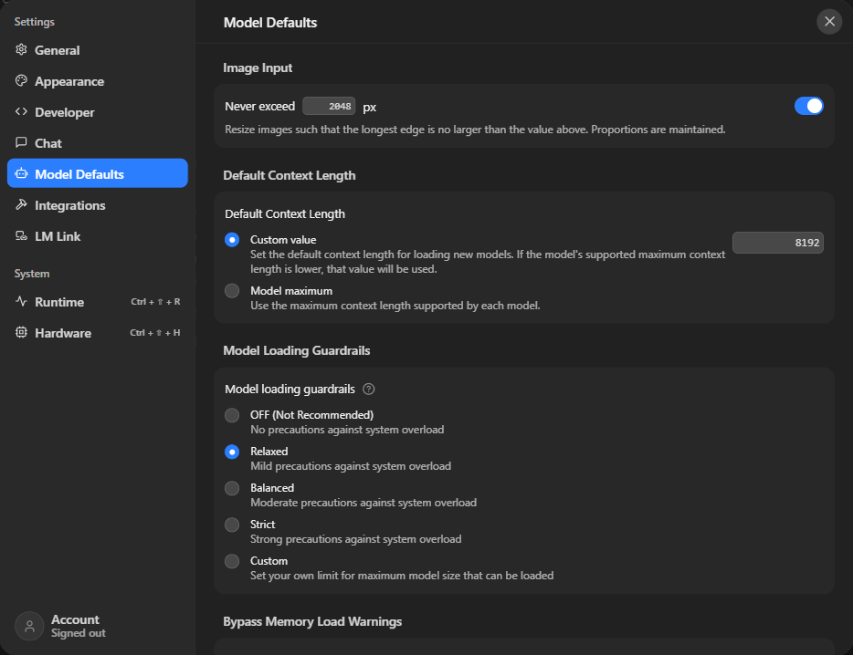
*Figure 7 — Settings → Model Defaults.*

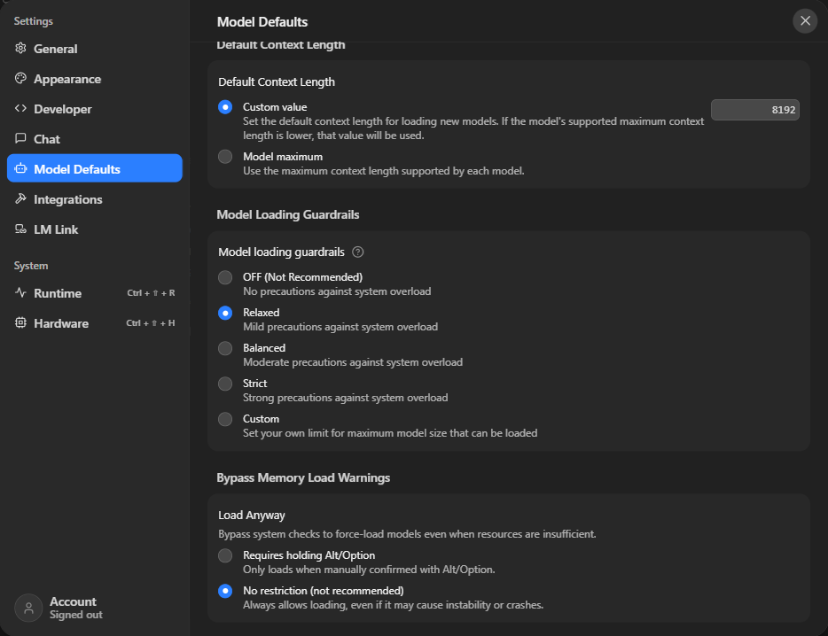
*Figure 7 bis — Settings → Model Defaults (bas de page : contournement des alertes mémoire).*

| Champ | Rôle | Valeur observée |
|---|---|---|
| **Image Input — Never exceed … px** | Réduit toute image dont le **plus grand côté** dépasse la valeur (proportions conservées). Important pour l'OCR ([Manuel 05](05-vision-images-et-ocr.md#limite-de-taille-de-lm-studio)). | 2048 px |
| **Default Context Length** | Taille de contexte proposée au chargement d'un nouveau modèle : *Custom value* ou *Model maximum*. Si le modèle ne supporte pas la valeur, son maximum s'applique. | Custom value |
| **Model loading guardrails** | Garde-fous contre la surcharge : *OFF (Not Recommended)*, *Relaxed*, *Balanced*, *Strict*, *Custom* (limite de taille maximale). | *Relaxed* |
| **Bypass Memory Load Warnings** | *Load Anyway* : forcer le chargement malgré l'alerte (touche `Alt`) ; ou « No restriction » (déconseillé). | — |

> **Attention** — Désactiver les garde-fous permet de lancer un modèle trop gros pour la machine : ralentissement sévère ou plantage possibles. Conserver au minimum *Relaxed*.

### 6.6 Integrations

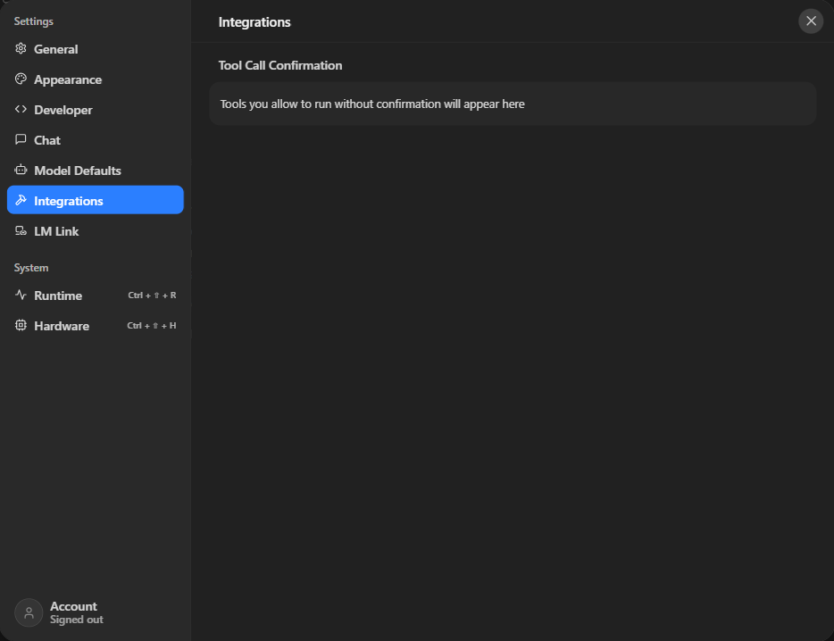
*Figure 8 — Settings → Integrations.*

Liste des outils (plugins, serveurs MCP) autorisés à s'exécuter **sans confirmation** (*Tool Call Confirmation*). Vide par défaut : c'est le comportement le plus sûr.

### 6.7 LM Link

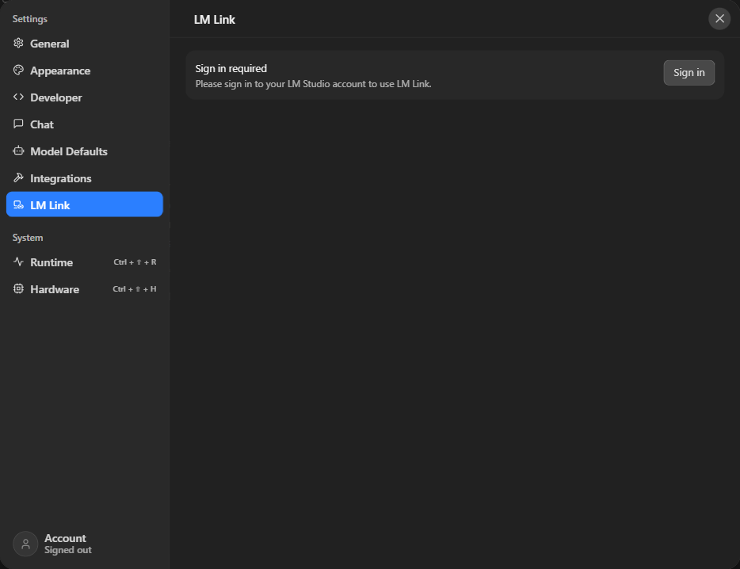
*Figure 9 — Settings → LM Link.*

LM Link relie LM Studio à d'autres appareils pour utiliser leurs modèles à distance ; il **exige un compte LM Studio** (« Sign in required »). Inutile pour un usage local.

### 6.8 Runtime (`Ctrl + Maj + R`)

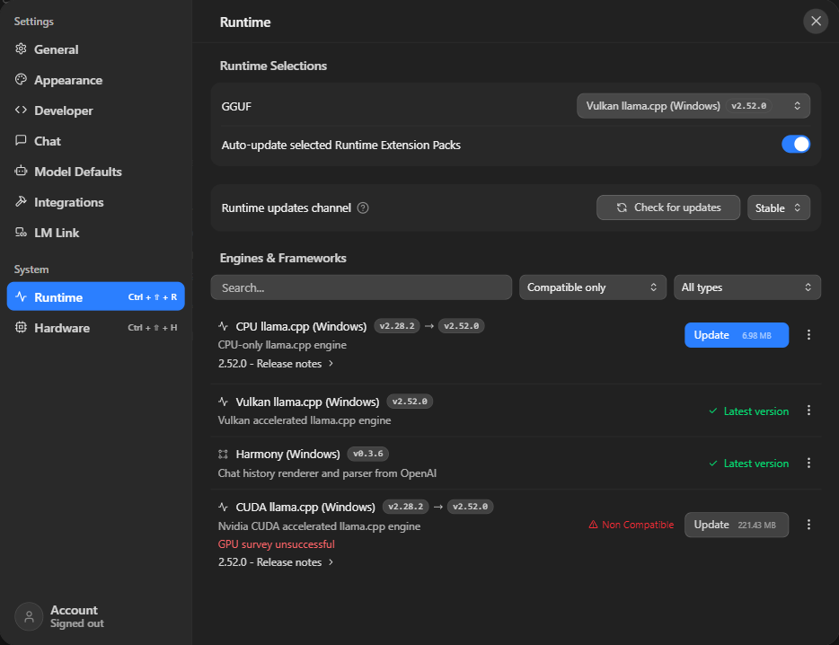
*Figure 10 — Settings → Runtime.*

Le **runtime** (moteur) est le composant qui exécute le modèle. Exemple du poste de test :

| Moteur | Rôle | État |
|---|---|---|
| **Vulkan llama.cpp** v2.52.0 | Accélération GPU via Vulkan ; **sélectionné** pour les modèles GGUF | À jour |
| **CPU llama.cpp** v2.28.2 → v2.52.0 | Calcul 100 % processeur | Mise à jour proposée (≈ 7 Mo) |
| **CUDA llama.cpp** v2.28.2 | GPU Nvidia | *Non compatible* (« GPU survey unsuccessful ») |
| **Harmony** v0.3.6 | Rendu et analyse de l'historique de chat au format OpenAI | À jour |

**Rôle de chaque type de moteur** (indépendamment des versions) :

| Moteur | Rôle |
|---|---|
| **CPU** | Calcul sur le processeur ; fonctionne partout, le plus lent |
| **Vulkan** | Calcul sur GPU Intel, AMD ou Nvidia (dont les GPU intégrés) via l'interface Vulkan ; choix universel |
| **CUDA** | Calcul sur carte graphique **Nvidia** ; le plus rapide sur ce matériel, inutilisable sans carte Nvidia |
| **Harmony** | **Pas un moteur de calcul** : décodeur du format de conversation d'OpenAI (messages, raisonnement, outils) |

Explications détaillées : [Manuel 00, section 6](00-notions-fondamentales.md#6-les-moteurs-runtimes--cpu-cuda-vulkan-metal-harmony).

| Champ | Rôle |
|---|---|
| **GGUF** (sélecteur) | Moteur utilisé pour les modèles GGUF. |
| **Auto-update selected Runtime Extension Packs** | Mise à jour automatique du moteur sélectionné (**activé** sur le poste de test : voir [section 8](#8-points-de-vigilance)). |
| **Runtime updates channel** | Canal des mises à jour de moteurs (*Stable*). |
| **Compatible only / All types** | Filtres de la liste. |

### 6.9 Hardware (`Ctrl + Maj + H`)

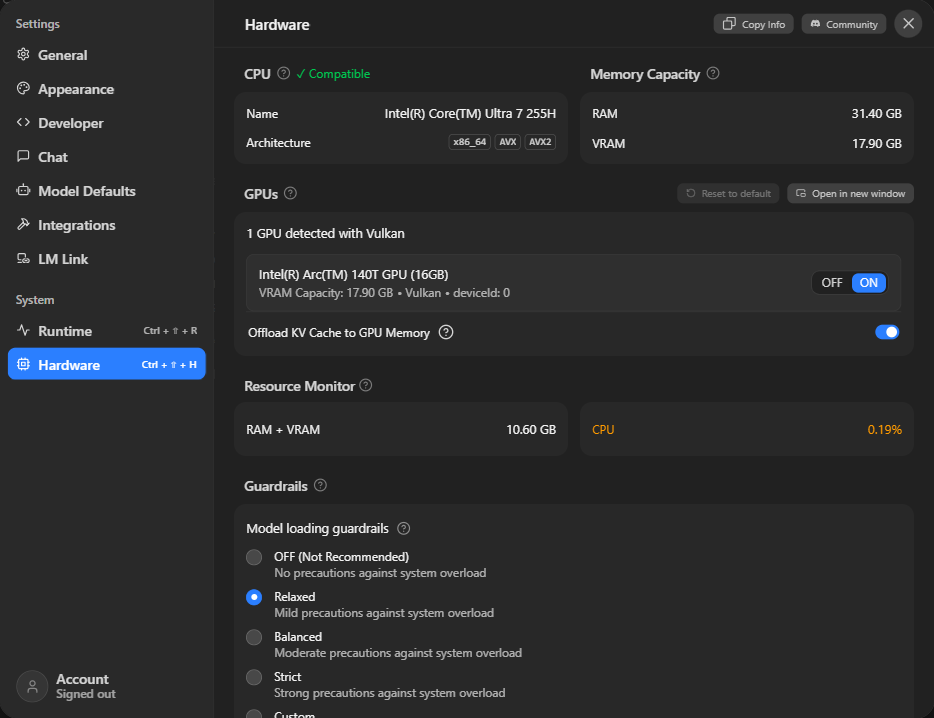
*Figure 11 — Settings → Hardware.*

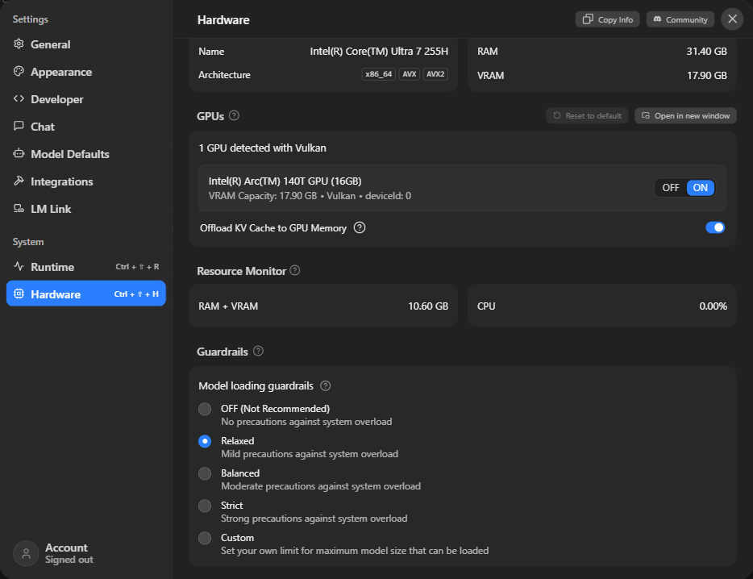
*Figure 11 bis — Settings → Hardware (garde-fous de chargement).*

| Zone | Contenu (poste de test) |
|---|---|
| **CPU** | Intel Core Ultra 7 255H, `x86_64`, **AVX** et **AVX2** (✓ *Compatible*). |
| **Memory Capacity** | **RAM 31,40 Go** ; **VRAM 17,90 Go**. Le GPU étant *intégré*, la « VRAM » est une portion de la RAM partagée. |
| **GPUs** | 1 GPU détecté via Vulkan (*Intel Arc 140T, 16 Go*) ; interrupteur `OFF/ON` d'utilisation ; **Offload KV Cache to GPU Memory**. |
| **Resource Monitor** | Consommation instantanée (RAM + VRAM, CPU). |
| **Guardrails** | Mêmes garde-fous que *Model Defaults*. |

**Sur un poste à GPU dédié** (RTX 4060 Ti, 16 Go de VRAM, Ryzen 5 9600X, 61,6 Go de RAM) [Vérifié, 7 octobre 2026] :

| Zone | Contenu |
|---|---|
| **CPU** | AMD Ryzen 5 9600X, `x86_64`, **AVX** et **AVX2** (✓ *Compatible*). |
| **Memory Capacity** | **RAM 61,58 Go** ; **VRAM 16,00 Go** (mémoire dédiée réelle, et non une part de la RAM). |
| **GPUs** | « 1 GPU detected with CUDA » : *NVIDIA GeForce RTX 4060 Ti*, `deviceId: 0`, interrupteur `OFF/ON` ; **Limit Model Offload to Dedicated GPU Memory** (désactivé : « *Allow model weights to offload to shared memory if dedicated GPU memory is full* ») ; **Offload KV Cache to GPU Memory** (activé). |
| **Guardrails** | *Relaxed* par défaut. |

Le premier interrupteur **ne modifie pas** les indicateurs d'adéquation du catalogue ([Manuel 02, section 6](02-selectionner-et-telecharger-un-modele.md#6-les-indicateurs-dadéquation-matérielle)) ; l'effet de *Model Defaults → Default Context Length* et des garde-fous sur ces indicateurs est également nul **[Vérifié]**. Le chargement d'un modèle de 18 Go sur 16 Go de VRAM n'a **pas** été bloqué en *Relaxed*.

**Copy Info** copie un résumé du matériel (utile pour un ticket de support).

---

## 7. Stockage des données

Tout se trouve dans `C:\Users\<utilisateur>\.lmstudio\` :

| Élément | Contenu |
|---|---|
| `settings.json` | Réglages de l'application. |
| `models\` | Modèles : `models\<éditeur>\<dépôt>\<fichier>.gguf` ([Manuel 02](02-selectionner-et-telecharger-un-modele.md)). |
| `conversations\` | Conversations, en **fichiers JSON lisibles** (`<horodatage>.conversation.json`). |
| `config-presets\` | Presets de paramètres ([Manuel 04](04-parametrer-l-inference.md#9-presets)). |
| `bin\` | Programme CLI `lms.exe`. |
| `mcp.json` | Serveurs MCP déclarés (vide par défaut : `{"mcpServers": {}}`). |
| `server-logs\` | Journaux du serveur local. |
| `hub\`, `extensions\`, `skills\`, `projects\`, `workspace\`, `working-directories\`, `scratchpads\`, `user-files\` | Données internes (extensions, compétences, projets, fichiers de travail). |
| `credentials\`, `.internal\` | Données internes sensibles : ne pas copier ni partager. |

> **Confidentialité** — Les conversations sont stockées **en clair** (vérifié : format JSON lisible contenant les messages). Pour des données sensibles, traiter `.lmstudio\conversations` comme un dossier confidentiel (sauvegardes, synchronisation de type OneDrive).

---

## 8. Points de vigilance

| # | Constat (poste de test) | Risque | Action recommandée |
|---|---|---|---|
| 1 | *Developer → Server Settings → Serve on Local Network* **activé** et authentification **désactivée**. | Exposition de l'API et du modèle à tout le réseau local dès le démarrage du serveur. | **Désactiver *Serve on Local Network*** sauf besoin ; sinon activer *Require Authentication* ([Manuel 06](06-serveur-local-et-api.md#5-sécurité)). Désactivé avant tout démarrage lors de la rédaction. |
| 2 | **Mise à jour automatique des moteurs** et **proxy Hugging Face** activés ; le moteur Vulkan est passé de 2.51.0 à 2.52.0 **sans action** pendant les tests (panneau *Downloads* : paquets de 17 à 20 Mo). | Téléchargements non sollicités (de 7 à plus de 200 Mo selon le moteur) : problématique en **connexion limitée** ou sur réseau filtré. | Désactiver l'auto-update ; mettre à jour manuellement hors périmètre contraint. |
| 3 | Modèles et conversations dans le profil utilisateur, en clair. | Fuite par synchronisation ou copie de profil. | Exclure `.lmstudio` des dossiers synchronisés ; chiffrer le disque. |
| 4 | *LM Link* et le compte LM Studio sont disponibles. | Flux sortants vers les services LM Studio. | Ne pas se connecter sauf besoin ; valider avec la sécurité. |
| 5 | Garde-fous mémoire contournables avec `Alt`. | Saturation de la machine. | Conserver *Relaxed* ou plus strict. |

---

## 9. Check-list de première configuration

- [ ] `Ctrl + ,` → **Developer** → **Developer mode : ON**.
- [ ] **General** : activer *Always open full model loader panel*.
- [ ] **Appearance** : *Show Gen Info* → *Always show*.
- [ ] **Chat** : vérifier *first unload any currently loaded ones*.
- [ ] **Model Defaults** : fixer un *Default Context Length* adapté (8192 pour du chat léger, [Manuel 03](03-charger-un-modele.md)) ; garde-fous sur *Relaxed* ou plus.
- [ ] **Runtime** : vérifier le moteur sélectionné (Vulkan, ou CPU sans GPU compatible) ; décider de l'auto-update.
- [ ] **Hardware** : vérifier la détection du GPU ; noter RAM et VRAM.
- [ ] **Developer → Server Settings** : *Serve on Local Network* **désactivé**.

---

### Suite

| Manuel | Sujet |
|---|---|
| [02](02-selectionner-et-telecharger-un-modele.md) | Sélectionner et télécharger un modèle |
| [03](03-charger-un-modele.md) | Charger un modèle : paramètres de chargement |
| [04](04-parametrer-l-inference.md) | Paramétrer l'inférence |
| [05](05-vision-images-et-ocr.md) | Vision, images et OCR |
| [06](06-serveur-local-et-api.md) | Serveur local et API |
| [07](07-cli-lms.md) | Ligne de commande `lms` |
| [08](08-recettes-par-cas-usage.md) | Recettes par cas d'usage |
| [09](09-depannage-faq.md) | Dépannage et FAQ |
