# Manuel 02 — Sélectionner et télécharger un modèle

> **Objet** : choisir un modèle pertinent pour un besoin et une machine, lire les options de téléchargement (quantifications, indicateurs d'adéquation matérielle), puis télécharger, importer et gérer les modèles.
> **Prérequis** : [Manuel 01](01-prise-en-main.md) ; notions de taille et de quantification : [Manuel 00, sections 2 à 4](00-notions-fondamentales.md).
> **Version décrite** : LM Studio 0.4.25 — captures des 6 et 7 octobre 2026.
> **Contrainte de rédaction** : le catalogue a été consulté en **lecture seule** ; le bouton *Download* n'a jamais été utilisé sur le poste de test. Les modèles décrits comme installés étaient déjà présents ou ont été copiés à la main.
> **Exemple fil rouge** : *Gemma 4 E4B*, modèle généraliste (texte, images, outils, raisonnement), installé sur le poste de test.
> **Postes de test** : captures et tailles du catalogue relevées sur un poste à **GPU intégré** (17,9 Go de « VRAM » partagés, 31 Go de RAM) ; indicateurs d'adéquation (section 6) **rejoués sur une carte dédiée** (RTX 4060 Ti, 16 Go de VRAM, 61,6 Go de RAM) le 7 octobre 2026.
> **Étiquettes** : **[Vérifié]** observé dans l'application ; **[Source]** documentation officielle ou dépôt du projet cité ; **[Source tierce]** article ou ticket non officiel ; **[Estimation]** calcul ; **[À tester]** point à confirmer.

---

## Sommaire

1. [Notions](#1-notions)
2. [Choisir un modèle pertinent](#2-choisir-un-modèle-pertinent)
3. [Model Search : le catalogue](#3-model-search--le-catalogue)
4. [Exemple guidé avec Gemma 4 E4B](#4-exemple-guidé-avec-gemma-4-e4b)
5. [Les quantifications](#5-les-quantifications)
6. [Les indicateurs d'adéquation matérielle](#6-les-indicateurs-dadéquation-matérielle)
7. [Télécharger](#7-télécharger)
8. [Installer un modèle sans connexion](#8-installer-un-modèle-sans-connexion)
9. [Suivre les téléchargements](#9-suivre-les-téléchargements)
10. [Organisation des fichiers et modèles installés](#10-organisation-des-fichiers-et-modèles-installés)
11. [Charger un modèle : le sélecteur](#11-charger-un-modèle--le-sélecteur)
12. [Check-list de choix](#12-check-list-de-choix)

---

## 1. Notions

| Notion | Explication |
|---|---|
| **Paramètres** (`7.5B`, `27B`…) | Taille du modèle en milliards de paramètres. Plus il est élevé, plus le modèle est capable et volumineux. *Exemple : Gemma 4 E4B est affiché 7.9B dans le catalogue (tables d'embeddings comprises) ; l'éditeur le présente comme « effective 4B ».* |
| **Architecture** (`gemma4`, `qwen2vl`…) | Famille technique du modèle. LM Studio n'exécute que les architectures prises en charge par son moteur. |
| **Format** : **GGUF** / **MLX** | GGUF : format universel (moteur *llama.cpp*) pour Windows, Linux et Mac ; format de ces manuels. MLX : réservé aux Mac Apple Silicon. |
| **Quantification** (`Q4_K_M`, `Q8_0`…) | Compression des poids : moins de bits par poids = fichier plus petit et plus rapide, légèrement moins précis ([section 5](#5-les-quantifications)). |
| **Capacités** (pastilles) | **Vision** (images), **Tool Use** (appel de fonctions), **Reasoning** (réflexion avant réponse). |
| **Contexte** | Nombre maximal de tokens (≈ ¾ de mot) traités en une fois : question + historique + réponse ([Manuel 03](03-charger-un-modele.md)). |
| **Download Options** | Liste déroulante de la fiche d'un modèle : une ligne par fichier téléchargeable (variante, quantification, taille) avec un indicateur d'adéquation matérielle ([sections 4 à 6](#4-exemple-guidé-avec-gemma-4-e4b)). |
| **Indicateur d'adéquation** | Pastille *Full GPU Offload Possible*, *Partial GPU Offload Possible* ou *Likely too large* : estimation de la place du modèle dans la machine ([section 6](#6-les-indicateurs-dadéquation-matérielle)). |
| **Fichier `mmproj`** | Second fichier GGUF (« adaptateur de vision ») qui accompagne un modèle capable de lire des images. Inclus dans la taille affichée. *Exemple : Gemma 4 E4B = 5,34 Go de modèle + 0,99 Go de `mmproj` = 6,33 Go.* |
| **Modèle brouillon** (*drafter*, lignes « Mtp ») | Petit modèle accompagnant un grand pour accélérer la génération (décodage spéculatif). Ce n'est pas un modèle utilisable seul ([section 4](#4-exemple-guidé-avec-gemma-4-e4b)). |

---

## 2. Choisir un modèle pertinent

### Essentiel : cinq questions, dans l'ordre

| Ordre | Question | Comment y répondre | Où le lire dans LM Studio |
|---|---|---|---|
| 1 | **Pour quelle tâche ?** | Discuter, résumer, écrire, coder, lire des images, appeler des outils, raisonner, vectoriser des textes. | Pastilles de capacités : **Vision**, **Tool Use**, **Reasoning** ; catégorie *Text Embedding* pour la recherche sémantique |
| 2 | **Quelle taille tient dans la machine ?** | Fichier + cache KV < mémoire disponible, avec ≥ 20 % de marge. | Taille de la ligne choisie, indicateur d'adéquation ([section 6](#6-les-indicateurs-dadéquation-matérielle)), *Hardware* ([Manuel 01](01-prise-en-main.md#69-hardware-ctrl--maj--h)) |
| 3 | **Quelle quantification ?** | La plus haute qui tient confortablement ; **Q4_K_M** par défaut ([section 5](#5-les-quantifications)). | Liste *Download Options* |
| 4 | **De qui vient le fichier ?** | Éditeur d'origine, équipe LM Studio ou conversion communautaire connue ([section 3](#3-model-search--le-catalogue)). | Nom de l'éditeur, pastille **Staff Pick**, étoiles, téléchargements, date |
| 5 | **Peut-il être utilisé ?** | Licence compatible, langue de travail couverte, version récente. | README de la fiche (licence, langues, consignes d'usage) |

> **Exemple** — Besoin : rédiger et résumer des textes en français, lire quelques images de documents, sur un poste de 32 Go de RAM sans GPU dédié. Réponses : (1) capacités **Vision** + **Tool Use** ; (2) un fichier d'environ 6 à 7 Go laisse une large marge ; (3) **Q4_K_M** ; (4) fiche **Staff Pick** `google/gemma-4-e4b` ; (5) licence et langues lues dans le README. Résultat : *Gemma 4 E4B* en Q4_K_M, 6,33 Go.

### Ordres de grandeur de taille [Estimation]

La taille d'un fichier vaut approximativement **paramètres × bits par poids ÷ 8** ([Manuel 00, section 4](00-notions-fondamentales.md#43-effet-sur-la-taille)). En Q4_K_M (≈ 4,9 bits par poids) :

| Mémoire disponible pour le modèle | Fichier maximal raisonnable | Classe de modèle en Q4_K_M |
|---|---|---|
| 8 Go | ≈ 4 à 5 Go | 3 à 8 Md de paramètres |
| 16 Go | ≈ 9 à 11 Go | 12 à 14 Md |
| 32 Go | ≈ 18 à 22 Go | 27 à 32 Md |
| 64 Go | ≈ 40 à 45 Go | 70 Md |

Ces valeurs réservent la place du système, du cache KV et d'une marge. Le calcul précis, avec le contexte, est décrit au [Manuel 00, section 7](00-notions-fondamentales.md#7-calculer-la-ram-nécessaire).

### Pour aller plus loin

| Sujet | Détail |
|---|---|
| **Modèle dense ou à experts (MoE)** | Un modèle *MoE* active seulement une partie de ses paramètres à chaque token. *Exemple : « Gemma 4 26B A4B » = 26 Md de paramètres au total, ≈ 4 Md actifs par token* **[Source]** (fiche du catalogue). Conséquence : **mémoire nécessaire = taille totale** (26 Md), **vitesse comparable à un modèle de 4 Md**. |
| **Modèle d'instruction ou de base** | Les fichiers `-it` / `Instruct` sont réglés pour dialoguer. Un modèle « base » complète du texte sans suivre de consigne : à éviter pour un chat. |
| **Modèles modifiés par la communauté** | Les recherches renvoient aussi des variantes dites *uncensored*, *abliterated*, *obliterated* ou *heretic* **[Vérifié]** (recherche « gemma 4 e4b »). Les poids y sont retouchés pour retirer des refus ; qualité, sécurité et licence sont à examiner au cas par cas. Pour un usage professionnel, préférer l'éditeur d'origine ou une conversion neutre. |
| **Date de mise à jour** | Une architecture récente exige un moteur à jour (*Settings → Runtime*, [Manuel 00, section 6](00-notions-fondamentales.md#6-les-moteurs-runtimes--cpu-cuda-vulkan-metal-harmony)). Un modèle plus ancien que son moteur fonctionne ; l'inverse non. |
| **Plusieurs modèles pour plusieurs tâches** | Un petit modèle rapide pour le chat et un modèle de vision ou d'outils pour les tâches ciblées valent souvent mieux qu'un seul grand modèle ([Manuel 08](08-recettes-par-cas-usage.md)). |

---

## 3. Model Search : le catalogue

Onglet **Model Search** (4ᵉ icône de la barre de navigation) : fenêtre avec la liste à gauche et le détail du modèle sélectionné à droite.

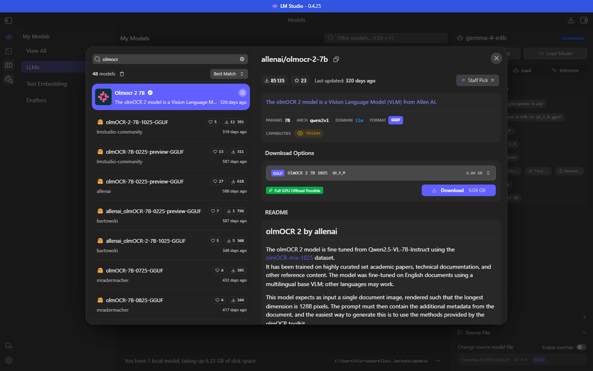
*Figure 1 — Model Search à l'ouverture : « Staff picks », modèles recommandés par LM Studio.*

À droite, pour le modèle sélectionné : téléchargements, étoiles, date de mise à jour, paramètres, architecture, formats (**GGUF**, **MLX**), capacités, **Download Options** (quantifications) et **README**.

### 3.1 Recherche

Saisir un nom, un éditeur ou un mot-clé. La recherche porte sur le catalogue LM Studio **et** sur Hugging Face.

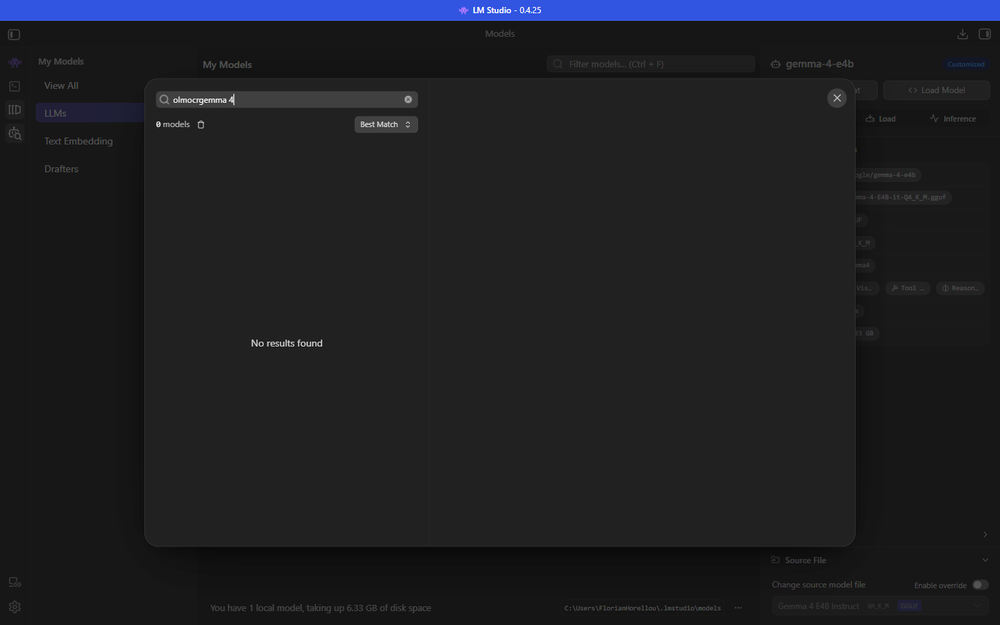
*Figure 2 — Résultat d'une recherche.*

Tri par défaut : **Best Match**. Une icône de visage souriant (logo Hugging Face) marque un résultat Hugging Face ; les autres viennent du catalogue de LM Studio.

| Source | Particularités |
|---|---|
| **Catalogue LM Studio** (pastille **Staff Pick**) | Fiche vérifiée, une ou quelques options, fichier `mmproj` inclus. |
| **lmstudio-community** | Conversions faites par l'équipe LM Studio ; nomenclature régulière. |
| **unsloth**, **bartowski** | Conversions communautaires très suivies ; **plus de quantifications** (variantes `UD`, `IQ`, `XL`, [section 5](#5-les-quantifications)). |
| **Éditeur d'origine** (ex. `allenai`, `google`) | Fichiers publiés par l'équipe qui a entraîné le modèle. |

> **Bonne pratique en environnement contraint** — Préférer un modèle **Staff Pick** ou publié par **lmstudio-community** : format vérifié et fichier `mmproj` fourni.

### 3.2 Lire une fiche

| Zone de la fiche | Information utile | Réflexe |
|---|---|---|
| En-tête | Identifiant (`éditeur/dépôt`), téléchargements, étoiles, date | Un dépôt très téléchargé et récent est un signe de fiabilité, jamais une garantie. |
| Ligne de caractéristiques | **PARAMS**, **ARCH**, **FORMAT**, **CAPABILITIES** | Vérifier que la capacité voulue (Vision, Tool Use…) est présente. |
| **Download Options** | Fichiers, quantifications, tailles, indicateurs | [Sections 4 à 6](#4-exemple-guidé-avec-gemma-4-e4b). |
| **README** | Licence, langues, consignes d'usage, paramètres recommandés | Lire la licence et la consigne de prompt avant d'investir du temps. |

---

## 4. Exemple guidé avec Gemma 4 E4B

Objectif : repérer, dans la liste *Download Options* d'un dépôt de *Gemma 4 E4B*, le fichier adapté à une machine donnée. Parcours de lecture, sans téléchargement.

1. Ouvrir **Model Search**.
2. Saisir **`gemma 4 e4b`** et attendre les résultats (≈ 5 s).
3. Sélectionner un dépôt Hugging Face proposant de nombreuses variantes (ici `unsloth/gemma-4-E4B-it-GGUF`).
4. Ouvrir la liste déroulante **Download Options** : elle ne déclenche aucun téléchargement.

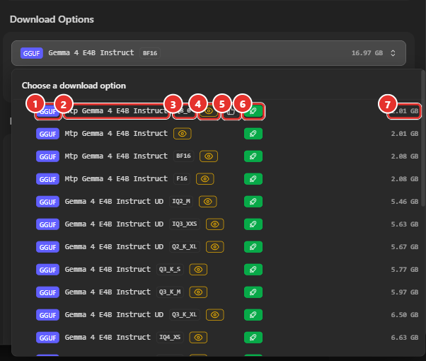
*Figure 3 — Liste *Download Options* (haut de liste). ① Format — ② Variante du modèle — ③ Quantification — ④ Œil : le fichier inclut la vision — ⑤ Pouce levé : option recommandée par LM Studio — ⑥ Indicateur d'adéquation — ⑦ Taille du téléchargement.*

| N° | Colonne | Lecture |
|---|---|---|
| 1 | **GGUF** | Format de fichier. MLX apparaît pour les modèles Apple. |
| 2 | Nom de variante | `Gemma 4 E4B Instruct` : modèle d'instruction standard. **UD** : variante *Unsloth Dynamic* (précision variable selon les couches, [section 5.3](#53-les-suffixes-et-les-recettes)). **Mtp** : modèle *brouillon* (voir ci-dessous). |
| 3 | Quantification | `Q4_K_M`, `IQ2_M`, `Q6_K_XL`, `BF16`… ([section 5](#5-les-quantifications)). Une ligne sans mention est une quantification par défaut du dépôt. |
| 4 | Œil | Le téléchargement comprend aussi le `mmproj` : le modèle lira les images. |
| 5 | Pouce levé | Option que LM Studio recommande. **Ne désigne pas toujours le meilleur choix pour l'usage visé** : ici, la ligne recommandée est un modèle brouillon (voir ci-dessous). |
| 6 | Icône d'adéquation | Vert : tient entièrement dans la mémoire graphique ; bleu : partiel ([section 6](#6-les-indicateurs-dadéquation-matérielle)). |
| 7 | Taille | Poids du téléchargement, **vision comprise** si l'œil est présent. |

> **Attention — lignes « Mtp »** — Les quatre premières lignes de ce dépôt (2,01 à 2,08 Go) portent le préfixe **Mtp** **[Vérifié]**. Le README du dépôt mentionne l'ajout d'un « support MTP » (*multi-token prediction*) **[Source]**. Il s'agit de petits modèles destinés à **accompagner** le modèle principal pour accélérer la génération, pas de modèles autonomes. Le premier choix proposé par défaut (et recommandé par le pouce levé) n'est donc **pas** le modèle à télécharger pour discuter : sélectionner une ligne `Gemma 4 E4B Instruct` sans préfixe.
>
> **Essais sur le poste à GPU dédié (7 octobre 2026)** — Ces lignes sont des **brouillons** (*drafters*) pour le décodage spéculatif. LM Studio 0.4.25 les exploite par `lms load --speculative-draft-mtp` (tête de prédiction multi-jetons **intégrée au fichier du modèle**) ou `--speculative-draft-simple --speculative-draft-model <brouillon>` **[Vérifié]**. Le fichier installé `google/gemma-4-e4b` (Q8_0, 9,02 Go) **n'embarque pas** de tête MTP : « *MTP speculative decoding requires a GGUF model with a bundled supported MTP head* ». Le sélecteur de modèles signale par un badge **MTP** les fichiers qui en contiennent (ici *Qwen3.8 27B*). Les lignes « Mtp » elles-mêmes n'ont **pas** été téléchargées (téléchargement hors périmètre) **[À tester]** ; les gains mesurés avec les autres brouillons sont dans le [Manuel 15, section 7](15-performances-gpu-dedie.md#7-décodage-spéculatif).

Faire défiler la liste jusqu'en bas :

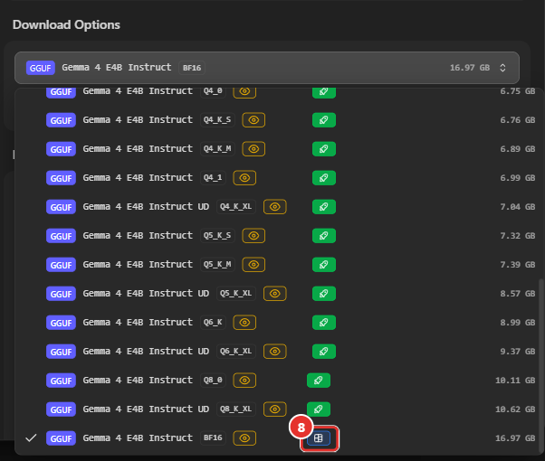
*Figure 4 — Bas de liste. ⑧ Indicateur **bleu** (« partiel ») de la version BF16, non quantifiée : 16,97 Go. Les autres lignes sont vertes.*

**Tailles relevées dans cette liste** **[Vérifié]** (dépôt `unsloth/gemma-4-E4B-it-GGUF`, vision comprise) :

| Quantification | Taille | | Quantification | Taille |
|---|---|---|---|---|
| `UD-IQ2_M` | 5,46 Go | | `Q5_K_S` | 7,32 Go |
| `UD-IQ3_XXS` | 5,63 Go | | `Q5_K_M` | 7,39 Go |
| `UD-Q2_K_XL` | 5,67 Go | | `UD-Q5_K_XL` | 8,57 Go |
| `Q3_K_S` | 5,77 Go | | `Q6_K` | 8,99 Go |
| `Q3_K_M` | 5,97 Go | | `UD-Q6_K_XL` | 9,37 Go |
| `UD-Q3_K_XL` | 6,50 Go | | `Q8_0` | 10,11 Go |
| `IQ4_XS` | 6,63 Go | | `UD-Q8_K_XL` | 10,62 Go |
| `IQ4_NL` / `Q4_0` | 6,75 Go | | `BF16` | 16,97 Go |
| `Q4_K_S` | 6,76 Go | | | |
| **`Q4_K_M`** | **6,89 Go** | | | |
| `Q4_1` | 6,99 Go | | | |
| `UD-Q4_K_XL` | 7,04 Go | | | |

> **Constat** — Pour ce modèle, passer de `Q8_0` (10,11 Go) à `Q3_K_S` (5,77 Go) ne divise la taille que par **1,75**, au lieu des 2,5 environ attendus d'après les bits par poids. Raison probable **[Estimation]** : les grandes tables d'embeddings (ce qui fait passer le modèle de « 4B effectifs » à 7,9B) et l'adaptateur de vision restent en haute précision. Les modèles de cette famille gagnent donc peu en taille sous Q4 et perdent de la qualité : **Q4_K_M** à **Q6_K** constituent la plage utile.

> **Exemple de décision** — Poste de 32 Go de RAM, GPU intégré, usage général avec images : retenir `Q4_K_M` (6,89 Go) ; viser `Q6_K` (8,99 Go) ou `Q8_0` (10,11 Go) pour des tâches sensibles (chiffres, extraction) si la mémoire reste confortable. La version du catalogue LM Studio `google/gemma-4-e4b` (fiche **Staff Pick**) propose directement **une seule option** : 6,33 Go sur le premier poste de test ; sur le poste à GPU dédié, la fiche affiche l'option **déjà installée** (Q8_0, 9,02 Go, « *Applicable model file already downloaded* »).

---

## 5. Les quantifications

### Essentiel

La quantification arrondit les poids du modèle pour les stocker sur moins de bits. Principe et analogie : [Manuel 00, section 4](00-notions-fondamentales.md#4-la-quantification--décoder-q4_k_m). Retenir trois règles :

1. **Plus le nombre après `Q` est petit, plus le fichier est petit et moins le modèle est précis.**
2. **`Q4_K_M` est le compromis de départ** ; monter (`Q5_K_M`, `Q6_K`, `Q8_0`) si la mémoire le permet et que la tâche est exigeante (chiffres, code, extraction).
3. **Les noms les moins courants (`IQ`, `UD`, `XL`, `TQ`…) sont des variantes spécialisées** : ne les choisir que pour une raison précise (voir ci-dessous).

### 5.1 Lire un nom

Un nom se lit de gauche à droite : `[préfixe] Q 4 _K _M` ou `IQ 3 _XXS`.

| Élément | Signification | Exemple |
|---|---|---|
| **Q** + chiffre | **Q**uantifié ; nombre de bits approximatif par poids | `Q4` : ≈ 4 bits |
| **`_0`**, **`_1`** | Anciennes méthodes par petits blocs de 32 poids : `_0` = valeur × échelle ; `_1` ajoute un décalage (un peu plus précis, un peu plus gros) | `Q4_0`, `Q5_1` |
| **`_K`** (« K-quants ») | Super-blocs de 256 poids dont les échelles sont elles-mêmes quantifiées : meilleure qualité à taille égale | `Q4_K_M`, `Q6_K` |
| **`_S`, `_M`, `_L`** | *Small*, *Medium*, *Large* : recette qui dose les précisions selon les tenseurs. S = plus compact ; L = plus précis | `Q3_K_S`, `Q3_K_M`, `Q3_K_L` |
| **`IQ`** (« i-quants ») | Très bas débit (1 à 4 bits), guidé par une **matrice d'importance** ; plus lent sur CPU | `IQ3_XXS`, `IQ4_XS` |
| **`XXS`, `XS`, `S`, `M`** | Sous-variantes d'une famille `IQ`, de la plus petite à la plus grande (`IQ2_XXS` < `IQ2_XS` < `IQ2_S` < `IQ2_M`) | `IQ2_M` |
| **`NL`** | *Non-linear* : variante `IQ4` à blocs de 32 poids et table de valeurs non linéaire | `IQ4_NL` |
| **`UD`** | *Unsloth Dynamic* : précision variable couche par couche, calibrée par l'éditeur **[Source tierce]** | `UD-Q4_K_XL` |
| **`XL`** | Suffixe des variantes *Unsloth* (au-dessus de `L`) : davantage de tenseurs critiques en haute précision **[Source tierce]** ; absent du jeu officiel de *llama.cpp* | `Q6_K_XL` |
| **`i1`** / **imatrix** | Matrice d'importance calculée sur un texte de calibration : protège les poids importants (utile de 2 à 5 bits) | `…-i1-GGUF` |
| **`QAT`** | *Quantization-Aware Training* : modèle entraîné pour être compressé ; meilleure qualité à 4 bits | `gemma-4-12B-it-QAT` |
| **`F32`, `F16`, `BF16`** | Non quantifiés ; référence | `BF16` |

### 5.2 Catalogue des quantifications

Bits par poids : valeurs approximatives **[Source]** (`tools/quantize` de *llama.cpp*), qualité : règles empiriques **[Source tierce]**.

| Famille | Types | Bits par poids (≈) | Usage et qualité |
|---|---|---|---|
| Très bas débit | `IQ1_S`, `IQ1_M` | 1,6 – 1,8 | Quasi expérimental ; réservé à faire tenir un très gros modèle |
| Bas débit | `IQ2_XXS`, `IQ2_XS`, `IQ2_S`, `IQ2_M`, `Q2_K` | 2,1 – 3,0 | Dernier recours ; pertes nettes |
| 3 bits | `IQ3_XXS`, `IQ3_XS`, `IQ3_S`, `IQ3_M`, `Q3_K_S`, `Q3_K_M`, `Q3_K_L` | 3,1 – 4,3 | Machine contrainte ; pertes sensibles |
| 4 bits | `IQ4_XS` (4,25), `IQ4_NL` (4,5), `Q4_0` (4,5), `Q4_K_S` (4,6), **`Q4_K_M` (4,9)**, `Q4_1` (5,0) | 4,25 – 5,0 | **Valeur sûre par défaut** |
| 5 bits | `Q5_K_S` (5,5), **`Q5_K_M` (5,7)**, `Q5_0`, `Q5_1` | 5,5 – 6,0 | Meilleure fidélité (code, texte soigné) |
| 6 bits | **`Q6_K`** (6,6) | 6,6 | Très proche du non quantifié ; chiffres, tableaux |
| 8 bits | **`Q8_0`** (8,5) | 8,5 | Quasi sans perte |
| Non quantifié | `F16`, `BF16`, `F32` | 16 – 32 | Référence ; entraînement, comparaison |
| Ternaire | `TQ1_0`, `TQ2_0` | 1,7 – 2,1 | Réservé aux modèles **entraînés** en ternaire |
| **`MXFP4`** | — | ≈ 4,25 | Flottant 4 bits à échelle partagée (blocs de 32) ; format natif de certains modèles (*gpt-oss*) |
| **`NVFP4`** | — | ≈ 4,5 | Variante NVIDIA (blocs de 16) ; accélération réelle seulement sur GPU récents **[Source tierce]** |

> **Exemple** — Le dépôt `lmstudio-community/gpt-oss-safeguard-120b-GGUF` propose un seul fichier `MXFP4` de 63,39 Go **[Vérifié]** (figure 5) : pour ce modèle, MXFP4 est le format d'origine, non une compression ajoutée après coup.

### 5.3 Les suffixes et les recettes

- **`S` / `M` / `L`** : à bits égaux, une recette plus « grande » conserve en haute précision les tenseurs les plus sensibles (attention, sortie). Le gain de qualité est réel mais modeste ; le surcoût est de quelques centaines de Mo. *Exemple mesuré : `Q4_K_S` 6,76 Go, `Q4_K_M` 6,89 Go, soit 2 % d'écart.*
- **`IQ`** : choisir une `IQ` lorsque la taille est la contrainte principale (entre 2 et 4 bits) ; à taille égale, elle est en général plus fidèle qu'une `Q` classique. Contreparties : calcul plus lent sur CPU, besoin d'un moteur récent.
- **`UD` et `XL`** : recettes d'éditeur (*Unsloth*) qui placent plus de précision là où elle compte. Elles sont plus grosses que la version standard du même chiffre (*exemple : `Q4_K_XL` 7,04 Go contre `Q4_K_M` 6,89 Go*). Gain mesurable seulement par essai comparatif **[À tester]**.
- **`imatrix`** : améliore surtout les quantifications ≤ 4 bits ; sans effet sur `Q8_0`.

### 5.4 Formats qui ne se chargent pas

| Format | Statut dans LM Studio |
|---|---|
| **GGUF** | Chargé (moteur *llama.cpp*) : format de référence. |
| **MLX** (4 ou 8 bits par groupes de 64 ou 128 poids) | Chargé sur **Mac Apple Silicon** uniquement. |
| **AWQ**, **GPTQ** | **Non chargeables** **[Source tierce]** : formats destinés à d'autres moteurs (vLLM, Transformers). |
| **Safetensors**, **FP8** (poids bruts de l'éditeur) | Non chargeables directement : convertir en GGUF ou télécharger une conversion. |

### 5.5 Ordres de grandeur pour un modèle de 7 à 8 milliards de paramètres

Tailles réelles des fichiers d'un modèle de 7,6 Md publiés par la communauté, rapportées à la version non compressée BF16 de 15,24 Go :

| Quantification | Taille | % du BF16 | Usage |
|---|---|---|---|
| **Q2_K** | ≈ 3,0 Go | 20 % | Dernier recours : pertes de qualité nettes |
| **Q3_K_M** | ≈ 3,8 Go | 25 % | Machine très contrainte |
| **Q4_K_M** | ≈ 4,7 Go | 31 % | **Compromis standard** : qualité proche de l'original, taille divisée par 3 |
| **Q5_K_M** | ≈ 5,4 Go | 36 % | Précision accrue, surcoût modéré |
| **Q6_K** | ≈ 6,3 Go | 41 % | Très proche de l'original ; recommandée pour les chiffres et tableaux (OCR) |
| **Q8_0** | ≈ 8,1 Go | 53 % | Quasi sans perte |
| **BF16 / F16** | ≈ 15,2 Go | 100 % | Référence non compressée |

### 5.6 Règle de choix

**Retenir la plus haute quantification qui tient confortablement en mémoire.** Tâches de précision (OCR, chiffres, code) : `Q6_K` / `Q8_0`. Chat général : `Q4_K_M`. Plus un modèle est petit, plus il supporte mal une compression forte : un modèle de 4 Md en `Q3` se dégrade davantage qu'un modèle de 30 Md.

> **Calcul de la mémoire** — Méthode pas à pas et script : [Manuel 00, section 7](00-notions-fondamentales.md#7-calculer-la-ram-nécessaire).
>
> **Mémoire réellement consommée** — Le fichier n'est qu'une partie : le **cache KV** croît avec le contexte. *Exemple : Gemma 4 E4B (6,33 Go) est estimé à 6,6 Go pour 8 192 tokens, 9,5 Go pour 65 536 et 12,7 Go pour 131 072* ([Manuel 03](03-charger-un-modele.md#51-taille-de-contexte-et-mémoire)).

---

## 6. Les indicateurs d'adéquation matérielle

Sous la liste *Download Options*, une pastille indique si le fichier sélectionné tient dans la machine. **La documentation officielle ne définit pas ces pastilles** ; les sens et les seuils ci-dessous viennent de **mesures** sur deux postes (un GPU intégré, puis une carte dédiée de 16 Go de VRAM).

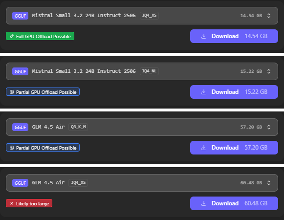
*Figure 5 — Les trois états sur un poste à **GPU dédié** (RTX 4060 Ti, 16 Go de VRAM, 61,6 Go de RAM). De haut en bas : **vert** (`IQ4_XS` de Mistral Small 3.2 24B, 14,54 Go), **bleu** (`IQ4_NL`, 15,22 Go), **bleu** (GLM 4.5 Air `Q3_K_M`, 57,20 Go) et **rouge** (GLM 4.5 Air `IQ4_XS`, 60,48 Go).*

| Pastille | Couleur observée | Sens | Conséquence |
|---|---|---|---|
| **Full GPU Offload Possible** | **Vert** (icône fusée) | Le modèle entier tient dans la mémoire graphique | Vitesse maximale : toutes les couches sur le GPU |
| **Partial GPU Offload Possible** | **Bleu** (icône quadrillage) | Une partie des couches tient dans la mémoire graphique, le reste va en RAM et sur le CPU | Fonctionne, **plus lent** ; réglable avec *GPU Offload* ([Manuel 03](03-charger-un-modele.md)) |
| **Likely too large** | **Rouge** (croix) | Dépasse la mémoire du poste, même en répartissant | Chargement déconseillé ; risque de saturer la RAM |

> **Correction d'une idée reçue** — La pastille « partielle » est **bleue** dans LM Studio 0.4.25, non orange **[Vérifié]**.

Dans la liste déroulante, chaque ligne porte la même pastille (sous forme d'icône) ; la fiche d'un modèle **déjà installé** affiche en outre « *Applicable model file already downloaded* » et un bouton **Use in New Chat** à la place de *Download* **[Vérifié]**.

### 6.1 Seuils mesurés sur une carte de 16 Go (RAM de 61,6 Go)

Relevé de **toutes les lignes** de plusieurs dépôts du catalogue (≈ 240 fichiers de 2 à 470 Go), en lecture seule ; les tailles sont celles affichées par LM Studio (« GB » = Gio). Les seuils sont les mêmes pour les dépôts de plusieurs éditeurs.

| Transition | Dernier fichier de l'état précédent | Premier fichier de l'état suivant | Lecture |
|---|---|---|---|
| **Vert → bleu** | 14,54 Go (Mistral Small 3.2 24B `IQ4_XS`) ; 14,33 Go (autre dépôt, `Q4_K_M`) | 14,83 Go (`Q4_K_L`) ; 15,02 Go (Gemma 4 26B A4B `Q3_K_M`) | Seuil entre **14,5 et 14,8 Go**, soit **≈ 91 à 93 % de la VRAM** (16,00 Go) : le reste est réservé au cache de contexte et aux tampons de calcul |
| **Bleu → rouge** | 59,10 Go (Mistral Large `Q3_K_M`) ; 58,40 Go (Llama 3.3 70B `Q6_K_L`) | 60,48 Go (GLM 4.5 Air `IQ4_XS`) ; 62,56 Go (gpt-oss-120b `Q3_K_S`) | Seuil entre **59,1 et 60,5 Go**, soit **≈ 96 à 98 % de la RAM** (61,58 Go) : le rouge dépend de la **RAM seule**, non de la RAM **plus** la VRAM (77,6 Go) |

Exemples de classement sur ce poste (contexte par défaut) :

| Fichier | Taille | Indicateur |
|---|---|---|
| Gemma 4 E4B, toutes les quantifications de `UD-IQ2_M` à `UD-Q8_K_XL` | 5,46 à 10,62 Go | Vert |
| Gemma 4 E4B `BF16` | 16,97 Go | **Bleu** |
| Gemma 4 26B A4B, de `UD-IQ2_XXS` à `UD-IQ3_XXS` | 12,21 à 13,71 Go | Vert |
| Gemma 4 26B A4B, de `UD-Q3_K_M` à `BF16` (dont le `Q4_K_M` installé, 17,99 Go) | 15,02 à 52,80 Go | Bleu |
| Llama 3.3 70B `Q4_K_M` | 42,52 Go | Bleu |
| Llama 3.3 70B `Q8_0` et `F16` | 74,98 et 141,12 Go | **Rouge** |
| gpt-oss-120b, toutes les quantifications | 62,56 à 65,37 Go | **Rouge** |
| Modèles « Mtp » (brouillons) | 2,01 à 3,15 Go | Vert |

> **Sur le poste précédent (GPU intégré)** : 17,9 Go de « VRAM » annoncés (mémoire partagée) sur 31,4 Go de RAM ; toutes les quantifications de Gemma 4 E4B jusqu'à `UD-Q8_K_XL` vertes, le `BF16` (16,97 Go) **bleu**, `gpt-oss-safeguard-120b` (63,39 Go) **rouge**. Le vert d'un GPU intégré signifie « tient dans la mémoire partagée », une portion de la RAM : il n'indique ni la vitesse d'une carte dédiée ni une mémoire rapide.

### 6.2 Ce qui ne modifie **pas** l'indicateur

Chacun des réglages suivants a été changé, puis les listes de trois dépôts (≈ 80 lignes) ont été relues : **aucune pastille n'a changé** **[Vérifié]**.

| Réglage modifié | Valeurs essayées |
|---|---|
| *Settings → Model Defaults → Default Context Length* | 8 192, 32 768, 131 072, 262 144, *Model maximum* |
| *Model loading guardrails* | OFF, Relaxed, Balanced, Strict |
| *Settings → Hardware → Limit Model Offload to Dedicated GPU Memory* | désactivé, activé |

**Conséquence** : l'indicateur est une **estimation fixe**, calculée à partir de la **taille du fichier** par rapport à la VRAM et à la RAM détectées. Il **ne tient pas compte du contexte choisi au chargement** : un fichier vert peut dépasser la VRAM avec un contexte très grand (voir ci-dessous). Les réglages d'origine ont été rétablis après l'essai.

### 6.3 L'indicateur contre la réalité

| Cas | Indicateur | Réalité (mesurée) |
|---|---|---|
| Gemma 4 E4B Q8_0 (9,02 Go), contexte 131 072 | Vert | VRAM 8,2 Go : **tient**, génération 47 tok/s |
| Gemma 4 26B A4B Q4_K_M (17,99 Go), contexte 8 192 | Bleu | VRAM 12,1 Go + RAM 13,2 Go : **fonctionne**, 37 tok/s (automatique), jusqu'à **55 tok/s** avec les experts de 8 couches sur le CPU |
| Qwen3.8 27B Q4_K_M (17,74 Go) | Bleu | **10 à 19 tok/s** selon la répartition choisie au chargement ; 37 Go de RAM à 262 144 jetons |
| Fichier rouge (> RAM) | Rouge | **Non essayé** : le chargement forcé (*Load anyway*) expose à saturer la mémoire |

Détails et mesures : [Manuel 15](15-performances-gpu-dedie.md). Sur une carte de 16 Go, **un modèle bleu peut être très utilisable** (modèle MoE) ou **peu utilisable** (modèle dense de 27 Md) : le **type de modèle** compte autant que la couleur.

### 6.4 Estimation avant téléchargement

`lms load --estimate-only <modèle>` affiche l'estimation pour un modèle **déjà présent** ([Manuel 07](07-cli-lms.md)). Sur ce poste, elle **surestime** la mémoire GPU de Gemma 4 E4B de **2,7 à 7,5 Go** (écart croissant avec le contexte) et affiche `Confidence: LOW` ([Manuel 15, section 5](15-performances-gpu-dedie.md#5-mémoire-réelle-et-estimation)). Elle est **prudente** : on peut la lire comme un maximum.

### Utiliser l'indicateur

- **Vert** : choix sûr si la marge de RAM reste ≥ 20 % après réglage du contexte. Pour un **grand contexte**, recalculer avec l'estimation de la fenêtre de chargement : le vert ne la prévoit pas.
- **Bleu** : essayer une quantification plus basse pour retrouver le vert, ou accepter la baisse de vitesse. Pour un modèle **MoE**, placer les experts de quelques couches sur le CPU ([Manuel 15, section 6.2](15-performances-gpu-dedie.md#62-experts-moe-sur-le-cpu---n-cpu-moe-via-le-sdk)) ; ne pas forcer `GPU Offload : max` sur un modèle plus gros que la VRAM.
- **Rouge** : choisir une quantification plus basse, un modèle plus petit ou un modèle MoE à ≈ 4 Md de paramètres actifs.

### Limites connues

- L'estimation peut s'écarter de la réalité dans les deux sens selon l'architecture : des tickets publics signalent des valeurs très supérieures aux mesures (22,9 Go annoncés pour ≈ 11,5 Go consommés) **[Source tierce]** ; le relevé ci-dessus la confirme pour Gemma 4 E4B **[Vérifié]**.
- Le réglage **GPU Offload : Max** exprime une **demande**, non un résultat : le nombre de couches réellement placées figure dans les journaux de chargement **[Source tierce]** ([Manuel 03](03-charger-un-modele.md)).
- L'option de chargement forcé malgré une pastille rouge (*Load anyway*, [Manuel 01](01-prise-en-main.md#65-model-defaults)) n'existe pas en ligne de commande ni par l'API **[Source tierce]**.

---

## 7. Télécharger

| Méthode | Procédure | Cas d'usage |
|---|---|---|
| **Interface** | *Model Search* → modèle et quantification → **Download** (taille affichée sur le bouton). Suivi dans **Downloads**. | Général |
| **Ligne de commande** | `lms get <nom>` ; `lms get qwen/qwen3.5-9b@q8_0` (« @ » = quantification) ; `--gguf` / `--mlx` ; `--select` ; `-y` ; URL Hugging Face complète acceptée ([Manuel 07](07-cli-lms.md#7-télécharger-et-importer-des-modèles)). | Scripts, serveurs |
| **Import manuel** | Copie du fichier ([section 8](#8-installer-un-modèle-sans-connexion)). | Connexion limitée ou absente |

**Avant de cliquer sur Download** : relever la taille sur le bouton ; contrôler l'espace disque libre ; vérifier que la ligne choisie est bien le modèle principal (et non un modèle brouillon, [section 4](#4-exemple-guidé-avec-gemma-4-e4b)).

**Connexion limitée** (partage mobile, VPN lent) :

- relever la **taille avant** de cliquer sur *Download* : 5 à 7 Go pour un modèle de 7-8 Md en Q4_K_M ;
- désactiver la mise à jour automatique des moteurs (*Settings → Runtime*), qui télécharge aussi des paquets de 17 à 220 Mo ([Manuel 01](01-prise-en-main.md#8-points-de-vigilance)) ;
- télécharger depuis un autre poste (réseau d'entreprise) puis transférer par clé USB ou partage ;
- *Use LM Studio's Hugging Face Proxy* (*Settings → General*, Developer mode) : à décocher si la politique de sécurité l'exige.

---

## 8. Installer un modèle sans connexion

### 8.1 Copie manuelle

1. Créer `models\<éditeur>\<dépôt>\` (ex. `models\lmstudio-community\gemma-4-E4B-it-GGUF\`).
2. Y copier le `.gguf` **et** le `mmproj-….gguf` pour un modèle de vision.
3. *My Models* → menu `…` du dossier → **Refresh model list**.

### 8.2 `lms import`

Options de `lms import --help` :

| Option | Effet |
|---|---|
| `<file-path>` | Fichier à importer |
| `--user-repo <éditeur/dépôt>` | Indique éditeur et dépôt, sans questions |
| `-c, --copy` | **Copie** (l'original reste en place) |
| `-L, --hard-link` / `-l, --symbolic-link` | Lien dur / symbolique : économie d'espace disque |
| `--dry-run` | Simule |
| `-y, --yes` | Répond oui aux questions |

> **Attention** — Sans `--copy` ni lien, `lms import` **déplace** le fichier. Exemple : `lms import --copy --user-repo lmstudio-community/gemma-4-E4B-it-GGUF D:\transfert\gemma-4-E4B-it-Q4_K_M.gguf`.
> *Non testé : sur un fichier situé déjà dans le dossier des modèles, la commande est restée en attente. Utiliser un fichier extérieur à ce dossier.*

---

## 9. Suivre les téléchargements

L'icône **Downloads** (en haut à droite) ouvre le panneau des téléchargements.

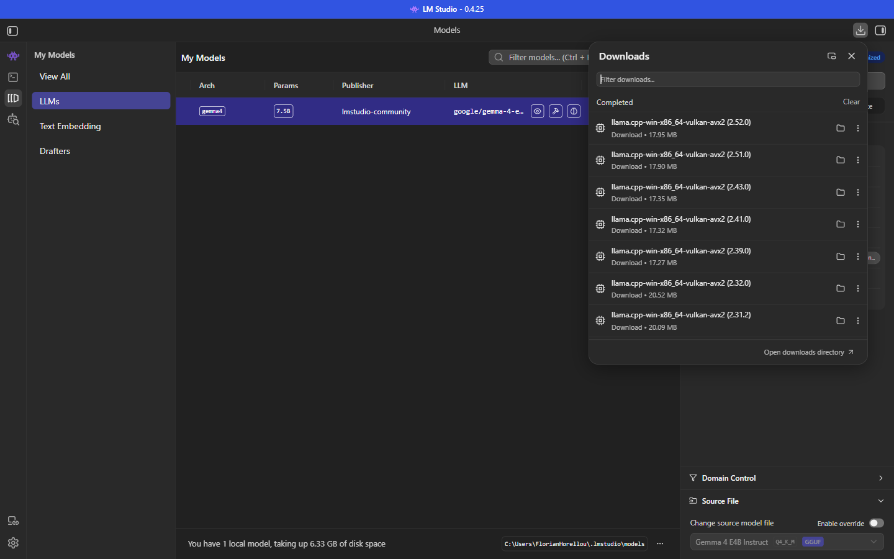
*Figure 6 — Panneau Downloads.*

Il liste les téléchargements **en cours** et **terminés** (filtre, *Clear*, *Open downloads directory*). *Exemple : sur le poste de test, aucun modèle n'y figure ; seuls apparaissent des paquets de moteur `llama.cpp-win-x86_64-vulkan-avx2` (versions 2.31.2 à 2.52.0, 17 à 20 Mo chacun) téléchargés par la mise à jour automatique.*

---

## 10. Organisation des fichiers et modèles installés

### 10.1 Organisation des fichiers

Dossier par défaut : `C:\Users\<utilisateur>\.lmstudio\models\` (modifiable : *Settings → General → Models Directory*, [Manuel 01](01-prise-en-main.md#61-general)).

Structure **obligatoire** : `models\<éditeur>\<dépôt>\<fichiers>`.

```text
.lmstudio\models\
└── lmstudio-community\                       <- éditeur (publisher)
    └── gemma-4-E4B-it-GGUF\                  <- dépôt (repository)
        ├── gemma-4-E4B-it-Q4_K_M.gguf        <- le modèle (5,34 Go)
        └── mmproj-gemma-4-E4B-it-BF16.gguf   <- l'adaptateur de vision (0,99 Go)
```

> **Règle** — Le fichier `mmproj-*.gguf` se place dans le **même dossier** que le modèle (convention de nommage des dépôts `lmstudio-community`). Un modèle de vision sans son `mmproj` se charge, mais **ne voit pas les images**.

### 10.2 My Models : modèles installés

Onglet **My Models** (3ᵉ icône de la barre de navigation).

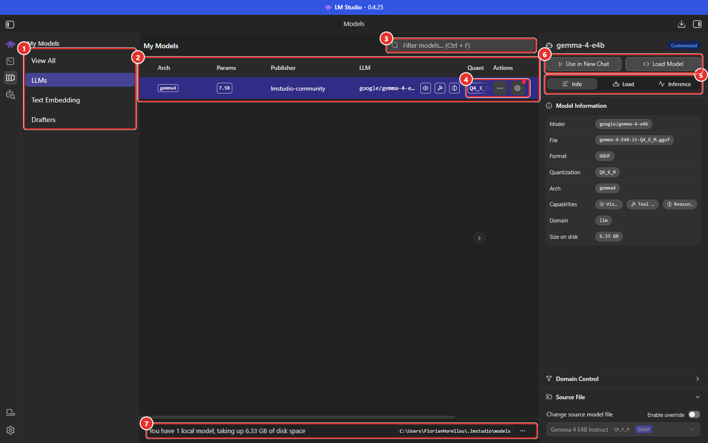
*Figure 7 — Page My Models.*

| N° | Zone | Rôle |
|---|---|---|
| 1 | Catégories | **View All**, **LLMs** (langage), **Text Embedding** (vectorisation pour recherche sémantique / RAG), **Drafters** (petits modèles « brouillons » pour le décodage spéculatif). |
| 2 | Tableau | Un modèle par ligne : architecture, paramètres, éditeur, identifiant, capacités (œil / outil / raisonnement), quantification, taille, date. En-têtes **triables**. |
| 3 | Filtre | Recherche dans la liste (`Ctrl + F`). |
| 4 | Actions | Menu `…` et **engrenage** (réglages par défaut du modèle). Un **point rouge** signale des réglages personnalisés (badge **Customized**). |
| 5 | Onglets **Info / Load / Inference** | Fiche du modèle et réglages par défaut. |
| 6 | **Use in New Chat** / **Load Model** | Ouvrir une conversation avec ce modèle, ou le charger. |
| 7 | Pied de page | Nombre de modèles, espace disque, **dossier des modèles** et son menu `…`. |

### 10.3 Onglet Info

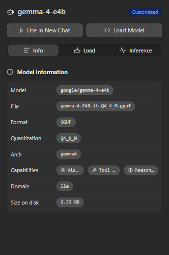
*Figure 8 — Onglet Info.*

Fiche d'identité : identifiant (`google/gemma-4-e4b`), fichier, format, quantification, architecture, capacités, domaine (`llm`), taille sur disque. Plus bas : *Domain Control* (forcer le type du modèle — LLM ou embedding — si LM Studio se trompe) et *Source File* (changer le fichier source).

### 10.4 Onglets Load et Inference : valeurs par défaut du modèle

Les réglages existent à **deux niveaux** :

| Niveau | Emplacement | Portée |
|---|---|---|
| **Par défaut du modèle** | *My Models* → onglets **Load** et **Inference** | Chaque chargement ou nouvelle conversation avec ce modèle ; **également** valeurs appliquées aux requêtes d'API qui ne précisent pas un paramètre |
| **Par conversation** | Panneau de droite du Chat | La conversation ouverte |

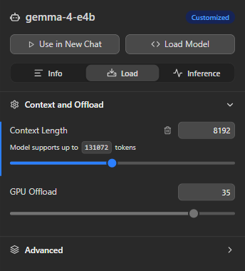
*Figure 9 — Onglet Load : paramètres de chargement par défaut (sections *Context and Offload* ouverte, *Advanced* repliée).*

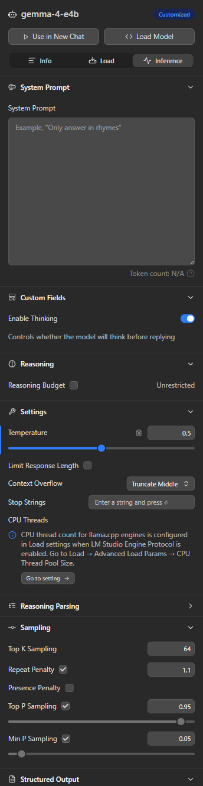
*Figure 10 — Onglet Inference : paramètres de génération par défaut.*

Champs de **Load** : [Manuel 03](03-charger-un-modele.md). Champs de **Inference** : [Manuel 04](04-parametrer-l-inference.md).

### 10.5 Menu `…` d'un modèle

Entrées : **Open in File Explorer**, **Pin to Top** (épingler en tête de liste), **Copy Default Identifier** (identifiant à utiliser dans l'API), **Copy Absolute Path**, **Show on Web** (page du modèle), **Delete** (suppression du disque).

> **Attention** — **Delete** supprime les fichiers. En connexion limitée, le retéléchargement est coûteux : conserver une copie du GGUF (clé USB, partage réseau) avant toute suppression.

### 10.6 Menu du dossier des modèles

Le menu `…` du pied de page propose **Open in File Explorer**, **Change…** (autre dossier, par exemple un disque plus grand), **Reset to Default Path** et **Refresh model list** (après une copie manuelle de fichier).

---

## 11. Charger un modèle : le sélecteur

Le sélecteur s'ouvre avec `Ctrl + L`.

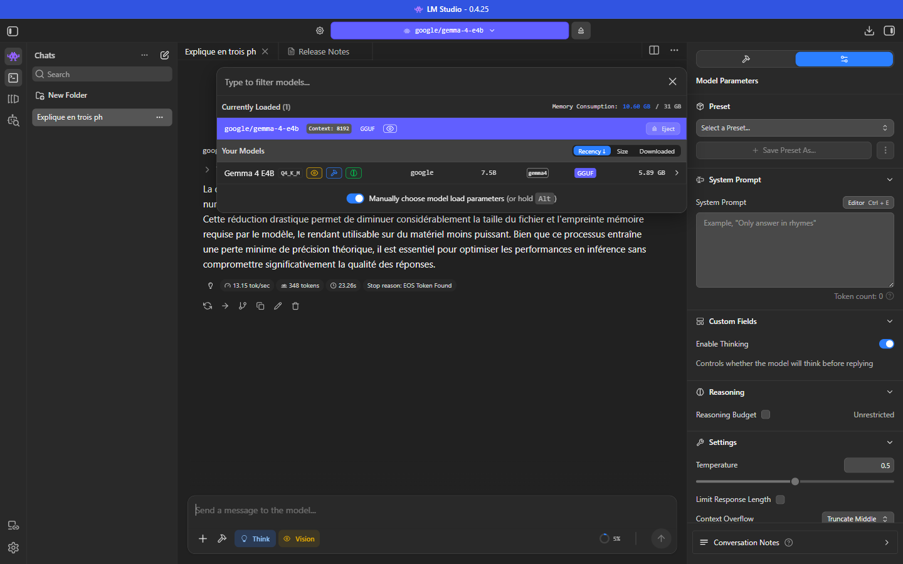
*Figure 11 — Sélecteur de modèle.*

- **Currently Loaded** : modèles en mémoire, contexte alloué, bouton **Eject**, consommation mémoire globale (`10.60 GB / 31 GB`) ;
- **Your Models** : modèles installés (taille, architecture, capacités), triables par **Recency**, **Size**, **Downloaded** ;
- **Manually choose model load parameters** (ou `Alt` + clic) : ouvre la fenêtre de chargement complète ([Manuel 03](03-charger-un-modele.md)).

---

## 12. Check-list de choix

- [ ] **Besoin** : chat, images, OCR, outils, raisonnement ? Vérifier les pastilles de capacités.
- [ ] **Format** : GGUF (Windows / Linux) ; MLX seulement sur Mac Apple Silicon ; AWQ / GPTQ non chargeables.
- [ ] **Ligne choisie** : modèle principal (pas un modèle brouillon « Mtp »), variante `Instruct` pour le chat.
- [ ] **Taille** : fichier + cache KV < RAM disponible, avec ≥ 20 % de marge ([Manuel 01](01-prise-en-main.md#69-hardware-ctrl--maj--h)).
- [ ] **Indicateur** : vert de préférence ; bleu = plus lent ; rouge = à éviter ([section 6](#6-les-indicateurs-dadéquation-matérielle)).
- [ ] **Quantification** : `Q4_K_M` par défaut ; `Q6_K` / `Q8_0` pour la précision.
- [ ] **`mmproj`** présent si le modèle doit lire des images (œil dans la liste).
- [ ] **Langue** : modèle entraîné sur le français ?
- [ ] **Licence** : vérifiée dans le README (Gemma 4 : Apache 2.0 selon la fiche officielle) ; validation juridique selon l'usage.
- [ ] **Source** : Staff Pick ou éditeur reconnu ; prudence avec les variantes modifiées.
- [ ] **Sauvegarde** du GGUF avant suppression.
