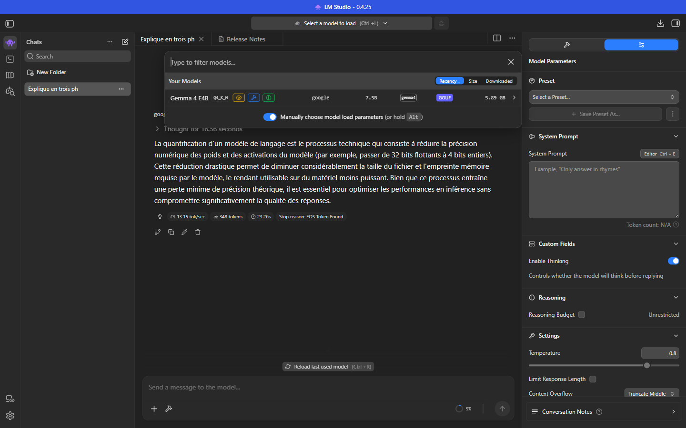
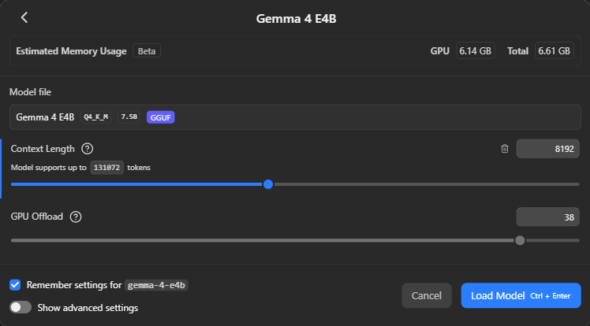
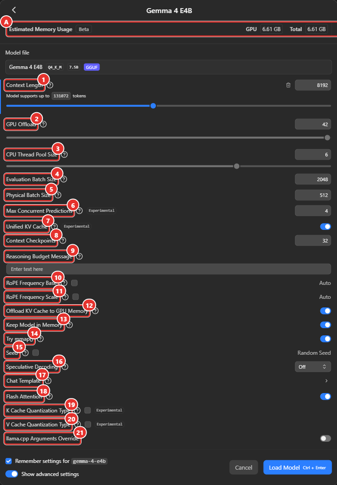
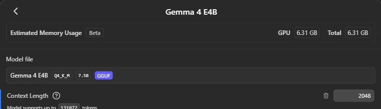
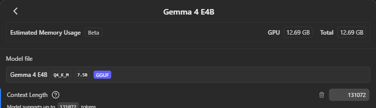
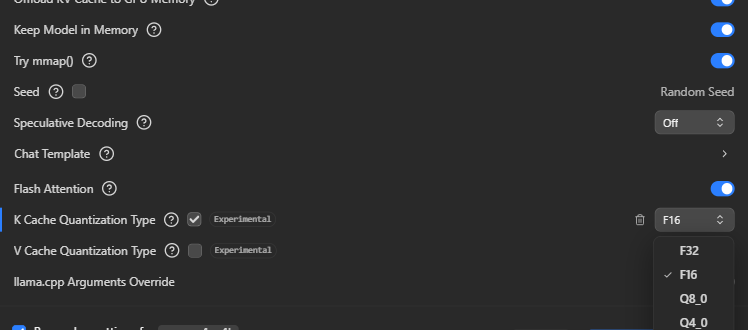
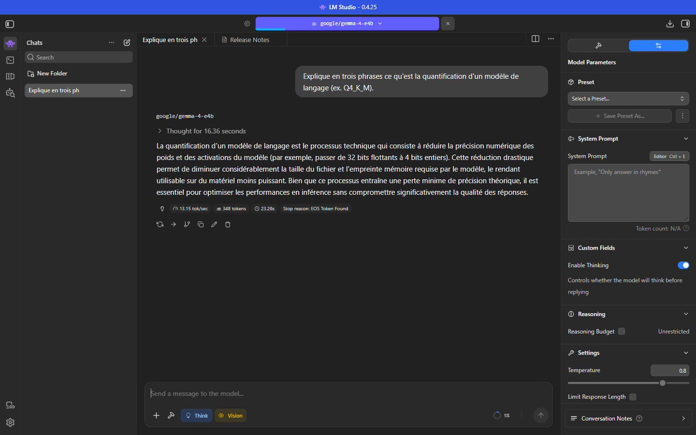
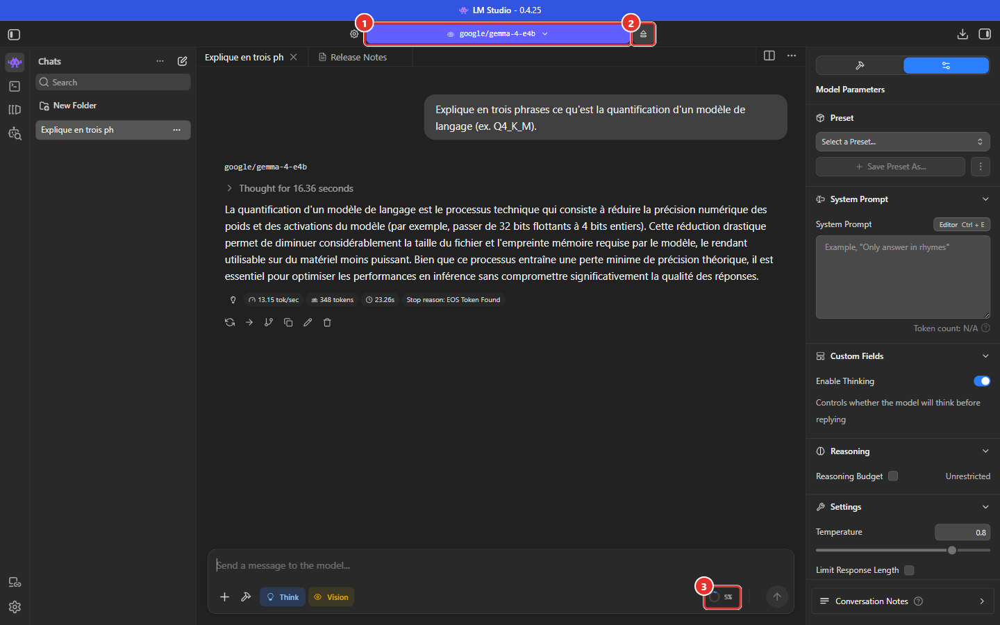
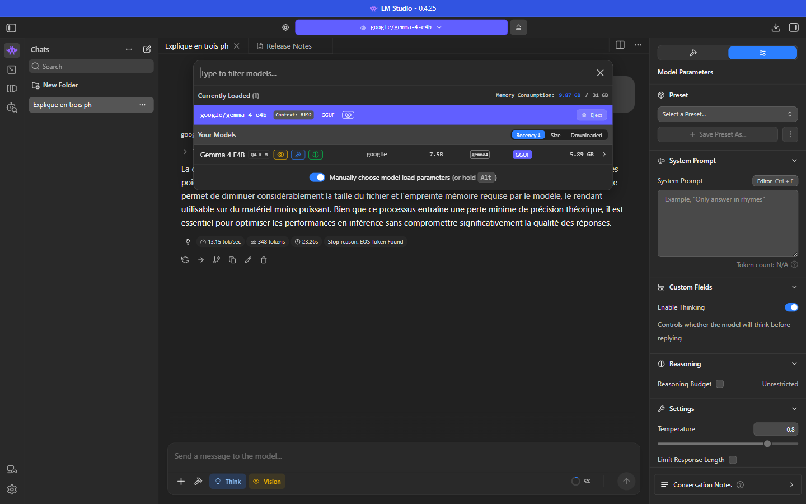

# Manuel 03 — Charger un modèle : paramètres de chargement

> **Objet** : expliquer ce que fait chaque paramètre de la fenêtre de chargement de LM Studio, son effet sur la mémoire et la vitesse, et la façon de le régler selon le cas d'usage.
> **Prérequis** : [Manuel 01](01-prise-en-main.md) (Developer mode activé) et [Manuel 02](02-selectionner-et-telecharger-un-modele.md).
> **Version décrite** : LM Studio 0.4.25, moteur llama.cpp (format GGUF).
> **Exemples** : mesures réalisées sur le poste de test (Core Ultra 7 255H, 31 Go de RAM, GPU intégré Intel Arc 140T, moteur Vulkan) avec le modèle *Gemma 4 E4B* (Q4_K_M, 6,33 Go). Les valeurs numériques sont propres à cette configuration ; les principes sont généraux.

---

## Sommaire

1. [Principe : ce que « charger » signifie](#1-principe--ce-que--charger--signifie)
2. [Composition de la mémoire](#2-composition-de-la-mémoire)
3. [Ouvrir la fenêtre de chargement](#3-ouvrir-la-fenêtre-de-chargement)
4. [Référence des paramètres](#4-référence-des-paramètres)
5. [Effets mesurés](#5-effets-mesurés)
6. [Réglages types par cas d'usage](#6-réglages-types-par-cas-dusage)
7. [Mémoriser, automatiser, décharger](#7-mémoriser-automatiser-décharger)
8. [Dépannage](#8-dépannage)

---

## 1. Principe : ce que « charger » signifie

Charger un modèle consiste à copier ses **poids** (le fichier GGUF) dans la mémoire de la machine, à réserver la mémoire de travail (cache et tampons de calcul) et à initialiser le moteur d'inférence.

Deux familles de réglages coexistent :

| Famille | Moment d'application | Modification | Documentation |
|---|---|---|---|
| **Paramètres de chargement** (*Load*) | À l'instant du chargement | Exige de **décharger puis recharger** le modèle | Ce manuel |
| **Paramètres d'inférence** (*Inference*) : température, prompt système, échantillonnage… | À chaque message | Immédiate, sans rechargement | [Manuel 04](04-parametrer-l-inference.md) |

> **Exemple** — Changer la taille de contexte de 8192 à 32768 impose un rechargement ; changer la température de 0,5 à 0,8 s'applique au message suivant.

---

## 2. Composition de la mémoire

La mémoire consommée par un modèle chargé se décompose en trois postes :

| Poste | Dépend de | Ordre de grandeur |
|---|---|---|
| **Poids du modèle** | Taille du fichier GGUF (paramètres × bits de quantification) | Constant : ≈ taille du fichier |
| **Cache KV** | **Taille de contexte** × nombre de couches × taille des têtes d'attention × précision du cache | Croît **linéairement** avec le contexte |
| **Tampons de calcul** | Tailles de lots (*batch*), pièces vision, moteur | Quelques centaines de Mo |

Méthode complète de calcul, avec tableau d'ordres de grandeur et script : [Manuel 00, section 7](00-notions-fondamentales.md#7-calculer-la-ram-nécessaire).

Formule du cache KV, valable pour tout modèle à attention classique :

```text
octets par token = 2 (K et V) × couches × têtes KV × dimension d'une tête × octets par valeur
cache KV         = octets par token × taille de contexte × nombre de séquences non partagées
```

LM Studio affiche en temps réel une **estimation** (*Estimated Memory Usage*, étiquetée *Beta*) avec deux valeurs :

| Valeur | Signification |
|---|---|
| **GPU** | Part placée en mémoire graphique (VRAM, ou mémoire partagée pour un GPU intégré). |
| **Total** | Mémoire totale nécessaire (GPU + RAM système). |

Cette estimation évolue à chaque modification d'un paramètre (avec un léger retard) et sert de base aux **garde-fous** de chargement (voir le [Manuel 01](01-prise-en-main.md#65-model-defaults)). La commande `lms load <modèle> -c <contexte> --estimate-only` fournit la même estimation en ligne de commande (en GiB ; de légers écarts avec l'interface sont normaux).

> **Exemple (Gemma 4 E4B)** — Poids : 6,33 Go (dont 0,99 Go de projecteur vision). Cache KV : ≈ 50 Ko par token en F16. Estimation à 8 192 tokens : **6,61 Go** ; à 131 072 tokens : **12,69 Go**.

> **Contexte par défaut selon l'application** — LM Studio propose **8 192** tokens (valeur modifiable, *Settings → Model Defaults*, [Manuel 01](01-prise-en-main.md#65-model-defaults)) **[Vérifié]**. Bionic charge un modèle avec un contexte **bien plus grand** : 262 144 tokens mesurés pour *Gemma 4 12B QAT*, soit 14,1 Go de RAM occupés pour un fichier de 7,15 Go ([Manuel Bionic 04](../bionic/04-modeles.md)). Le même modèle peut donc être léger dans un outil et très gourmand dans l'autre.

---

## 3. Ouvrir la fenêtre de chargement

| Méthode | Procédure |
|---|---|
| **Sélecteur de modèle** | `Ctrl + L` → activer **Manually choose model load parameters** → cliquer sur le modèle. Équivalent : maintenir `Alt` en cliquant. |
| **Réglage permanent** | *Settings → General → Always open full model loader panel*. |
| **My Models** | Sélectionner le modèle → **Load Model**. |
| **Ligne de commande** | `lms load <modèle> [options]` (voir [section 7](#7-mémoriser-automatiser-décharger)). |
| **API** | `POST /api/v1/models/load` ou chargement automatique à la première requête (*Just-in-Time*, [Manuel 06](06-serveur-local-et-api.md)). |

Sans le mode manuel, le sélecteur charge immédiatement le modèle avec les réglages mémorisés.


*Figure 1 — Sélecteur de modèle (`Ctrl + L`) : liste des modèles installés et interrupteur « Manually choose model load parameters ».*

### 3.1 Vue simple


*Figure 2 — Vue simple : estimation mémoire, taille de contexte et déchargement GPU.*

La vue simple ne propose que :

- **Context Length** : taille de contexte ;
- **GPU Offload** : nombre de couches placées sur le GPU (valeur **proposée automatiquement** selon la mémoire disponible) ;
- **Remember settings for …** : mémorise les réglages comme valeurs par défaut du modèle ;
- **Show advanced settings** : bascule vers la vue avancée.

### 3.2 Vue avancée


*Figure 3 — Vue avancée. **A** : estimation mémoire. **1 à 21** : paramètres, détaillés en [section 4](#4-référence-des-paramètres).*

Le trait bleu à gauche d'un paramètre indique une valeur **différente du défaut** ; l'icône de corbeille à droite la **réinitialise**. L'icône **?** affiche la description officielle.

---

## 4. Référence des paramètres

Les descriptions entre guillemets sont la traduction des infobulles officielles de LM Studio 0.4.25. Les colonnes « Défaut » indiquent la valeur observée à l'ouverture sur le poste de test (elle varie selon le modèle et la machine).

### 4.1 Mémoire et contexte

| N° | Paramètre | Rôle et effet | Plage / défaut | Quand modifier |
|---|---|---|---|---|
| 1 | **Context Length** | « Nombre maximal de tokens que le modèle peut considérer dans un prompt. » Détermine la longueur cumulée *question + historique + documents + réponse*. Le cache KV croît **linéairement** avec cette valeur. | 1 024 → maximum du modèle (curseur logarithmique). Défaut : valeur mémorisée du modèle, sinon *Settings → Model Defaults → Default Context Length*. | **Réduire** pour économiser la mémoire ; **augmenter** pour de longs documents, de l'OCR multipage ou des conversations longues. Une valeur supérieure au besoin gaspille de la mémoire. |
| 2 | **GPU Offload** | « Nombre de couches du modèle calculées sur le GPU. » Plus de couches sur le GPU = génération plus rapide. | 0 → nombre total de couches du modèle (42 pour l'exemple). Défaut : calculé selon la mémoire libre. | **Maximum** si la mémoire graphique le permet. Réduire pour libérer de la mémoire graphique ou lorsque le modèle ne tient pas entièrement. À 0, le calcul se fait sur le CPU. |
| 12 | **Offload KV Cache to GPU Memory** | « Place le cache KV en mémoire GPU. Améliore les performances mais exige plus de mémoire GPU. » | Activé | Désactiver si la mémoire graphique est saturée : le cache passe en RAM (plus lent). |
| 13 | **Keep Model in Memory** | « Réserve de la mémoire système pour le modèle, même déchargé sur GPU. Améliore les performances mais exige plus de RAM. » | Activé | Désactiver sur une machine à RAM limitée. |
| 14 | **Try mmap()** | « Améliore le temps de chargement. Le désactiver peut améliorer les performances lorsque le modèle dépasse la RAM disponible. » | Activé | Désactiver uniquement si le modèle est plus grand que la RAM libre. |
| 18 | **Flash Attention** | « Diminue l'usage mémoire et le temps de génération sur certains modèles. » Prérequis pour quantifier le cache V. | Activé | Laisser activé ; désactiver seulement en cas d'instabilité ou de sortie incohérente avec un modèle donné. |
| 19 | **K Cache Quantization Type** *(Experimental)* | « Des valeurs plus basses réduisent la mémoire mais peuvent diminuer la qualité. L'effet varie fortement selon les modèles. » Compresse le cache des clés. Valeurs : F32, **F16** (défaut), Q8_0, Q4_0, Q4_1, IQ4_NL, Q5_0, Q5_1. | Case décochée = F16 | Contextes très longs sur mémoire limitée. À éviter pour les tâches de précision (OCR, chiffres) sans test préalable. |
| 20 | **V Cache Quantization Type** *(Experimental)* | Idem, pour le cache des valeurs. **Requiert Flash Attention.** | Case décochée = F16 | Idem. |

### 4.2 Performance de calcul

| N° | Paramètre | Rôle et effet | Plage / défaut | Quand modifier |
|---|---|---|---|---|
| 3 | **CPU Thread Pool Size** | « Nombre de threads CPU alloués au pool utilisé pour le calcul du modèle. » Concerne les couches calculées sur CPU et la préparation des données. | 1 → 8 (curseur) ; défaut 6 | Modifier surtout si le calcul se fait en grande partie sur CPU. Une valeur supérieure au nombre de cœurs physiques n'apporte pas de gain. |
| 4 | **Evaluation Batch Size** | « Nombre maximal de tokens de prompt planifiés pendant le traitement du prompt. Des valeurs plus grandes peuvent améliorer les performances mais utiliser plus de mémoire. » | 2 048 | Rarement. Aucun effet mesurable sur l'estimation mémoire dans l'exemple. |
| 5 | **Physical Batch Size** | « Nombre maximal de tokens de prompt traités en un seul bloc. » Augmente les tampons de calcul. | 512 | Augmenter peut accélérer le traitement de longs prompts (images, documents) au prix de mémoire ; diminuer pour économiser quelques centaines de Mo. |

### 4.3 Concurrence

| N° | Paramètre | Rôle et effet | Plage / défaut | Quand modifier |
|---|---|---|---|---|
| 6 | **Max Concurrent Predictions** *(Experimental)* | « Nombre maximal de prédictions que le modèle peut exécuter simultanément. La vitesse de chaque prédiction peut diminuer, mais chacune démarre plus vite et un débit total plus élevé peut être atteint. » | 4 | **1** pour un usage mono-utilisateur ou un traitement séquentiel ; **≥ 2** pour un serveur partagé **sur matériel offrant de la marge de calcul** (voir [section 5.5](#55-concurrence-sur-gpu-intégré)). |
| 7 | **Unified KV Cache** *(Experimental)* | « Les prédictions concurrentes partagent un seul cache KV, ce qui économise de la mémoire. Le désactiver garantit que chaque prédiction peut utiliser toute la longueur de contexte, au prix de plus de mémoire. » | Activé | Désactiver si plusieurs requêtes longues simultanées doivent chacune disposer du contexte complet. |
| 8 | **Context Checkpoints** | « Nombre maximal de points de contrôle de contexte conservés par slot du serveur llama. 0 désactive les points de contrôle. » Permet de réutiliser le calcul d'un début de prompt identique (cache de prompt), surtout pour les modèles à attention à fenêtre glissante. *Documentation LM Studio : absente ; description par analogie avec llama.cpp.* | 32 | Laisser par défaut. |

### 4.4 Comportement du modèle

| N° | Paramètre | Rôle et effet | Plage / défaut | Quand modifier |
|---|---|---|---|---|
| 9 | **Reasoning Budget Message** | « Message injecté avant la balise de fin de réflexion lorsque le budget de raisonnement est épuisé (défaut : aucun). » Associé au réglage *Reasoning Budget* ([Manuel 04](04-parametrer-l-inference.md)). | Vide | Pour inciter un modèle raisonneur à conclure lorsque sa réflexion est plafonnée. |
| 10 | **RoPE Frequency Base** | « Fréquence de base personnalisée des embeddings positionnels rotatifs (RoPE). L'augmenter peut améliorer les performances à long contexte. » | *Auto* (case décochée) | Uniquement pour dépasser le contexte d'entraînement, selon les recommandations de l'éditeur du modèle. |
| 11 | **RoPE Frequency Scale** | « La longueur de contexte est mise à l'échelle par ce facteur pour étendre le contexte effectif via RoPE. » | *Auto* | Idem. |
| 15 | **Seed** | « Graine du générateur aléatoire utilisé pour la génération. -1 = aléatoire. » | *Random Seed* (case décochée) | Fixer pour obtenir des résultats **reproductibles** (tests, comparaisons). |
| 16 | **Speculative Decoding** | « Configure le décodage spéculatif au chargement. » Un petit modèle *drafter* propose des tokens que le modèle principal valide : génération plus rapide sans changer le résultat. | *Off* | Quand un drafter compatible est installé (onglet *Drafters* de My Models). |
| 17 | **Chat Template** | « Gabarit utilisé par le protocole du moteur pour le chat, les outils, le raisonnement et le formatage multimodal. Le modifier exige de recharger le modèle. » | Gabarit intégré au modèle | Uniquement si le gabarit fourni est défectueux ou si l'éditeur en recommande un autre. |
| 21 | **llama.cpp Arguments Override** | Permet de transmettre des arguments llama.cpp supplémentaires. *Syntaxe non documentée dans les sources consultées : [À tester].* | Désactivé | Cas avancés uniquement. |

---

## 5. Effets mesurés

Mesures sur le poste de test, modèle *Gemma 4 E4B* Q4_K_M. Les relevés d'estimation proviennent de l'interface (valeurs stabilisées) ; les relevés de vitesse proviennent de `lms load` + API (génération de 200 tokens, prompt de 2 119 tokens).

### 5.1 Taille de contexte et mémoire

| Contexte (tokens) | 2 048 | 4 096 | 8 192 | 16 384 | 32 768 | 65 536 | 131 072 |
|---|---|---|---|---|---|---|---|
| **Mémoire estimée (Go)** | 6,31 | 6,41 | 6,61 | 7,02 | 7,83 | 9,45 | 12,69 |

```text
  2 048 | ████████████████████████████████                                6,31 Go
  8 192 | █████████████████████████████████                               6,61 Go
 32 768 | ████████████████████████████████████████                        7,83 Go
 65 536 | ███████████████████████████████████████████████                 9,45 Go
131 072 | ████████████████████████████████████████████████████████████████ 12,69 Go
          (1 caractère = 0,2 Go)
```

| Contexte 2 048 tokens | Contexte 131 072 tokens |
|---|---|
|  |  |

*Figure 4 — Estimation mémoire affichée par la fenêtre de chargement pour deux tailles de contexte (6,31 Go et 12,69 Go).*

Chaque doublement du contexte ajoute le double du précédent : **≈ +50 Ko par token**. Le contexte maximal annoncé par un modèle n'est donc pas un réglage par défaut raisonnable : à 131 072 tokens, le cache KV représente à lui seul autant que le modèle.

### 5.2 Effet des autres paramètres sur l'estimation (contexte 8 192)

| Paramètre | Valeurs testées | Effet sur le total | Effet sur la part GPU |
|---|---|---|---|
| **GPU Offload** | 0 / 12 / 24 / 36 / 42 couches | Aucun (6,61 Go) | **0 / 1,89 / 3,94 / 5,83 / 6,61 Go** : proportionnel au nombre de couches |
| **Offload KV Cache to GPU** | activé → désactivé | Aucun | −0,40 Go (le cache passe en RAM) |
| **Physical Batch Size** | 128 / 512 / 1 024 / 2 048 | **6,49 / 6,61 / 6,77 / 7,09 Go** | idem |
| **Evaluation Batch Size** | 512 / 2 048 / 8 192 | Aucun | Aucun |
| **Max Concurrent Predictions** | 4 → 1 | Aucun (cache unifié) | Aucun |
| **Flash Attention** (contexte 32 768) | activé → désactivé | +0,02 Go | — |

### 5.3 Quantification du cache KV (contexte 32 768)

| K | V | Mémoire estimée | Économie vs F16 |
|---|---|---|---|
| F16 | F16 | 7,83 Go | — |
| Q8_0 | F16 | 7,45 Go | −0,38 Go |
| Q8_0 | Q8_0 | 7,07 Go | −0,76 Go (≈ −47 % du cache) |
| Q4_0 | Q4_0 | 6,67 Go | −1,16 Go (≈ −71 % du cache) |

À contexte maximal (131 072 tokens), le gain se multiplie par quatre : le cache F16 d'environ 6 Go passe à environ 3 Go en Q8_0 *(extrapolation de la mesure à 32 768 tokens)*. Le coût en qualité n'a pas été mesuré : **l'effet varie selon les modèles** (infobulle officielle) et doit être validé sur des cas réels.


*Figure 5 — Case « K Cache Quantization Type » cochée : liste des types (F32, F16, Q8_0, Q4_0…).*

### 5.4 Vitesse selon le déchargement GPU

| Configuration (contexte 8 192, 1 requête) | Traitement du prompt | Génération | Chargement |
|---|---|---|---|
| GPU 100 % (42 couches) | **353 tok/s** | **14,8 tok/s** | 16 s |
| GPU 50 % | 250 tok/s | 13,3 tok/s | 17 s |
| CPU seul (GPU 0) | 215 tok/s | 11,2 tok/s | 15 s |

Sur ce GPU **intégré**, le passage au GPU améliore la génération d'environ **+30 %** et le traitement du prompt d'environ **+65 %**. Un GPU dédié, doté de sa propre mémoire rapide, donne généralement des écarts bien plus importants. Principe général : la génération est limitée par la **bande passante mémoire** ; le traitement du prompt par la **puissance de calcul**.

### 5.5 Concurrence sur GPU intégré

| Configuration | Génération par requête | Débit total |
|---|---|---|
| 1 requête | 14,8 tok/s | 14,8 tok/s |
| 4 requêtes simultanées (*Max Concurrent Predictions* = 4) | **3,3 tok/s** | **12,8 tok/s** |

Quatre requêtes simultanées se partagent la même bande passante mémoire : le **débit total n'augmente pas** et chaque utilisateur est servi quatre fois plus lentement. La concurrence n'apporte un gain que si le matériel dispose de marge de calcul inutilisée (GPU dédié puissant). Sur machine modeste, préférer **1 requête à la fois** et une file d'attente côté application.

---

## 6. Réglages types par cas d'usage

| Cas d'usage | Context Length | GPU Offload | Concurrent | KV cache | Remarques |
|---|---|---|---|---|---|
| **Chat personnel, machine modeste** | 4 096 – 8 192 | Maximum possible | 1 | F16 | Réponses rapides, mémoire minimale. |
| **Analyse de longs documents, RAG** | 32 768 et plus | Maximum possible | 1 | Q8_0 si la mémoire manque | Vérifier l'estimation ; le contexte coûte ≈ 50 Ko/token (modèle de 7-8 Md de paramètres). |
| **OCR / vision de pages** | ≥ 16 384 (une page ≈ 1 000 à 2 000 tokens d'image, plus la sortie) | Maximum possible | 1 | **F16** (ne pas dégrader) | Voir [Manuel 05](05-vision-images-et-ocr.md). |
| **Serveur partagé, GPU dédié** | Selon le besoin × nombre d'utilisateurs | Maximum | 2 – 8 | Unifié | Tester le débit total avec le nombre réel d'utilisateurs. |
| **RAM limitée (≤ 16 Go)** | 2 048 – 4 096 | Partiel | 1 | Q8_0 | *Keep Model in Memory* désactivé ; modèle plus petit ou quantification inférieure. |
| **Tests reproductibles** | Défaut | Défaut | 1 | F16 | *Seed* fixée + température 0 ([Manuel 04](04-parametrer-l-inference.md)). |
| **Vitesse maximale** | Juste suffisant | Maximum | 1 | F16 | Flash Attention activé ; éviter toute quantification du cache. |

---

## 7. Mémoriser, automatiser, décharger

### 7.1 Mémoriser les réglages

La case **Remember settings for <modèle>** enregistre les paramètres comme **valeurs par défaut du modèle** : ils sont proposés à chaque chargement ultérieur et consultables dans *My Models → <modèle> → onglet Load* (voir [Manuel 02](02-selectionner-et-telecharger-un-modele.md#104-onglets-load-et-inference--valeurs-par-défaut-du-modèle)). Décocher la case pour un essai ponctuel.

### 7.2 Équivalences en ligne de commande et API

| Paramètre | `lms load` | API `POST /api/v1/models/load` |
|---|---|---|
| Context Length | `-c, --context-length <n>` | `context_length` |
| GPU Offload | `--gpu <off \| max \| 0-1>` (ratio) | — |
| Max Concurrent Predictions | `--parallel <n>` | `parallel` |
| Évaluation Batch Size | — | `eval_batch_size` |
| Flash Attention | — | `flash_attention` |
| Offload KV Cache to GPU | — | `offload_kv_cache_to_gpu` |
| Identifiant du modèle | `--identifier <nom>` | — |
| Durée de vie (TTL) | `--ttl <secondes>` | — |
| Décodage spéculatif | `--speculative-draft-*` | — |
| Estimation seule | `--estimate-only` | — |

Exemple de chargement scripté :

```powershell
lms load google/gemma-4-e4b --gpu max -c 8192 --parallel 1 --identifier gemma -y
lms ps
lms unload gemma
```

### 7.3 Surveiller et décharger

- **Pendant le chargement** : une barre de progression s'affiche sous le nom du modèle, en haut de la fenêtre.
- **Une fois chargé** : l'identifiant du modèle apparaît dans le sélecteur ; un bouton d'**éjection** (**Eject**) le décharge.
- **Déchargement automatique** : un modèle chargé automatiquement par une requête API (*Just-in-Time*) est déchargé après une durée d'inactivité (TTL, 60 minutes par défaut ; [Manuel 06](06-serveur-local-et-api.md)).
- *Settings → Chat → When selecting a model to load, first unload any currently loaded ones* : décharge automatiquement le modèle précédent.


*Figure 6 — Pendant le chargement : barre de progression sous l'identifiant du modèle.*


*Figure 7 — Modèle chargé. ① Identifiant du modèle (ouvre le sélecteur) — ② Éjection — ③ Indicateur de remplissage du contexte de la conversation.*


*Figure 8 — Sélecteur avec un modèle chargé : contexte alloué, bouton Eject et consommation mémoire globale.*

---

## 8. Dépannage

| Symptôme | Cause probable | Action |
|---|---|---|
| Chargement bloqué par un message de **garde-fou** | L'estimation dépasse la limite fixée (*Settings → Model Defaults / Hardware → Guardrails*). | Réduire le contexte ou la quantification, libérer de la mémoire, ou ajuster les garde-fous (déconseillé : risque de saturation). |
| **Échec de chargement** ou plantage | Mémoire insuffisante ; GPU saturé. | Diminuer *Context Length* ; réduire *GPU Offload* ; désactiver *Offload KV Cache* ; fermer les applications gourmandes. |
| Machine très **lente** après chargement | Mémoire presque saturée (swap disque). | Estimation < 80 % de la RAM libre ; quantification inférieure ; contexte réduit. |
| Génération **plus lente que prévu** | Couches sur CPU ; plusieurs requêtes concurrentes ; contexte très rempli. | Vérifier *GPU Offload* ; passer *Max Concurrent Predictions* à 1 ; vider le contexte. |
| Réponse **tronquée** ou perte du début de conversation | Contexte saturé. | Augmenter *Context Length* (recharger) ; voir *Context Overflow* ([Manuel 04](04-parametrer-l-inference.md)). |
| Images **ignorées** par un modèle de vision | Fichier `mmproj` absent du dossier du modèle. | Placer `mmproj-*.gguf` dans le dossier du modèle ([Manuel 02](02-selectionner-et-telecharger-un-modele.md#101-organisation-des-fichiers)). |
| Estimation **différente** entre l'interface et `lms` | Valeurs par défaut différentes (parallélisme, unités GB / GiB). | Comparer à paramètres identiques ; considérer l'estimation comme indicative. |
| Après un changement de réglage, rien ne change | Les paramètres de chargement exigent un **rechargement**. | Décharger puis recharger le modèle. |
