# Manuel 04 — Paramétrer l'inférence

> **Objet** : paramétrer la génération d'un modèle dans LM Studio : comprendre chaque paramètre d'inférence, son effet et son réglage selon le cas d'usage, en partant de l'interface de conversation (chat) qui sert à les essayer.
> **Prérequis** : un modèle chargé ([Manuel 03](03-charger-un-modele.md)), Developer mode activé ([Manuel 01](01-prise-en-main.md#5-developer-mode)).
> **Version décrite** : LM Studio 0.4.25.
> **Exemples** : mesures sur le poste de test avec *Gemma 4 E4B* (Q4_K_M, GPU Vulkan). Les principes valent pour tout modèle ; les valeurs numériques sont propres à ce modèle et à cette machine.

---

## Sommaire

1. [Principe : paramètres de chargement et d'inférence](#1-principe--paramètres-de-chargement-et-dinférence)
2. [Premier échange et lecture de l'interface](#2-premier-échange-et-lecture-de-linterface)
3. [Gérer les conversations](#3-gérer-les-conversations)
4. [Le panneau de paramètres](#4-le-panneau-de-paramètres)
5. [Prompt système](#5-prompt-système)
6. [Raisonnement (thinking)](#6-raisonnement-thinking)
7. [Paramètres de génération et d'échantillonnage](#7-paramètres-de-génération-et-déchantillonnage)
8. [Sortie structurée](#8-sortie-structurée)
9. [Presets](#9-presets)
10. [Réglages types par cas d'usage](#10-réglages-types-par-cas-dusage)
11. [Mesures de l'effet des paramètres](#11-mesures-de-leffet-des-paramètres)
12. [Dépannage](#12-dépannage)

---

## 1. Principe : paramètres de chargement et d'inférence

| Famille | Quand | Où | Rechargement |
|---|---|---|---|
| **Chargement** | Au chargement du modèle | Fenêtre de chargement ([Manuel 03](03-charger-un-modele.md)) | Oui |
| **Inférence** | À chaque message | Panneau de droite du chat | Non |

Les paramètres d'inférence existent à **deux niveaux** :

| Niveau | Emplacement | Portée |
|---|---|---|
| **Par conversation** | Panneau de droite de l'onglet *Chat* | La conversation ouverte |
| **Par défaut du modèle** | *My Models → <modèle> → onglet Inference* ([Manuel 02](02-selectionner-et-telecharger-un-modele.md#104-onglets-load-et-inference--valeurs-par-défaut-du-modèle)) | Toute nouvelle conversation avec ce modèle |

Un **preset** ([section 9](#9-presets)) regroupe un jeu de paramètres réutilisable.

---

## 2. Premier échange et lecture de l'interface

1. Charger un modèle (`Ctrl + L`).
2. Cliquer sur **New** (icône de création, en haut de la liste des conversations) ou ouvrir une conversation existante.
3. Saisir un message dans la zone de saisie puis valider avec `Entrée`.

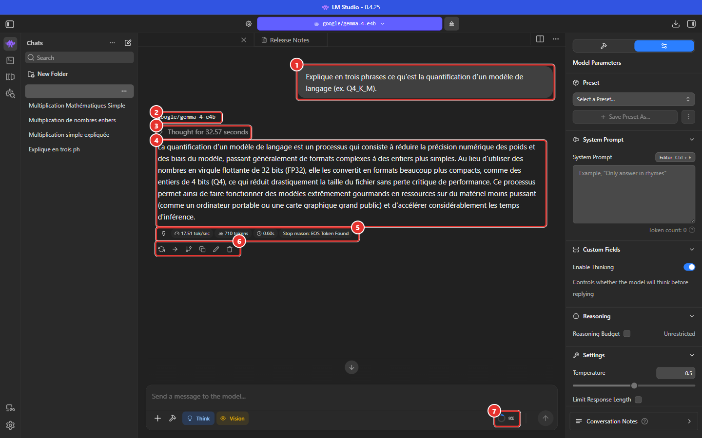
*Figure 1 — Une conversation avec un modèle à raisonnement. ① Message de l'utilisateur — ② Nom du modèle — ③ Bloc de réflexion (« Thought for … seconds ») — ④ Réponse — ⑤ Statistiques de génération — ⑥ Actions sur le message — ⑦ Indicateur de remplissage du contexte.*

### 2.1 Statistiques de génération (⑤)

| Élément | Signification |
|---|---|
| **tok/sec** | Vitesse de génération en tokens par seconde |
| **tokens** | Nombre de tokens générés (réflexion comprise) |
| Icône **horloge** | Délai avant le premier token (*Time To First Token*, TTFT) |
| **Stop reason** | Motif d'arrêt : `EOS Token Found` = le modèle a terminé sa réponse ; un autre motif signale une interruption (limite de longueur, chaîne d'arrêt, arrêt manuel). |

Par défaut, seules les statistiques du **dernier message** sont affichées ; *Settings → Appearance → Show Gen Info* permet de les afficher toujours ou au survol ([Manuel 01](01-prise-en-main.md#62-appearance)).

> **Exemple** — Réponse en 710 tokens à 17,5 tok/s, délai avant premier token 0,60 s. La même question avec un modèle plus lent ou un contexte plus rempli donne des valeurs différentes : ces statistiques servent à **comparer des réglages**, pas à promettre une performance.

### 2.2 Bloc de réflexion (③)

Un modèle à raisonnement affiche « Thought for N seconds » : un clic déplie le texte de sa réflexion.

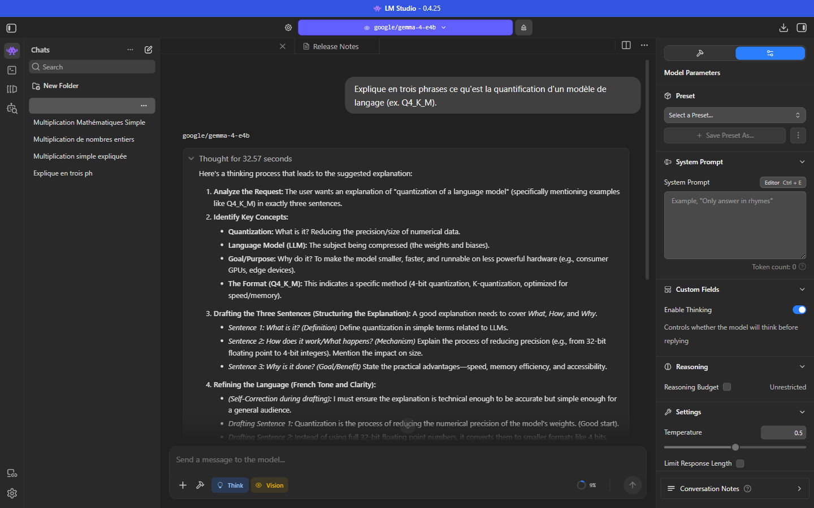
*Figure 2 — Réflexion dépliée. La réflexion peut être rédigée dans une autre langue que la question (ici en anglais pour une question en français).*

La réflexion ne fait pas partie de la réponse finale ; elle consomme du temps et des tokens (voir [section 6](#6-raisonnement-thinking)).

### 2.3 Zone de saisie

| Élément | Rôle |
|---|---|
| **+** | Joindre un fichier ou une image (voir [Manuel 05](05-vision-images-et-ocr.md)) |
| Icône **outils** | Activer des intégrations / plugins (voir [section 4.1](#41-longlet-integrations)) |
| Pastille **Think** | Reflète l'état du réglage *Enable Thinking* (colorée = actif, grisée = inactif) |
| Pastille **Vision** | Indique que le modèle accepte les images |
| Indicateur **%** (⑦) | Part du contexte déjà utilisée par la conversation |
| Bouton d'envoi / d'arrêt | Envoyer le message ; interrompre une génération en cours |

### 2.4 Actions sur un message (⑥)

Icônes affichées sous la réponse (de gauche à droite) : **régénérer** (`Ctrl + R` pour la dernière réponse), **continuer**, **dupliquer la conversation à partir de ce message** (branche), **copier**, **modifier**, **supprimer**. *Libellés déduits des icônes ; les infobulles ne sont pas affichées par l'interface.*

Régénérer une réponse avec une température non nulle produit un texte différent ; avec une température 0, un texte identique ([section 11](#11-mesures-de-leffet-des-paramètres)).

---

## 3. Gérer les conversations

Le menu `…` d'une conversation (liste de gauche) propose :

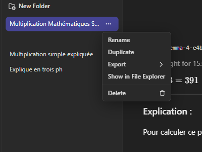
*Figure 3 — Menu d'une conversation.*

| Entrée | Effet |
|---|---|
| **Rename** | Renommer (par défaut, le modèle propose un nom : *Settings → Chat → AI-generated Chat Names*) |
| **Duplicate** | Dupliquer la conversation |
| **Export** | Exporter (sous-menu de formats) |
| **Show in File Explorer** | Afficher le fichier `.conversation.json` |
| **Delete** | Supprimer (corbeille Windows si l'option est activée) |

Les conversations peuvent être classées dans des **dossiers** (*New Folder*) et recherchées (*Search*). Les fichiers sont stockés **en clair** dans `%USERPROFILE%\.lmstudio\conversations\` ([Manuel 01](01-prise-en-main.md#7-stockage-des-données)).

---

## 4. Le panneau de paramètres

Le panneau de droite comporte deux onglets : **Integrations** (icône outil) et **Configuration** (icône curseurs, « Model Parameters »).

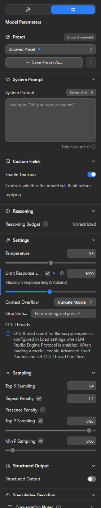
*Figure 4 — Panneau Model Parameters au complet (Developer mode activé). L'indicateur « Unsaved Preset » apparaît dès qu'un paramètre diffère de la valeur de départ.*

Sections, de haut en bas : **Preset**, **System Prompt**, **Custom Fields** (*Enable Thinking*), **Reasoning**, **Settings** (température, limite de réponse, dépassement de contexte, chaînes d'arrêt), **Sampling** (Top K, pénalités, Top P, Min P), **Structured Output**, **Speculative Decoding**, **Conversation Notes**.

Un **point bleu** à côté d'un paramètre signale une valeur modifiée ; l'icône de corbeille la **réinitialise**.

> **Paramètres déplacés** — Dans cette version, le nombre de threads CPU, le décodage spéculatif, le gabarit de prompt (*chat template*) et le *Reasoning Parsing* ne se règlent plus dans ce panneau mais dans la **fenêtre de chargement** ([Manuel 03](03-charger-un-modele.md#4-référence-des-paramètres)). Des messages d'information l'indiquent dans le panneau.

### 4.1 L'onglet Integrations

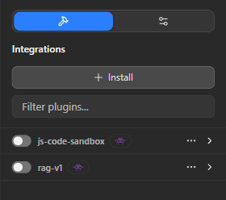
*Figure 5 — Onglet Integrations.*

Liste les **plugins** installables (bouton **Install**) et leur interrupteur d'activation. Deux plugins sont fournis : **js-code-sandbox** (exécution de code JavaScript dans un bac à sable) et **rag-v1** (interrogation de documents joints). Un plugin activé permet au modèle d'**appeler des outils** (modèles « Tool Use ») ; l'exécution demande une confirmation, sauf autorisation permanente dans *Settings → Integrations* ([Manuel 01](01-prise-en-main.md#66-integrations)).

> **Sécurité** — Un outil activé peut agir sur la machine (fichiers, code). N'activer que les plugins nécessaires et conserver la confirmation manuelle.

---

## 5. Prompt système

Le **prompt système** donne au modèle son rôle, ses règles et son format de réponse pour **toute la conversation**. Il est placé avant les messages de l'utilisateur.

| Élément | Détail |
|---|---|
| Champ **System Prompt** | Zone de texte du panneau (exemple affiché : « Only answer in rhymes ») |
| **Editor** (`Ctrl + E`) | Ouvre un éditeur en grand format dans un volet à côté de la conversation ; **Close Editor** le referme |
| **Token count** | Nombre de tokens consommés par le prompt système (déduits du contexte disponible) |

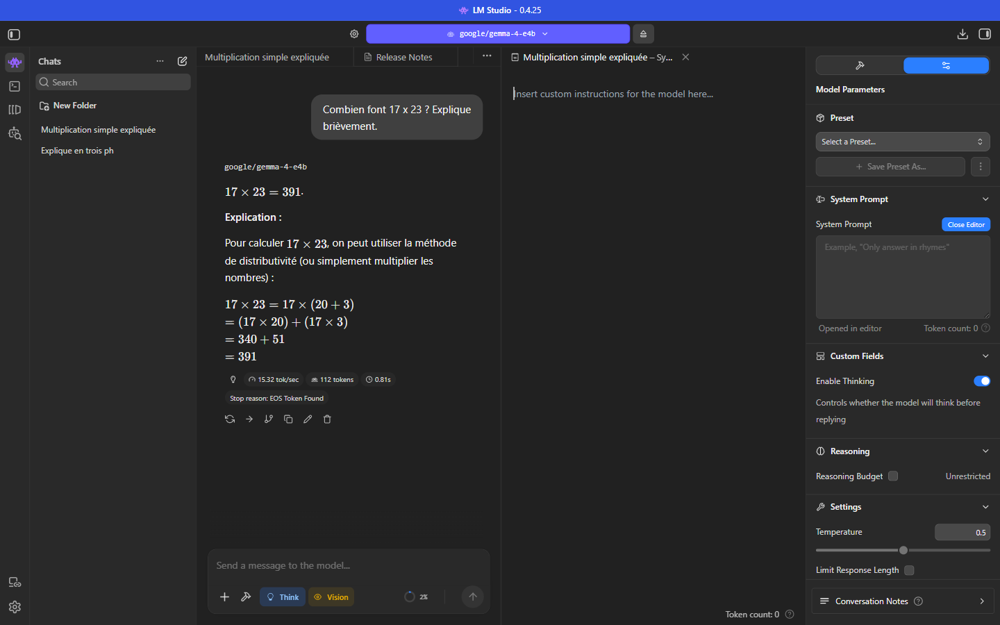
*Figure 6 — Éditeur de prompt système ouvert à droite de la conversation.*

**Bonnes pratiques** : rédiger des consignes **courtes, explicites et testables** (rôle, langue, format, interdits) ; préciser le format de sortie attendu ; ne pas y placer de données sensibles inutiles (le prompt est enregistré dans la conversation et dans les presets).

> **Exemple** — « Tu es un assistant technique. Réponds en français, en deux phrases maximum. » (utilisé dans [`exemples/02_chat_simple.py`](../../exemples/02_chat_simple.py)).

Certains modèles n'utilisent pas de prompt système (OlmOCR 2 : le laisser **vide**, [Manuel 05, section 7.5](05-vision-images-et-ocr.md#75-paramètres-de-chargement-et-dinférence)).

---

## 6. Raisonnement (thinking)

Certains modèles **réfléchissent** avant de répondre : ils produisent d'abord un texte de raisonnement, puis la réponse. Cela améliore souvent la fiabilité sur le calcul, la logique et les tâches en plusieurs étapes, mais **augmente le délai et le nombre de tokens**.

| Réglage | Emplacement | Effet |
|---|---|---|
| **Enable Thinking** | *Custom Fields* | Active ou désactive la réflexion du modèle. Visible pour les modèles qui la prennent en charge (pastille *Reasoning* du modèle). |
| **Reasoning Budget** | *Reasoning* | Plafonne le nombre de tokens de réflexion (*Unrestricted* par défaut). |
| **Reasoning Budget Message** | Fenêtre de chargement | Message injecté lorsque le budget est épuisé ([Manuel 03](03-charger-un-modele.md#44-comportement-du-modèle)). |
| Pastille **Think** | Zone de saisie | Reflète l'état du réglage. |

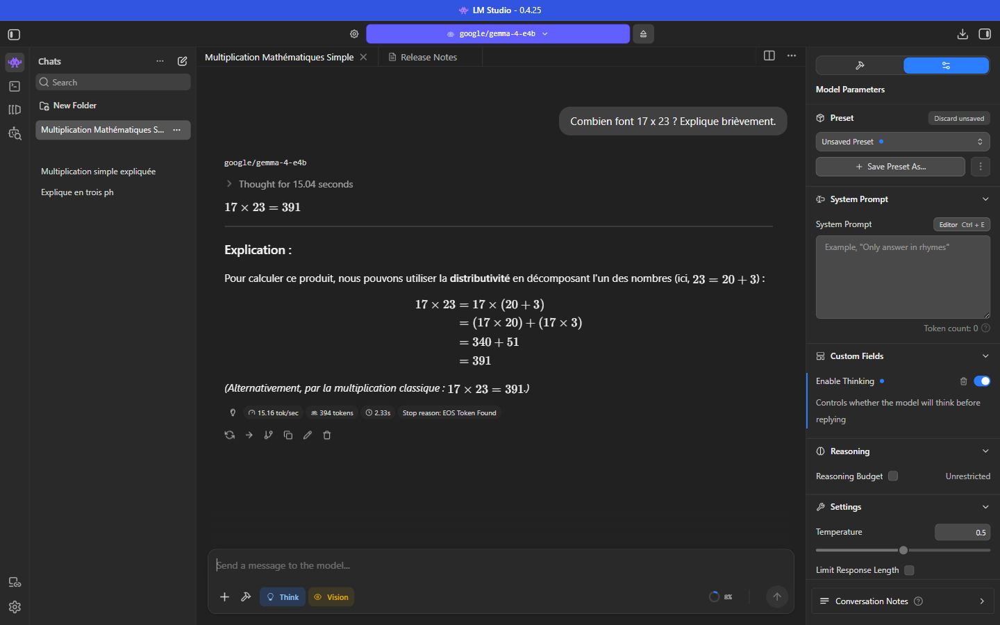
*Figure 7 — Thinking actif : bloc « Thought for 15.04 seconds » puis réponse (394 tokens).*

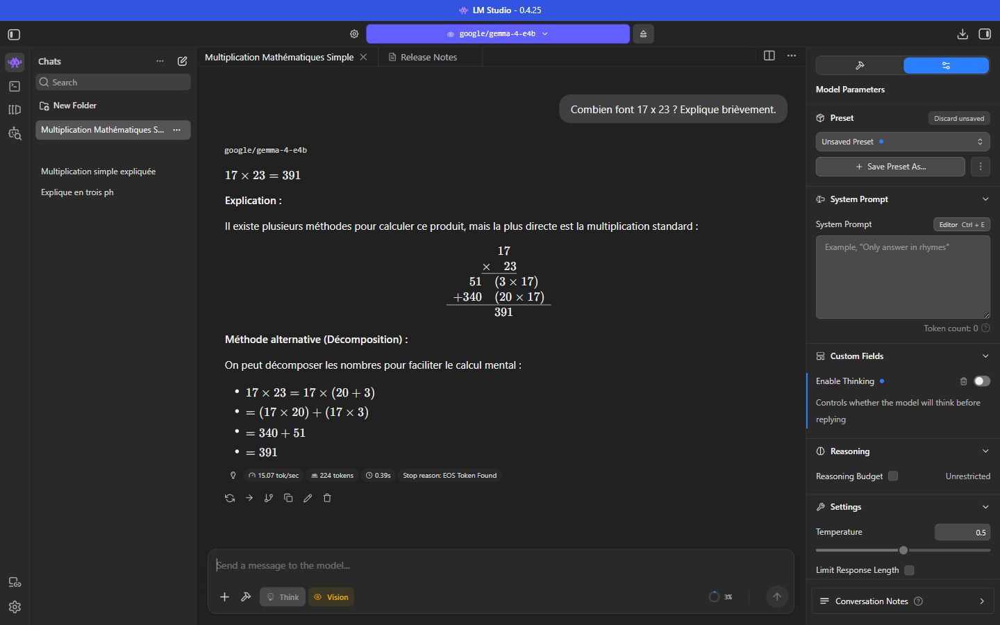
*Figure 8 — Thinking désactivé : réponse directe (224 tokens), pastille Think grisée.*

> **Exemple (même question, « Combien font 17 x 23 ? Explique brièvement. »)**
>
> | | Thinking actif | Thinking désactivé |
> |---|---|---|
> | Interface | 394 tokens, 15 s de réflexion | 224 tokens, aucune réflexion |
> | API (`/v1/chat/completions`) | 542 tokens dont 407 de réflexion, 38 s | 252 tokens, 18 s |
>
> La désactivation divise le temps par environ **2** pour un résultat correct dans les deux cas.

**Quand désactiver** : tâches simples ou mécaniques (extraction, OCR, reformulation, classification), traitement en lot, besoin de rapidité. **Quand activer** : problèmes de logique, calcul, planification, code complexe.

**Via l'API** : le champ `reasoning_effort` ; la valeur `"none"` désactive la réflexion (mesuré : 0 token de réflexion). Les valeurs testées `"low"`, ainsi que les champs `reasoning` et `chat_template_kwargs`, **n'ont eu aucun effet** sur cette version avec ce modèle ([Manuel 06](06-serveur-local-et-api.md)).

---

## 7. Paramètres de génération et d'échantillonnage

À chaque étape, le modèle calcule une **probabilité pour chaque mot (token) possible** ; les paramètres ci-dessous contrôlent le **choix** du token suivant. Valeurs observées à l'ouverture sur le poste de test : température 0,5 ; Top K 64 ; pénalité de répétition 1,1 (active) ; Top P 0,95 (actif) ; Min P 0,05 (actif). Ces valeurs de départ varient selon le modèle, la version et la conversation.

### 7.1 Section Settings

| Paramètre | Rôle | Réglage |
|---|---|---|
| **Temperature** | Contrôle le **hasard**. 0 = toujours le token le plus probable (réponse déterministe) ; plus la valeur monte, plus les choix improbables sont possibles (variété, créativité, risque d'incohérence). | **0 – 0,3** : extraction, code, faits, OCR. **0,5 – 0,8** : conversation, résumés. **0,8 – 1,2** : rédaction créative, idées. Suivre d'abord la recommandation de l'éditeur du modèle (Gemma 4 : 1,0). |
| **Limit Response Length** | Plafonne le nombre de tokens de la **réponse** (case à cocher ; environ 1000 tokens proposés une fois cochée). La réponse s'arrête brutalement, éventuellement au milieu d'une phrase. | Protège contre les réponses interminables ou les boucles ; prévoir une marge pour la réflexion des modèles raisonneurs. |
| **Context Overflow** | Comportement quand la conversation dépasse le contexte : **Truncate Middle** (défaut) retire des messages **au milieu** pour conserver le début et la fin ; **Rolling Window** retire les **plus anciens** ; **Stop at Limit** **arrête** la génération. *Descriptions d'après le fonctionnement documenté par LM Studio ; non toutes testées.* | **Stop at Limit** pour de l'OCR ou de l'extraction (un échec franc vaut mieux qu'un contexte altéré). **Rolling Window** pour un chat long. |
| **Stop Strings** | Chaînes de caractères qui **arrêtent** la génération dès qu'elles sont produites (saisir la chaîne puis `Entrée`). | Délimiteurs de format, marqueurs de fin personnalisés. |

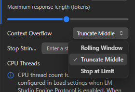
*Figure 9 — Liste Context Overflow : Rolling Window, Truncate Middle, Stop at Limit.*

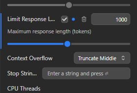
*Figure 10 — Limit Response Length activée : curseur « Maximum response length (tokens) ».*

### 7.2 Section Sampling

| Paramètre | Rôle | Réglage |
|---|---|---|
| **Top K Sampling** | Ne considère que les **K** tokens les plus probables. Petit K = prudent ; grand K = plus varié. | 40 – 64 selon l'éditeur ; 1 = déterministe. |
| **Top P Sampling** | *Nucleus sampling* : ne considère que le plus petit ensemble de tokens dont la probabilité **cumulée** atteint **P**. | 0,9 – 0,95 usuel ; baisser (0,3 – 0,5) pour des réponses plus stables. |
| **Min P Sampling** | Écarte les tokens dont la probabilité est inférieure à **Min P × probabilité du token le plus probable**. Adaptatif : filtre davantage quand le modèle est sûr de lui. | 0,05 usuel ; 0 pour désactiver. |
| **Repeat Penalty** | **Pénalité multiplicative** appliquée aux tokens déjà présents dans le contexte récent. 1,0 = aucune. | 1,05 – 1,15 pour éviter les répétitions en rédaction ; **1,0 (désactivée)** pour l'OCR, les tableaux et le code, où la répétition est légitime. Au-delà de 1,3, le texte se dégrade. |
| **Presence Penalty** | **Pénalité additive** appliquée une fois qu'un token est apparu : encourage de **nouveaux sujets**. | Désactivée par défaut ; 0,2 – 0,6 pour diversifier un brainstorming. |

Chaque case à cocher active ou désactive le paramètre ; décoché = comportement par défaut du moteur.

**Ordre de grandeur de l'interaction** : Top K, Top P et Min P **réduisent** l'ensemble des candidats ; la température **redistribue** ensuite les probabilités parmi les candidats restants. Pour des résultats stables, régler d'abord la température et ne modifier les autres filtres que si nécessaire.

### 7.3 Reproductibilité

Une réponse est **reproductible** lorsque la température vaut 0 **ou** lorsque la graine (*Seed*, réglage de chargement, [Manuel 03](03-charger-un-modele.md#44-comportement-du-modèle)) est fixée avec les mêmes paramètres. Par API, le champ `seed` fixe la graine par requête.

---

## 8. Sortie structurée

**Structured Output** contraint le modèle à produire une sortie conforme à un **schéma JSON** (*JSON Schema*). Utile pour l'extraction de données, la classification ou l'intégration dans une application : le résultat est toujours un JSON valide.

La section **Structured Output** se situe en bas du panneau de paramètres (Figure 4). Procédure : activer l'interrupteur **Structured Output**, coller un schéma dans le champ « Enter valid JSON schema… », envoyer le message.

Exemple de schéma (extraction de facture) et résultat mesuré via l'API :

```json
{
  "type": "object",
  "properties": {
    "numero": {"type": "string"}, "date": {"type": "string"},
    "client": {"type": "string"}, "total_ttc": {"type": "number"}
  },
  "required": ["numero", "date", "client", "total_ttc"],
  "additionalProperties": false
}
```

Texte d'entrée : « Facture F-2026-0042 du 06/10/2026 pour Atelier Démo SARL. Total TTC : 3 060,00 euros. »

```json
{ "numero": "F-2026-0042", "date": "06/10/2026", "client": "Atelier Démo SARL", "total_ttc": 3060.0 }
```

L'exemple complet par API est dans [`exemples/04_sortie_json_schema.py`](../../exemples/04_sortie_json_schema.py). Recommandation : température **0** avec la sortie structurée, et thinking désactivé.

---

## 9. Presets

Un **preset** enregistre un jeu de paramètres sous un nom pour le réutiliser. Il ne stocke que les **champs modifiés**.

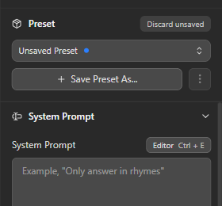
*Figure 11 — Après modification d'un paramètre (ici la température), l'état devient « Unsaved Preset » ; **Discard unsaved** annule les modifications.*

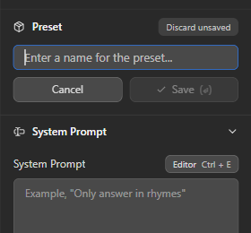
*Figure 12 — **Save Preset As…** : saisie du nom du preset.*

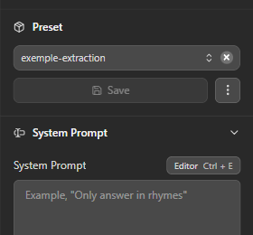
*Figure 13 — Preset enregistré et sélectionné.*

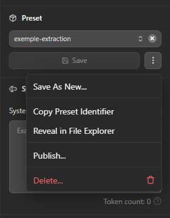
*Figure 14 — Menu `⋮` d'un preset : Save As New…, Copy Preset Identifier, Reveal in File Explorer, Publish…, Delete….*

| Action | Effet |
|---|---|
| **Select a Preset…** | Appliquer un preset à la conversation (la liste propose aussi **New Preset** et **Import Preset**) |
| **Save Preset As…** | Créer un preset à partir des paramètres modifiés |
| **Save** | Mettre à jour le preset sélectionné |
| **Save As New…** | Dupliquer sous un autre nom |
| **Copy Preset Identifier** | Copier l'identifiant (`@local:<nom>`) |
| **Reveal in File Explorer** | Afficher le fichier du preset |
| **Publish…** | Publier sur le Hub LM Studio (**compte requis ; à ne pas utiliser pour des données internes**) |
| **Delete…** | Supprimer, après confirmation (« This action is irreversible ») |

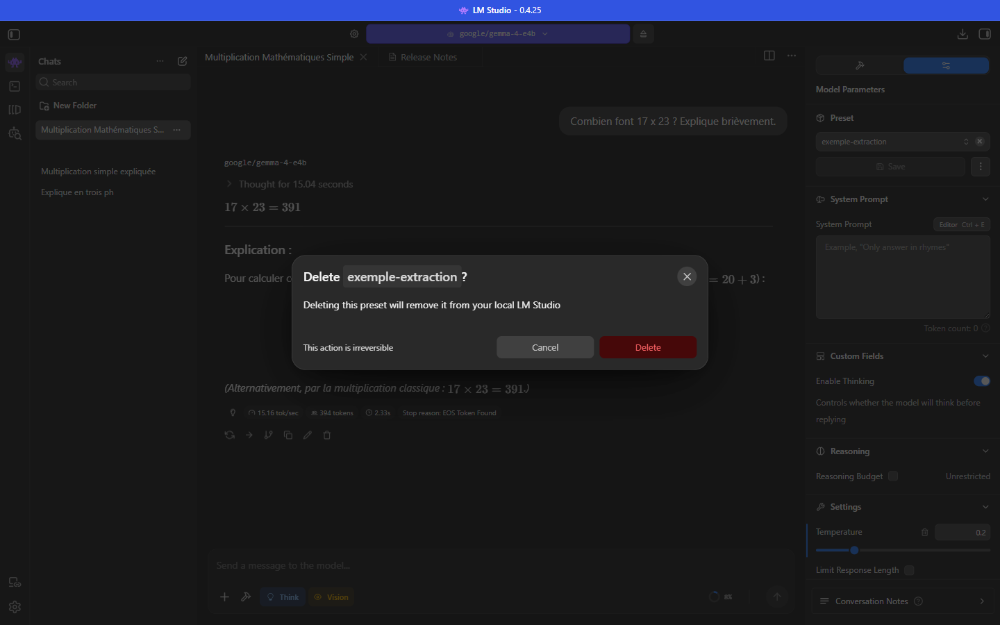
*Figure 15 — Confirmation de suppression d'un preset.*

**Stockage** : `%USERPROFILE%\.lmstudio\config-presets\<nom>.preset.json`. Exemple réel (preset ne modifiant que la température) :

```json
{
  "identifier": "@local:exemple-extraction",
  "name": "exemple-extraction",
  "changed": false,
  "operation": { "fields": [ { "key": "llm.prediction.temperature", "value": 0.2 } ] },
  "load": { "fields": [] }
}
```

Le bloc `operation` contient les paramètres d'inférence ; le bloc `load` prévoit les paramètres de chargement. Un fichier de preset peut être copié d'un poste à l'autre ou versionné : **pratique pour standardiser les réglages d'une équipe**.

---

## 10. Réglages types par cas d'usage

Points de départ à valider sur des exemples réels (la recommandation de l'éditeur du modèle prévaut).

| Cas d'usage | Temp. | Top P / Min P | Pénalités | Thinking | Limite de réponse | Autres |
|---|---|---|---|---|---|---|
| **Extraction de données, OCR** | 0 – 0,1 | défaut | **Repeat = 1,0** | Désactivé | Large (ex. 8000) | *Context Overflow* = Stop at Limit ; sortie structurée si JSON |
| **Classification / étiquetage** | 0 | défaut | aucune | Désactivé | Courte (ex. 50) | Sortie structurée |
| **Questions factuelles** | 0,1 – 0,3 | défaut | aucune | Selon difficulté | Moyenne | Prompt système précisant la langue et les sources |
| **Résumé** | 0,2 – 0,4 | défaut | aucune | Désactivé | Moyenne | Consigne de longueur dans le prompt |
| **Rédaction, reformulation** | 0,6 – 0,9 | 0,95 / 0,05 | Repeat 1,05 – 1,15 | Désactivé | Selon besoin | — |
| **Génération d'idées** | 0,9 – 1,2 | 0,95 | Presence 0,3 – 0,6 | Désactivé | Moyenne | — |
| **Code** | 0,1 – 0,3 | défaut | aucune | Activé si complexe | Large | *Stop Strings* aux délimiteurs de blocs |
| **Raisonnement, calcul** | Recommandation éditeur | défaut | aucune | **Activé** | Large (réflexion incluse) | Reasoning Budget si besoin de plafond |
| **Tests reproductibles** | 0 | — | — | Fixe | — | *Seed* fixée au chargement |

> **Exemple Gemma 4 E4B** — L'éditeur recommande température **1,0**, Top P **0,95**, Top K **64** pour tous les usages. Pour de l'extraction, une température plus basse est un point de départ raisonnable **à valider** (la baisse de température n'a pas été évaluée pour ce modèle).

---

## 11. Mesures de l'effet des paramètres

Mesures sur le poste de test (API locale, modèle *Gemma 4 E4B*, thinking désactivé sauf mention). Scripts : `outils/experiences_api.py`, résultats bruts dans `outils/resultats/`.

### 11.1 Température et variété

Même prompt (« Écris en deux phrases le début d'une histoire sur un ingénieur qui découvre une anomalie dans une salle de contrôle. »), 3 essais par valeur :

| Température | Réponses **distinctes** sur 3 essais | Observation |
|---|---|---|
| **0** | **1** (3 textes strictement identiques) | Déterministe |
| 0,5 | 3 | Variantes proches (même ouverture, détails différents) |
| 1,0 | 3 | Variantes plus éloignées (personnage et décor différents) |
| 1,5 | 3 | Plus de variété et d'images ; texte encore cohérent, mais risque croissant de dérive |

### 11.2 Graine, longueur et chaînes d'arrêt

| Test | Résultat |
|---|---|
| Température 1,0 avec **`seed` = 42**, 3 essais | **3 textes identiques** : la graine rend le tirage reproductible |
| **`max_tokens` = 15** | Réponse coupée en milieu de mot, `finish_reason: length` |
| **`stop` = `["2."]`** sur une liste numérotée | Génération arrêtée **avant** « 2. » (1 seul élément produit), `finish_reason: stop` |

### 11.3 Sortie structurée, outils, flux

| Test | Résultat |
|---|---|
| JSON Schema (`strict`) | JSON valide conforme au schéma, 73 tokens, 8,8 s |
| Appel d'outil (`tools`) | Le modèle renvoie `get_meteo({"ville": "Lyon"})` avec `finish_reason: tool_calls` |
| Flux (`stream`) | Premier token après **0,85 s**, 50 morceaux en 4,3 s |

### 11.4 Thinking

Voir la [section 6](#6-raisonnement-thinking) : ≈ ×2 en durée et en tokens pour un résultat équivalent sur une question de calcul.

---

## 12. Dépannage

| Symptôme | Cause probable | Action |
|---|---|---|
| Message envoyé mais aucune réponse | Aucun modèle chargé ; chargement en cours | Vérifier le sélecteur de modèle ([Manuel 03](03-charger-un-modele.md)) |
| Réponse **coupée** en milieu de phrase | *Limit Response Length* atteinte ; contexte plein | Augmenter la limite ; vérifier *Stop reason* ; augmenter le contexte au chargement |
| **Réponses différentes** à chaque essai | Température > 0 | Température 0 ou graine fixe |
| **Réponses répétitives**, boucles | Température trop basse, pénalité absente | *Repeat Penalty* 1,05 – 1,15 ; température légèrement plus haute |
| Texte **incohérent**, mélange de langues | Température ou Top P trop élevés | Baisser la température ; Top P ≤ 0,95 |
| Chiffres ou tableaux **altérés** (OCR, extraction) | *Repeat Penalty* > 1, température élevée | Repeat = 1,0 ; température 0 – 0,1 |
| Réponse **très lente** avant le premier mot | Thinking actif ; long prompt | Désactiver le thinking ; réduire le prompt |
| **Début de la conversation oublié** | Contexte saturé, *Context Overflow* | Augmenter *Context Length* (recharger) ; synthétiser l'historique |
| Plugin / outil non proposé | Modèle sans capacité *Tool Use* ; plugin désactivé | Vérifier la pastille d'outils du modèle et l'onglet *Integrations* |
| « Unsaved Preset » persistant | Paramètre modifié non enregistré | **Save** ou **Discard unsaved** |
