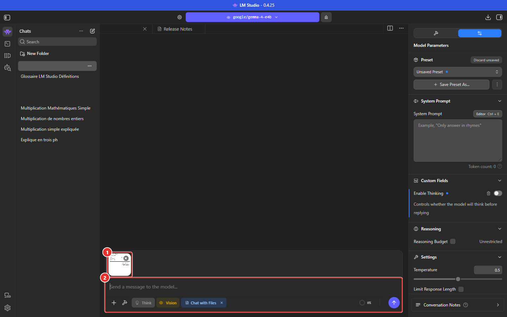
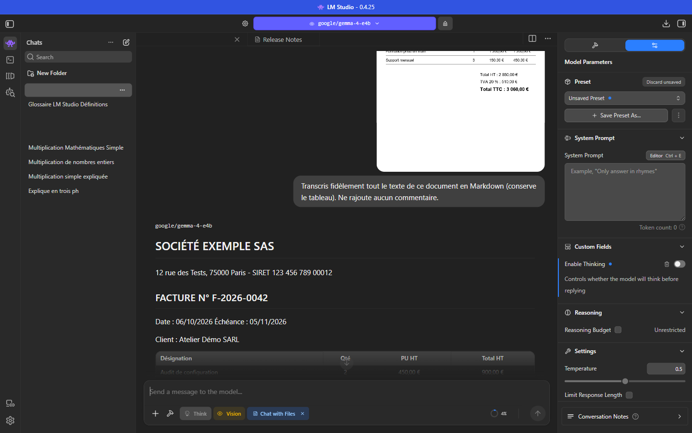
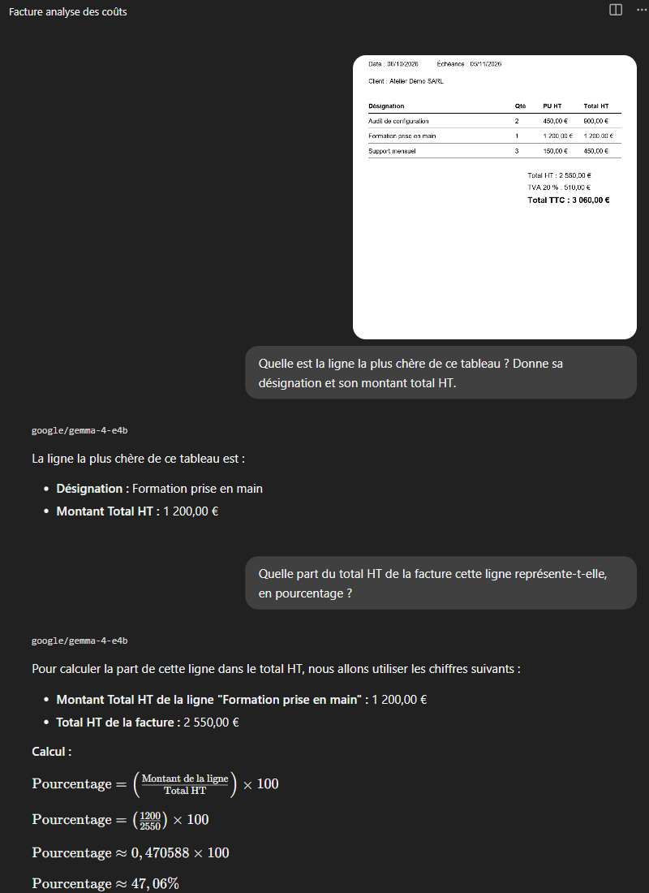
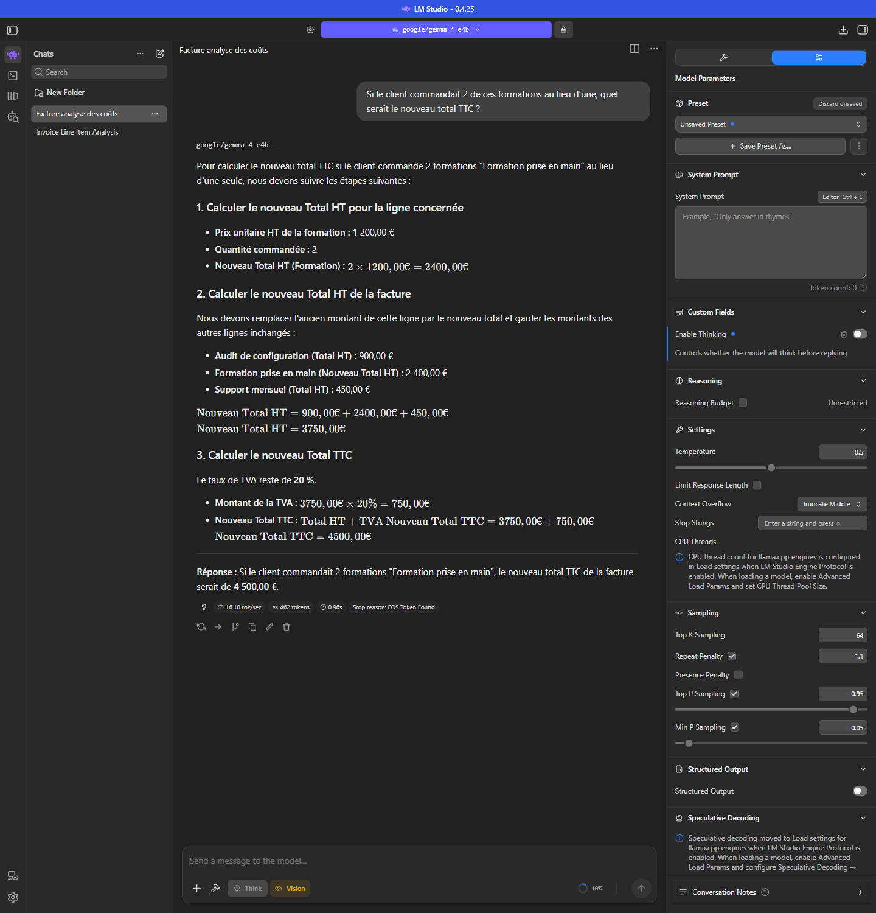
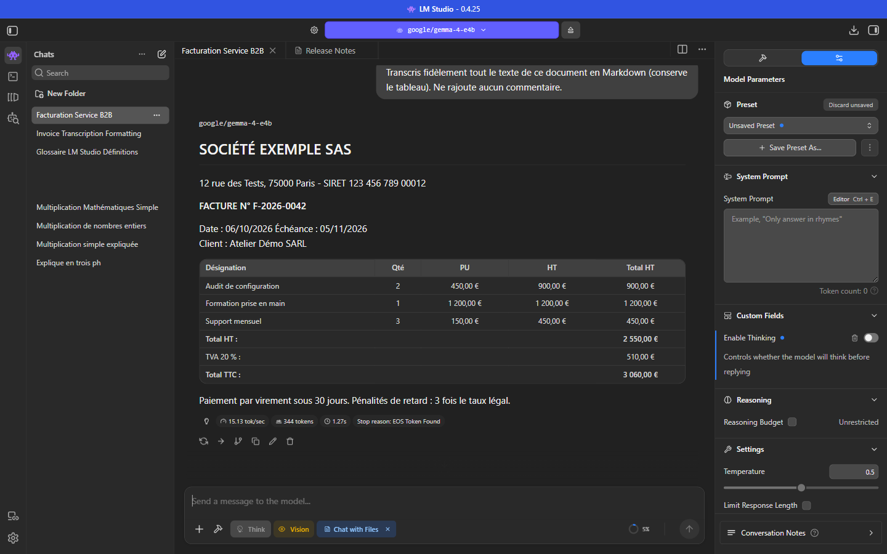
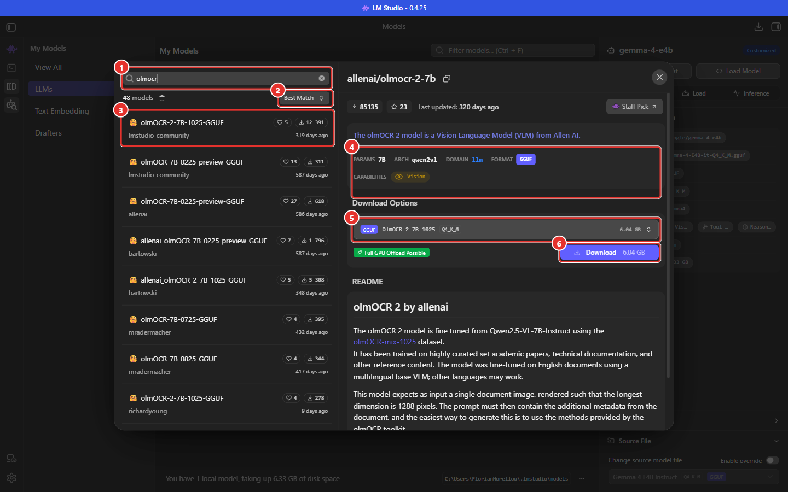
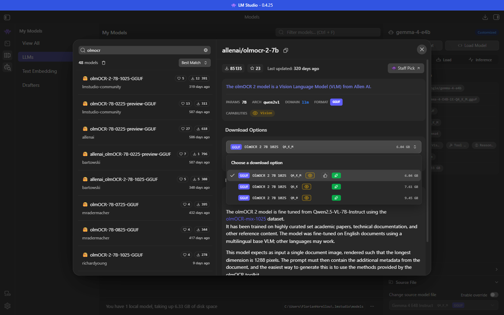
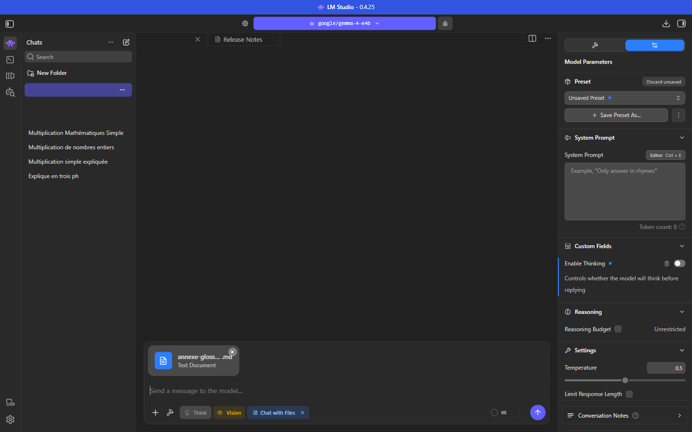
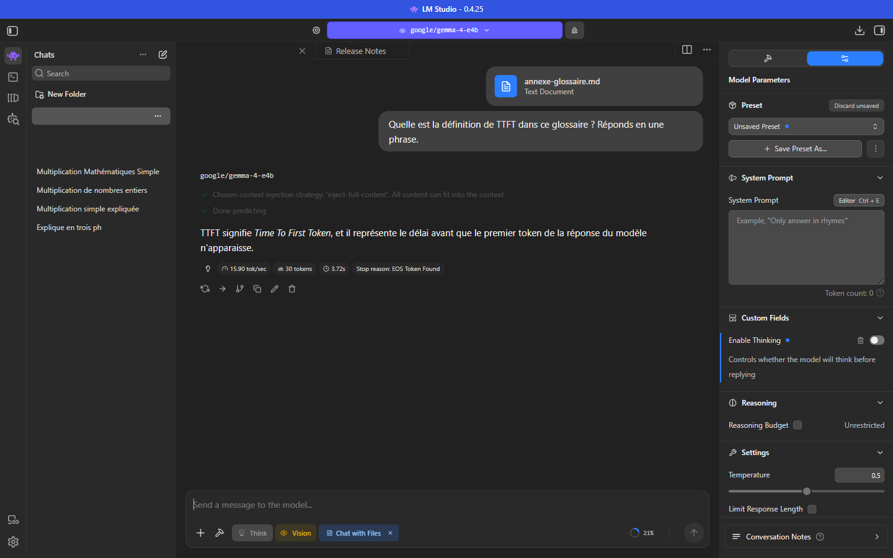

# Manuel 05 — Vision, images et OCR

> **Objet** : envoyer des images et des documents à un modèle dans LM Studio, comprendre ce qui détermine la qualité d'une lecture d'image (OCR), choisir et régler un modèle pour cet usage, de la conversation à l'API.
> **Prérequis** : [Manuel 03](03-charger-un-modele.md) et [Manuel 04](04-parametrer-l-inference.md).
> **Version décrite** : LM Studio 0.4.25.
> **Exemples** : *Gemma 4 E4B* (modèle généraliste avec vision, Q4_K_M) sur le poste de test, avec une **facture fictive** générée pour l'occasion (aucune donnée réelle) ; *OlmOCR 2 7B* (modèle d'OCR dédié) **consulté dans le catalogue mais non téléchargé**.
> **Étiquettes** : **[Vérifié]** observé sur le poste de test (ou mesuré avec Gemma 4 E4B) ; **[Source]** documentation officielle (fiches Hugging Face, dépôt `allenai/olmocr`, documentation LM Studio), consultée le 6 octobre 2026 ; **[Estimation]** calcul à mesurer ; **[À tester]** point non documenté.

---

## Sommaire

1. [Principe : comment un modèle « voit » une image](#1-principe--comment-un-modèle--voit--une-image)
2. [Prérequis d'un modèle de vision](#2-prérequis-dun-modèle-de-vision)
3. [Joindre une image dans le chat](#3-joindre-une-image-dans-le-chat)
4. [Résolution : le facteur décisif](#4-résolution--le-facteur-décisif)
5. [Réglages recommandés pour l'OCR](#5-réglages-recommandés-pour-locr)
6. [Choisir un modèle pour lire des images](#6-choisir-un-modèle-pour-lire-des-images)
7. [Exemple : un modèle d'OCR dédié, OlmOCR 2 7B](#7-exemple--un-modèle-docr-dédié-olmocr-2-7b)
8. [Joindre un document (texte, PDF)](#8-joindre-un-document-texte-pdf)
9. [Utiliser la vision par l'API](#9-utiliser-la-vision-par-lapi)
10. [Fiabiliser une extraction](#10-fiabiliser-une-extraction)
11. [Limites](#11-limites)
12. [Dépannage](#12-dépannage)

---

## 1. Principe : comment un modèle « voit » une image

Un modèle de vision (*VLM*, *Vision-Language Model*) comprend deux entrées : du texte et des images. Une image est découpée en petits carreaux, chacun converti en un **jeton visuel** par un **encodeur de vision** ; ces jetons sont ensuite lus par le modèle comme du texte. Conséquences :

| Conséquence | Détail |
|---|---|
| **Une image consomme du contexte** | Plus l'image est grande, plus elle produit de jetons (de quelques dizaines à plus d'un millier). Ces jetons s'ajoutent au prompt et à la réponse ([Manuel 03](03-charger-un-modele.md#2-composition-de-la-mémoire)). |
| **La résolution limite la lisibilité** | Un texte trop petit dans l'image devient illisible pour l'encodeur, même si l'œil le lit encore. |
| **Le modèle lit, il ne « calcule » pas les pixels** | Les erreurs sur des chiffres, des colonnes ou des caractères proches (0/O, 1/l) restent possibles : voir [section 10](#10-fiabiliser-une-extraction). |

> **Exemple** — Sur le poste de test, la même facture fictive représente environ **500 jetons visuels** à 1288 px de grand côté (548 jetons au total avec la consigne) et environ **110** à 640 px (152 jetons au total).

---

## 2. Prérequis d'un modèle de vision

| Élément | Vérification |
|---|---|
| **Capacité Vision** | Pastille **Vision** (œil) dans le sélecteur de modèle, dans *My Models* et dans la zone de saisie du chat ([Manuel 02](02-selectionner-et-telecharger-un-modele.md)). |
| **Fichier `mmproj`** | Fichier `mmproj-*.gguf` présent dans le **même dossier** que le modèle (adaptateur de vision, 1 Go environ). Sans lui, le modèle se charge mais **ne voit pas les images**. |
| **Contexte suffisant** | Contexte au chargement ≥ jetons de l'image + consigne + réponse (voir [Manuel 03](03-charger-un-modele.md)). Une page dense peut demander 16 384 tokens. |

---

## 3. Joindre une image dans le chat

### 3.1 Les trois moyens

| Moyen | Procédure |
|---|---|
| **Bouton « + »** | Zone de saisie → **+** → choisir le fichier. |
| **Glisser-déposer** | Déposer le fichier sur la fenêtre de conversation. |
| **Collage** | Coller une image depuis le presse-papiers dans la zone de saisie. *(Non testé ici.)* |

Une **vignette** apparaît au-dessus de la zone de saisie, avec une croix pour la retirer. Plusieurs images peuvent être jointes à un même message.


*Figure 1 — Image jointe. ① Vignette de l'image (croix de retrait) — ② Zone de saisie avec la pastille Vision.*

### 3.2 Transcrire

Saisir la consigne puis envoyer. Exemple de consigne d'OCR :

```text
Transcris fidèlement tout le texte de ce document en Markdown (conserve le tableau). Ne rajoute aucun commentaire.
```


*Figure 2 — Image en 1288 px de grand côté : l'image apparaît dans la conversation puis la transcription, tableau compris.*

> **Attention** — Les images d'une conversation restent dans son **historique** et continuent d'occuper du contexte. Pour comparer deux images ou deux réglages, utiliser **une conversation vierge par essai** : une image précédente peut influencer la réponse suivante.

### 3.3 Interroger l'image sur plusieurs tours

Une image jointe n'est pas réservée à la transcription : le modèle peut répondre à des questions sur son contenu, puis **s'appuyer sur ses propres réponses** pour les questions suivantes (mémoire de la conversation).

Déroulé testé : une seule image jointe (la facture fictive à 1288 px), thinking désactivé, trois questions dans la même conversation avec *Gemma 4 E4B* **[Vérifié]**.

| Tour | Question | Réponse obtenue | Durée |
|---|---|---|---|
| 1 | « Quelle est la ligne la plus chère de ce tableau ? Donne sa désignation et son montant total HT. » | *Formation prise en main*, 1 200,00 € : **exact** (lecture du tableau) | 7,5 s |
| 2 | « Quelle part du total HT de la facture cette ligne représente-t-elle, en pourcentage ? » | 1 200 / 2 550 ≈ **47,06 %** : **exact**, sans que la ligne ni le total soient rappelés dans la question (mémoire de la conversation) | 15,0 s |
| 3 | « Si le client commandait 2 de ces formations au lieu d'une, quel serait le nouveau total TTC ? » | Nouveau HT 3 750 €, TVA 750 €, **TTC 4 500 €** : **exact** (réutilise la ligne, les autres montants et le taux de TVA) | 32,6 s |


*Figure 3 — Début de la conversation : image jointe, question 1 (lecture du tableau), question 2 (mémoire et calcul). Les formules sont rendues en notation mathématique.*


*Figure 4 — Tour 3 : raisonnement détaillé en trois étapes jusqu'au nouveau total TTC. Génération à 16 tok/s ; 462 tokens.*

Ce que cette démonstration illustre :

- **Lecture structurée** : le modèle retrouve la ligne la plus chère sans transcription préalable.
- **Mémoire** : les tours 2 et 3 ne répètent ni l'image ni les montants ; la réponse du tour 1 et l'image restent dans l'historique, donc dans le contexte (coût en jetons : [section 1](#1-principe--comment-un-modèle--voit--une-image)).
- **Calcul** : les trois résultats sont exacts, ce qui n'est pas garanti. Les modèles de cette taille se trompent plus souvent sur les divisions et les pourcentages longs : vérifier avec un programme ou une calculatrice dès que le résultat compte ([section 10](#10-fiabiliser-une-extraction)).
- **Durée** : elle croît avec la longueur de la réponse (≈ 16 tok/s sur ce poste) ; demander « réponds en une phrase » raccourcit nettement.

---

## 4. Résolution : le facteur décisif

Même document, deux résolutions, chacun dans une conversation vierge (thinking désactivé, température 0,5 par défaut) :

| Résolution (grand côté) | Jetons d'entrée (image + consigne) | Résultat |
|---|---|---|
| **1288 px** | 548 | Transcription **exacte** : en-tête, tableau à 4 colonnes, montants, totaux, mentions |
| **640 px** | 152 | Texte correct, mais **tableau altéré** : une colonne en trop (« PU » et « HT » séparées), montants décalés |


*Figure 5 — Même document réduit à 640 px : la structure du tableau est faussée (colonne « HT » supplémentaire) alors que le texte courant reste correct.*

**Enseignements généraux**

- Une erreur de résolution touche d'abord la **structure** (colonnes, alignement) et les **petits caractères**, pas le texte en gros.
- Fournir l'image à la résolution que le modèle attend. Pour OlmOCR 2 : **1288 px** de grand côté ([section 7.3](#73-préparer-les-pages)). Pour Gemma 4 : les documents denses bénéficient d'un budget de jetons visuels élevé (560 ou 1120 selon la fiche de l'éditeur) ; le réglage de ce budget n'est pas exposé dans l'interface de LM Studio 0.4.25 *(à tester via « llama.cpp Arguments Override »)*.
- **Ne pas agrandir artificiellement** une image basse résolution : l'information perdue ne revient pas.

### Limite de taille de LM Studio

*Settings → Model Defaults → Image Input → Never exceed … px* (2048 par défaut sur le poste de test) **réduit** toute image dont le grand côté dépasse la valeur, proportions conservées ([Manuel 01](01-prise-en-main.md#65-model-defaults)). Cette valeur doit rester **supérieure ou égale** à la résolution voulue (par exemple ≥ 1288 pour OlmOCR 2).

---

## 5. Réglages recommandés pour l'OCR

| Réglage | Valeur | Raison |
|---|---|---|
| **Enable Thinking** | Désactivé | Tâche mécanique : le raisonnement ralentit sans améliorer la copie ([Manuel 04](04-parametrer-l-inference.md#6-raisonnement-thinking)). |
| **Temperature** | 0 – 0,1 | Réponse déterministe et fidèle. |
| **Repeat Penalty** | 1,0 (désactivée) | Les répétitions (chiffres, libellés de tableau) sont légitimes. |
| **Context Overflow** | *Stop at Limit* | Un échec franc vaut mieux qu'une page tronquée en silence. |
| **Limit Response Length** | Large (≥ 4000) | Une page dense produit plusieurs milliers de tokens. |
| **Context Length** (chargement) | ≥ 16 384 | Image + consigne + sortie. |
| **K/V cache** | F16 (non quantifié) | Ne pas dégrader la précision sans test. |
| **Max Concurrent Predictions** | 1 | Pages traitées l'une après l'autre. Sur GPU intégré, 4 requêtes simultanées ne donnent **aucun gain de débit** **[Vérifié]** ([Manuel 03](03-charger-un-modele.md#55-concurrence-sur-gpu-intégré)). |
| **Ordre image / texte** | Image **avant** le texte (Gemma 4) | Recommandation de l'éditeur ; OlmOCR 2 : texte puis image ([section 7.4](#74-prompt)). |
| **Flash Attention** | Activé | Moins de mémoire, plus de vitesse **[Vérifié]**. |

**Rédaction de la consigne** : demander un **format** précis (Markdown, JSON), préciser quoi faire des éléments non textuels, interdire les commentaires, indiquer la langue du document. Une consigne par tâche ; ne pas mélanger transcription et analyse.

---

## 6. Choisir un modèle pour lire des images

### Essentiel

Deux familles de modèles lisent des images :

| Famille | Exemples | Atouts | Limites |
|---|---|---|---|
| **Généraliste avec vision** | *Gemma 4 E4B*, modèles *Qwen-VL* | Décrit, répond aux questions, suit des consignes variées, conserve la conversation, appelle des outils | Moins précis sur les mises en page denses, les équations, les tableaux complexes |
| **OCR dédié** | *OlmOCR 2 7B* | Transcription de pages (texte, tableaux HTML, équations LaTeX) avec un prompt fixe | Une seule tâche ; pas de dialogue ; langue d'entraînement limitée |

**Règle** : commencer avec le généraliste (déjà installé, polyvalent) ; passer à un modèle dédié lorsque le volume ou la complexité des pages le justifie.

### Pour aller plus loin : la précision selon la quantification

| Élément | Effet sur la lecture d'images |
|---|---|
| **Quantification du modèle** | La lecture de chiffres et de colonnes est la première à se dégrader : **Q6_K** ou **Q8_0** recommandées si la mémoire le permet ([Manuel 02, section 5](02-selectionner-et-telecharger-un-modele.md#5-les-quantifications)). |
| **Précision du `mmproj`** | L'adaptateur de vision est un second fichier, souvent en BF16 (≈ 1 Go). Un `mmproj` plus compressé fait gagner de la mémoire au prix d'une perception moins fine **[À tester]**. |
| **Taille du modèle** | À résolution égale, un modèle plus grand se trompe moins sur les petits caractères et la structure. |
| **Budget de jetons visuels** | Nombre de jetons par image : plus il est élevé, plus la lecture est fine et plus le contexte est consommé ([section 4](#4-résolution--le-facteur-décisif)). |
| **Langue** | Un modèle entraîné sur l'anglais peut mal lire des accents ou des abréviations françaises : toujours tester sur des pages représentatives. |

> **Exemple** — Avec *Gemma 4 E4B* en Q4_K_M, la facture est transcrite sans erreur à 1288 px. Pour une page dense ou un scan de faible qualité, le passage en Q6_K (8,99 Go dans le dépôt `unsloth`, [Manuel 02](02-selectionner-et-telecharger-un-modele.md#4-exemple-guidé-avec-gemma-4-e4b)) ou l'essai d'un modèle d'OCR dédié sont les deux pistes à comparer sur un échantillon.

---

## 7. Exemple : un modèle d'OCR dédié, OlmOCR 2 7B

> **Statut de validation** — **OlmOCR 2 7B n'a pas été téléchargé** sur le poste de test. Cette section n'a donc **pas pu être validée par un essai réel du modèle** ; chaque information porte une étiquette. La procédure de validation figure en [section 7.8](#78-protocole-de-validation).

### 7.1 Présentation du modèle

| Élément | Information |
|---|---|
| Éditeur | Allen Institute for AI (AI2) **[Source]** |
| Nom | `allenai/olmOCR-2-7B-1025` (BF16) et variante FP8 officielle ; dans LM Studio : **`allenai/olmocr-2-7b`** **[Vérifié]** |
| Base | Affinage de **Qwen2.5-VL-7B-Instruct**, puis apprentissage par renforcement (équations, tableaux, cas difficiles) **[Source]** |
| Taille | ≈ 8,3 milliards de paramètres (« 7B » dans le nom) ; architecture `qwen2vl` dans LM Studio **[Vérifié]** |
| Licence | Apache 2.0 (fiche Hugging Face) **[Source]** ; validation juridique selon l'usage |
| Entrée | **Une image de page** par requête **[Vérifié]** (README affiché dans LM Studio) |
| Sortie | Markdown précédé d'un en-tête YAML ; **équations en LaTeX, tableaux en HTML** **[Source]** |
| Langue d'entraînement | **Anglais** ; « d'autres langues peuvent fonctionner » **[Vérifié]** |
| Texte « anchor » | **Plus utilisé** par OlmOCR 2 : le prompt ne contient plus de texte extrait du PDF **[Source]** |

> **Ambiguïté du README affiché dans LM Studio** — Il indique que le prompt doit contenir des métadonnées générées par la boîte à outils olmOCR. Ce texte provient de la version 1. La boîte à outils actuelle (olmOCR 0.4) emploie, pour ce modèle, un prompt **sans** texte « anchor » ([section 7.4](#74-prompt)) **[Source]**.

### 7.2 Dans le catalogue

1. Ouvrir **Model Search** ([Manuel 02](02-selectionner-et-telecharger-un-modele.md#3-model-search--le-catalogue)).
2. Saisir **`olmocr`** et attendre les résultats (≈ 5 s).
3. Sélectionner **« Olmocr 2 7B »** (Staff Pick, `allenai/olmocr-2-7b`).


*Figure 6 — ① Recherche — ② Tri — ③ Résultats — ④ Fiche technique — ⑤ Choix de la quantification — ⑥ Bouton **Download** (non utilisé).*

| Information | Valeur |
|---|---|
| Identifiant | `allenai/olmocr-2-7b` |
| Paramètres / architecture | **7B** / `qwen2vl` |
| Format / capacités | GGUF / **Vision** uniquement |
| Téléchargements / étoiles | 85 135 / 23 |
| README | Entrée : **une image de page**, **plus grand côté à 1288 pixels** ; prompt contenant des métadonnées issues de la boîte à outils *olmOCR* |


*Figure 7 — Trois quantifications proposées.*

| Quantification | Taille | Remarque |
|---|---|---|
| Q4_K_M | 6,04 Go | Recommandée par le catalogue |
| **Q6_K** | 7,61 Go | **Choix conseillé pour l'OCR** : plus fidèle sur chiffres et tableaux |
| Q8_0 | 9,45 Go | Quasi sans perte |

Les tailles incluent l'adaptateur de vision `mmproj` (≈ 1,35 Go) **[Estimation]** ; toutes sont indiquées *Full GPU Offload Possible* (pastille verte) sur le poste de test, **à GPU intégré** **[Vérifié]** ([Manuel 02, section 6](02-selectionner-et-telecharger-un-modele.md#6-les-indicateurs-dadéquation-matérielle)).

**Règle de décision** : partir de **Q6_K** ; passer en Q4_K_M si la mémoire ou la vitesse l'impose et si la comparaison sur des documents réels ne montre pas de dégradation ([protocole](#78-protocole-de-validation)). Les variantes FP8 / BF16 de l'éditeur n'existent pas dans le catalogue GGUF de LM Studio **[Source]**.

### 7.3 Préparer les pages

Le modèle attend **une image par page**, dont le **plus grand côté mesure 1288 pixels** **[Source]** **[Vérifié]**.

1. **Convertir le PDF en images**, une par page, avec une résolution telle que le grand côté = 1288 px. La boîte à outils olmOCR emploie `pdftoppm` (poppler) **[Source]** ; toute bibliothèque de rendu convient.
2. **Format** : PNG.
3. **Orientation** : fournir des pages **à l'endroit**. La boîte à outils olmOCR corrige l'orientation en relançant le modèle après rotation ; LM Studio ne le fait pas **[Source]**.
4. **Limite d'image de LM Studio** : *Settings → Model Defaults → Image Input → Never exceed … px* doit être **≥ 1288** (2048 sur le poste de test **[Vérifié]**).

> **Mesure avec un autre modèle [Vérifié]** — Gemma 4 E4B lit **exactement** la facture fictive à 1288 px, mais **décale les colonnes** du tableau à 640 px ([section 4](#4-résolution--le-facteur-décisif)). La résolution n'est pas un détail.

### 7.4 Prompt

Prompt de la boîte à outils olmOCR pour ce modèle (fonction `build_no_anchoring_v4_yaml_prompt`, fichier `olmocr/prompts/prompts.py`) **[Source]** :

```text
Attached is one page of a document that you must process. Just return the plain text representation of this document as if you were reading it naturally. Convert equations to LateX and tables to HTML.
If there are any figures or charts, label them with the following markdown syntax 
Return your output as markdown, with a front matter section on top specifying values for the primary_language, is_rotation_valid, rotation_correction, is_table, and is_diagram parameters.
```

Points d'attention **[Source]** :

- la coquille « **LateX** » est d'origine : **recopier tel quel** ;
- le message contient **d'abord le texte, puis l'image** (ordre inverse de la recommandation Gemma 4) ;
- **aucun prompt système** : laisser le champ *System Prompt* de LM Studio **vide**.

Message OpenAI-compatible équivalent :

```json
{
  "model": "allenai/olmocr-2-7b",
  "messages": [{
    "role": "user",
    "content": [
      {"type": "text", "text": "<le prompt ci-dessus>"},
      {"type": "image_url", "image_url": {"url": "data:image/png;base64,<...>"}}
    ]
  }],
  "temperature": 0.1,
  "max_tokens": 8000
}
```

### 7.5 Paramètres de chargement et d'inférence

Valeurs issues du pipeline officiel (contexte 16 384 tokens, 8 000 tokens de sortie maximum) **[Source]**, adaptées au poste de test. Chargement : fenêtre de chargement (Developer mode + *Show advanced settings*, [Manuel 03](03-charger-un-modele.md)). Inférence : panneau de droite du chat, ou onglet **Inference** de *My Models* pour en faire le défaut du modèle ([Manuel 04](04-parametrer-l-inference.md)).

| Paramètre | Valeur | Justification |
|---|---|---|
| **Context Length** | **16384** | Le pipeline borne *prompt + image + sortie* à 16 384 tokens **[Source]**. Le défaut de LM Studio (8192) est **trop juste** pour une page dense **[Estimation]**. |
| **GPU Offload** | **max** | Catalogue : *Full GPU Offload Possible* **[Vérifié]**. |
| **Max Concurrent Predictions** | **1** | Traitement séquentiel (voir [section 5](#5-réglages-recommandés-pour-locr)). |
| **K / V Cache Quantization** | Désactivé (F16) | Fonction *Experimental* ; ne pas dégrader le cache pour de l'OCR sans test **[À tester]**. |
| **Evaluation / Physical Batch Size** | Défaut (2048 / 512) | Une image de ≈ 1 500 tokens s'accommode des valeurs par défaut **[Estimation]**. |
| **System Prompt** | *vide* | Absent du pipeline officiel **[Source]**. |
| **Temperature** | **0.1** | Valeur du premier essai du pipeline ; elle n'augmente (0.2 → 1.0) que pour **relancer** une page ratée **[Source]**. `0` est acceptable : à 0, trois essais donnent un texte identique **[Vérifié]** ([Manuel 04](04-parametrer-l-inference.md#111-température-et-variété)). |
| **Limit Response Length** | Activé, **8000** | Valeur du pipeline **[Source]**. |
| **Repeat Penalty** | **Désactivé (1.0)** | Un OCR doit pouvoir répéter mots et chiffres (tableaux) **[Estimation]**. |
| **Top P / Top K / Min P** | Valeurs par défaut du modèle | Non précisées par l'éditeur **[À tester]**. |
| **Structured Output** | Désactivé | La sortie YAML + Markdown n'est pas du JSON. |
| **Thinking** | Sans objet | Pas de capacité de raisonnement **[Vérifié]** (pastille *Vision* seule). |

**Estimation mémoire [Estimation]** : fichiers ≈ 6,0 à 7,6 Go + cache KV d'environ 57 Ko par token (28 couches × 4 têtes KV × 128 dimensions × 2 (K et V) × 2 octets), soit ≈ **0,9 Go à 16 384 tokens** ; **≈ 7 à 9 Go au total** selon la quantification (calcul : [Manuel 00](00-notions-fondamentales.md#7-calculer-la-ram-nécessaire), script [`exemples/09_calculateur_memoire.py`](../../exemples/09_calculateur_memoire.py)). L'**Estimated Memory Usage** affichée par LM Studio fait foi.

### 7.6 Lire la sortie

Forme attendue **[Source]** :

```text
---
primary_language: en
is_rotation_valid: True
rotation_correction: 0
is_table: False
is_diagram: False
---
<texte de la page en Markdown ; tableaux en HTML ; équations en LaTeX>
```

| Champ | Sens |
|---|---|
| `primary_language` | Code de langue sur 2 lettres (ou `null`) |
| `is_rotation_valid` | `False` : la page semble tournée |
| `rotation_correction` | Rotation à appliquer : 0, 90, 180 ou 270 |
| `is_table` / `is_diagram` | Page essentiellement tableau / schéma |

**Traitement conseillé** :

1. Séparer l'en-tête YAML (entre les deux lignes `---`) du corps.
2. Si `is_rotation_valid` vaut `False`, **pivoter l'image** de `rotation_correction` degrés et **relancer**.
3. Relancer (température 0.2 puis plus haut) toute réponse dont `finish_reason` n'est pas `stop` **[Source]**.
4. Les balises `` sont des **pseudo-chemins**, non des fichiers.

### 7.7 Traitement par lot

Le script [`exemples/08_olmocr_lot.py`](../../exemples/08_olmocr_lot.py) applique ces recommandations : lecture d'un dossier de pages PNG, envoi avec le prompt officiel, séparation de l'en-tête YAML, relance avec rotation ou température plus haute en cas d'échec, un fichier `.md` par page.

```powershell
python exemples\08_olmocr_lot.py D:\pages --sortie D:\pages_md --modele allenai/olmocr-2-7b
```

**Statut** : testé de bout en bout avec Gemma 4 E4B à la place d'OlmOCR (`--modele google/gemma-4-e4b --sans-yaml`) : 1 page, 548 tokens en entrée, 292 en sortie, 25 s **[Vérifié]** ; analyse de l'en-tête YAML validée sur des exemples **[Vérifié]**. Comportement avec OlmOCR 2 **[À tester]**.

### 7.8 Protocole de validation

À exécuter une fois le modèle téléchargé, sur 10 à 20 pages réelles (anonymisées si besoin) :

| Étape | Action | Critère |
|---|---|---|
| 1 | Télécharger **Q6_K** (7,61 Go) depuis un réseau non limité ; contrôler la taille. | ≈ 7,6 Go |
| 2 | Charger avec les paramètres de la [section 7.5](#75-paramètres-de-chargement-et-dinférence) ; relever l'**Estimated Memory Usage** et la mémoire réelle (*Hardware → Resource Monitor*). | Chargement < 1 min ; marge de RAM ≥ 20 % |
| 3 | Traiter **1 page anglaise** (texte simple). | En-tête YAML présent, texte fidèle |
| 4 | Traiter **1 page française** avec accents et tableau. | Accents corrects, tableau reconnu |
| 5 | Mesurer tokens d'entrée (image comprise), tokens de sortie, durée, tok/s (champ `usage` de l'API). | Renseigner les performances ci-dessous |
| 6 | Comparer à **Gemma 4 E4B** sur les mêmes pages. | Écarts de qualité et de vitesse documentés |
| 7 | Comparer **Q4_K_M** et **Q6_K** sur les pages difficiles (chiffres, tableaux denses). | Choix de quantification justifié |
| 8 | Tester une page **tournée** à 90°. | Comportement documenté |
| 9 | Mettre à jour cette section : convertir les étiquettes **[Estimation]** et **[À tester]** en **[Vérifié]**. | — |

**Performances attendues [Estimation]** — non mesurées. Référence **mesurée** avec Gemma 4 E4B (modèle de vision de taille comparable) sur le même poste **[Vérifié]** :

| Mesure (Gemma 4 E4B, Q4_K_M, GPU Vulkan) | Valeur |
|---|---|
| Vitesse de génération | ≈ 14-15 tok/s |
| Traitement du prompt | ≈ 330-350 tok/s |
| Facture fictive (image 1288 px → 292 tokens de texte) | 25 à 37 s |

OlmOCR 2 7B est un modèle **dense** de ≈ 7,6 Md de paramètres (contre ≈ 4,5 Md « effectifs » pour Gemma 4 E4B) : génération attendue **plus lente**, de l'ordre de **9 à 12 tok/s** **[Estimation]**. Une page de texte dense produit 1 000 à 2 000 tokens : **1,5 à 3,5 minutes par page**, soit ≈ **20 à 40 pages par heure** **[Estimation]**. Au-delà de quelques dizaines de pages par jour, un **GPU dédié** ou un serveur est préférable.

### 7.9 Limites et pièges de ce modèle

| Piège | Détail |
|---|---|
| **Langue** | Entraîné sur des documents anglais ; le français peut fonctionner mais **n'est pas garanti** **[À tester]**. |
| **Contexte** | Défaut LM Studio (8192) insuffisant : prévoir **16384**. |
| **Résolution** | Grand côté = 1288 px. Trop petit : colonnes décalées **[Vérifié]** ; trop grand : plus de tokens et de temps **[Estimation]**. |
| **Rotation** | Non corrigée automatiquement par LM Studio. |
| **Une page par requête** | Ne pas envoyer plusieurs pages dans un même message **[Source]**. |
| **Tableaux en HTML** | Prévoir une conversion en aval (HTML → Markdown ou tableur). |
| **Figures** | Légendées, non extraites. |
| **Répétitions** | Pas de *Repeat Penalty* ; surveiller les boucles (`finish_reason: length`). |
| **Confidentialité** | Traitement local **[Vérifié]** ; contrôler l'exposition réseau du serveur ([Manuel 06](06-serveur-local-et-api.md#5-sécurité)). |

**Solution de repli** : Gemma 4 E4B, **installé**, lit des documents. Mesures **[Vérifié]** sur la facture fictive : image 1288 px, transcription exacte en 25 à 37 s ; image réduite à 640 px, texte correct mais tableau décalé en 27 s. Crédible pour des documents simples ; moins spécialisé qu'OlmOCR 2 sur les équations, les tableaux complexes et les mises en page denses **[À tester]**.

---

## 8. Joindre un document (texte, PDF)

Un fichier (texte, Markdown, PDF…) peut être joint comme une image (bouton **+** ou glisser-déposer). Il apparaît sous forme de carte (nom, type) et la pastille **Chat with Files** s'affiche dans la zone de saisie.


*Figure 8 — Document joint : carte du fichier et pastille « Chat with Files ».*


*Figure 9 — Question sur le document : LM Studio indique la stratégie retenue (« inject-full-content ») puis le modèle répond à partir du fichier.*

Le message d'état affiché avant la réponse précise la **stratégie d'injection** :

| Stratégie | Condition | Principe |
|---|---|---|
| **inject-full-content** (observée) | Le document **tient dans le contexte** | Le contenu complet est injecté dans le prompt : réponses les plus fiables. |
| Récupération par passages (RAG) | Document trop long pour le contexte | Seuls les passages les plus pertinents, retrouvés par similarité (modèle d'embedding), sont injectés. *Non testé ici ; fonctionnement décrit d'après le plugin `rag-v1`.* |

> **Exemple** — Document de 6 Ko (glossaire Markdown) ; question : « Quelle est la définition de TTFT dans ce glossaire ? Réponds en une phrase. » Réponse exacte en 3,7 s avant le premier token, 30 tokens au total.

**Règles pratiques** : un document court (quelques pages) → contexte suffisant pour tout injecter ; un document long → augmenter le contexte au chargement ou le découper ; demander des **citations** ou des numéros de page pour vérifier ; ne joindre que les documents utiles (chaque fichier consomme du contexte).

---

## 9. Utiliser la vision par l'API

Message à contenu multiple (texte et image encodée en base64) via `POST /v1/chat/completions`. Exemple exécuté sur le poste de test : [`exemples/06_ocr_image.py`](../../exemples/06_ocr_image.py).

```python
from lmstudio_client import chat, image_part

rep = chat(
    [{"role": "user", "content": [
        image_part("facture_test_1288.png"),                      # image AVANT le texte
        {"type": "text", "text": "Transcris fidèlement tout le texte ... en Markdown."},
    ]}],
    temperature=0, max_tokens=1500, reasoning_effort="none",
)
print(rep["choices"][0]["message"]["content"])
```

Résultat constaté : transcription exacte, **548 jetons en entrée** (image comprise), **292 en sortie**, **25 s**. Le champ `usage.prompt_tokens` permet de **mesurer le coût réel d'une image** pour dimensionner le contexte.

Traitement par lot de pages : [`exemples/08_olmocr_lot.py`](../../exemples/08_olmocr_lot.py) ([section 7.7](#77-traitement-par-lot)).

> **Comportement constaté** — Le réglage *Image Input → Never exceed* est documenté pour l'interface ; son application aux images envoyées par l'API n'a pas été vérifiée. Fournir des images déjà à la bonne résolution.

---

## 10. Fiabiliser une extraction

| Risque | Mesure |
|---|---|
| **Chiffre mal lu** | Contrôles de cohérence automatiques : somme des lignes = total HT, HT + TVA = TTC. *Exemple : 900 + 1 200 + 450 = 2 550 ; 2 550 + 510 = 3 060, valeurs retrouvées dans la sortie.* |
| **Colonnes décalées** | Image en haute résolution ; demander une sortie **JSON structurée** (schéma) plutôt qu'un tableau Markdown ([Manuel 04](04-parametrer-l-inference.md#8-sortie-structurée)). |
| **Texte inventé** | Température 0 ; consigne « ne rien ajouter » ; comparer à un échantillon de référence. |
| **Page tournée ou floue** | Redresser et nettoyer l'image avant l'envoi. |
| **Document volumineux** | Une page par requête ; reprise automatique en cas d'échec ([`08_olmocr_lot.py`](../../exemples/08_olmocr_lot.py)). |
| **Calcul demandé au modèle** | Faire recalculer par un programme les opérations sur les montants extraits ; le modèle peut se tromper sur une multiplication ou un pourcentage ([section 3.3](#33-interroger-limage-sur-plusieurs-tours)). |
| **Données sensibles** | Traitement 100 % local ; vérifier que le serveur n'est pas exposé au réseau ([Manuel 06](06-serveur-local-et-api.md)). |

Mettre en place un **jeu de test** : 10 à 20 pages représentatives, vérité terrain saisie à la main, mesure du taux d'erreur par champ avant toute mise en production.

---

## 11. Limites

- Les erreurs de lecture sont **silencieuses** : aucune alerte n'est émise lorsqu'un chiffre est mal lu.
- La vitesse est limitée par la génération (≈ 15 tok/s sur le poste de test) : une facture simple demande ≈ 25 à 37 s ; une page dense plusieurs minutes.
- Les modèles généralistes (Gemma 4) sont moins spécialisés qu'un modèle d'OCR dédié (OlmOCR 2) sur les **équations**, les **tableaux complexes** et les mises en page denses.
- **Audio** : Gemma 4 est annoncé comme acceptant l'audio par l'éditeur ; la prise en charge dans LM Studio 0.4.25 n'a pas été testée.
- Les images très grandes sont réduites (*Image Input*) : vérifier la valeur configurée.

---

## 12. Dépannage

| Symptôme | Cause probable | Action |
|---|---|---|
| Le modèle répond qu'il **ne voit pas d'image** | Fichier `mmproj` absent ; modèle sans vision | Vérifier la pastille Vision ; placer `mmproj-*.gguf` dans le dossier du modèle |
| Tableau **décalé**, petits caractères faux | Résolution insuffisante | Image au grand côté recommandé (1288 px pour OlmOCR 2) |
| Réponse **tronquée** | Contexte ou limite de réponse insuffisants | Augmenter *Context Length* (recharger) et *Limit Response Length* |
| Réponse **influencée par une image précédente** | Historique de la conversation | Nouvelle conversation par essai |
| Très **lent** | Thinking actif ; image volumineuse ; GPU non utilisé | Désactiver le thinking ; réduire la résolution raisonnablement ; vérifier *GPU Offload* |
| Vignette **absente** après un dépôt | Type de fichier non pris en charge ; modèle sans vision | Format PNG / JPEG ; vérifier le modèle |
| Document **ignoré** | Pastille *Chat with Files* absente ; document vide | Rejoindre le fichier ; vérifier son contenu |
