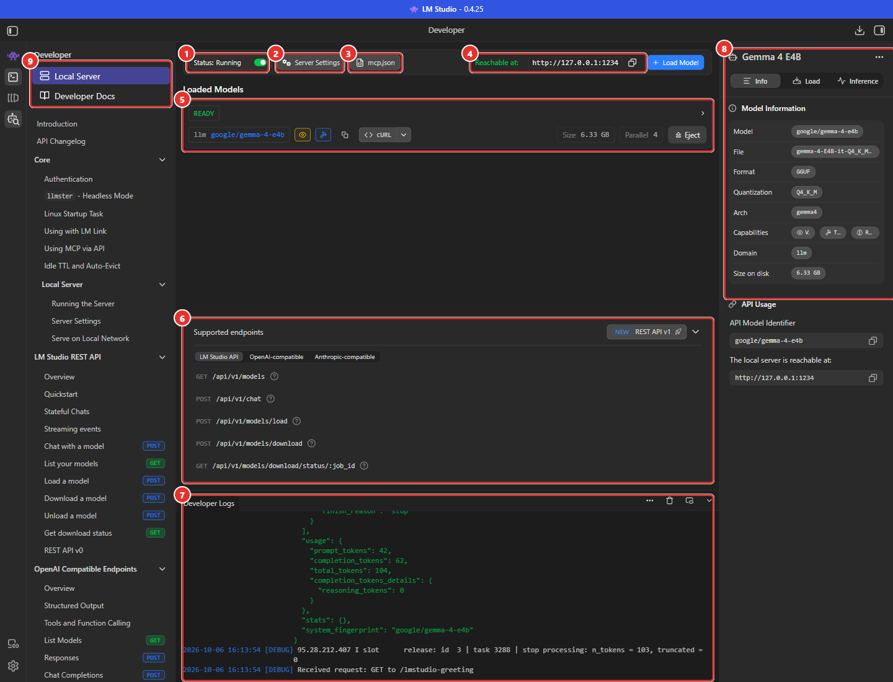
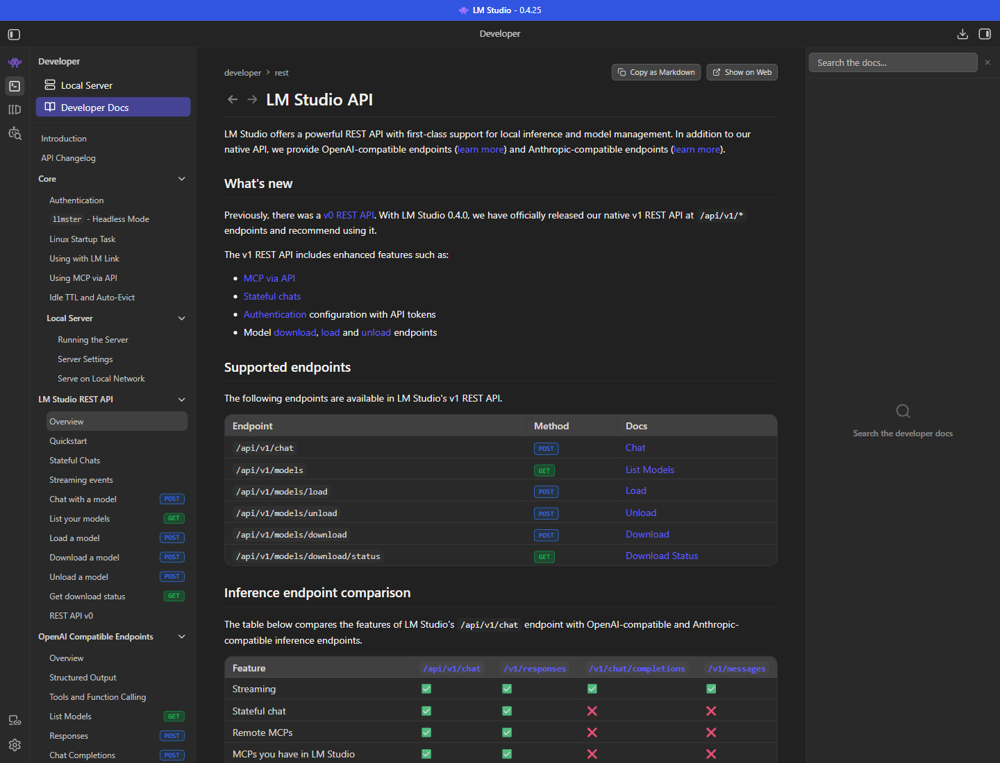
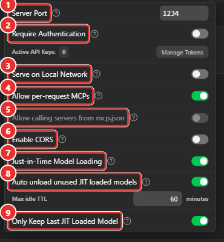
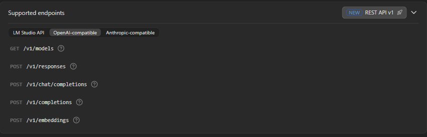
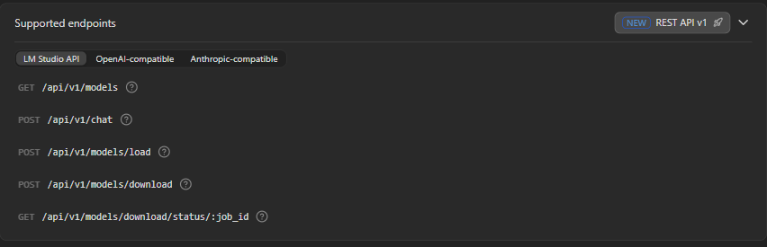
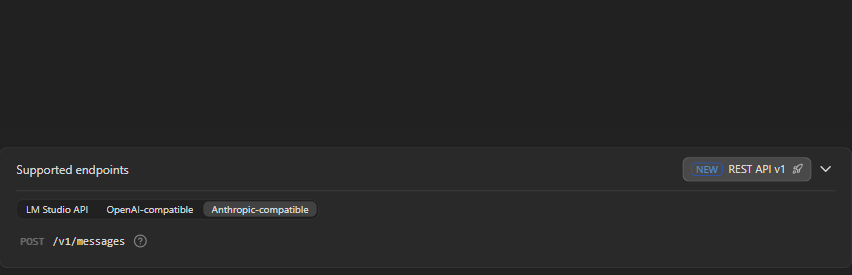
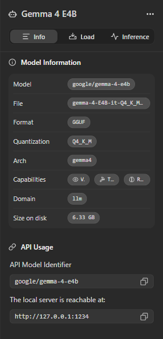

# Manuel 06 — Serveur local et API

> **Objet** : exposer un modèle chargé dans LM Studio sous forme d'API HTTP locale, la sécuriser et l'utiliser depuis des scripts et des applications.
> **Prérequis** : [Manuel 01](01-prise-en-main.md), [Manuel 03](03-charger-un-modele.md).
> **Suite** : [Manuel 10 — MCP et outils](10-mcp-et-appel-d-outils.md), [Manuel 11 — Sécurité](11-securiser-le-serveur.md), [Manuel 12 — API avancée](12-api-avancee.md), [Manuel 13 — Intégrations](13-integrations-outils-tiers.md).
> **Version décrite** : LM Studio 0.4.25.
> **Statut des informations** : chaque appel présenté a été **exécuté** sur le poste de test (modèle *Gemma 4 E4B*) sauf mention « non testé ».

---

## Sommaire

1. [Principe](#1-principe)
2. [Démarrer et arrêter le serveur](#2-démarrer-et-arrêter-le-serveur)
3. [La page Developer](#3-la-page-developer)
4. [Réglages du serveur](#4-réglages-du-serveur)
5. [Sécurité](#5-sécurité)
6. [Les endpoints](#6-les-endpoints)
7. [Appeler l'API : exemples exécutés](#7-appeler-lapi--exemples-exécutés)
8. [Paramètres et valeurs par défaut](#8-paramètres-et-valeurs-par-défaut)
9. [Chargement des modèles, JIT et TTL](#9-chargement-des-modèles-jit-et-ttl)
10. [Journaux](#10-journaux)
11. [Dépannage](#11-dépannage)

---

## 1. Principe

LM Studio peut démarrer un **serveur HTTP local** qui expose les modèles chargés. Une application (script, outil interne, extension d'éditeur, bibliothèque cliente) envoie une requête et reçoit la réponse du modèle, **sans sortir de la machine**.

Trois familles d'API cohabitent sur le même port :

| Famille | Préfixe | Intérêt |
|---|---|---|
| **API LM Studio** (REST v1) | `/api/v1/…` | API native : chat avec état, chargement / déchargement de modèles, statistiques détaillées |
| **Compatible OpenAI** | `/v1/…` | Les bibliothèques et outils prévus pour OpenAI fonctionnent en changeant l'adresse de base |
| **Compatible Anthropic** | `/v1/messages` | Les clients au format Anthropic fonctionnent en changeant l'adresse de base |

Adresse par défaut : `http://127.0.0.1:1234`.

---

## 2. Démarrer et arrêter le serveur

| Méthode | Procédure |
|---|---|
| **Interface** | Onglet **Developer** → interrupteur **Status** (`Stopped` / `Running`). |
| **Ligne de commande** | `lms server start`, `lms server stop`, `lms server status` ([Manuel 07](07-cli-lms.md#4-serveur-local)). |
| **Sans interface** | Démon `llmster` + `lms server start` ([Manuel 07](07-cli-lms.md#9-mode-sans-interface--llmster)). |

> **Démarrage automatique** — Constaté : après un arrêt (lms server stop) puis un redémarrage de l'application, le serveur local était **de nouveau en écoute** (127.0.0.1:1234) sans action. Le réglage enableLocalService de settings.json (valeur 	rue sur le poste de test) correspond à ce comportement *(lien non confirmé par la documentation)*. Vérifier l'état du serveur après chaque lancement.

**Vérifier que le serveur répond** (exécuté) :

```powershell
curl.exe http://127.0.0.1:1234/v1/models
```

```json
{ "data": [ { "id": "google/gemma-4-e4b", "object": "model", "owned_by": "organization_owner" },
            { "id": "text-embedding-nomic-embed-text-v1.5", "object": "model", "owned_by": "organization_owner" } ],
  "object": "list" }
```

**Vérifier l'adresse d'écoute** (point de sécurité essentiel) :

```powershell
Get-NetTCPConnection -LocalPort 1234 -State Listen | Select-Object LocalAddress, LocalPort
```

| Adresse affichée | Signification |
|---|---|
| `127.0.0.1` | Accessible **uniquement depuis la machine** |
| `0.0.0.0` | Accessible depuis **tout le réseau** (voir [section 5](#5-sécurité)) |

---

## 3. La page Developer


*Figure 1 — Onglet Developer, serveur démarré.*

| N° | Zone | Rôle |
|---|---|---|
| ① | **Status** | Démarre / arrête le serveur. |
| ② | **Server Settings** | Réglages du serveur ([section 4](#4-réglages-du-serveur)). |
| ③ | **mcp.json** | Ouvre le fichier de déclaration des serveurs MCP (outils externes) : [Manuel 10](10-mcp-et-appel-d-outils.md). |
| ④ | **Reachable at** | Adresse du serveur, avec bouton de copie (`http://127.0.0.1:1234`). |
| ⑤ | **Loaded Models** | Modèles chargés : état (`READY`), identifiant à utiliser dans l'API, capacités, taille, parallélisme, bouton **Eject**, bouton **cURL** (copie une commande d'exemple). |
| ⑥ | **Supported endpoints** | Liste des endpoints par famille d'API (onglets). |
| ⑦ | **Developer Logs** | Journal en direct des requêtes et de la génération. |
| ⑧ | **Panneau de droite** | Fiche du modèle (*Info / Load / Inference*) et **API Usage** : identifiant du modèle à copier et adresse du serveur. |
| ⑨ | **Local Server / Developer Docs** | Bascule entre la page serveur et la **documentation intégrée** de l'API. |


*Figure 2 — Developer Docs : la documentation officielle de l'API est consultable hors ligne dans l'application (démarrage rapide, endpoints, authentification, TTL, serveur sans interface…).*

---

## 4. Réglages du serveur

Bouton **Server Settings**. Les descriptions entre guillemets traduisent les infobulles officielles de la version 0.4.25.


*Figure 3 — Fenêtre Server Settings (valeurs observées sur le poste de test après durcissement).*

| N° | Réglage | Description officielle | Valeur observée | Recommandation |
|---|---|---|---|---|
| 1 | **Server Port** | « Définit le port réseau utilisé par le serveur local. Par défaut 1234. À changer si le port est déjà utilisé. » | 1234 | Changer en cas de conflit. |
| 2 | **Require Authentication** | « Seules les requêtes qui incluent l'en-tête `Authorization` avec la valeur `Bearer $LM_API_TOKEN` sont autorisées. » **Active API Keys** : nombre de jetons ; **Manage Tokens** : création et révocation. | Désactivé, 0 jeton | **Activer** dès que le serveur n'est pas strictement local. |
| 3 | **Serve on Local Network** | « Autorise les connexions depuis d'autres appareils du réseau. Si décoché, le serveur n'écoute que sur localhost. » | **Désactivé** *(activé à l'origine sur le poste de test : modifié avant le premier démarrage)* | **Désactivé** par défaut. |
| 4 | **Allow per-request MCPs** | « Autorise des MCP absents de mcp.json. Ces connexions sont éphémères (durée de la requête). Seuls les MCP distants sont pris en charge. » | Activé | Désactiver si l'usage de MCP par l'API n'est pas prévu. |
| 5 | **Allow calling servers from mcp.json** | « Autorise les clients API à utiliser les serveurs définis dans mcp.json. **Peut constituer un risque de sécurité** si ces serveurs accèdent au système de fichiers ou à des données privées. **Exige que Require Authentication soit activé.** » | Désactivé (grisé) | Laisser désactivé sauf besoin et authentification active. |
| 6 | **Enable CORS** | « Permet aux **sites web** visités d'envoyer des requêtes au serveur LM Studio. Peut être nécessaire depuis une page web ou une extension (VS Code…). » | Désactivé | Désactivé ; l'activer seulement pour une page web légitime et maîtrisée. |
| 7 | **Just-in-Time Model Loading** | « Si une requête désigne un modèle non chargé, il est chargé automatiquement. Le endpoint `/v1/models` liste aussi les modèles non encore chargés. » | Activé | Pratique ; désactiver pour contrôler strictement la mémoire. |
| 8 | **Auto unload unused JIT loaded models** | « Un modèle chargé à la volée est déchargé après une durée d'inactivité (TTL). » **Max idle TTL** : durée en minutes. | Activé, 60 min | Adapter à l'usage. |
| 9 | **Only Keep Last JIT Loaded Model** | « Garantit au plus un modèle chargé à la volée (le précédent est déchargé). » | Activé | Conserver pour protéger la mémoire. |

---

## 5. Sécurité

Un serveur sans authentification **exécute n'importe quelle requête qui l'atteint** : génération, chargement de modèles, consommation de CPU/GPU et de mémoire. Le niveau de protection dépend de l'exposition.

| Profil | Réglages | Usage |
|---|---|---|
| **A — Local strict** (défaut recommandé) | *Serve on Local Network* désactivé ; *Enable CORS* désactivé ; adresse d'écoute `127.0.0.1` | Un seul poste, scripts locaux |
| **B — Service d'équipe (intranet)** | *Serve on Local Network* activé ; **Require Authentication activé** avec un jeton par application ; pare-feu limitant les adresses sources ; journalisation | Plusieurs postes, après validation de la sécurité |
| **C — Navigateur** | Profil A + *Enable CORS* activé, uniquement pour une page maîtrisée | Application web locale |
| **À proscrire** | Exposition à Internet, serveur réseau sans authentification, CORS activé « par commodité » | — |

**Points de contrôle**

1. Après chaque changement, **revérifier l'adresse d'écoute** (`Get-NetTCPConnection`, [section 2](#2-démarrer-et-arrêter-le-serveur)).
2. **Jetons** : *Server Settings → Require Authentication → Manage Tokens*. Le jeton n'est affiché **qu'une fois** à la création ; le stocker dans un coffre-fort et le transmettre par variable d'environnement (`LMSTUDIO_TOKEN` dans les exemples). Les requêtes portent l'en-tête `Authorization: Bearer <jeton>`. *Création, utilisation, permissions et suppression de jetons testées : voir le [Manuel 11](11-securiser-le-serveur.md#3-authentification-et-jetons).*
3. **CORS** : constaté — avec l'option désactivée, une requête portant un en-tête `Origin` externe reçoit une réponse **sans** en-tête `Access-Control-*` : un navigateur bloque alors la lecture de la réponse par la page.
4. Un fichier `mcp.json` référençant des outils accédant au disque ne doit **jamais** être exposé à des clients non authentifiés.
5. Les journaux de requêtes (*Developer Logs*) contiennent les **prompts** : les traiter comme des données confidentielles.

> **Pour aller plus loin** — Niveaux d'exposition, jetons et permissions, CORS, serveurs MCP et données conservées : [Manuel 11 — Sécuriser le serveur local](11-securiser-le-serveur.md).

> **Constat sur le poste de test** — À la livraison, *Serve on Local Network* était activé et l'authentification désactivée : le serveur aurait été joignable depuis le réseau dès son démarrage. À vérifier sur tout poste avant utilisation.

---

## 6. Les endpoints

Onglets de **Supported endpoints** (page Developer) :


*Figure 4 — Endpoints compatibles OpenAI.*

| Famille | Endpoint | Rôle | Testé |
|---|---|---|---|
| **LM Studio API** | `GET /api/v1/models` | Lister les modèles, avec configuration des instances chargées | Oui |
| | `POST /api/v1/chat` | Chat natif (avec état, statistiques) | Oui |
| | `POST /api/v1/models/load` | Charger un modèle avec ses paramètres | Non |
| | `POST /api/v1/models/download` | Télécharger un modèle | **Non — téléchargement** |
| | `GET /api/v1/models/download/status/:job_id` | Suivre un téléchargement | Non |
| **Compatible OpenAI** | `GET /v1/models` | Lister les modèles | Oui |
| | `POST /v1/chat/completions` | Chat (le plus utilisé) | Oui |
| | `POST /v1/responses` | API *Responses* | Oui |
| | `POST /v1/completions` | Complétion de texte (ancienne API) | Non |
| | `POST /v1/embeddings` | Vecteurs de sens | Oui |
| **Compatible Anthropic** | `POST /v1/messages` | Messages au format Anthropic | Oui |

L'icône **?** à droite de chaque endpoint ouvre la documentation correspondante.


*Figure 4 bis — Endpoints de l'API LM Studio (REST v1).*


*Figure 4 ter — Endpoint compatible Anthropic.*

---

## 7. Appeler l'API : exemples exécutés

Les scripts du dossier [`exemples/`](../../exemples/) s'appuient sur un mini-client sans dépendance ([`lmstudio_client.py`](../../exemples/lmstudio_client.py)). Variables d'environnement : `LMSTUDIO_URL`, `LMSTUDIO_MODEL`, `LMSTUDIO_TOKEN`.

| Script | Objet | Résultat constaté |
|---|---|---|
| `01_lister_modeles.py` | Modèles et configuration des instances | 2 modèles ; instance chargée : contexte 8192, parallélisme 4, Flash Attention |
| `02_chat_simple.py` | Question / réponse, usage en tokens | 42 tokens en entrée, 62 en sortie, 4,6 s |
| `03_streaming.py` | Réponse en flux (SSE) | Premier token après **0,94 s**, 50 morceaux en 4,1 s |
| `04_sortie_json_schema.py` | JSON conforme à un schéma | JSON valide, 4 champs corrects |
| `05_embeddings.py` | Vecteurs et similarité | Dimension **768** ; similarité 0,74 (phrases proches) contre 0,545 (sans rapport) |
| `06_ocr_image.py` | OCR d'une image | 548 tokens en entrée (image comprise), 292 en sortie, 25 s |
| `07_appel_outil.py` | Appel de fonction | `get_meteo({"ville": "Lyon"})`, `finish_reason: tool_calls` |
| `08_olmocr_lot.py` | OCR par lot (avec Gemma 4 en substitut) | 1 page traitée, 25 s |

### 7.1 PowerShell **[exécuté]**

```powershell
$body = @{
    model = 'google/gemma-4-e4b'
    messages = @(@{ role = 'user'; content = 'Réponds par un seul mot : capitale de la Grèce ?' })
    temperature = 0; max_tokens = 50; reasoning_effort = 'none'
} | ConvertTo-Json -Depth 5
$r = Invoke-RestMethod -Uri http://127.0.0.1:1234/v1/chat/completions -Method Post `
     -ContentType 'application/json; charset=utf-8' -Body ([System.Text.Encoding]::UTF8.GetBytes($body))
$r.choices[0].message.content      # -> Athènes
```

L'encodage UTF-8 explicite évite la corruption des caractères accentués.

### 7.2 curl **[exécuté]**

```powershell
curl.exe http://127.0.0.1:1234/v1/chat/completions -H "Content-Type: application/json" -d "@requete.json"
```

avec `requete.json` :

```json
{"model":"google/gemma-4-e4b","messages":[{"role":"user","content":"Reponds par un seul mot : capitale de la Suisse ?"}],"temperature":0,"max_tokens":50,"reasoning_effort":"none"}
```

Réponse : `"content": "Berne"`, `"finish_reason": "stop"`, usage de tokens inclus. Passer par un **fichier** (`-d @fichier`) évite les problèmes de guillemets du shell.

### 7.3 Bibliothèque OpenAI **[non testé : bibliothèque non installée]**

```python
from openai import OpenAI
client = OpenAI(base_url="http://127.0.0.1:1234/v1", api_key="lm-studio")   # la clé est ignorée sans authentification
rep = client.chat.completions.create(model="google/gemma-4-e4b",
                                     messages=[{"role": "user", "content": "Bonjour"}])
print(rep.choices[0].message.content)
```

Le principe (changer `base_url`) est celui de la documentation officielle ; les appels HTTP équivalents ci-dessus ont été exécutés.

### 7.4 API native `/api/v1/chat` **[exécuté]**

```json
{ "model": "google/gemma-4-e4b", "input": "Réponds par un seul mot : capitale de l'Italie ?",
  "reasoning": "off", "temperature": 0, "max_output_tokens": 50 }
```

Réponse (extrait) :

```json
{ "model_instance_id": "google/gemma-4-e4b",
  "output": [ { "type": "message", "content": "Rome" } ],
  "stats": { "input_tokens": 22, "total_output_tokens": 2, "reasoning_output_tokens": 0,
             "tokens_per_second": 16.5, "time_to_first_token_seconds": 0.54 },
  "response_id": "resp_…" }
```

Cette API renvoie directement les **statistiques** (vitesse, délai avant premier token) et un `response_id` qui permet de **poursuivre une conversation** côté serveur ([Manuel 12 — API avancée](12-api-avancee.md#2-chat-à-état--apiv1chat)).

### 7.5 Format Anthropic `/v1/messages` **[exécuté]**

```json
{ "model": "google/gemma-4-e4b", "max_tokens": 60, "temperature": 0,
  "messages": [ { "role": "user", "content": "Réponds par un seul mot : capitale de l'Espagne ?" } ] }
```

Réponse : `"content": [ { "type": "text", "text": "Madrid" } ]`, `"stop_reason": "end_turn"`.

---

## 8. Paramètres et valeurs par défaut

### 8.1 Paramètres d'inférence acceptés

`/v1/chat/completions` accepte notamment : `model`, `messages`, `temperature`, `top_p`, `top_k`, `max_tokens`, `stream`, `stop`, `presence_penalty`, `frequency_penalty`, `repeat_penalty`, `seed`, `response_format`, `tools`, `reasoning_effort`. Signification : [Manuel 04](04-parametrer-l-inference.md#7-paramètres-de-génération-et-déchantillonnage).

### 8.2 Valeurs par défaut

Un paramètre **absent** de la requête prend la valeur par défaut **du modèle** (onglet *Inference* de *My Models*, [Manuel 02](02-selectionner-et-telecharger-un-modele.md#104-onglets-load-et-inference--valeurs-par-défaut-du-modèle)). Constaté : la réponse de `/v1/responses` à une requête sans paramètre rapporte `temperature: 0.5`, `top_p: 0.95` et une pénalité de répétition de 1,1. **Toujours préciser explicitement** la température (et la graine si besoin) dans les scripts qui exigent des résultats reproductibles.

### 8.3 Raisonnement

| Champ testé (`/v1/chat/completions`) | Effet constaté |
|---|---|
| `reasoning_effort: "none"` | **Réflexion désactivée** : 0 token de raisonnement, 18 s au lieu de 38 s sur une question de calcul |
| `reasoning_effort: "low"` | Aucun effet visible (réflexion maintenue) |
| `reasoning: "off"` | Aucun effet sur cette route |
| `chat_template_kwargs: {"enable_thinking": false}` | Aucun effet sur cette route |
| `reasoning: "off"` sur `/api/v1/chat` | Champ accepté (0 token de réflexion constaté sur une question triviale ; effet non comparé à la valeur par défaut) |

La réflexion, lorsqu'elle existe, est renvoyée à part dans `reasoning_content` ; la réponse finale est dans `content`.

---

## 9. Chargement des modèles, JIT et TTL

| Mécanisme | Comportement constaté ou documenté |
|---|---|
| **Chargement manuel** | Modèle chargé par l'interface ou `lms load` ; il reste en mémoire jusqu'à éjection. |
| **Just-in-Time (JIT)** | Une requête sur un modèle non chargé le charge à la volée. *Constaté* : la première requête d'embedding a chargé `text-embedding-nomic-embed-text-v1.5` (≈ 15 s), visible ensuite dans `lms ps` avec un **TTL** (`41m / 1h`). |
| **TTL (durée d'inactivité)** | Les modèles chargés à la volée sont déchargés après le TTL (60 min par défaut) ; un modèle chargé **manuellement** n'est pas concerné. |
| **Auto-évincement** | Au plus **un** modèle chargé à la volée à la fois (option 9 des réglages) ; le précédent est déchargé. |
| **Identifiant inconnu** | *Constaté* : une requête dont le champ `model` ne correspond à aucun modèle (`"modele-inexistant"`) a été **traitée par le modèle chargé** et n'a pas renvoyé d'erreur. Ne pas se fier à une erreur pour détecter une faute de nom ; vérifier le champ `model` de la réponse. |
| **Chargement par l'API** | `POST /api/v1/models/load` (paramètres `context_length`, `flash_attention`, `parallel`, `offload_kv_cache_to_gpu`…) — *non testé ici*. |
| **Contexte différent dans une requête** | Un `context_length` différent de celui du modèle chargé charge une **seconde instance** (`:2`) : voir le [Manuel 12](12-api-avancee.md#9-raisonnement-et-options-de-apiv1chat). |

> **Charge** — Les requêtes simultanées partagent le modèle ; le paramètre *Max Concurrent Predictions* fixe le nombre de requêtes traitées en parallèle. Sur un GPU intégré, **le débit total n'augmente pas** avec le parallélisme ([Manuel 03](03-charger-un-modele.md#55-concurrence-sur-gpu-intégré)).

---

## 10. Journaux

La zone **Developer Logs** (⑦) affiche en direct les requêtes (`Received request: POST to /v1/chat/completions`), le corps des réponses, les temps de traitement du prompt et de génération (`prompt eval time`, `tg`, tokens par seconde) et les événements de chargement.

Autres accès :

- `lms log stream` : suivre les journaux dans un terminal ([Manuel 07](07-cli-lms.md#8-journaux)) ;
- fichiers : `%USERPROFILE%\.lmstudio\server-logs\` ;
- historique d'API : `%USERPROFILE%\.lmstudio\.internal\api-prediction-history\` (conservé 30 jours d'après les réglages observés) — **contient des prompts**.


*Figure 5 — Panneau de droite : fiche du modèle, identifiant à utiliser dans l'API et adresse du serveur.*

---

## 11. Dépannage

| Symptôme | Cause probable | Action |
|---|---|---|
| `Connexion refusée` | Serveur arrêté ; mauvais port | `lms server status` ; vérifier le port dans *Server Settings* |
| Accessible depuis la machine mais pas depuis un autre poste | *Serve on Local Network* désactivé ; pare-feu | Voir [section 5](#5-sécurité) avant toute ouverture |
| `401` / non autorisé | Authentification activée sans jeton | Ajouter l'en-tête `Authorization: Bearer <jeton>` |
| Erreur de page web « CORS » | *Enable CORS* désactivé | L'activer **seulement** pour une page maîtrisée (profil C) |
| Réponse **inattendue** malgré un nom de modèle erroné | Redirection vers le modèle chargé | Contrôler le champ `model` de la réponse ; `GET /v1/models` pour les identifiants valides |
| Premier appel **très long** | Chargement JIT du modèle | Charger le modèle à l'avance |
| Accents **corrompus** (PowerShell) | Encodage du corps de requête | Envoyer le corps en UTF-8 explicite ([7.1](#71-powershell-exécuté)) |
| Réponses **différentes** à chaque appel | Température du modèle par défaut > 0 | Préciser `temperature` et `seed` dans la requête |
| Mémoire saturée après des requêtes sur plusieurs modèles | Modèles chargés à la volée | Activer l'auto-évincement ; réduire le TTL |
| Réflexion trop longue | Modèle à raisonnement | `reasoning_effort: "none"` ([8.3](#83-raisonnement)) |
