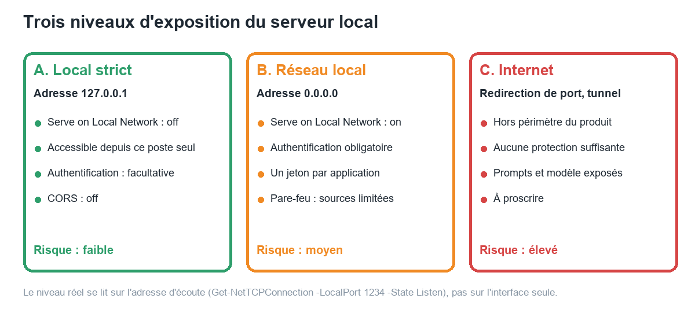
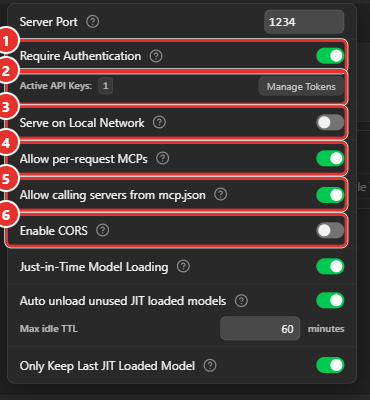
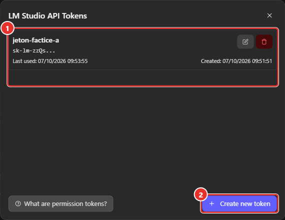
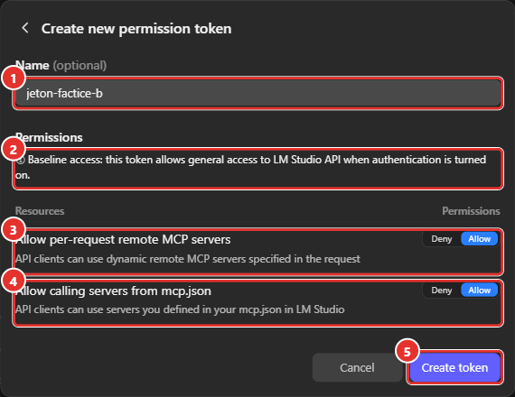
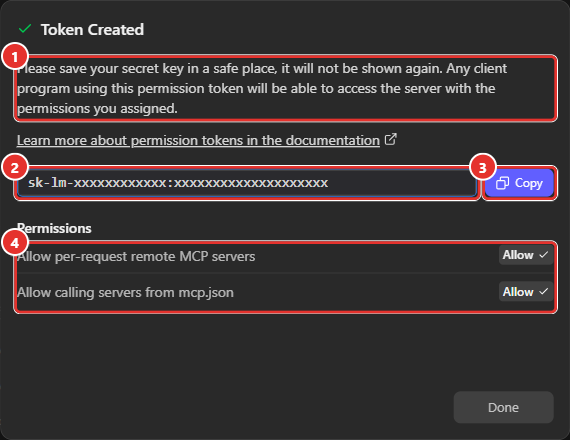
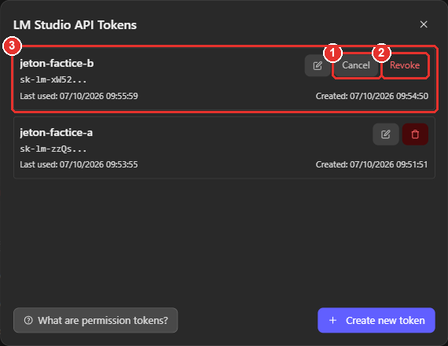
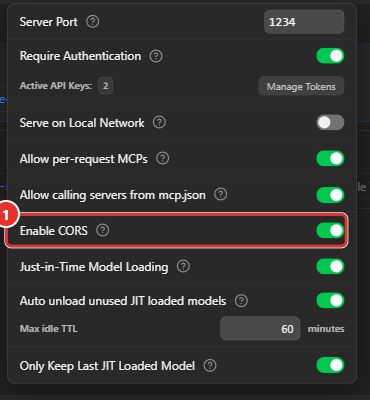
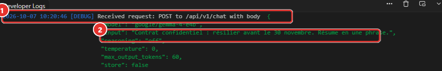

# Manuel 11 — Sécuriser le serveur local

> **Objet** : maîtriser qui peut joindre le serveur de LM Studio et ce qu'il peut faire : adresse d'écoute, *Serve on Local Network*, jetons d'API et permissions, CORS, serveurs MCP, données conservées.
> **Prérequis** : [Manuel 06](06-serveur-local-et-api.md) (serveur et réglages), [Manuel 10](10-mcp-et-appel-d-outils.md) (MCP).
> **Version décrite** : LM Studio 0.4.25, Windows 11.
> **Statut des informations** : [Vérifié] observé sur le poste de test ; [Source] documentation officielle ; [Estimation] ; [À tester].
> **Précautions prises pendant les essais** : serveur resté sur `127.0.0.1` ; *Serve on Local Network* **jamais activé** ; deux jetons **factices** créés pour l'occasion puis **supprimés** ; aucune valeur de jeton n'apparaît dans ce manuel ni dans les captures (masquage avant capture).

---

## Sommaire

1. [Principe : ce que le serveur expose](#1-principe--ce-que-le-serveur-expose)
2. [Trois niveaux d'exposition](#2-trois-niveaux-dexposition)
3. [Authentification et jetons](#3-authentification-et-jetons)
4. [Permissions des jetons et MCP](#4-permissions-des-jetons-et-mcp)
5. [CORS](#5-cors)
6. [Ce qu'il ne faut pas exposer](#6-ce-quil-ne-faut-pas-exposer)
7. [Check-list et vérifications](#7-check-list-et-vérifications)
8. [Dépannage](#8-dépannage)

---

## 1. Principe : ce que le serveur expose

### Essentiel

Le serveur de LM Studio n'est pas un simple « robinet à texte ». Un client qui l'atteint peut :

| Capacité | Route | Conséquence |
|---|---|---|
| **Consommer le calcul** | `/v1/chat/completions`, `/api/v1/chat`… | CPU / GPU et RAM occupés ; poste ralenti |
| **Charger et décharger des modèles** | `POST /api/v1/models/load`, `…/unload`, et le chargement à la volée (JIT) | Mémoire saturée ; modèle différent de celui attendu |
| **Déclencher des téléchargements** | `POST /api/v1/models/download` | Disque et bande passante consommés |
| **Faire exécuter des outils** | Serveurs d'`mcp.json` (si autorisé) | Lecture ou écriture de fichiers, accès à des services |
| **Lire des données** | Journaux, historique des requêtes | Les *prompts* y figurent ([section 6](#6-ce-quil-ne-faut-pas-exposer)) |

> **Exemple** — Un serveur ouvert au réseau sans authentification, sur lequel `mcp.json` déclare un serveur « système de fichiers », permet à n'importe quel poste du réseau de **lire des fichiers de l'utilisateur** par une simple requête. C'est pourquoi l'application impose l'authentification avant d'autoriser ce réglage ([section 4](#4-permissions-des-jetons-et-mcp)).

### Pour aller plus loin

La protection repose sur **quatre verrous indépendants**, à considérer ensemble :

1. l'**adresse d'écoute** (qui peut atteindre le port) ;
2. l'**authentification** (qui peut utiliser l'API) ;
3. les **permissions** de chaque jeton (ce que chacun peut faire) ;
4. les **réglages d'usage** (CORS, MCP, chargement à la volée).

---

## 2. Trois niveaux d'exposition


*Figure 1 — Trois niveaux d'exposition : local strict, réseau local avec authentification, Internet (à proscrire).*

### Essentiel

| Niveau | Réglages | Usage |
|---|---|---|
| **A. Local strict** | *Serve on Local Network* désactivé ; adresse `127.0.0.1` ; CORS désactivé | Un seul poste : scripts, outils de code, Open WebUI local |
| **B. Réseau local** | *Serve on Local Network* activé ; **authentification obligatoire** ; un jeton par application ; pare-feu limitant les sources | Serveur partagé par une équipe, après validation de la sécurité |
| **C. Internet** | Redirection de port, tunnel public | **À proscrire** |

**Le niveau réel se lit sur l'adresse d'écoute**, pas sur l'interface seule :

```powershell
Get-NetTCPConnection -LocalPort 1234 -State Listen | Select-Object LocalAddress, LocalPort
```

| Adresse | Signification |
|---|---|
| `127.0.0.1` | Accessible **depuis le poste uniquement** |
| `0.0.0.0` | Accessible depuis **toutes les interfaces réseau** |

> **Exemple (poste de test)** — Configuration retenue pour toutes les mesures : adresse `127.0.0.1`. Une connexion à `http://<adresse réseau du poste>:1234/v1/models` depuis le poste lui-même échoue (« Impossible de se connecter au serveur distant ») : le port n'est pas joignable par l'interface réseau [Vérifié].

### Pour aller plus loin

- **Réglage et ligne de commande** : l'interrupteur **Serve on Local Network** (*Server Settings*) correspond à l'option `--bind` de `lms server start` : `127.0.0.1` (défaut) pour le poste seul, `0.0.0.0` pour accepter le réseau local. La variable d'environnement `LMS_SERVER_HOST` donne la même information. L'option `--cors` active CORS [Vérifié : aide de la commande]. La documentation précise : « tout bind autre que 127.0.0.1 expose le serveur au-delà de localhost ; activer l'authentification » [Source].
- **Fichier de configuration** : `%USERPROFILE%\.lmstudio\.internal\http-server-config.json` contient `networkInterface` (`"127.0.0.1"` sur le poste de test), `cors`, `autoStartOnLaunch` (`true` : le serveur redémarre avec l'application), `logSensitiveData` et `logIncomingTokens` [Vérifié].
- **Pare-feu Windows** : l'installation crée deux règles entrantes « LM Studio » (action *Allow*, profil *Public*) [Vérifié]. Le pare-feu **ne** protège donc **pas** un serveur ouvert au réseau : seul le choix de l'adresse d'écoute et l'authentification le font. Ajouter une règle limitant les adresses sources avant tout usage de niveau B.
- **Cas non exécutés** : l'activation de *Serve on Local Network* et le démarrage avec `--bind 0.0.0.0` n'ont **pas** été testés, par précaution [À tester sur un poste isolé].
- **Autres chemins d'exposition** : le mode sans interface (`llmster`, [Manuel 07](07-cli-lms.md#9-mode-sans-interface--llmster)) et **LM Link** (accès chiffré entre appareils d'un même compte, compte requis) exposent des modèles à d'autres appareils ; leurs règles sont propres ; pour LM Link, voir le [Manuel 17, section 7](17-lm-link.md#7-sécurité-et-confidentialité) [Source ; non testé, aucun compte connecté].

---

## 3. Authentification et jetons

### Essentiel

Par défaut, **toute requête est acceptée**. Avec **Require Authentication**, chaque requête doit porter un **jeton d'API** (*API token*) dans l'en-tête `Authorization: Bearer <jeton>` [Source].


*Figure 2 — Server Settings : ① Require Authentication (activé), ② nombre de jetons actifs et bouton Manage Tokens, ③ Serve on Local Network (désactivé), ④ Allow per-request MCPs, ⑤ Allow calling servers from mcp.json, ⑥ Enable CORS (désactivé).*

### Créer un jeton

1. *Developer* → **Server Settings** → activer **Require Authentication**.
2. **Manage Tokens** → **Create new token**.
3. Saisir un **nom** (un jeton par application), régler les **permissions** ([section 4](#4-permissions-des-jetons-et-mcp)), **Create token**.
4. **Copier le jeton immédiatement** : il n'est affiché qu'une fois.


*Figure 3 — « LM Studio API Tokens » : ① carte d'un jeton (nom, début du jeton, dernière utilisation, création, boutons modifier et supprimer), ② création.*


*Figure 4 — Création : ① nom, ② accès de base, ③ permission MCP à la volée, ④ permission `mcp.json`, ⑤ validation.*


*Figure 5 — Jeton créé : ① avertissement (affichage unique), ② clé (masquée sur cette capture), ③ copie, ④ permissions accordées.*

> **Exemple (poste de test)** — Format observé : `sk-lm-` suivi de deux séries de caractères séparées par `:`. La liste des jetons n'affiche que le **début** et la date de **dernière utilisation** (mise à jour après les premiers essais), ce qui permet de repérer un jeton inutilisé ou de rotation à planifier [Vérifié].

### Comportement du serveur

Essais exécutés par [`outils/tester_authentification.py`](../../outils/tester_authentification.py), authentification activée, jeton factice valide [Vérifié] :

| Requête | Code | Message ou résultat |
|---|---|---|
| `GET /v1/models` **sans** en-tête | **401** | « An LM Studio API token is required… using the 'Bearer' scheme » |
| Jeton **faux** | **401** | « Malformed LM Studio API token provided: sk-lm-faux***** » (`invalid_api_key`) |
| En-tête `Authorization: <jeton>` **sans** « Bearer » | **401** | Traité comme absent |
| `Authorization: Bearer <jeton>` | **200** | Liste des modèles |
| `POST /v1/chat/completions` sans jeton | **401** | — |
| `POST /v1/chat/completions` avec jeton | **200** | Réponse normale |
| `POST /v1/messages`, en-tête **`x-api-key: <jeton>`** | **200** | La route Anthropic accepte `x-api-key` |
| `POST /v1/messages`, `x-api-key` factice | **401** | `authentication_error` |
| `POST /api/v1/chat` avec jeton | **200** | Réponse normale |

Points à retenir :

- Le message d'erreur **reprend le début** du jeton fourni (`sk-lm-faux*****`) : ne pas copier d'erreurs brutes dans un ticket ou un journal partagé si le jeton est réel.
- L'authentification s'applique **immédiatement**, sans redémarrage du serveur.
- Les clients qui exigent « une clé quelconque » (valeurs usuelles : `lm-studio`, `dummy-api-key`) sont **refusés** dès que l'authentification est activée : 10 requêtes sur 10 en 401 avec ces clés factices ([Manuel 13](13-integrations-outils-tiers.md#3-comportement-avec-lauthentification)). Il faut alors saisir un **vrai** jeton dans l'outil.

### Révoquer un jeton


*Figure 6 — Icône corbeille d'un jeton : ① annulation, ② **Revoke**, ③ carte concernée.*

Un clic sur la corbeille remplace les boutons de la carte par **Cancel** et **Revoke** ; la révocation est **immédiate** [Vérifié] :

| Étape | Résultat |
|---|---|
| Après « Revoke » sur les deux jetons de test | La fenêtre affiche « No tokens yet. Create one to get started. » ; *Active API Keys* repasse à **0** |
| Requête `GET /v1/models` avec chacun des deux jetons révoqués | **401** pour les deux (200 juste avant) |
| Retour à l'état initial | *Require Authentication* désactivé ; l'accès sans jeton est de nouveau accepté (200) |

### Pour aller plus loin

- **Un jeton par application et par usage**, nommé de façon explicite (« aider-poste-a », « openwebui-equipe »). La révocation d'un jeton coupe une application sans toucher aux autres.
- **Stockage** : variable d'environnement (`LM_API_TOKEN`) ou coffre-fort ; jamais dans un dépôt Git ni dans un fichier de configuration partagé. Les exemples du dossier [`exemples/`](../../exemples/) lisent `LMSTUDIO_TOKEN`.
- **Rotation** : créer le nouveau jeton, basculer les applications, vérifier la date de **dernière utilisation** de l'ancien, puis le supprimer.
- **Jeton absent des journaux** : après les essais, ni le jeton complet ni son préfixe n'apparaissaient dans `server-logs` ; le réglage `logIncomingTokens` vaut `false` [Vérifié].

---

## 4. Permissions des jetons et MCP

### Essentiel

Chaque jeton porte deux permissions (**Deny** / **Allow**) en plus de l'accès de base à l'API :

| Permission | Valeur par défaut | Rôle |
|---|---|---|
| **Allow per-request remote MCP servers** | Allow | Le client peut désigner, dans sa requête, un serveur MCP **distant** |
| **Allow calling servers from mcp.json** | **Deny** | Le client peut utiliser les serveurs déclarés dans `mcp.json` (programmes lancés sur le poste) |

À cela s'ajoutent deux **réglages du serveur** (figure 2) : *Allow per-request MCPs* et *Allow calling servers from mcp.json* (ce dernier est **grisé tant que l'authentification est désactivée** [Vérifié]). Pour qu'un appel réussisse, **le réglage du serveur ET la permission du jeton** doivent l'autoriser.

> **Exemple (poste de test)** — Requête `POST /api/v1/chat` avec `integrations: [{"type":"plugin","id":"mcp/demo-notes"}]` [Vérifié] :
>
> | Réglage serveur `mcp.json` | Permission du jeton | Résultat |
> |---|---|---|
> | Désactivé | Deny (jeton A) | **403** « Permission denied to use plugin 'mcp/demo-notes' » |
> | **Activé** | Deny (jeton A) | **403** (même message) |
> | **Activé** | **Allow** (jeton B) | **200**, outil exécuté ([Manuel 12](12-api-avancee.md#8-mcp-par-lapi)) |

Le message d'erreur ne distingue pas les deux causes (« Ensure that the server configuration allows plugin usage and, if using an API token, it has the necessary permissions ») : vérifier les deux.

### Pour aller plus loin

- **Principe du moindre privilège** : laisser **Deny** sur `mcp.json` pour tous les jetons sauf celui d'une application qui en a besoin, et limiter les outils par `allowed_tools` dans la requête.
- Un serveur `mcp.json` expose **les droits de l'utilisateur** (fichiers, réseau). Avant d'autoriser l'accès par jeton, relire le code et les arguments des outils ([Manuel 10](10-mcp-et-appel-d-outils.md#5-confirmer-refuser-autoriser)) : par l'API, **aucune confirmation** n'est demandée à l'utilisateur ; les appels autorisés s'exécutent directement [Vérifié : les essais de l'API n'ont affiché aucun dialogue].

---

## 5. CORS

### Essentiel

Un navigateur interdit par défaut à une page web de lire la réponse d'un autre site (*same-origin policy*). **CORS** (*Cross-Origin Resource Sharing*) est le mécanisme par lequel un serveur lève cette interdiction. **Enable CORS** autorise les pages web visitées à interroger le serveur local ; c'est utile pour une application web ou une extension, et risqué sinon : **n'importe quel site ouvert dans le navigateur** pourrait alors envoyer des requêtes au serveur local.


*Figure 7 — « Enable CORS » activé (test temporaire, puis désactivé) : ① interrupteur.*

Essais exécutés par [`outils/tester_cors.py`](../../outils/tester_cors.py) avec un en-tête `Origin: http://site-externe.example`, authentification activée [Vérifié] :

| Requête | CORS **désactivé** | CORS **activé** |
|---|---|---|
| `GET /v1/models` + jeton valide | 200, **aucun** en-tête `Access-Control-*` | 200, `Access-Control-Allow-Origin: *`, `Access-Control-Allow-Headers: *` |
| `GET /v1/models` sans jeton | 401, aucun en-tête CORS | 401, **mêmes en-têtes CORS** (la page peut lire l'erreur) |
| `OPTIONS /v1/chat/completions` (requête préalable du navigateur) | **401**, aucun en-tête CORS : le navigateur **bloque** | **200**, `…Allow-Methods: PUT, POST, PATCH, DELETE, GET` : le navigateur **laisse passer** la requête réelle |

La valeur `*` signifie **toutes les origines**. Avec CORS activé, la seule barrière restante est l'authentification : sans elle, une page web quelconque pourrait utiliser le modèle de l'utilisateur et, si `mcp.json` est exposé, ses outils.

### Pour aller plus loin

- Activer CORS **uniquement** pour une application web identifiée, avec authentification obligatoire ; le désactiver dès la fin du développement.
- Le CORS ne protège **pas** contre les clients qui ne sont pas des navigateurs (scripts, `curl`) : il ne remplace ni l'adresse d'écoute ni les jetons.
- État initial constaté sur le poste de test : **désactivé** ; réglage remis à cet état après les essais.

---

## 6. Ce qu'il ne faut pas exposer

| Élément | Où | Pourquoi |
|---|---|---|
| **Serveur MCP à accès disque ou service interne** | `mcp.json` | Un client autorisé fait lire ou écrire des fichiers sans confirmation (API) |
| **Secrets de `mcp.json`** (`headers`, `env`) | `%USERPROFILE%\.lmstudio\mcp.json` et copie `.internal\last-synced-mcp-state.json` | Stockés **en clair** [Vérifié] |
| **Prompts et réponses** | *Developer Logs*, `%USERPROFILE%\.lmstudio\server-logs\`, `.internal\api-prediction-history\` | `logSensitiveData: true` et mode `verbose` : le **corps** des requêtes est journalisé ; l'historique est conservé 30 jours [Vérifié] |
| **Conversations** | `%USERPROFILE%\.lmstudio\conversations\` | Fichiers JSON lisibles par tout programme du compte |
| **Réponses stockées** (chat à état) | Côté serveur ; suppression automatique après 30 jours [Source : message d'erreur du serveur] | Contiennent l'historique d'une conversation |
| **Route de téléchargement** | `POST /api/v1/models/download` | Un client authentifié peut remplir le disque |
| **Adresse du serveur** | Ports `1234` et ports annexes | Ne jamais rediriger vers Internet |


*Figure 8 — Developer Logs après une requête `/api/v1/chat` : ① requête reçue, ② **prompt en clair** (ici un texte déclaré confidentiel).*

Garde-fou propre à l'API : les serveurs MCP désignés **dans une requête** (`ephemeral_mcp`) sont **refusés** s'ils pointent vers une adresse non publique : « URL resolves to a non-public address. We only allow public addresses for dynamic remote MCP connections » [Vérifié]. Cela empêche un client d'utiliser le serveur comme relais vers le réseau interne.

> **Exemple** — Le serveur de démonstration `lire_note` refuse les noms qui sortent du dossier de notes (`..\..\README.md` renvoie une erreur) : la **validation des chemins** dans l'outil lui-même est la dernière protection quand le modèle ou le client est piégé [Vérifié].

### Pour aller plus loin

- **Réduire les traces** : effacer l'historique d'API après des essais sensibles, désactiver la journalisation détaillée dans les réglages de développement, ne pas coller de prompts confidentiels dans des tickets.
- **Données personnelles ou confidentielles** : traiter les journaux comme des **données** soumises aux mêmes règles que les documents traités (durée de conservation, accès).
- **Isolation** : pour des usages sensibles, un compte Windows dédié ou une machine virtuelle limite l'effet d'un serveur MCP malveillant.

---

## 7. Check-list et vérifications

**Avant d'utiliser le serveur avec une application**

- [ ] *Serve on Local Network* désactivé, sauf besoin justifié ; adresse d'écoute contrôlée (`Get-NetTCPConnection`).
- [ ] *Enable CORS* désactivé, sauf application web identifiée.
- [ ] Authentification activée dès que le serveur n'est plus strictement local.
- [ ] Un jeton par application ; permissions minimales ; `mcp.json` en **Deny** par défaut.
- [ ] Serveurs MCP relus (code, outils, arguments) ; outils à effet de bord en confirmation manuelle ([Manuel 10](10-mcp-et-appel-d-outils.md#5-confirmer-refuser-autoriser)).
- [ ] Jetons stockés hors dépôt ; date de dernière utilisation relue périodiquement.
- [ ] Journaux et historique traités comme confidentiels.

**Vérifications à rejouer après chaque changement**

```powershell
# 1. Adresse d'écoute
Get-NetTCPConnection -LocalPort 1234 -State Listen | Select-Object LocalAddress, LocalPort

# 2. Authentification : sans jeton, la réponse doit être 401
curl.exe -s -o NUL -w "%{http_code}" http://127.0.0.1:1234/v1/models

# 3. Avec jeton (variable d'environnement)
curl.exe -s -o NUL -w "%{http_code}" -H "Authorization: Bearer $env:LM_API_TOKEN" http://127.0.0.1:1234/v1/models
```

**Retrait après un test** (déroulé appliqué sur le poste de test) : supprimer les jetons de test (icône corbeille, [figure 6](#révoquer-un-jeton)), désactiver *Require Authentication* si le serveur redevient local, remettre *Allow calling servers from mcp.json* et *Enable CORS* à leur état initial, relire la liste *Active API Keys* (retour à 0).

---

## 8. Dépannage

| Symptôme | Cause probable | Action |
|---|---|---|
| `401` « token is required » | Authentification activée, en-tête absent ou sans « Bearer » | `Authorization: Bearer <jeton>` ; sur la route Anthropic, `x-api-key` |
| `401` « Malformed LM Studio API token » | Clé factice d'un outil (`lm-studio`, `dummy-api-key`) ou jeton tronqué | Créer un jeton et le saisir dans l'outil |
| `403` « Permission denied to use plugin » | Permission du jeton ou réglage serveur manquant | Vérifier les **deux** ([section 4](#4-permissions-des-jetons-et-mcp)) |
| Réglage *Allow calling servers from mcp.json* grisé | Authentification désactivée | Activer *Require Authentication* |
| Une page web n'obtient aucune réponse (erreur CORS dans la console) | *Enable CORS* désactivé, ou requête préalable sans jeton | Activer CORS **temporairement** et fournir le jeton dans l'application web |
| Jeton perdu | Affiché une seule fois | Supprimer et recréer |
| Serveur joignable depuis un autre poste alors que ce n'est pas voulu | Adresse `0.0.0.0` | Désactiver *Serve on Local Network* ; revérifier l'adresse d'écoute |
| Serveur arrêté et redémarré tout seul | `autoStartOnLaunch` | Vérifier l'état à chaque lancement ([Manuel 06](06-serveur-local-et-api.md#2-démarrer-et-arrêter-le-serveur)) |
