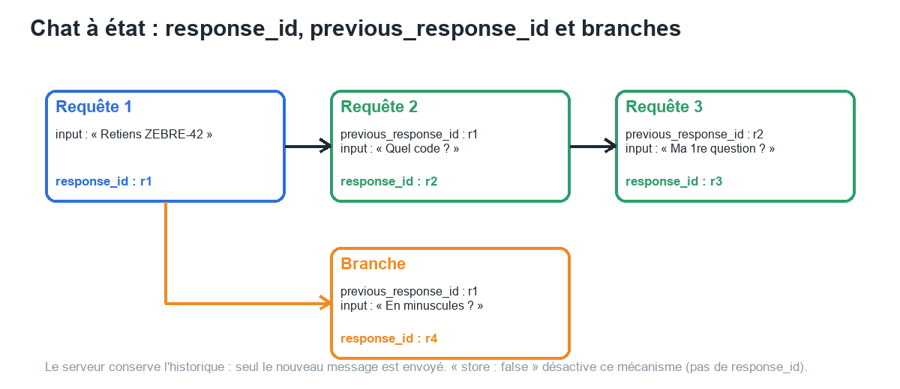
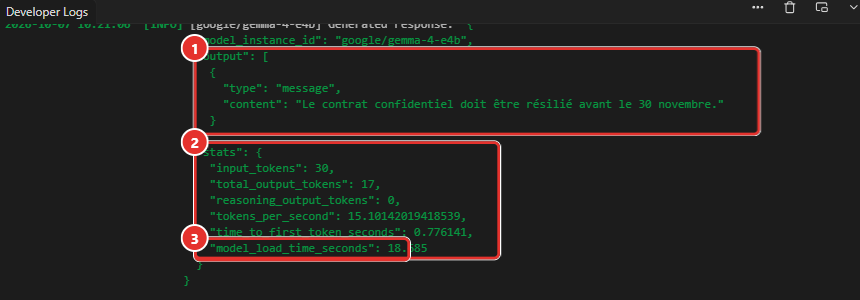

# Manuel 12 — API avancée

> **Objet** : exploiter les fonctions avancées de l'API locale : chat à état, API *Responses*, compatibilité Anthropic, statistiques de génération, appel d'outils, sortie structurée, MCP par l'API, options de raisonnement.
> **Prérequis** : [Manuel 06](06-serveur-local-et-api.md) (serveur, routes de base), [Manuel 10](10-mcp-et-appel-d-outils.md) (outils), [Manuel 11](11-securiser-le-serveur.md) (jetons).
> **Version décrite** : LM Studio 0.4.25, Windows 11.
> **Statut des informations** : chaque requête présentée a été **exécutée** sur le poste de test (Intel Core Ultra 7 255H, 31 Go de RAM, **GPU intégré**, modèle *Gemma 4 E4B*, contexte 16 384) ; [Vérifié] mesuré ou observé ; [Source] documentation officielle (partie *Developer*) ; [Estimation] ; [À tester]. Scripts : [`outils/experiences_api_lot2.py`](../../outils/experiences_api_lot2.py) et [`outils/experiences_mcp_api.py`](../../outils/experiences_mcp_api.py) ; résultats bruts dans [`outils/resultats/lot2_*.json`](../../outils/resultats/).

---

## Sommaire

1. [Panorama des routes](#1-panorama-des-routes)
2. [Chat à état : `/api/v1/chat`](#2-chat-à-état--apiv1chat)
3. [API *Responses* : `/v1/responses`](#3-api-responses--v1responses)
4. [Compatibilité Anthropic : `/v1/messages`](#4-compatibilité-anthropic--v1messages)
5. [Statistiques de génération et flux](#5-statistiques-de-génération-et-flux)
6. [Appel d'outils par l'API](#6-appel-doutils-par-lapi)
7. [Sortie structurée](#7-sortie-structurée)
8. [MCP par l'API](#8-mcp-par-lapi)
9. [Raisonnement et options de `/api/v1/chat`](#9-raisonnement-et-options-de-apiv1chat)
10. [Dépannage](#10-dépannage)

---

## 1. Panorama des routes

### Essentiel

Trois familles d'API coexistent ([Manuel 06](06-serveur-local-et-api.md#1-principe)). Le tableau compare leurs fonctions avancées, telles que vérifiées sur le poste de test.

| Fonction | `/api/v1/chat` (native) | `/v1/chat/completions` (OpenAI) | `/v1/responses` (OpenAI) | `/v1/messages` (Anthropic) |
|---|---|---|---|---|
| Conversation **à état** (côté serveur) | **Oui** (`response_id`) | Non (historique renvoyé à chaque appel) | **Oui** (`previous_response_id`) | Non |
| **Statistiques** détaillées (vitesse, délai) | **Oui** (`stats`) | `usage` seulement | `usage` | `usage` |
| **Outils** fournis par le client | Non (outils MCP seulement) | Oui | Oui | Oui |
| **MCP** (`mcp.json`, serveur distant) | **Oui** (`integrations`) | Non | Option documentée [Source] | Non |
| **Sortie structurée** (JSON Schema) | Non | **Oui** | **Non respectée** (constaté) | Non testée |
| **Flux** (SSE) | Oui (événements propres) | Oui | Oui | Oui |
| Réglage de la **réflexion** | `reasoning` (off, on) | `reasoning_effort` | `reasoning.effort` | — |

> **Exemple** — Une application de support qui garde le fil d'une conversation sans stocker l'historique choisit `/api/v1/chat` ; un outil existant écrit pour OpenAI se branche sur `/v1/chat/completions` ; un client Claude Code utilise `/v1/messages`.

### Pour aller plus loin

- Les routes OpenAI et Anthropic **ignorent ou refusent différemment** les paramètres inconnus (voir chaque section). Tester la route exacte avec le modèle exact avant de s'y fier.
- Avec l'authentification activée, toutes ces routes exigent un jeton ([Manuel 11](11-securiser-le-serveur.md#3-authentification-et-jetons)) ; les exemples ci-dessous supposent un serveur sans authentification ou la variable `LMSTUDIO_TOKEN`.

---

## 2. Chat à état : `/api/v1/chat`

### Essentiel

Avec `/api/v1/chat`, le **serveur conserve la conversation**. Chaque réponse porte un `response_id` ; pour poursuivre, il suffit d'envoyer le **nouveau message** et `previous_response_id` : le modèle « se souvient » sans que l'historique soit renvoyé [Source].


*Figure 1 — Chaîne de réponses et branche : r4 repart de r1, sans connaître l'échange r2.*

Requêtes exécutées (température 0, `reasoning: "off"`) [Vérifié] :

```json
{ "model": "google/gemma-4-e4b", "input": "Retiens ce code : ZEBRE-42. Réponds seulement : noté.",
  "reasoning": "off", "temperature": 0, "max_output_tokens": 60 }
```

puis :

```json
{ "model": "google/gemma-4-e4b", "input": "Quel est le code que je t'ai demandé de retenir ?",
  "previous_response_id": "resp_b357…", "reasoning": "off", "temperature": 0, "max_output_tokens": 60 }
```

| Requête | Réponse | `input_tokens` |
|---|---|---|
| 1. « Retiens ce code : ZEBRE-42… » | « noté » (+ `response_id`) | 27 |
| 2. « Quel est le code… ? » avec `previous_response_id` = réponse 1 | « **ZEBRE-42.** » | 53 |
| 3. Branche : « Répète le code en minuscules. » avec `previous_response_id` = réponse 1 | « zebra-42 » | 48 |
| 4. « Quelle était ma toute première question ? » avec `previous_response_id` = réponse 2 | première question correctement rappelée (« Retiens ce code : ZEBRE-42… ») | 76 |
| 5. « Quel est le code… ? » **sans** `previous_response_id` | le modèle indique ne pas avoir reçu de code | 23 |

Lecture : la mémoire existe **côté serveur**, et le champ `input_tokens` **croît** (27 → 53 → 76) : l'historique est rejoué au modèle à chaque tour. Le chat à état économise la **bande passante** et le code client, pas le calcul ni le contexte.

### Pour aller plus loin

| Sujet | Constat |
|---|---|
| **Branches** | Chaque réponse a son identifiant : repartir d'une réponse ancienne crée une branche indépendante (requête 3) [Vérifié] |
| **`store: false`** | La réponse n'est pas conservée et ne contient **pas** de `response_id` [Vérifié] |
| **Identifiant inconnu** | **400** « Could not find stored response for previous_response_id 'resp_inexistant'… Responses older than 30 days are automatically deleted » [Vérifié] |
| **Durée de conservation** | 30 jours, d'après le message d'erreur [Source implicite] |
| **Paramètres inconnus** | **400** `unrecognized_keys` : « Unrecognized key(s) in object » (contrairement aux routes OpenAI, qui les ignorent souvent) [Vérifié] |
| **Confidentialité** | Les réponses stockées contiennent la conversation : [Manuel 11](11-securiser-le-serveur.md#6-ce-quil-ne-faut-pas-exposer) |

Paramètres de `/api/v1/chat` [Source] : `model`, `input` (texte ou liste d'éléments texte / image), `system_prompt`, `integrations`, `stream`, `temperature`, `top_p`, `top_k`, `min_p`, `repeat_penalty`, `max_output_tokens`, `reasoning`, `context_length`, `store`, `previous_response_id`. Sortie : `output` (éléments `message`, `tool_call`, `reasoning`, `invalid_tool_call`), `stats`, `response_id`, `model_instance_id`.

---

## 3. API *Responses* : `/v1/responses`

### Essentiel

`/v1/responses` reprend l'API *Responses* d'OpenAI : champ `input`, `instructions` (prompt système), chaînage par `previous_response_id`, flux d'événements nommés [Source].

```json
{ "model": "google/gemma-4-e4b", "input": "Retiens ce code : ZEBRE-42. Réponds seulement : noté.",
  "instructions": "Réponds en français, très brièvement.",
  "max_output_tokens": 80, "temperature": 0, "reasoning": { "effort": "none" } }
```

Observations [Vérifié] :

| Fonction | Résultat |
|---|---|
| **Chaînage** `previous_response_id` | Fonctionne : « ZEBRE-42 » ; `usage.input_tokens` 44 dont **29 en cache** (`cached_tokens`) |
| **`instructions`** | Appliquées et renvoyées dans la réponse |
| **Flux** | Événements `response.created`, `response.in_progress`, `response.output_item.added`, `response.content_part.added`, `response.output_text.delta` (×N), `response.output_text.done`, `response.content_part.done`, `response.output_item.done`, `response.completed` |
| **Outil** (type `function`) | Élément `function_call` avec `call_id` ; le résultat se renvoie par un élément `function_call_output` (voir [section 6](#6-appel-doutils-par-lapi)) |
| **Sortie structurée** `text.format` (JSON Schema) | **Non respectée** : réponse en texte libre (« La France, dont la capitale est Paris. ») |

> **Point d'attention** — Pour un JSON garanti, utiliser `/v1/chat/completions` avec `response_format` ([section 7](#7-sortie-structurée)) ; ne pas supposer que `text.format` de l'API *Responses* est pris en charge.

### Pour aller plus loin

- La réponse contient de nombreux champs communs avec l'API d'origine (`temperature`, `top_p`, `truncation`, `tool_choice`, `usage`…), utiles pour contrôler les valeurs réellement appliquées (par exemple la température par défaut du modèle, [Manuel 06](06-serveur-local-et-api.md#82-valeurs-par-défaut)).
- Le **MCP distant** est documenté sur cette route (option à activer dans les réglages du serveur) [Source ; non testé : la route native `/api/v1/chat` a servi aux essais MCP, [section 8](#8-mcp-par-lapi)].

---

## 4. Compatibilité Anthropic : `/v1/messages`

### Essentiel

`/v1/messages` accepte le format de l'API Messages d'Anthropic : outils de type Claude Code, SDK Anthropic. Les en-têtes `x-api-key` et `anthropic-version` sont acceptés ; avec l'authentification activée, `x-api-key` doit contenir un **jeton LM Studio** [Vérifié, [Manuel 11](11-securiser-le-serveur.md#3-authentification-et-jetons)].

Résultats [Vérifié] :

| Fonction | Résultat |
|---|---|
| **`system` + conversation** (3 messages) | Réponse correcte (le prénom donné au premier tour est restitué) ; `usage` avec `cache_read_input_tokens` |
| **Flux** | `message_start`, `content_block_start`, `content_block_delta` (×N), `content_block_stop`, `message_delta`, `message_stop` |
| **Outil** (`tools` + `input_schema`) | `stop_reason: "tool_use"` avec un bloc `tool_use` (`id`, `name`, `input`) |
| **`max_tokens` absent** | **400** « request.max_tokens: Required » (comme l'API d'origine) |
| **Estimation de tokens** `POST /v1/messages/count_tokens` | **Non implémentée** : le serveur répond **HTTP 200** avec le corps `{"error":"Unexpected endpoint or method"}` : un client ne doit pas se fier au code seul |

> **Défaut constaté avec *Gemma 4 E4B* (poste de test)** — Après un résultat d'outil (`tool_result`) envoyé **sans autre contenu** et avec les `tools` toujours déclarés, la réponse du modèle est **vide** (1 token, `content: []`, `end_turn`). Mesure sur 3 essais par variante :
>
> | Second appel | Résultat |
> |---|---|
> | `tools` déclarés, `tool_result` **seul** | **Vide** (3 / 3) |
> | `tools` **omis** | Réponse correcte (3 / 3) |
> | `tool_result` **+ un bloc texte** (« Donne la réponse finale. ») | Réponse correcte (3 / 3) |
>
> Le même scénario fonctionne sur `/v1/chat/completions` ([section 6](#6-appel-doutils-par-lapi)). Un client agentique qui envoie toujours ses outils (cas de Claude Code) peut donc **s'arrêter sans réponse** avec ce modèle sur cette route. Mesurer le couple modèle + route avant de l'adopter [Estimation pour l'effet sur un client réel : non testé].

### Pour aller plus loin

- La documentation recommande, pour ces clients, un modèle et des réglages avec un **contexte supérieur à 25 000 tokens** [Source] : les prompts système des outils de code sont volumineux. Sur le poste de test, un contexte de 16 384 tokens n'aurait pas suffi pour un tel client [Estimation].
- Paramètres testés : `model`, `max_tokens`, `temperature`, `system`, `messages`, `stream`, `tools`. Les autres paramètres de l'API d'origine (`stop_sequences`, `top_k`, `thinking`, `metadata`) n'ont pas été éprouvés un à un [À tester].

---

## 5. Statistiques de génération et flux

### Essentiel

`/api/v1/chat` renvoie un objet **`stats`** : de quoi comparer des modèles et des réglages sans chronomètre.

```json
"stats": { "input_tokens": 30, "total_output_tokens": 102, "reasoning_output_tokens": 0,
           "tokens_per_second": 13.78, "time_to_first_token_seconds": 0.69 }
```


*Figure 2 — Fin de la réponse dans *Developer Logs* (page *Developer*) : ① `output`, ② `stats`, ③ `model_load_time_seconds` (chargement à la volée du modèle, 18,7 s au premier appel).*

| Champ | Signification | Valeur observée |
|---|---|---|
| `input_tokens` | Tokens du prompt (historique compris) | 30 |
| `total_output_tokens` | Tokens produits (réflexion comprise) | 102 |
| `reasoning_output_tokens` | Part de réflexion | 0 (`reasoning: "off"`) |
| `tokens_per_second` | Vitesse de génération | 13,8 |
| `time_to_first_token_seconds` | Délai avant le premier token | 0,69 s |
| `model_load_time_seconds` | Présent seulement si un chargement a eu lieu | 20,7 s (voir [section 9](#9-raisonnement-et-options-de-apiv1chat)) |

> **Exemple (poste de test, GPU intégré)** — Même consigne (« Explique en trois phrases ce qu'est un jeton… ») sur trois routes [Vérifié] :
>
> | Route | Durée côté client | Statistiques disponibles |
> |---|---|---|
> | `/api/v1/chat` | 8,2 s | `stats` complet (13,8 tok/s, premier token 0,69 s) |
> | `/v1/chat/completions` | 7,8 s | `usage` (30 + 102 tokens) ; champ `stats` présent mais **vide** ; pas de `timings` |
> | `/api/v1/chat` en flux | 7,7 s | événements, puis `chat.end` avec le même objet `stats` |

### Pour aller plus loin

**Événements du flux de `/api/v1/chat`** (`"stream": true`) [Vérifié sur la même séquence, complétée par la documentation] :

| Événement | Contenu |
|---|---|
| `chat.start` | Modèle utilisé |
| `model_load.start/progress/end` | Chargement à la volée (si besoin), avec `load_time_seconds` [Source] |
| `prompt_processing.start/progress/end` | Avancement du traitement du prompt (0 à 1) |
| `reasoning.start/delta/end` | Réflexion (si active) |
| `tool_call.start`, `tool_call.name`, `tool_call.arguments`, `tool_call.success` / `failure` | Appel d'outil MCP : nom, arguments, résultat [Vérifié ; `tool_call.name` absent de la liste de la documentation] |
| `message.start/delta/end` | Texte de la réponse, par morceaux |
| `error` | Erreur |
| `chat.end` | Résultat complet : sortie, `stats`, `response_id` |

- Le champ `tokens_per_second` mesure la **génération** ; la vitesse de traitement du prompt se déduit de `time_to_first_token_seconds` et de `input_tokens` ([Manuel 08](08-recettes-par-cas-usage.md)).
- En ligne de commande, `lms log stream --stats` journalise les mêmes mesures côté serveur ([Manuel 07](07-cli-lms.md#8-journaux)).

---

## 6. Appel d'outils par l'API

### Essentiel

Sur `/v1/chat/completions`, le **client** déclare les outils (`tools`) et **exécute** lui-même les fonctions demandées, puis renvoie les résultats (rôle `tool`). Boucle complète exécutée avec les outils du serveur de démonstration ([Manuel 10](10-mcp-et-appel-d-outils.md#3-un-serveur-mcp-minimal-pour-tester)) [Vérifié] :

```json
{ "model": "google/gemma-4-e4b", "temperature": 0, "reasoning_effort": "none",
  "messages": [{ "role": "user", "content": "Convertis 0 degré Celsius en Fahrenheit, puis 100 degrés Celsius en Kelvin." }],
  "tools": [ { "type": "function", "function": { "name": "convertir_temperature",
               "description": "Convertit une température entre Celsius (C), Fahrenheit (F) et Kelvin (K).",
               "parameters": { "type": "object", "properties": { "valeur": {"type":"number"}, "de": {"type":"string","enum":["C","F","K"]}, "vers": {"type":"string","enum":["C","F","K"]} },
                               "required": ["valeur","de","vers"] } } } ] }
```

1. **Réponse du modèle** : `finish_reason: "tool_calls"` avec **deux appels** dans le même message (`{"de":"C","valeur":0,"vers":"F"}` et `{"de":"C","valeur":100,"vers":"K"}`).
2. Le client exécute les deux fonctions et renvoie deux messages `{"role":"tool","tool_call_id":…,"content":"…"}`.
3. **Réponse finale** (`finish_reason: "stop"`) : « 0 degré Celsius équivaut à 32.0 degrés Fahrenheit. 100 degrés Celsius équivaut à 373.15 Kelvin. » (549 tokens de prompt pour ce second tour).

### Pour aller plus loin

| Sujet | Constat [Vérifié] |
|---|---|
| **`tool_choice`** `"auto"` | Question sans lien avec les outils (« capitale de l'Italie ? ») : réponse en texte, aucun appel |
| **`tool_choice`** `"none"` | Aucun appel, même si un outil conviendrait |
| **`tool_choice`** `"required"` | Un appel est **forcé** (ici `convertir_temperature`, sans rapport avec la question) : à réserver aux cas où un appel est toujours attendu |
| **`tool_choice`** désignant une fonction (`{"type":"function","function":{"name":…}}`) | **400** « Invalid tool_choice type: 'object'. Supported string values: none, auto, required » : **non pris en charge** |
| **Flux** | Les `tool_calls` arrivent en morceaux : un premier avec `id` et `name`, puis des fragments de `arguments` (22 morceaux, 21 avec `tool_calls`) ; concaténer les fragments avant d'analyser le JSON |
| **Appels parallèles** | Plusieurs appels dans un message : gérer une liste, pas un seul appel |
| **API Responses** | Élément `function_call` (`call_id`, `name`, `arguments`) ; le résultat revient dans `input` sous forme `{"type":"function_call_output","call_id":…,"output":…}` ; le modèle a ensuite répondu « 212 degrés Fahrenheit » |
| **API Anthropic** | Bloc `tool_use` ; résultat renvoyé par un bloc `tool_result` : voir le défaut de la [section 4](#4-compatibilité-anthropic--v1messages) |

Fiabilité du modèle : 32 appels corrects sur 32 avec 5 outils, 48 sur 52 avec 17 outils ([Manuel 10, section 6](10-mcp-et-appel-d-outils.md#6-fiabilité-et-limites-des-petits-modèles)). Un modèle de petite taille ou non entraîné aux outils peut produire des appels mal formés ; le champ `invalid_tool_call` de `/api/v1/chat` les signale [Source].

---

## 7. Sortie structurée

### Essentiel

Le paramètre `response_format` de `/v1/chat/completions` **contraint** la sortie à un JSON Schema : le moteur n'accepte que les tokens qui respectent la grammaire (modèles GGUF) [Source].

```json
"response_format": { "type": "json_schema", "json_schema": { "name": "fiche_film", "strict": true,
  "schema": { "type": "object", "required": ["titre","annee","genre","acteurs"], "additionalProperties": false,
              "properties": { "titre": {"type":"string"}, "annee": {"type":"integer"},
                              "genre": {"type":"string","enum":["drame","comedie","documentaire"]},
                              "acteurs": {"type":"array","items":{"type":"string"},"minItems":2} } } } }
```

> **Exemple (poste de test)** — Consigne d'**extraction** : « Extrais la fiche du film : Les Ombres du Nord, un drame de 2019, avec Léa Martin et Paul Roche. » ; température 0,7 ; 10 essais [Vérifié] :
>
> | Résultat | Valeur |
> |---|---|
> | JSON **conforme au schéma** (champs, types, énumération, `minItems`) | **10 / 10** |
> | Durée typique | 5,3 s (66 tokens) |
> | Durée du cas le plus long | **40,2 s** (554 tokens dont **484 de réflexion**) |

### Pièges constatés

| Piège | Détail |
|---|---|
| **La réflexion peut revenir malgré `reasoning_effort: "none"`** | Avec `response_format`, le modèle a **réfléchi** dans 1 essai sur 10 de l'extraction (484 tokens), et systématiquement pour une consigne **créative** (« Invente la fiche d'un film fictif » : 610 tokens, 51 s ; autres mesures : 156 à 726 tokens). Sans `response_format`, la même option donne 0 token de réflexion |
| **`max_tokens` trop petit = contenu vide** | Avec `max_tokens: 300`, les essais créatifs ont fini en `finish_reason: "length"` avec un `content` **vide** : toute la limite a été consommée par la réflexion. Prévoir `max_tokens` ≥ 1 500 quand un modèle à réflexion est utilisé avec un schéma |
| **Troncature = JSON invalide** | `max_tokens: 12` : `finish_reason: "length"`, contenu `{ "titre": "Les` : toujours contrôler `finish_reason` avant d'analyser |
| **`response_format.type = "json_object"`** | **400** « 'response_format.type' must be 'json_schema' or 'text' » : seul le JSON Schema est accepté |
| **Route *Responses*** | `text.format` ignoré ([section 3](#3-api-responses--v1responses)) |
| **Taille du modèle** | La documentation signale que les modèles de moins de 7 Md de paramètres respectent mal les schémas complexes [Source] ; *Gemma 4 E4B* (7,5 Md) a tenu 10 essais sur 10 avec un schéma de quatre champs |

### Pour aller plus loin

- Un JSON **valide** n'est pas un JSON **juste** : le schéma garantit la forme, pas l'exactitude du contenu. Valider les valeurs (dates, totaux) côté application.
- Pour les cas d'extraction répétitifs : température 0, consigne courte, schéma minimal, `max_tokens` large, mesure du taux de conformité sur un échantillon ([Manuel 08, fiche d'extraction](08-recettes-par-cas-usage.md)).

---

## 8. MCP par l'API

### Essentiel

`/api/v1/chat` peut utiliser des serveurs MCP via le champ **`integrations`**. Trois formes [Source] :

```json
"integrations": ["mcp/demo-notes"]
"integrations": [{ "type": "plugin", "id": "mcp/demo-notes", "allowed_tools": ["convertir_temperature"] }]
"integrations": [{ "type": "ephemeral_mcp", "server_label": "huggingface", "server_url": "https://…/mcp",
                   "allowed_tools": ["model_search"], "headers": {} }]
```

| Forme | Serveur | Prérequis |
|---|---|---|
| `plugin` / forme courte (`mcp/<nom>`) | Déclaré dans `mcp.json` | Authentification activée ; réglage *Allow calling servers from mcp.json* ; jeton avec la permission correspondante |
| `ephemeral_mcp` | Distant, désigné dans la requête | Réglage *Allow per-request MCPs* ; permission du jeton ; adresse **publique** |

L'**exécution est automatique** : aucune confirmation n'est demandée à l'utilisateur ([Manuel 11](11-securiser-le-serveur.md#4-permissions-des-jetons-et-mcp)). `allowed_tools` limite les outils déclarés au modèle.

Essais exécutés (jeton B : permission `mcp.json` accordée) [Vérifié] :

| Requête | Résultat |
|---|---|
| `plugin` + `allowed_tools: ["convertir_temperature"]` : « Convertis 100 degrés Celsius… » | Élément `tool_call` (`tool`, `arguments`, `output` `100 C = 212.0 F`, `provider_info: {"plugin_id":"mcp/demo-notes","type":"plugin"}`) ; 5,5 s ; `stats` : 167 tokens en entrée, 30 en sortie |
| Forme courte, sans restriction : « Liste les notes puis lis courses.txt… » | **Deux appels enchaînés** (`lister_notes`, puis `lire_note` avec `courses.txt`), puis réponse correcte ; 8,7 s |
| `allowed_tools: ["lister_notes"]` avec une question qui demande une conversion | **Aucun appel** : l'outil n'est pas déclaré ; le modèle répond avec ses connaissances (formule de conversion) |
| Plugin inexistant (`mcp/inexistant`) | **400** `plugin_connection_error` « Cannot find plugin handle for plugin: mcp/inexistant » |
| Flux, une question de calcul | Événements `chat.start`, `prompt_processing.start/end`, `tool_call.start`, `tool_call.name`, `tool_call.arguments`, `tool_call.success`, nouveau traitement du prompt, `message.start/end`, `chat.end` |
| `ephemeral_mcp` vers `http://127.0.0.1:8765/mcp` | **400** `mcp_connection_error` : « URL resolves to a non-public address. We only allow public addresses for dynamic remote MCP connections » |

> **Lecture** — Le serveur de démonstration n'a donc pas pu servir de serveur « à la volée » : la restriction aux adresses publiques empêche d'utiliser l'API comme relais vers le réseau interne. Un serveur distant réel (adresse publique) n'a **pas** été testé : aucun service externe n'a été joint [À tester].

### Pour aller plus loin

- Les appels apparaissent dans `output` avec `provider_info` : la requête garde la **trace** des outils réellement exécutés, indépendante de ce que le modèle affirme.
- `headers` (jeton d'un service distant) transitent dans la requête : ne pas les journaliser.
- La route `/v1/responses` accepte aussi des serveurs MCP distants [Source ; non testé].

---

## 9. Raisonnement et options de `/api/v1/chat`

### Essentiel

Le champ `reasoning` de `/api/v1/chat` accepte `"off"`, `"low"`, `"medium"`, `"high"`, `"on"` [Source] ; **les valeurs acceptées dépendent du modèle**. *Gemma 4 E4B* n'accepte que `"off"` et `"on"` : les autres valeurs renvoient **400** « Reasoning setting 'low' is not supported by model 'google/gemma-4-e4b'. Supported settings: 'off', 'on' » [Vérifié].

> **Exemple (poste de test)** — « Combien font 17 × 23 ? Réponds par le nombre seul. », température 0 [Vérifié] :
>
> | `reasoning` | Réflexion | Tokens produits | Durée | Réponse |
> |---|---|---|---|---|
> | `"off"` | 0 token | 4 | **2,0 s** | 391 |
> | `"on"` | 122 tokens | 130 | **10,9 s** | 391 |
> | `"low"`, `"medium"`, `"high"` | — | — | — | **400** (valeur non prise en charge) |

La réflexion coûte ici **5 fois plus de temps** pour une réponse identique ; elle se justifie sur des tâches de raisonnement ([Manuel 04](04-parametrer-l-inference.md#6-raisonnement-thinking)).

### Pour aller plus loin

| Option | Constat [Vérifié] |
|---|---|
| `system_prompt` | Appliqué (« Tu es un correcteur d'orthographe… » → réponse dans le rôle) |
| `temperature`, `top_p`, `top_k`, `min_p`, `repeat_penalty` | Acceptés |
| `context_length` différent de celui du modèle chargé | **Charge une seconde instance** du même modèle (`google/gemma-4-e4b:2`, contexte 2 048) : `model_load_time_seconds` = 20,7 s ; la seconde instance occupe sa propre mémoire (taille affichée : 6,33 Go) ; elle a ensuite été déchargée à la main (`lms unload`). Ne pas passer `context_length` si le contexte du modèle chargé convient |
| Paramètre inconnu | **400** `unrecognized_keys` |
| `reasoning_effort` (routes OpenAI) | Valeur `"none"` efficace hors sortie structurée ([section 7](#7-sortie-structurée), [Manuel 06](06-serveur-local-et-api.md#83-raisonnement)) |

---

## 10. Dépannage

| Symptôme | Cause probable | Action |
|---|---|---|
| `400 unrecognized_keys` sur `/api/v1/chat` | Paramètre OpenAI ou Anthropic transmis à la route native | Se limiter aux paramètres listés en [section 2](#2-chat-à-état--apiv1chat) |
| `400` « Could not find stored response » | `response_id` faux, expiré (30 jours) ou `store: false` à l'origine | Reprendre sans `previous_response_id` ou renvoyer l'historique |
| Le modèle « oublie » | `previous_response_id` absent | Chaîner chaque requête sur la précédente |
| Réponse **vide** après un résultat d'outil sur `/v1/messages` | Défaut propre au couple modèle + route ([section 4](#4-compatibilité-anthropic--v1messages)) | Ajouter un bloc texte au message du résultat, ou retirer `tools` du second appel |
| Contenu JSON vide et `finish_reason: "length"` | Réflexion consommée avant la sortie structurée | Augmenter `max_tokens` ; consigne de type extraction ; modèle sans réflexion |
| `403` sur `integrations` | Permission du jeton ou réglage serveur manquant | [Manuel 11, section 4](11-securiser-le-serveur.md#4-permissions-des-jetons-et-mcp) |
| `400 mcp_connection_error` « non-public address » | Serveur MCP à la volée sur une adresse locale ou privée | Déclarer le serveur dans `mcp.json` (forme `plugin`) |
| Seconde instance du modèle apparue dans `lms ps` | `context_length` différent dans une requête | `lms unload <identifiant>:2` |
| `count_tokens` renvoie 200 avec un message d'erreur | Route non implémentée | Ne pas dépendre de ce point d'extrémité |
