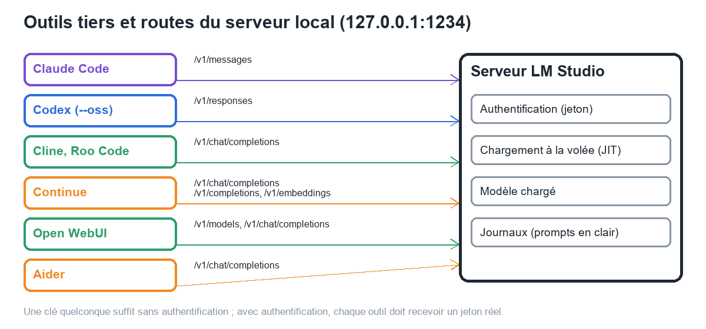

# Manuel 13 — Intégrations avec des outils tiers

> **Objet** : brancher des outils externes (assistants de code, interfaces de chat) sur le serveur local de LM Studio : réglages à fournir à chaque outil, comportement avec l'authentification, choix du modèle et du contexte.
> **Prérequis** : [Manuel 06](06-serveur-local-et-api.md) (serveur), [Manuel 11](11-securiser-le-serveur.md) (jetons), [Manuel 12](12-api-avancee.md) (routes).
> **Version décrite** : LM Studio 0.4.25, Windows 11.
> **Statut des informations — lecture indispensable** : **aucun de ces outils n'a été lancé** pendant la production du manuel (installation, compte ou téléchargement requis, ou serveur Docker arrêté). Les **réglages** viennent de la documentation officielle de LM Studio [Source] (Claude Code, Codex) ou de la documentation de chaque outil [Source tierce] (Cline, Roo Code, Continue, Open WebUI, Aider). Le seul test réel est un **rejeu des requêtes équivalentes** ([section 4](#4-vérification-par-simulation)) : il prouve que **le serveur accepte les routes et les formats** que ces outils emploient, pas que l'outil fonctionne de bout en bout [Vérifié pour le serveur, [À tester] pour chaque outil].

---

## Sommaire

1. [Principe](#1-principe)
2. [Réglages par outil](#2-réglages-par-outil)
3. [Comportement avec l'authentification](#3-comportement-avec-lauthentification)
4. [Vérification par simulation](#4-vérification-par-simulation)
5. [Modèle et contexte pour les outils de code](#5-modèle-et-contexte-pour-les-outils-de-code)
6. [Dépannage](#6-dépannage)

---

## 1. Principe

### Essentiel

Tout client a besoin de **quatre informations** :

| Information | Valeur sur le poste de test | Remarque |
|---|---|---|
| **Adresse de base** | `http://localhost:1234` (Anthropic, natif) ou `http://localhost:1234/v1` (OpenAI) | Selon l'outil, le suffixe `/v1` est ajouté ou non |
| **Clé / jeton** | Quelconque si l'authentification est désactivée ; **jeton réel** si elle est activée | Certains outils exigent une valeur même factice |
| **Identifiant du modèle** | `google/gemma-4-e4b` | Visible dans `GET /v1/models` et sur la page *Developer* |
| **Contexte suffisant** | Plus de 25 000 tokens pour les outils de code [Source] | Réglé au **chargement** du modèle ([Manuel 03](03-charger-un-modele.md)) |

Chaque outil emploie une **route** précise ; le serveur les expose toutes :

| Outil | Route principale | API |
|---|---|---|
| **Claude Code** | `POST /v1/messages` | Anthropic |
| **Codex** (`codex --oss`) | `POST /v1/responses` | OpenAI *Responses* |
| **Cline**, **Roo Code** | `GET /v1/models` (et `/api/v0/models`), `POST /v1/chat/completions` | OpenAI |
| **Continue** | `POST /v1/chat/completions`, `/v1/completions` (autocomplétion), `/v1/embeddings` (indexation) | OpenAI |
| **Open WebUI** | `GET /v1/models`, `POST /v1/chat/completions` | OpenAI |
| **Aider** (via LiteLLM) | `POST /v1/chat/completions` | OpenAI |


*Figure 1 — Chaque outil emploie une ou plusieurs routes du même serveur local.*

L'adresse du serveur et l'identifiant exact du modèle se copient depuis la page *Developer* (panneau de droite) :


*Figure 2 — « API Usage » : identifiant du modèle à saisir dans l'outil et adresse du serveur.*

> **Exemple** — Pour Aider, deux variables d'environnement et un nom de modèle suffisent : `LM_STUDIO_API_BASE=http://localhost:1234/v1`, `LM_STUDIO_API_KEY=<valeur>`, `aider --model lm_studio/google/gemma-4-e4b`.

### Pour aller plus loin

- Le serveur doit être **démarré** et un modèle **chargé** (ou le chargement à la volée activé) avant le premier message ; sinon l'outil affiche une erreur de connexion ou de modèle ([Manuel 06](06-serveur-local-et-api.md#9-chargement-des-modèles-jit-et-ttl)).
- L'outil et le serveur sont sur le **même poste** : l'adresse `localhost` suffit, sans *Serve on Local Network* ([Manuel 11](11-securiser-le-serveur.md#2-trois-niveaux-dexposition)). Si l'outil tourne dans un **conteneur**, voir la remarque Open WebUI ci-dessous.

---

## 2. Réglages par outil

### 2.1 Claude Code **[Source]**

Claude Code s'adresse à l'API Anthropic ; LM Studio fournit une route compatible [Source : documentation officielle]. PowerShell :

```powershell
lms server start --port 1234
$env:ANTHROPIC_BASE_URL = "http://localhost:1234"
$env:ANTHROPIC_AUTH_TOKEN = "<jeton LM Studio ou valeur quelconque>"
$env:CLAUDE_CODE_ATTRIBUTION_HEADER = "0"
claude --model google/gemma-4-e4b
```

| Point | Détail |
|---|---|
| Jeton | Avec authentification activée : `ANTHROPIC_AUTH_TOKEN` = **jeton LM Studio** ; l'en-tête `x-api-key` est aussi accepté ([Manuel 11](11-securiser-le-serveur.md#3-authentification-et-jetons)) |
| Contexte | Plus de 25 000 tokens recommandés [Source] : l'outil envoie un prompt système volumineux et beaucoup d'outils |
| Limites constatées sur le serveur | `POST /v1/messages/count_tokens` **non implémentée** (réponse 200 avec un message d'erreur) ; avec *Gemma 4 E4B*, réponse **vide** après un résultat d'outil si les outils sont redéclarés ([Manuel 12, section 4](12-api-avancee.md#4-compatibilité-anthropic--v1messages)) : choisir et tester le modèle avec soin [Vérifié sur le serveur ; effet réel sur Claude Code : À tester] |
| Compte | Avec ces variables, l'outil vise le serveur local ; la connexion à un compte Anthropic n'a **pas** été testée [À tester] |

### 2.2 Codex **[Source]**

```powershell
lms server start --port 1234
codex --oss                          # modèle par défaut : openai/gpt-oss-20b
codex --oss -m google/gemma-4-e4b    # autre modèle
```

L'option `--oss` utilise le serveur local à l'adresse par défaut (port 1234) et l'API *Responses* [Source]. Plus de 25 000 tokens de contexte sont recommandés. La documentation mentionne aussi LM Link pour exécuter Codex sur un poste et le modèle sur un autre (compte requis ; non testé).

### 2.3 Cline **[Source tierce]**

1. Démarrer le serveur ; charger un modèle.
2. Réglages de Cline → fournisseur (*API Provider*) **LM Studio**.
3. *Base URL* : `http://localhost:1234` (valeur par défaut).
4. Choisir le modèle dans la liste.
5. Recommandations : activer **Use Compact Prompt** ; garder des tâches ciblées pour limiter le contexte ; ouvrir une nouvelle tâche quand le contexte devient trop grand.

### 2.4 Roo Code **[Source tierce]**

1. Démarrer le serveur depuis l'onglet *Developer* ; charger un modèle.
2. Réglages de Roo Code → *API Provider* **LM Studio**.
3. *Base URL* : `http://localhost:1234` (défaut) ; *Model ID* : identifiant du modèle.
4. En cas d'erreur dans les journaux de développeur, augmenter le **contexte** du modèle ([Manuel 03](03-charger-un-modele.md)).

### 2.5 Continue **[Source tierce]**

Fichier `config.yaml` de l'extension :

```yaml
models:
  - name: Gemma local
    provider: lmstudio
    model: google/gemma-4-e4b
    # apiBase: http://localhost:1234/v1     # valeur par défaut
  - name: Embeddings locaux
    provider: lmstudio
    model: text-embedding-nomic-embed-text-v1.5
    roles:
      - embed
```

| Rôle (`roles`) | Usage |
|---|---|
| `chat`, `edit`, `apply`, `summarize` | Valeurs par défaut |
| `autocomplete` | Complétion en ligne (route `/v1/completions`) |
| `embed` | Indexation du code (modèle d'embeddings) |

> **Exemple** — Le modèle d'embeddings *nomic-embed-text-v1.5* est déjà présent dans LM Studio sur le poste de test : il peut servir directement au rôle `embed`.

### 2.6 Open WebUI **[Source tierce]**

1. Démarrer le serveur LM Studio.
2. *Admin → Settings → Connections* : ajouter une connexion **compatible OpenAI** vers `http://localhost:1234/v1`.
3. Les modèles de LM Studio apparaissent dans le sélecteur.

> **Point d'attention (Docker)** — Open WebUI est souvent lancé dans un **conteneur**, où `localhost` désigne le conteneur lui-même. L'adresse usuelle de l'hôte est `host.docker.internal`. Or LM Studio n'écoute par défaut que sur `127.0.0.1`. La documentation consultée ne traite pas ce cas ; le comportement dépend de la configuration de Docker et **n'a pas pu être testé** (service Docker arrêté sur le poste de test). Ne pas résoudre le problème en activant *Serve on Local Network* sans authentification ([Manuel 11](11-securiser-le-serveur.md#2-trois-niveaux-dexposition)) [À tester].

### 2.7 Aider **[Source tierce]**

PowerShell :

```powershell
setx LM_STUDIO_API_KEY "<jeton ou valeur quelconque>"
setx LM_STUDIO_API_BASE "http://localhost:1234/v1"
# ouvrir un nouveau terminal (setx n'agit pas sur la session courante)
cd C:\chemin\du\projet
aider --model lm_studio/google/gemma-4-e4b
```

| Point | Détail |
|---|---|
| Clé | Une valeur est **obligatoire**, même factice, tant que l'authentification est désactivée ; **jeton réel** sinon |
| Nom du modèle | Préfixe `lm_studio/` suivi de l'identifiant du modèle |
| Installation | `aider-install` (installation d'un paquet : non réalisée) |

### Pour aller plus loin

- **Bionic** et les **assistants de code** de ce manuel ne sont pas équivalents : Bionic est une application agent complète ([manuels Bionic](../bionic/README.md)), alors que ces outils délèguent au serveur LM Studio l'inférence seule.
- Les outils évoluent vite : relire leur documentation avant déploiement. Les noms de variables d'environnement et les fournisseurs listés ci-dessus sont ceux publiés au moment de la rédaction.

---

## 3. Comportement avec l'authentification

### Essentiel

Sans authentification, les clients qui exigent « une clé » acceptent n'importe quelle valeur. **Dès que l'authentification est activée**, le serveur vérifie le jeton : une valeur factice est refusée.

> **Exemple (poste de test)** — Rejeu des dix requêtes de la [section 4](#4-vérification-par-simulation) [Vérifié] :
>
> | Clé envoyée | Résultat |
> |---|---|
> | Valeurs factices usuelles (`lm-studio`, `dummy-api-key`), authentification **activée** | **10 requêtes sur 10 en 401** : « Malformed LM Studio API token provided » |
> | **Jeton réel** (factice créé pour l'essai, puis supprimé), authentification activée | **9 requêtes sur 10 en 200** ; la dixième (Aider, qui avait gardé la clé `dummy-api-key`) : **401** |
> | Authentification **désactivée**, clés factices | 10 requêtes sur 10 en 200 |

Conséquence pratique : après activation de l'authentification, **mettre à jour la clé dans chaque outil** (variable d'environnement, fichier de configuration). Les outils sont en général peu explicites sur ce point ; l'erreur 401 apparaît dans les journaux de LM Studio (*Developer Logs*).

### Pour aller plus loin

- Un jeton **par outil**, nommé en conséquence, pour pouvoir révoquer un outil sans toucher aux autres ([Manuel 11](11-securiser-le-serveur.md#3-authentification-et-jetons)).
- Les outils d'assistance au code manipulent des fichiers du projet : ne jamais leur donner de jeton autorisant `mcp.json` sans nécessité ([Manuel 11, section 4](11-securiser-le-serveur.md#4-permissions-des-jetons-et-mcp)).

---

## 4. Vérification par simulation

### Essentiel

Le script [`outils/simuler_clients_tiers.py`](../../outils/simuler_clients_tiers.py) envoie au serveur les requêtes que chaque outil est censé émettre (route, en-têtes d'authentification, flux, outils), avec *Gemma 4 E4B* [Vérifié] :

| Requête rejouée | Code | Remarque |
|---|---|---|
| Claude Code : `POST /v1/messages` (flux, outils, `system` en blocs avec `cache_control`, `x-api-key`, `anthropic-beta`) | 200 | Flux SSE `message_start`… |
| Claude Code : `POST /v1/messages/count_tokens` | **200 + corps d'erreur** | « Unexpected endpoint or method » : route non implémentée |
| Codex : `POST /v1/responses` (flux, outil `function`, `store: false`) | 200 | Événements `response.created`… |
| Cline, Roo Code, Open WebUI : `GET /v1/models` | 200 | Liste des modèles |
| Cline, Roo Code : `GET /api/v0/models` (ancienne API REST) | 200 | Liste avec type (`llm`, `vlm`) |
| Cline, Roo Code, Open WebUI : `POST /v1/chat/completions` (flux, `stream_options.include_usage`) | 200 | `usage` dans le flux |
| Continue : `POST /v1/chat/completions` avec un outil | 200 | — |
| Continue : `POST /v1/completions` (autocomplétion) | 200 | Complétion de texte brut |
| Continue : `POST /v1/embeddings` (modèle *nomic-embed-text-v1.5*) | 200 | Premier appel : chargement à la volée (≈ 10 s) |
| Aider : `POST /v1/chat/completions` avec la clé `dummy-api-key` | 200 | Authentification désactivée |

**Lecture** : toutes les routes employées par ces outils répondent. Le seul défaut identifié côté serveur est `count_tokens`.

### Pour aller plus loin

- Ce que la simulation **ne** prouve **pas** : le comportement d'un outil réel avec un petit modèle (qualité des modifications de code, respect du format d'édition, longueur du prompt système), ni l'effet de `count_tokens` absent sur Claude Code.
- Pour valider un outil réel : l'installer sur un poste de test, lancer une tâche courte, et relire dans *Developer Logs* les requêtes reçues (`Received request: POST to …`) et les erreurs éventuelles.
- Le rejeu est reproductible : relancer le script après une mise à jour de LM Studio pour détecter une régression de compatibilité.

---

## 5. Modèle et contexte pour les outils de code

### Essentiel

Les outils de code sont **exigeants** : prompt système long (instructions, outils), fichiers du projet, historique. Trois conditions :

| Condition | Pourquoi | Constat sur le poste de test |
|---|---|---|
| **Contexte ≥ 25 000 tokens** [Source] | Le prompt de l'outil peut occuper une grande partie d'un petit contexte | Contexte du modèle de test : 16 384 : **insuffisant** pour ces outils [Estimation] |
| **Modèle capable d'appeler des outils** | Les éditions de fichiers passent par des appels d'outils | *Gemma 4 E4B* : 100 % avec 5 outils, 92 % avec 17 ([Manuel 10, section 6](10-mcp-et-appel-d-outils.md#6-fiabilité-et-limites-des-petits-modèles)) |
| **Débit suffisant** | Chaque action relit tout le contexte | GPU intégré : ≈ 14 tok/s en génération, ≈ 340 tok/s en traitement du prompt [Vérifié, [Manuel 08](08-recettes-par-cas-usage.md)] |

> **Exemple d'estimation** — Un prompt de 25 000 tokens se traite en environ **75 secondes** à 340 tok/s avant le premier token de chaque tour ; une session de plusieurs dizaines de tours sur GPU intégré est lente [Estimation d'après le débit mesuré ; non testé avec un outil réel]. Un GPU dédié ou un modèle plus petit change cet ordre de grandeur.

### Pour aller plus loin

- Mémoire du contexte : ≈ +50 Ko par token pour un modèle de 7-8 Md ([Manuel 09, FAQ](09-depannage-faq.md)) ; 25 000 tokens ≈ 1,2 Go supplémentaires [Estimation].
- Le **cache de prompt** (`cached_tokens` dans `usage`, [Manuel 12](12-api-avancee.md#3-api-responses--v1responses)) évite de retraiter la partie inchangée du prompt d'un tour à l'autre : il explique en partie les temps plus courts des tours suivants.
- Pour les tâches courtes, un modèle plus petit avec un contexte réduit est souvent plus pertinent qu'un grand modèle lent.

---

## 6. Dépannage

| Symptôme | Cause probable | Action |
|---|---|---|
| « Connection refused » | Serveur arrêté, mauvais port | Vérifier l'état (`lms server status`) et le port |
| `401` après avoir activé l'authentification | Clé factice conservée dans l'outil | Créer un jeton et le saisir dans l'outil ([section 3](#3-comportement-avec-lauthentification)) |
| L'outil ne voit aucun modèle | Aucun modèle chargé et chargement à la volée désactivé | Charger un modèle ; vérifier `GET /v1/models` |
| Erreurs de contexte ou réponses tronquées | Contexte du modèle inférieur aux besoins de l'outil | Recharger avec un contexte plus grand ([Manuel 03](03-charger-un-modele.md)) |
| L'outil boucle ou ne répond plus après un appel d'outil | Modèle peu fiable aux outils, défaut de route | Tester un autre modèle ou une autre route ([Manuel 12](12-api-avancee.md#4-compatibilité-anthropic--v1messages)) |
| Depuis un conteneur : serveur injoignable | `localhost` désigne le conteneur ; serveur sur `127.0.0.1` | [Section 2.6](#26-open-webui-source-tierce) : ne pas ouvrir le réseau sans authentification |
| Réponses très lentes | Prompt volumineux sur GPU intégré | [Section 5](#5-modèle-et-contexte-pour-les-outils-de-code) |
