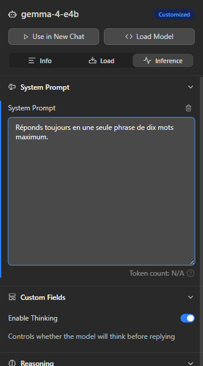
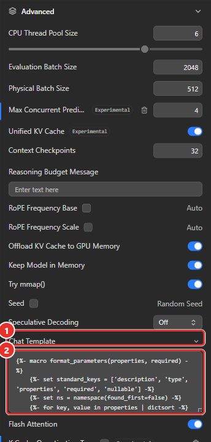
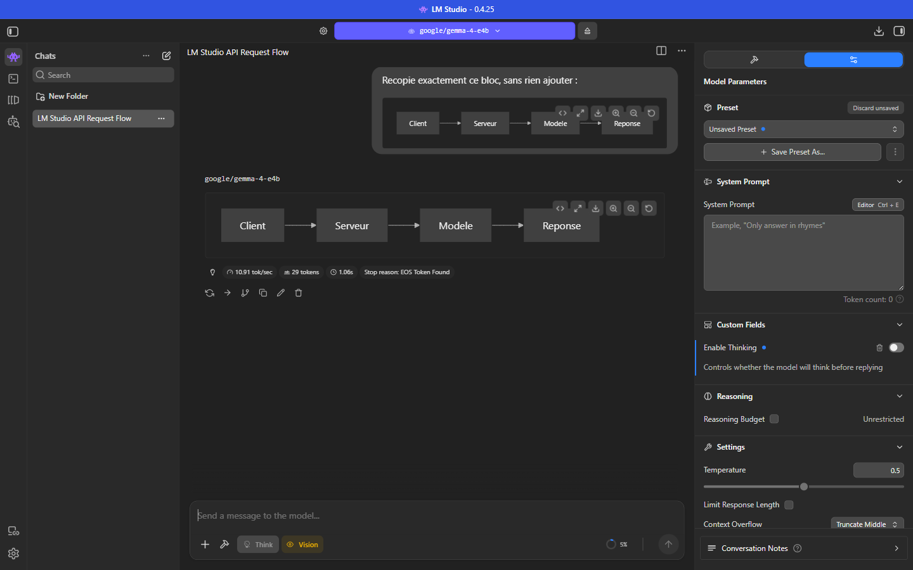
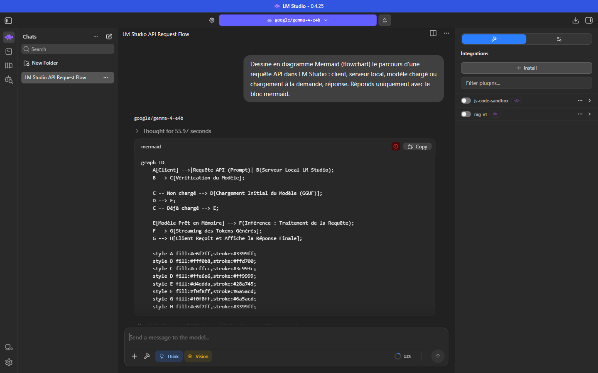

# Manuel 14 — Personnaliser les modèles : défauts, gabarit, `model.yaml`, Hub et conversations

> **Objet** : comprendre à quels niveaux un réglage s'applique (modèle, preset, conversation, requête), modifier le gabarit de conversation d'un modèle, lire un fichier `model.yaml`, situer le Hub et savoir où et sous quelle forme les conversations sont conservées.
> **Prérequis** : [Manuel 03](03-charger-un-modele.md) (chargement), [Manuel 04](04-parametrer-l-inference.md) (inférence et presets), [Manuel 12](12-api-avancee.md) (API).
> **Version décrite** : LM Studio 0.4.25, Windows 11.
> **Statut des informations** : [Vérifié] observé ou mesuré sur le poste de test (Intel Core Ultra 7 255H, 31 Go de RAM, GPU intégré, *Gemma 4 E4B*) ; [Source] documentation officielle ; [Source tierce] ; [Estimation] ; [À tester].
> **Aucun compte** n'a été connecté et **rien n'a été publié ni téléchargé depuis le Hub** : les parties « Hub » reposent sur la documentation et sur les fichiers déjà présents sur le poste.

---

## Sommaire

1. [Qui l'emporte : les niveaux de réglage](#1-qui-lemporte--les-niveaux-de-réglage)
2. [Les défauts d'un modèle](#2-les-défauts-dun-modèle)
3. [Le gabarit de conversation (chat template)](#3-le-gabarit-de-conversation-chat-template)
4. [`model.yaml` et modèles virtuels](#4-modelyaml-et-modèles-virtuels)
5. [Le Hub](#5-le-hub)
6. [Les conversations : stockage et diagrammes](#6-les-conversations--stockage-et-diagrammes)
7. [Dépannage](#7-dépannage)

---

## 1. Qui l'emporte : les niveaux de réglage

### Essentiel

Un même réglage (prompt système, température…) peut être défini à plusieurs endroits. Le plus **proche de la requête** l'emporte.

| Niveau | Où | Portée | Priorité |
|---|---|---|---|
| **Requête d'API** | Corps de la requête (`messages`, `temperature`…) | Une requête | **La plus haute** |
| **Conversation** | Panneau de droite du chat ([Manuel 04](04-parametrer-l-inference.md)) | Une conversation | Haute |
| **Preset** | Menu *Preset* du chat ([Manuel 04, section 9](04-parametrer-l-inference.md#9-presets)) | Toute conversation qui l'applique | Moyenne |
| **Défaut du modèle** | *My Models* → engrenage → onglets **Load** et **Inference** | Chaque chargement, chaque nouvelle conversation, et **les requêtes d'API qui ne précisent pas la valeur** | Basse |
| **Modèle (fichier)** | Valeurs fournies par l'éditeur (`model.yaml`, métadonnées du GGUF) | Tout usage du modèle | La plus basse |

> **Exemple** — *Gemma 4 E4B* : l'éditeur recommande une température de 1,0 (valeur lue dans `model.yaml`) ; un preset peut la fixer à 0,2 pour l'extraction ; une requête d'API qui envoie `temperature: 0` l'emporte sur les deux.

### Pour aller plus loin

Les paramètres de **chargement** (contexte, offload, gabarit) ne font plus partie des presets : ils se règlent dans l'onglet **Load** du modèle ou à chaque chargement ([Manuel 03](03-charger-un-modele.md)) [Source].

---

## 2. Les défauts d'un modèle

### Essentiel

*My Models* → engrenage du modèle (ou clic sur la ligne puis onglets **Load** / **Inference**). Un badge **Customized** signale un modèle dont au moins un défaut est modifié ; une icône de corbeille à côté d'un champ le remet à sa valeur d'origine [Vérifié].


*Figure 1 — Onglet **Inference** d'un modèle : un prompt système saisi ici devient le défaut du modèle (badge **Customized**, corbeille de remise à zéro) ; en dessous, la section **Custom Fields** (**Enable Thinking**).*

> **Mesure** — Défaut saisi : « Réponds toujours en une seule phrase de dix mots maximum. » Requête d'API **sans** message système : « Qu'est-ce qu'un token ? » **[Vérifié]**

| Situation | Réponse obtenue | Durée |
|---|---|---|
| Avant (aucun défaut) | Plusieurs paragraphes, tronqués à 120 tokens | 21,4 s |
| **Défaut actif**, requête sans message système | « Un jeton numérique représente une unité d'information ou valeur. » | 2,6 s |
| Défaut actif, requête **avec** un message système explicite (« Réponds en trois phrases. ») | Réponse longue : le message système de la requête l'**emporte** | 7,5 s |

Conséquences pratiques :

- Un défaut de modèle s'applique **aussi** aux outils tiers qui appellent l'API sans prompt système ([Manuel 13](13-integrations-outils-tiers.md)) : à utiliser pour imposer une consigne commune (langue, ton, format), à éviter si un autre outil attend un comportement par défaut.
- Après un essai, **remettre le champ à zéro** (corbeille ou effacement) : un prompt système oublié modifie silencieusement toutes les réponses du modèle.

### Pour aller plus loin

- Les défauts de chargement (contexte, offload, parallélisme) sont repris par `lms load` et par le chargement à la demande de l'API ([Manuel 06](06-serveur-local-et-api.md)). Un contexte différent de celui d'une instance déjà chargée crée **une seconde instance** du modèle ([Manuel 12](12-api-avancee.md)).
- Le champ **Enable Thinking** n'est pas un réglage de l'application mais un **champ personnalisé** déclaré par le modèle ([section 4](#4-modelyaml-et-modèles-virtuels)) : il apparaît dans la section *Custom Fields*.

---

## 3. Le gabarit de conversation (chat template)

### Essentiel

Un modèle ne lit pas des « messages » mais une **suite de texte** avec des balises spéciales qui séparent les rôles (système, utilisateur, assistant, outils). Le **gabarit** transforme la conversation en cette suite. Un gabarit incorrect donne des réponses étranges : réponses qui ne s'arrêtent pas, rôles confondus, outils ignorés.

LM Studio utilise le gabarit **intégré au modèle** (ou celui du `model.yaml`). Dans la version décrite, il se modifie dans **Load → Advanced → Chat Template** (champ repliable) [Vérifié] ; les anciennes sections *Prompt Template*, *Speculative Decoding* et *CPU Threads* de l'onglet **Inference** renvoient désormais vers cet emplacement (« moved to Load settings ») [Vérifié].


*Figure 2 — Onglet **Load** → section **Advanced**. ① Champ **Chat Template** (replié par défaut, flèche) — ② Gabarit **Jinja** déplié, modifiable. Gabarit réel de *Gemma 4 E4B* ; seules les premières lignes sont visibles.*

| Mode | Principe | Usage |
|---|---|---|
| **Jinja** | Gabarit complet en langage Jinja, avec boucles sur les messages, outils et variables (`messages`, `tools`, `enable_thinking`, `add_generation_prompt`) | Modèles récents ; c'est le mode du gabarit intégré |
| **Manuel** | Préfixe et suffixe saisis pour chaque rôle | Modèle ancien ou sans métadonnées de gabarit [Source] |

**Quand modifier le gabarit** [Source] : le modèle n'en fournit pas ou le fait de façon incorrecte, LM Studio ne le reconnaît pas, ou un cas d'usage précis l'exige. **Sinon, ne pas y toucher** : le gabarit fourni par l'éditeur est celui avec lequel le modèle a été entraîné.

> **Exemple** — Dans le gabarit de *Gemma 4 E4B*, le raisonnement est piloté par la variable `enable_thinking` : si elle est vraie, la balise `<|think|>` est insérée dans le bloc système ; si elle est fausse, le gabarit ajoute au tour de l'assistant un bloc de réflexion **vide** (`<|channel>thought` suivi de `<channel|>`), ce qui dispense le modèle de réfléchir. L'interrupteur **Enable Thinking** n'est donc que l'écriture de cette variable [Vérifié, lecture du fichier].

### Pour aller plus loin

- **Un gabarit modifié est mémorisé avec le modèle** et rechargé à chaque chargement. Garder une copie du texte d'origine avant toute édition.
- Les **chaînes d'arrêt** issues du gabarit utilisent le réglage *Stop Strings* de l'onglet **Inference** ([Manuel 04](04-parametrer-l-inference.md)) [Vérifié].
- Le gabarit conditionne l'**appel d'outils** : un gabarit sans bloc `tools` rend inopérants les outils déclarés ([Manuel 10](10-mcp-et-appel-d-outils.md)).
- Pour comparer deux gabarits, charger deux instances du même modèle avec des identifiants différents (`lms load --identifier`, [Manuel 07](07-cli-lms.md)).

---

## 4. `model.yaml` et modèles virtuels

### Essentiel

`model.yaml` est un **format ouvert** (modelyaml.org) qui décrit un modèle de façon portable : quels fichiers le composent, quelles métadonnées afficher, quels réglages appliquer par défaut. Un « modèle virtuel » est un `model.yaml` qui **pointe** vers des fichiers (GGUF, MLX) sans les contenir [Source].

Sur le poste de test, chaque modèle du catalogue installé possède son fichier dans `%USERPROFILE%\.lmstudio\hub\models\<éditeur>\<modèle>\` (avec `manifest.json`, `README.md` et une vignette) [Vérifié]. Extrait réel, abrégé, de `hub\models\google\gemma-4-e4b\model.yaml` :

```yaml
model: google/gemma-4-e4b
base:
  - key: lmstudio-community/gemma-4-e4b-it-gguf
    sources:
      - type: huggingface
        user: lmstudio-community
        repo: gemma-4-E4B-it-GGUF
config:
  operation:
    fields:
      - key: llm.prediction.temperature
        value: 1.0
      - key: llm.prediction.topPSampling
        value: { checked: true, value: 0.95 }
      - key: llm.prediction.topKSampling
        value: 64
      - key: llm.prediction.promptTemplate
        value: { type: jinja, jinjaPromptTemplate: { template: "…gabarit Jinja…", stopStrings: [] } }
customFields:
  - key: enableThinking
    displayName: Enable Thinking
    description: Controls whether the model will think before replying
    type: boolean
    defaultValue: true
    effects:
      - type: setJinjaVariable
        variable: enable_thinking
metadataOverrides:
  domain: llm
  architectures: [gemma4]
  compatibilityTypes: [gguf]
  paramsStrings: [7.9B]
  minMemoryUsageBytes: 5900000000
  contextLengths: [131072]
  vision: true
  reasoning: true
  trainedForToolUse: true
```

| Champ | Rôle |
|---|---|
| `model` | Identifiant canonique `éditeur/modèle` : celui que l'API et `lms` utilisent (`google/gemma-4-e4b`) |
| `base` | Fichiers réels (ou autres modèles virtuels) dont le modèle dérive, avec leur origine (ici un dépôt Hugging Face) |
| `config.operation` | Défauts d'**inférence** (équivalent des *Per Model Defaults*) |
| `config.load` | Défauts de **chargement** |
| `customFields` | Champs ajoutés à l'interface du modèle, avec un **effet** (ici : écrire une variable Jinja) |
| `metadataOverrides` | Informations affichées dans le catalogue et les fiches : paramètres, architecture, contexte, capacités |

Dans la figure 1, la section **Custom Fields** montre un tel champ (**Enable Thinking**) : il s'affiche dans l'onglet **Inference** de chaque conversation avec ce modèle.

Le champ personnalisé est stocké dans les conversations sous une clé qui reprend l'identifiant du modèle : `ext.virtualModel.customField.google.gemma4E4b.enableThinking` [Vérifié].

### Pour aller plus loin

- **Les valeurs de `model.yaml` sont les défauts les plus bas** : ils sont écrasés par les défauts du modèle saisis dans l'interface, puis par les niveaux supérieurs ([section 1](#1-qui-lemporte--les-niveaux-de-réglage)).
- **Créer un modèle virtuel à la main n'a pas fonctionné** sur le poste de test : un `model.yaml` et un `manifest.json` déposés dans `hub\models\<éditeur>\<nom>\` (avec une `base` pointant vers le modèle installé), puis dans `models\<éditeur>\<nom>\`, **n'ont pas été reconnus** (absents de `lms ls` et de `GET /v1/models`, y compris après redémarrage de l'application) [Vérifié]. La documentation ne décrit pas de source de type fichier local [Source]. Pour obtenir un modèle personnalisé, deux pistes plus sûres : **preset** ([Manuel 04](04-parametrer-l-inference.md#9-presets)) ou **défauts du modèle** (section 2).
- La commande `lms clone <éditeur/nom>` copie un artefact du Hub dans un dossier local (pour l'adapter), et `lms push` le publie : **compte et connexion Internet requis, non exécutés** ([Manuel 07](07-cli-lms.md)).
- Les valeurs de `metadataOverrides` ne sont **pas** recalculées à partir du fichier : *PARAMS* peut différer entre le catalogue (7.9B, valeur du `model.yaml`) et `lms ls` (7.5B, valeur du fichier) [Vérifié].

---

## 5. Le Hub

### Essentiel

Le **Hub** de LM Studio est un dépôt communautaire en ligne (site web) qui regroupe des **modèles** (fiches `model.yaml`), des **presets**, des **plugins** (outils, prétraitement de prompt, générateurs) et des **compétences** [Source]. L'application en consomme le contenu : le catalogue *Model Search* ([Manuel 02](02-selectionner-et-telecharger-un-modele.md)) affiche des fiches du Hub, et un preset peut être importé depuis un lien du Hub (*Import Preset*).

| Besoin | Moyen | Compte |
|---|---|---|
| Parcourir, lire les fiches | Site du Hub (navigateur) | Non |
| Installer un modèle, un preset, un plugin | Depuis l'application ou `lms get <éditeur/nom>` | Non [Source] |
| **Publier** un preset, un plugin ou un modèle | *Publish…* (menu d'un preset), `lms push` | **Oui** (`lms login`) |

> **Attention** — **Publier** envoie le contenu sur un service public. Un preset qui contient un prompt système interne, un nom de client ou une adresse serveur ne doit **jamais** être publié. Le menu d'un preset propose *Publish…* à côté de *Delete…* : vérifier le contenu avant tout clic ([Manuel 04, section 9](04-parametrer-l-inference.md#9-presets)).

### Pour aller plus loin

- **Dossiers locaux** du poste de test [Vérifié] : `hub\models` (fiches des modèles installés), `hub\presets`, `hub\skills`, `config-presets` (presets locaux), `extensions\plugins` (plugins installés), `mcp.json` ([Manuel 10](10-mcp-et-appel-d-outils.md)).
- Les **plugins** (TypeScript : outils, prétraitement de prompt comme le RAG intégré, générateurs) se développent avec `lms dev` et le SDK. Ils exigent Node.js, absent du poste de test ; non couverts ici.
- Un artefact téléchargé du Hub est du **code ou de la configuration d'un tiers** : le lire avant de l'activer, en particulier les plugins et les serveurs MCP.

---

## 6. Les conversations : stockage et diagrammes

### Essentiel

Chaque conversation est un fichier JSON dans **`%USERPROFILE%\.lmstudio\conversations\`** (nom : `<horodatage>.conversation.json`) [Vérifié]. Le fichier est lisible, copiable et sauvegardable ; il contient **tout** : messages, réglages de la conversation, modèle utilisé.

| Clé | Contenu |
|---|---|
| `name`, `pinned`, `createdAt`, `tokenCount` | Titre, épinglage, date, taille en tokens |
| `systemPrompt`, `preset` | Prompt système et preset de la conversation |
| `perChatPredictionConfig` | Réglages propres à la conversation (ex. le champ personnalisé *Enable Thinking*) |
| `messages` | Liste de messages ; chacun a des `versions` (régénérations, branches) et `currentlySelected` |
| `lastUsedModel` | Identifiant du modèle et **configuration de chargement complète** (contexte, offload, quantification du cache, **gabarit entier**) |
| `notes`, `plugins`, `looseFiles` | Notes de conversation, plugins actifs, fichiers joints |

Une réponse d'assistant se compose d'**étapes** (`steps`) : bloc de réflexion, bloc de contenu avec ses statistiques de génération (`genInfo`), bloc de débogage.

> **Confidentialité** — Les conversations contiennent le texte envoyé, les noms des fichiers joints et, pour les outils, les arguments et résultats. Les sauvegarder comme des documents sensibles. Un fichier vide pèse déjà ≈ 18 Ko car il embarque le gabarit du modèle utilisé **[Vérifié]** ; une conversation de quatre messages avec un raisonnement long atteint ≈ 100 Ko.

### Diagrammes Mermaid dans le chat

Un bloc de code de langage `mermaid` est **rendu en diagramme** dans la conversation, aussi bien dans le message de l'utilisateur que dans la réponse ; une barre d'outils propose l'affichage du code, l'agrandissement, le téléchargement et le zoom [Vérifié].


*Figure 3 — Bloc `mermaid` recopié par *Gemma 4 E4B* : diagramme rendu (flux Client → Serveur → Modèle → Réponse) avec barre d'outils.*

Un diagramme produit **librement** par un petit modèle échoue souvent : la syntaxe Mermaid est stricte (points-virgules, deux-points dans une forme `(…)`, caractères accentués dans les identifiants).


*Figure 4 — Diagramme demandé librement à *Gemma 4 E4B* (raisonnement actif, 84 s) : le bloc est affiché comme code avec une **icône rouge** d'erreur au lieu du rendu ; les deux-points dans les libellés entre parenthèses rendent la syntaxe invalide.*

Méthode fiable : demander un **diagramme simple** (graph LR, identifiants sans accents ni espaces), ou fournir la syntaxe et demander au modèle de la modifier.

### Pour aller plus loin

- Mise en page du chat (dossiers, vue scindée, branches, génération multiple, recherche, corbeille, export PDF / Markdown / texte) : [Manuel 04, section 3](04-parametrer-l-inference.md#3-gérer-les-conversations) ; le fichier JSON reste la copie de référence.
- Les conversations ne sont **pas chiffrées** : le chiffrement du disque de l'utilisateur est la seule protection.

---

## 7. Dépannage

| Symptôme | Cause probable | Action |
|---|---|---|
| Toutes les réponses d'un modèle sont courtes, ou ont un ton imposé | Prompt système laissé dans les **défauts du modèle** | *My Models* → engrenage → **Inference** → vider le champ |
| Un réglage de l'interface est ignoré par un outil tiers | La requête d'API envoie sa propre valeur | Retirer le champ dans l'outil ou accepter sa priorité ([section 1](#1-qui-lemporte--les-niveaux-de-réglage)) |
| Réponses qui ne s'arrêtent pas, rôles mélangés | Gabarit absent ou incorrect | Contrôler **Load → Advanced → Chat Template** ; rétablir le gabarit d'origine |
| Outils déclarés mais jamais appelés | Gabarit sans bloc d'outils, ou modèle non adapté | [Manuel 10, section 6](10-mcp-et-appel-d-outils.md#6-fiabilité-et-limites-des-petits-modèles) |
| `model.yaml` déposé à la main introuvable | Dépôt local non reconnu ([section 4](#4-modelyaml-et-modèles-virtuels)) | Utiliser un preset ou les défauts du modèle |
| Diagramme Mermaid affiché comme code avec une icône rouge | Syntaxe invalide | Redemander un diagramme plus simple |
| Dossier `conversations` volumineux | Gabarit embarqué dans chaque fichier ; fichiers joints | Supprimer les conversations inutiles depuis l'application (corbeille) |
