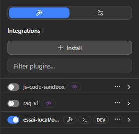
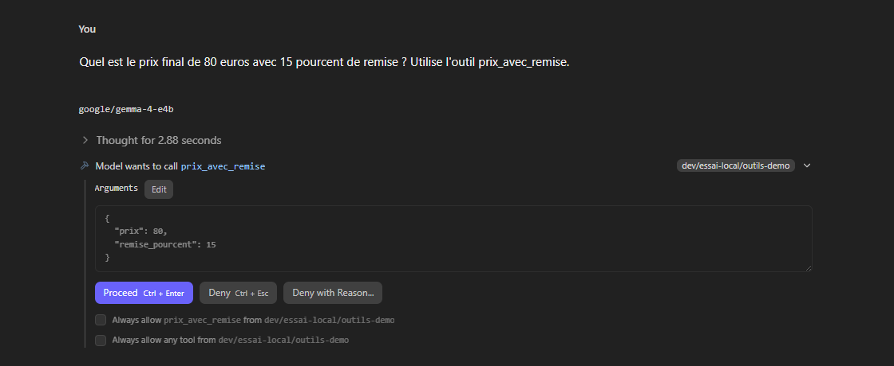
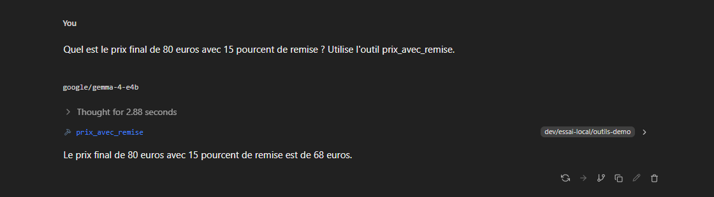

# Manuel 16 — SDK JavaScript, plugins et mode sans interface

> **Objet** : piloter LM Studio par programme avec le **SDK JavaScript** (`@lmstudio/sdk`), écrire un **plugin** (outils proposés au modèle dans le chat) avec `lms dev`, et situer le mode sans interface (**llmster**).
> **Prérequis** : [Manuel 06](06-serveur-local-et-api.md) (serveur), [Manuel 07](07-cli-lms.md) (`lms`), [Manuel 10](10-mcp-et-appel-d-outils.md) (appel d'outils). Node.js ≥ 18 (testé avec la version 24).
> **Version décrite** : LM Studio 0.4.25, `@lmstudio/sdk` **2.0.0**, Windows 11. Essais du **7 octobre 2026** sur le poste à GPU dédié ([Manuel 15](15-performances-gpu-dedie.md)).
> **Contrainte** : paquets installés dans un **dossier de test** ; aucun compte connecté (`lms login`, `lms push` non utilisés).
> **Étiquettes** : **[Vérifié]** exécuté ; **[Source]** documentation officielle ; **[À tester]**.

---

## Sommaire

1. [Choisir entre API, SDK et plugin](#1-choisir-entre-api-sdk-et-plugin)
2. [Le SDK JavaScript](#2-le-sdk-javascript)
3. [Paramètres de chargement accessibles par le SDK](#3-paramètres-de-chargement-accessibles-par-le-sdk)
4. [Écrire un plugin](#4-écrire-un-plugin)
5. [Le mode sans interface : llmster](#5-le-mode-sans-interface--llmster)
6. [Pièges constatés](#6-pièges-constatés)

---

## 1. Choisir entre API, SDK et plugin

| Besoin | Outil | Remarque |
|---|---|---|
| Appeler un modèle depuis n'importe quel langage ou outil existant | **API** compatible OpenAI / Anthropic ([Manuels 06 et 12](06-serveur-local-et-api.md)) | Aucune dépendance |
| Charger un modèle avec **tous** les paramètres, gérer les modèles, définir des outils en JavaScript | **SDK** `@lmstudio/sdk` | Voir section 3 : le SDK expose des réglages **absents** de `lms load` et de `POST /api/v1/models/load` |
| Donner au modèle de **nouveaux outils** dans l'interface de LM Studio (chat) | **Plugin** (`lms dev`) | Un fournisseur d'outils apparaît dans le panneau *Integrations* |
| Brancher un serveur d'outils standard | **MCP** ([Manuel 10](10-mcp-et-appel-d-outils.md)) | Indépendant du langage |

---

## 2. Le SDK JavaScript

### Essentiel

```powershell
mkdir essai-sdk; cd essai-sdk
npm init -y
npm install @lmstudio/sdk zod        # versions testées : @lmstudio/sdk 2.0.0, zod 3.x
```

Le SDK se connecte au serveur local (port 1234 par défaut) ; LM Studio doit tourner. Exemple minimal (fichier `.mjs`) :

```js
import { LMStudioClient } from "@lmstudio/sdk";
const client = new LMStudioClient();
const modele = await client.llm.load("google/gemma-4-e4b", { identifier: "essai", config: { contextLength: 8192 } });
const r = await modele.respond([{ role: "user", content: "Réponds en une phrase : à quoi sert le cache KV ?" }], { temperature: 0, maxTokens: 1500 });
console.log(r.content, r.stats);
await modele.unload();
```

Le script complet [`outils/sdk_js/essai_sdk.mjs`](../../outils/sdk_js/essai_sdk.mjs) enchaîne : version, liste des modèles du disque, chargement paramétré, génération avec statistiques, sortie structurée, **agent à outil**, embeddings. Résultat brut : `outils/resultats/gpu_dedie/sdk_essai.json`.

| Fonction | Appel | Résultat observé [Vérifié] |
|---|---|---|
| Version de l'application | `client.system.getLMStudioVersion()` | `{ version: "0.4.25", build: 1 }` |
| Modèles présents | `client.system.listDownloadedModels()` | clé, type, taille de chaque modèle (5 entrées : 4 LLM, 1 embedding) |
| Chargement | `client.llm.load(cle, { identifier, config, verbose: false })` | Modèle chargé en ≈ 12 s (Gemma 4 E4B Q8_0), progression imprimée si `verbose` |
| Génération | `modele.respond(messages, options)` | `stats` : `tokensPerSecond` 42,8, `timeToFirstTokenSec` 0,17, `promptTokensCount` 29, `predictedTokensCount` 386 |
| Agent à outil | `modele.act(consigne, [tool({…})])` | 1 appel d'outil `convertir_temperature(100, C, F)` puis réponse, **3,4 s**, 2 tours |
| Embeddings | `client.embedding.model(cle).embed([…])` | vecteurs de dimension 768 |

Définition d'un outil (schéma **zod**, exécuté localement par le code du plugin) :

```js
import { tool } from "@lmstudio/sdk";
import { z } from "zod";
const convertir = tool({
  name: "convertir_temperature",
  description: "Convertit une température entre Celsius (C) et Fahrenheit (F).",
  parameters: { valeur: z.number(), de: z.enum(["C", "F"]), vers: z.enum(["C", "F"]) },
  implementation: ({ valeur, de, vers }) => /* … */ String(de === "C" ? valeur * 9 / 5 + 32 : (valeur - 32) * 5 / 9),
});
await modele.act("Combien font 100 degrés Celsius en Fahrenheit ? Utilise l'outil.", [convertir]);
```

### Pour aller plus loin

- La documentation officielle de TypeScript est à `lmstudio.ai/docs/typescript` **[Source]** ; une version Python (`lmstudio-python`) existe **[Source]**, non testée ici.
- Le SDK peut aussi **télécharger** un modèle ; **aucun essai** : les téléchargements sont restés manuels.
- `modele.respond(…, { structured: schemaZod })` et la **réflexion** : voir [section 6](#6-pièges-constatés).

---

## 3. Paramètres de chargement accessibles par le SDK

Le champ `config` de `client.llm.load()` (type `LLMLoadModelConfig`, SDK 2.0.0) couvre **davantage** que les deux autres voies :

| Réglage SDK | `lms load` | API REST `models/load` | Rôle |
|---|---|---|---|
| `contextLength` | `-c` | `context_length` | Longueur de contexte |
| `gpu: { ratio: "max" \| "off" \| 0..1 }` | `--gpu` | — | Part des couches sur le GPU |
| `maxParallelPredictions`, `useUnifiedKvCache` | `--parallel` | `parallel` | Requêtes simultanées, cache partagé |
| `flashAttention` | — | `flash_attention` | Flash Attention |
| `evalBatchSize` | — | `eval_batch_size` | Lot d'évaluation |
| **`physicalBatchSize`** | — | — | Lot physique |
| `offloadKVCacheToGpu` | — | `offload_kv_cache_to_gpu` | Cache K/V sur le GPU |
| **`llamaKCacheQuantizationType`, `llamaVCacheQuantizationType`** | — | — | Quantification du cache K / V (`"q8_0"`, `"q4_0"`…) |
| `numExperts` | — | `num_experts` | Nombre d'experts actifs (MoE) |
| **`llamaCppArgumentsOverride`** | — | — | Arguments `llama.cpp` libres (ex. `--n-cpu-moe 8`) |
| **`speculativeDraftMtp`, `speculativeDraftSimple`, `speculativeDraftModel`, `speculativeDraftMaxTokens`…** | `--speculative-draft-*` | — | Décodage spéculatif |
| `gpuStrictVramCap` | — | — | Plafonne l'offload à la VRAM détectée |
| `keepModelInMemory`, `tryMmap`, `tryDirectIO`, `seed`, `ropeFrequencyBase/Scale`, `promptTemplate`, `contextCheckpoints` | — | — | Réglages avancés |
| `autoFit` | `--auto` | — | **Réservé à Bionic** (« only available when using Bionic ») |

Le script [`outils/sdk_js/charger.mjs`](../../outils/sdk_js/charger.mjs) charge un modèle avec une configuration JSON ; les mesures des [sections 4 et 6 du Manuel 15](15-performances-gpu-dedie.md) l'emploient :

```powershell
node charger.mjs google/gemma-4-26b-a4b bench '{"contextLength":8192,"gpu":{"ratio":"max"},"llamaCppArgumentsOverride":{"enabled":true,"disabledParameters":[],"excludeAllConfig":false,"overrideParameters":[{"key":"--n-cpu-moe","value":"8"}]}}'
```

> **Particularité constatée** — Le SDK charge la variante `olmocr-2-7b-1025@q8_0` **que `lms load` ne retrouve pas** (« Model not found » malgré sa présence dans `lms ls`) **[Vérifié]** : en cas d'échec de `lms load` sur une variante, essayer le SDK.

---

## 4. Écrire un plugin

### Essentiel

Un plugin est un petit programme Node.js que LM Studio lance et connecte au chat. Types **[Source]** : fournisseur d'outils, pré-processeur de prompt, générateur, configuration. Cet essai : un **fournisseur d'outils** de deux outils inoffensifs.

Arborescence du plugin de démonstration [`outils/sdk_js/plugin-demo/`](../../outils/sdk_js/plugin-demo/) :

```text
plugin-demo/
├── manifest.json        { "type": "plugin", "runner": "node", "owner": "essai-local", "name": "outils-demo", "revision": 1 }
├── package.json         dépendances : @lmstudio/sdk 2.0.0, zod
├── tsconfig.json        module CommonJS, rootDir src, outDir dist
└── src/
    ├── index.ts         main(context) { context.withToolsProvider(toolsProvider); }
    └── toolsProvider.ts renvoie un tableau d'outils créés avec tool({ name, description, parameters, implementation })
```

Cette structure est celle des plugins livrés avec l'application (`~/.lmstudio/extensions/plugins/lmstudio/js-code-sandbox`, `rag-v1`) **[Vérifié]**.

```powershell
cd outils\sdk_js\plugin-demo
npm install
lms dev --no-notify          # serveur de développement : recompile à chaque modification
```

Sortie observée : `Starting the development server for essai-local/outils-demo…`, `[esbuild] build finished, watching for changes…`, `[Tools Prvdr.] Register with LM Studio` **[Vérifié]**. LM Studio crée un sous-dossier `.lmstudio/` dans le plugin (point d'entrée généré).


*Figure 1 — Panneau *Integrations* : le plugin `essai-local/…` apparaît activé avec la pastille **DEV**, à côté de `js-code-sandbox` et `rag-v1` ; une puce « outils-demo » s'ajoute à la zone de saisie.*

Dans une nouvelle conversation, la consigne « Quel est le prix final de 80 euros avec 15 pourcent de remise ? Utilise l'outil prix_avec_remise. » provoque :


*Figure 2 — « Model wants to call prix_avec_remise » (fournisseur `dev/essai-local/outils-demo`) : arguments `{"prix": 80, "remise_pourcent": 15}`, boutons **Proceed**, **Deny**, **Deny with Reason…**, cases « Always allow… ». Le même mécanisme de confirmation que pour les outils MCP ([Manuel 10](10-mcp-et-appel-d-outils.md)).*


*Figure 3 — Après **Proceed** : résultat `{"prix_initial":80,"remise_pourcent":15,"prix_final":68}` et réponse du modèle (Gemma 4 E4B).*

### Pour aller plus loin

- **Installer** durablement le plugin : `lms dev --install` (ou `-i`) ; **partager** : `lms push` (compte requis) ; **récupérer** : `lms clone`. Non exécutés **[À tester]**.
- **Plugin et API** : la requête `POST /api/v1/chat` avec `"integrations": [{"type":"plugin","id":"essai-local/outils-demo"}]` est refusée : « *Permission denied to use plugin … Ensure that the server configuration allows plugin usage and, if using an API token, it has the necessary permissions.* » **[Vérifié]**. La page *Server Settings* ne propose que *Allow per-request MCPs* et *Allow calling servers from mcp.json* : **aucun réglage dédié aux plugins** n'a été trouvé ; l'usage d'un plugin passe donc par l'**interface de chat** **[Vérifié]**, pas par l'API.
- La confirmation avant chaque appel peut être supprimée outil par outil (cases « Always allow ») : à réserver aux outils sans effet de bord.
- Un plugin s'exécute **avec les droits de l'utilisateur** : relire le code avant d'installer un plugin tiers ([Manuel 11](11-securiser-le-serveur.md)).

---

## 5. Le mode sans interface : llmster

La documentation officielle décrit **llmster** : le moteur de LM Studio **sans interface graphique**, pour un serveur Linux ou une machine distante, installé par un script (`curl -fsSL https://lmstudio.ai/install.sh | bash`), démarré par `lms daemon up`, arrêté par `lms daemon down`, puis `lms load …` et `lms server start`, avec un exemple de tâche de démarrage `systemd` **[Source : page *llmster — Headless Mode* de la documentation intégrée à l'application]**.

**Sur le poste Windows de test**, `lms --help` (0.4.25) ne liste **ni `daemon` ni `status`**, mais les deux commandes **existent** : `lms daemon --help` affiche `up`, `down`, `status`, `update`, et `lms status` répond « Server: ON (port: 1234) » **[Vérifié]**. `lms daemon status` répond « *LM Studio v0.4.25+1 is running (PID …)* » : tant que l'application est ouverte, **c'est elle** que la commande désigne comme démon (fichier `.internal\llmster-pid.lock`). `lms daemon up` et `lms daemon update` n'ont **pas** été exécutées (elles démarrent ou téléchargent le moteur sans interface ; `lms daemon down` aurait arrêté l'application) **[À tester]**. Le script d'installation de llmster n'a pas été exécuté non plus (exécution d'un script distant ; cible Linux). Pour un usage sans interface sous Windows, le serveur de l'application elle-même (`lms server start`) reste la voie testée.

---

## 6. Pièges constatés

| Piège | Détail | Parade |
|---|---|---|
| **Sortie structurée + modèle à réflexion** | Avec `respond(…, { structured: schemaZod })` sur Gemma 4 E4B, le SDK 2.0.0 lève « *Failed to parse structured output* » : le contenu renvoyé contient la **réflexion**, un marqueur interne `__LM_STUDIO_INTERNAL_LSEP_SYNTHETIC_REASONING_END_…__`, puis le JSON valide. Avec `maxTokens` trop bas (120), la réflexion épuise la limite avant le JSON. | `maxTokens` large (≥ 1 500) ; récupérer le JSON après le marqueur ; ou utiliser un modèle sans réflexion ; ou l'API REST `response_format` ([Manuel 12](12-api-avancee.md)). |
| `A model with identifier … already exists` | Un essai interrompu laisse le modèle chargé sous son identifiant. | `client.llm.unload(identifiant)` au début du script, ou `lms unload --all`. |
| `lms load` : « Model not found » sur une variante | Cas d'`olmocr-2-7b-1025@q8_0`. | Charger par le SDK. |
| Plugin refusé par l'API | Voir section 4. | Utiliser le chat. |
| `autoFit` | Option du SDK réservée à Bionic. | Ne pas l'utiliser avec LM Studio. |
| `node_modules` dans le projet | Quelques dizaines de fichiers (zod, chalk…). | Fichier `.gitignore` (`node_modules/`). |
