# Manuel 17 — LM Link : utiliser des modèles locaux à distance

> **Objet** : utiliser, depuis un appareil, des modèles chargés sur un **autre** appareil (poste puissant, serveur sans écran, machine virtuelle) comme s'ils étaient locaux : principe, mise en place, chargement et réglage d'un modèle distant, discussion, vérification, éjection, API, outils de code, sécurité, limites.
> **Prérequis** : [Manuel 01](01-prise-en-main.md) (installation), [Manuel 06](06-serveur-local-et-api.md) (serveur local), [Manuel 07](07-cli-lms.md) (commande `lms`).
> **Version décrite** : LM Studio **0.4.26** (build 4), Windows 11, interface en anglais ; documentation officielle consultée le **11 octobre 2026**.
> **Statut des informations** : **[Vérifié]** observé lors d'un essai réel le 11 octobre 2026 ; **[Source]** documentation officielle de LM Studio (liste en fin de manuel) ; **[Estimation]** déduction ; **[À tester]** non exécuté.
> **Poste d'essai** : un **portable** (client : affichage du chat) et un **PC fixe** (hôte : carte NVIDIA GeForce RTX 4060 Ti de 16 Go, 61,6 Go de mémoire vive), même compte LM Studio, LM Studio 0.4.26 sur les deux. Les identifiants saisis dans le navigateur l'ont été par l'utilisateur ; **le nom du compte, le nom du portable, les identifiants d'appareil et le chemin du profil sont floutés** sur les captures.
> **Ce qui n'a pas été essayé** : voir la [section 13](#13-résultats-de-lessai-et-ce-qui-reste-à-vérifier) (modèles plus gros que la mémoire vidéo, appareil préféré, API depuis le portable, ajout d'un appareil sans écran ou d'un iPhone, coupure d'Internet).

---

## Sommaire

1. [Principe](#1-principe)
2. [Disponibilité, prix et prérequis](#2-disponibilité-prix-et-prérequis)
3. [Activer LM Link et se connecter](#3-activer-lm-link-et-se-connecter)
4. [Lire l'écran LM Link](#4-lire-lécran-lm-link)
5. [Ajouter un appareil](#5-ajouter-un-appareil)
6. [Charger et régler un modèle distant](#6-charger-et-régler-un-modèle-distant)
7. [Discuter avec le modèle distant et vérifier où il tourne](#7-discuter-avec-le-modèle-distant-et-vérifier-où-il-tourne)
8. [Éjecter le modèle](#8-éjecter-le-modèle)
9. [API, outils de code et Bionic](#9-api-outils-de-code-et-bionic)
10. [Les commandes `lms link`](#10-les-commandes-lms-link)
11. [Sécurité et confidentialité](#11-sécurité-et-confidentialité)
12. [Limites constatées ou annoncées](#12-limites-constatées-ou-annoncées)
13. [Résultats de l'essai et ce qui reste à vérifier](#13-résultats-de-lessai-et-ce-qui-reste-à-vérifier)
14. [Dépannage](#14-dépannage)
15. [Sources](#15-sources)

**En six étapes** : (1) activer LM Link sur chaque appareil, avec le même compte ; (2) ouvrir la fiche de l'appareil distant ; (3) charger l'un de ses modèles ; (4) le choisir dans le chat ; (5) discuter, le calcul se faisant sur l'appareil distant ; (6) éjecter le modèle pour libérer la carte graphique.

---

## 1. Principe

### Essentiel

**LM Link** relie plusieurs appareils d'un **même compte** LM Studio dans un réseau privé chiffré, appelé **lien** (*link*) ; l'interface le nomme **Personal Network**. Les modèles chargés sur un appareil deviennent utilisables depuis les autres « comme s'ils étaient locaux » [Source].

| Notion | Définition |
|---|---|
| **Lien** (*link*) | Réseau privé de bout en bout chiffré, propre au compte ; créé automatiquement la première fois que la fonction est activée |
| **Appareil** (*device*) | Machine qui exécute LM Studio (avec interface) ou `llmster` (sans interface) |
| **Appareil hôte** | Appareil qui stocke les modèles et fait le calcul (ici : le PC fixe) |
| **Appareil client** | Appareil qui affiche le chat et envoie les questions (ici : le portable) |
| **Modèle distant** (*remote model*) | Modèle d'un autre appareil du lien ; le **calcul** s'y effectue |
| **Appareil préféré** (*preferred device*) | Appareil utilisé en priorité quand le même modèle existe sur plusieurs machines |

- **Qui calcule quoi** : la génération s'exécute sur l'**appareil distant** ; la **conversation reste** sur l'appareil où elle est saisie [Source ; **confirmé** par l'essai : mémoire du portable restée à 0 Go, [section 7](#7-discuter-avec-le-modèle-distant-et-vérifier-où-il-tourne)].
- **Technologie** : réseau maillé (*mesh*) privé construit avec **Tailscale** (service de réseau privé virtuel) ; le serveur de LM Studio ne sert qu'à la **découverte** des appareils [Source].
- **Usages cités** : laisser tourner une carte graphique de joueur pendant une absence ; mutualiser un serveur d'inférence dans une équipe ; utiliser depuis un portable ou un téléphone un gros modèle hébergé ailleurs [Source].

### Pour aller plus loin

- Le principe rappelle un **serveur d'inférence distant**, mais **sans ouvrir de port** ni configurer de réseau : l'appairage passe par le compte.
- LM Link ne remplace pas le **serveur local** ([Manuel 06](06-serveur-local-et-api.md)) : il s'y **greffe** ([section 9](#9-api-outils-de-code-et-bionic)).

---

## 2. Disponibilité, prix et prérequis

| Point | Constat | Statut |
|---|---|---|
| **Statut du produit** | **Préversion** (*Preview*) ; accès déployé **par lots**, demande d'accès par formulaire sur la page de présentation | [Source] |
| **Prix** | **Gratuit pendant la préversion** ; offres gratuite et payante annoncées pour la disponibilité générale ; la formule gratuite est utilisable en entreprise dans ses limites d'appareils et d'utilisateurs ; contact dédié pour un déploiement en entreprise | [Source] |
| **Limite de la formule gratuite de Bionic** | La page des prix de Bionic (11 octobre 2026) range **LM Link pour 5 appareils au plus** dans la formule **Free** ; Bionic+ et Pro reprennent « tout ce que contient Free » sans annoncer d'autre limite ([Manuel Bionic 10, offres et prix](../bionic/10-securite-compte-api.md#offres-et-prix)) | [Source] |
| **Compte** | Un **compte LM Studio** est requis : il associe les appareils au compte et permet leur découverte ; le **même** compte doit servir sur tous les appareils | [Vérifié] |
| **Logiciel** | LM Studio **ou** `llmster` installé sur **chaque** appareil, en version récente | [Source] |
| **Machine hôte** | **Allumée**, LM Studio **lancé** ; sinon ses modèles disparaissent de la liste | [Vérifié, [section 12](#12-limites-constatées-ou-annoncées)] |
| **Réseau** | Connexion Internet **nécessaire** sur les deux machines ; pas de fonctionnement hors ligne | [Source] |
| **Systèmes** | Appareils locaux, serveurs, stations d'inférence, machines virtuelles ; liste de systèmes d'exploitation **non publiée** ; essai : Windows 11 sur les deux | [Source ; Vérifié pour Windows] |
| **Mobile** | iPhone et iPad par l'application **Locally** (même compte) | [Source] |
| **Nombre d'appareils et de liens** | Limites **non indiquées** dans la documentation de LM Link | [À tester] |

**Version** : l'interface décrite ici est celle de la **0.4.26**. Les captures du [manuel 01](01-prise-en-main.md) (0.4.25) montraient un écran « Sign in required » ; en 0.4.26 le bouton s'appelle **Login & Enable LM Link** et **aucune étape « Créer un Link »** n'apparaît : le lien est créé automatiquement [Vérifié].

---

## 3. Activer LM Link et se connecter

À faire **une seule fois par appareil**.

### 3.1 Ouvrir la page LM Link

Cliquer sur **LM Link** dans la barre latérale gauche (① , entre *Library* et *Model Search*), puis sur **Login & Enable LM Link** (②).

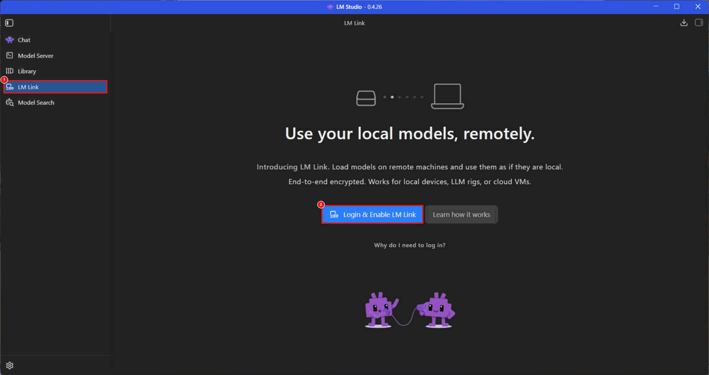
*Figure 1 — Page **LM Link** avant connexion : ① entrée de la barre latérale, ② **Login & Enable LM Link**. Texte affiché : « Use your local models, remotely. … End-to-end encrypted. Works for local devices, LLM rigs, or cloud VMs. »* [Vérifié, 0.4.26]

### 3.2 Terminer dans le navigateur

Le bouton devient **Complete in the browser…** : la connexion s'achève dans le **navigateur web**.

1. Passer dans le navigateur.
2. Se connecter au compte LM Studio.
3. Valider.
4. Revenir dans LM Studio.

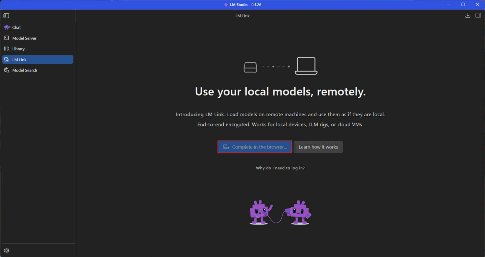
*Figure 2 — ① **Complete in the browser…** : l'application attend la fin de la connexion dans le navigateur.* [Vérifié]

**Les identifiants se saisissent uniquement dans le navigateur**, jamais dans LM Studio.

### 3.3 Premier affichage

Une fois connecté, la page affiche les appareils du réseau. Une infobulle explique que les modèles de l'appareil distant apparaissent dans la liste de droite.

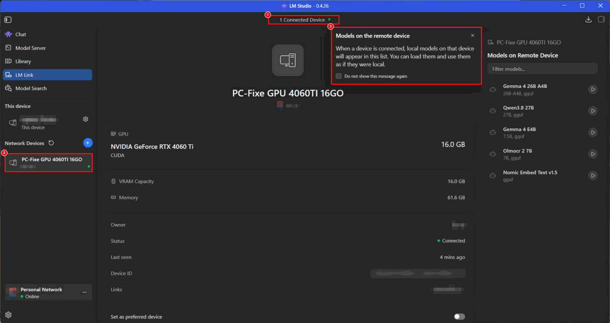
*Figure 3 — ① compteur d'appareils connectés (point vert) ; ② l'appareil distant, sous **Network Devices** ; ③ infobulle d'aide (fermer avec la croix, ou cocher « Do not show this message again »).* [Vérifié]

**Appareil sans autre appareil lié** : la page affiche « Welcome to LM Link — Get started by adding another device to your link » et le bouton **Add a Device** ([section 5](#5-ajouter-un-appareil)).

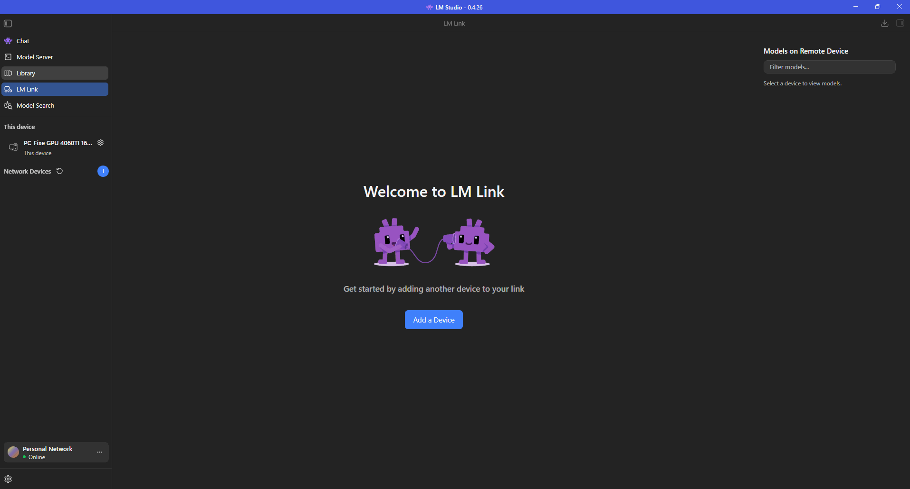
*Figure 4 — Côté PC fixe, avant l'arrivée du portable : **This device** (le PC fixe), **Network Devices** vide, bouton **+** et **Add a Device**, bloc **Personal Network — Online** en bas de la barre latérale.* [Vérifié]

### Pour aller plus loin

- **Nom de l'appareil** : modifiable depuis la page LM Link ([section 4.3](#43-régler-cet-appareil)) ou par `lms link set-device-name "<nom>"` ([section 10](#10-les-commandes-lms-link)). Les autres appareils voient ce nom : le choisir **explicite** (ex. « PC-Fixe GPU 4060TI 16GO »).
- **Désactiver** : *Settings → LM Link →* désactiver « **Enable LM Link** », ou `lms link disable` [Source].

---

## 4. Lire l'écran LM Link

### 4.1 La fiche de l'appareil distant

Cliquer sur l'appareil dans la barre latérale ouvre sa fiche.

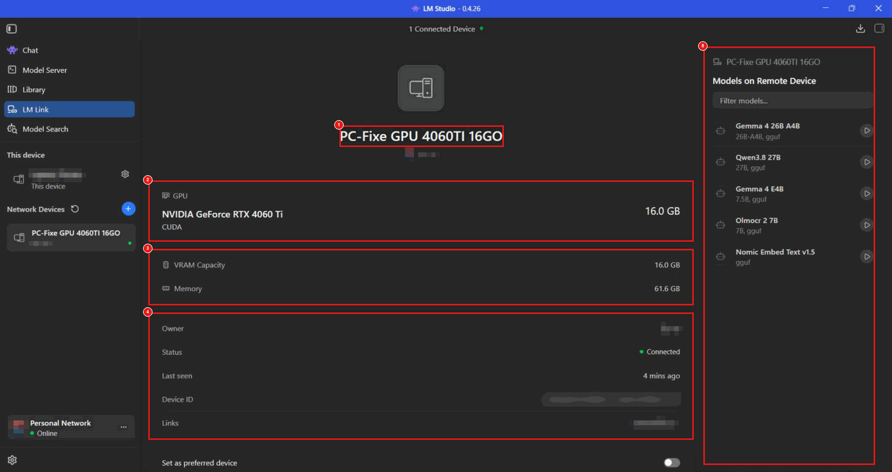
*Figure 5 — Fiche d'un appareil distant : ① nom ; ② carte graphique ; ③ mémoire vidéo et mémoire vive ; ④ propriétaire, état, dernière activité, identifiant, lien ; ⑤ modèles de l'appareil.*

| Repère | Contenu observé |
|---|---|
| ① | Nom de l'appareil : « PC-Fixe GPU 4060TI 16GO » |
| ② | NVIDIA GeForce RTX 4060 Ti, 16,0 Go, CUDA |
| ③ | Mémoire vidéo (VRAM) 16,0 Go ; mémoire vive 61,6 Go |
| ④ | Propriétaire (compte), état (*Connected*), dernière activité (*Last seen*), identifiant de l'appareil, lien de réseau (*Links*) |
| ⑤ | Liste des modèles installés sur l'hôte, filtrable par nom (**Filter models…**) |

Modèles listés sur l'hôte [Vérifié] : *Gemma 4 26B A4B*, *Qwen3.8 27B*, *Gemma 4 E4B*, *Olmocr 2 7B*, *Nomic Embed Text v1.5* (modèle d'embedding). Le bouton de lecture à droite de chaque ligne ouvre le chargement ([section 6](#6-charger-et-régler-un-modèle-distant)).

### 4.2 Appareil préféré

En bas de la fiche, l'interrupteur **Set as preferred device** (« favoriser le chargement des modèles sur cet appareil quand c'est possible ») est **désactivé par défaut**.

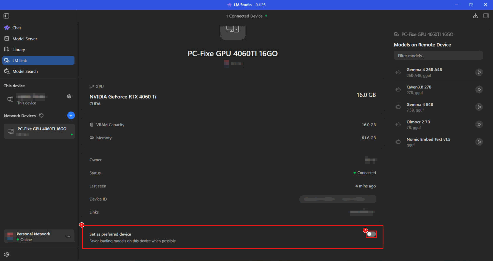
*Figure 6 — ② **Set as preferred device**.* [Vérifié ; **non activé** pendant l'essai]

Détails de la documentation : [section 9.3](#93-choisir-lappareil--lappareil-préféré).

### 4.3 Régler cet appareil

Dans la barre latérale, section **This device**, l'engrenage à côté du nom de l'appareil ouvre la fenêtre **This Device**.

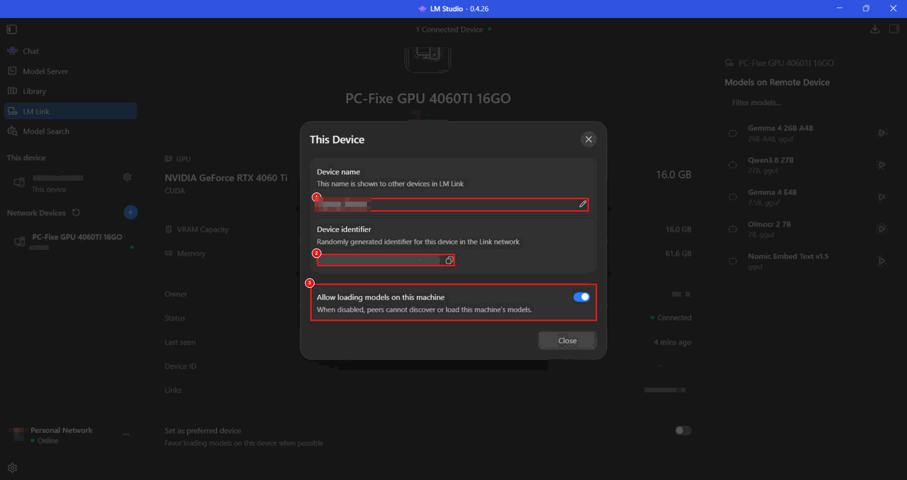
*Figure 7 — ① nom de l'appareil (le crayon permet de le modifier) ; ② identifiant aléatoire dans le réseau (flouté) ; ③ interrupteur **Allow loading models on this machine**.*

| Repère | Rôle |
|---|---|
| ① | **Device name** : nom affiché aux autres appareils de LM Link |
| ② | **Device identifier** : identifiant généré au hasard pour cet appareil dans le réseau |
| ③ | **Allow loading models on this machine** : désactivé, les autres appareils **ne voient plus** les modèles de cette machine et ne peuvent plus les charger |

Pour partager les modèles d'une machine, laisser l'interrupteur activé ; pour la protéger, le désactiver. **Ce réglage se fait sur la machine concernée** : pour empêcher le PC fixe de servir ses modèles, il se règle **sur le PC fixe** [Vérifié, fenêtre consultée sans modification].

### 4.4 Le bloc réseau

En bas de la barre latérale, **Personal Network** affiche le nom du réseau et son état (**Online**). Le bouton **…** ouvre un menu à **une seule entrée**, **Manage on web**, qui ouvre la gestion du réseau sur le site de LM Studio (entrée **non ouverte** pendant l'essai : elle sort de l'application). À côté de **Network Devices**, la flèche circulaire **actualise** la liste.

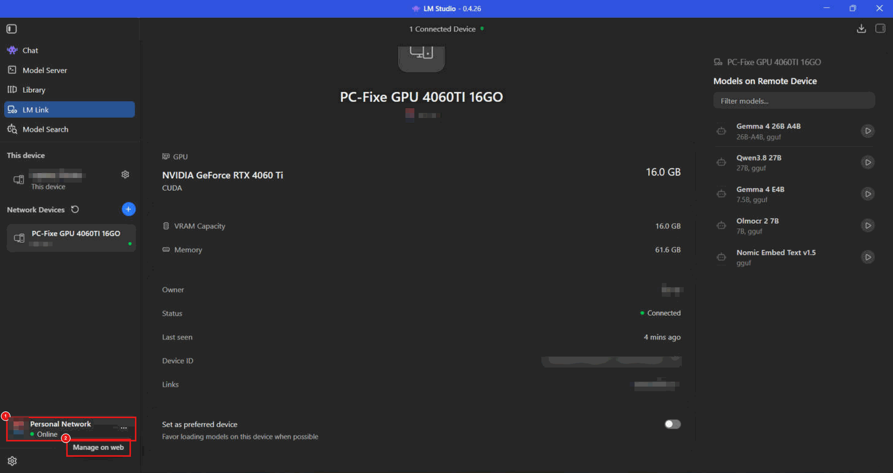
*Figure 8 — ① bloc **Personal Network** ; ② **Manage on web**.* [Vérifié]

---

## 5. Ajouter un appareil

Le bouton bleu **+** à côté de **Network Devices** (ou **Add a Device**) ouvre un assistant à **trois types** d'appareils ; cliquer sur une carte ouvre directement les instructions, **Back** revient au choix, **Done** ferme l'assistant.

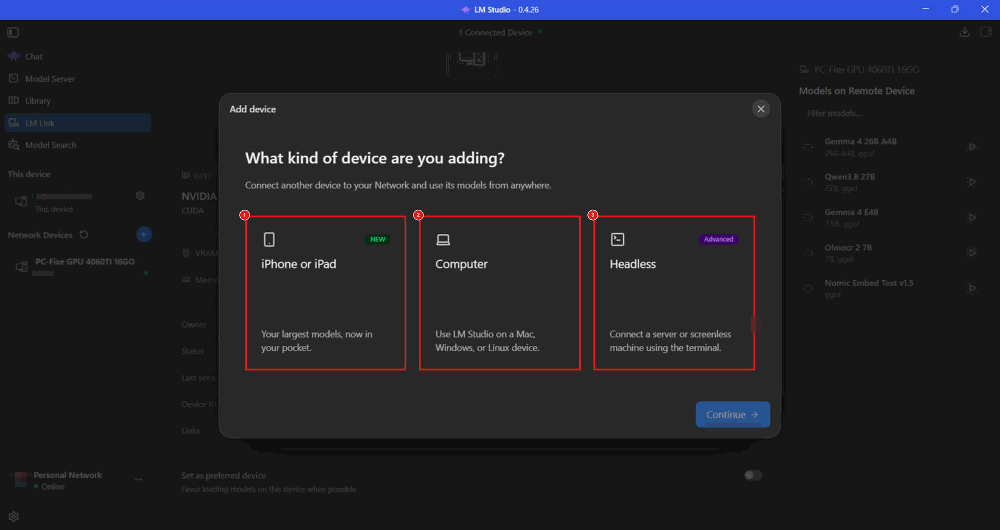
*Figure 9 — ① **iPhone or iPad** (étiquette « NEW ») ; ② **Computer** (Mac, Windows, Linux avec LM Studio) ; ③ **Headless** (serveur ou machine sans écran, par le terminal ; étiquette « Advanced »).* [Vérifié]

### 5.1 Ajouter un ordinateur

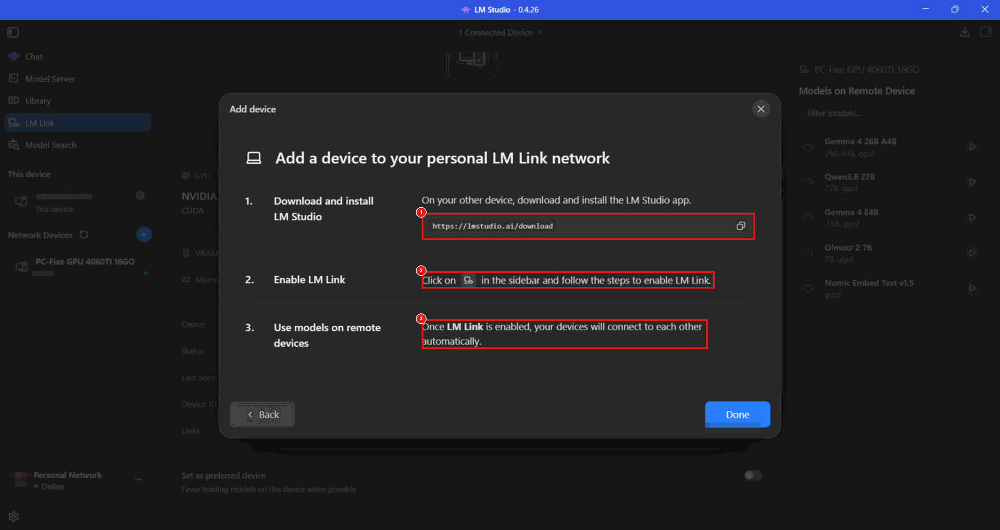
*Figure 10 — ① adresse de téléchargement ; ② activation de LM Link depuis la barre latérale ; ③ connexion automatique des appareils.*

1. **Installer LM Studio** sur l'autre appareil (`https://lmstudio.ai/download`).
2. Cliquer sur l'icône **LM Link** de la barre latérale et **suivre les étapes d'activation** ([section 3](#3-activer-lm-link-et-se-connecter)) avec **le même compte**.
3. Les appareils se **connectent ensuite automatiquement** [Vérifié : c'est la séquence suivie pour le portable].

### 5.2 Ajouter une machine sans interface (`llmster`)

Pour un serveur, une station distante ou une machine virtuelle sans écran [Source et assistant ; **non exécuté** : exécution d'un script distant, connexion à un compte].

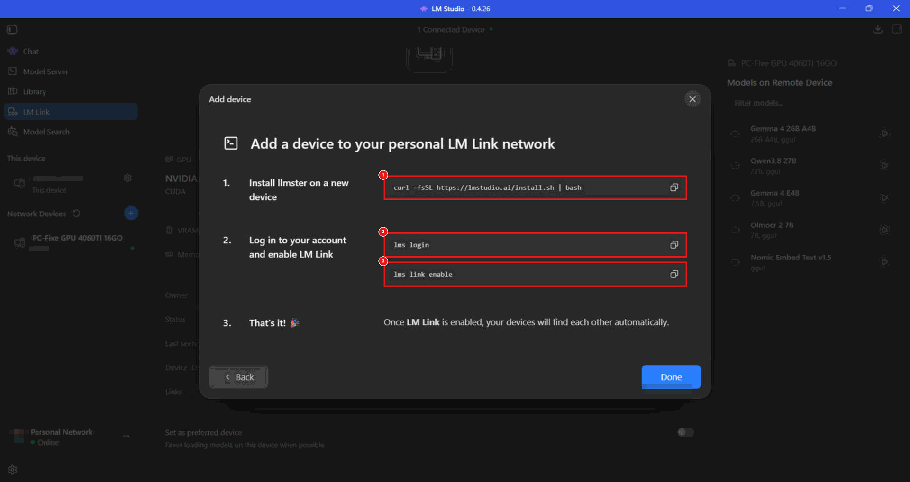
*Figure 11 — ① installation de `llmster` ; ② connexion au compte ; ③ activation de LM Link.*

| Étape | Commande | Rôle |
|---|---|---|
| 1 | `curl -fsSL https://lmstudio.ai/install.sh \| bash` | Installe `llmster`, la version sans interface (cible Linux et macOS ; sous Windows, voir le [Manuel 16, section 5](16-sdk-et-plugins.md#5-le-mode-sans-interface--llmster)) |
| 2 | `lms login` | Se connecte au compte ; suivre les instructions affichées dans le terminal |
| 3 | `lms link enable` | Active LM Link sur cette machine ; la commande attend la connexion et indique la marche à suivre en cas de problème |
| 4 | — | La machine **apparaît automatiquement** dans la page LM Link des autres appareils |

Ensuite, charger un modèle sur la machine (`lms load …`, [Manuel 07](07-cli-lms.md)) : il devient disponible pour les autres appareils. L'icône de copie, à droite de chaque commande, la place dans le presse-papiers.

### 5.3 Ajouter un iPhone ou un iPad (Locally)

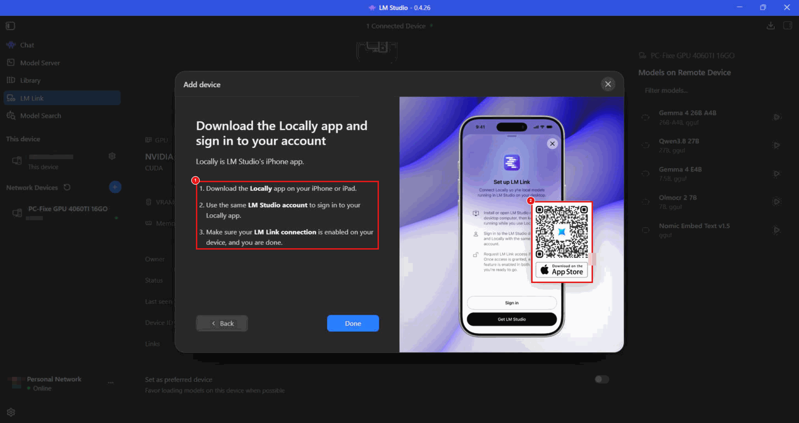
*Figure 12 — ① installation de l'application **Locally** ; ② code QR vers l'App Store.*

Prérequis : LM Studio sur un ordinateur avec LM Link activé, **même compte** dans **Locally**, Internet. Étapes : installer **Locally** ; s'y connecter avec le même compte ; vérifier que LM Link y est activé. Limites annoncées : la connexion a des **délais après mise en arrière-plan** de Locally ; **pas de lien entre deux applications Locally** (le lien relie LM Studio sur ordinateur à Locally sur mobile) [Source ; **non exécuté**, aucune installation de Locally].

---

## 6. Charger et régler un modèle distant

L'essai utilise *Gemma 4 E4B* (assez léger pour 16 Go de mémoire vidéo). **Trois niveaux de réglage** existent depuis le client ; chacun agit sur le modèle qui tourne **sur l'hôte** :

| Niveau | Où | Portée |
|---|---|---|
| **Au chargement** | Fenêtre *Load Model* | Cette session de chargement |
| **Par défaut du modèle** | Onglet *Library*, panneau du modèle | Chaque futur chargement ou chat avec ce modèle |
| **Par conversation** | Onglet *Chat*, panneau de droite | La conversation en cours |

### 6.1 Lancer le chargement

Fiche de l'hôte → **Models on Remote Device** → bouton de lecture à droite du modèle. La fenêtre de chargement s'ouvre ; **ses réglages s'appliquent sur l'hôte, pas sur le client**.

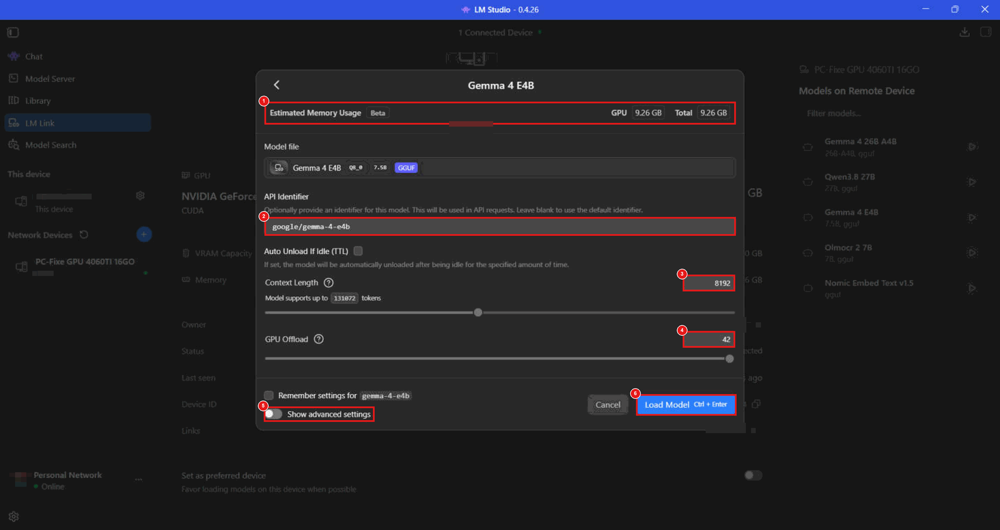
*Figure 13 — ① estimation de mémoire (bêta) ; ② identifiant d'API ; ③ longueur de contexte ; ④ déchargement vers la carte graphique ; ⑤ réglages avancés ; ⑥ **Load Model** (`Ctrl + Entrée`).*

| Repère | Élément | Valeur de l'essai |
|---|---|---|
| ① | Estimation de mémoire, **calculée pour l'hôte** | 9,26 Go de GPU, 9,26 Go au total |
| ② | Identifiant d'API : nom utilisé par les programmes qui appellent le modèle | `google/gemma-4-e4b` |
| ③ | Longueur de contexte | 8192 (maximum du modèle : 131072) |
| ④ | Déchargement GPU (*GPU Offload*) : nombre de couches placées sur la carte | 42 (maximum) |
| ⑤ | Interrupteur *Show advanced settings* | Désactivé |
| ⑥ | Lancement | `Ctrl + Entrée` |

**Règle pratique** : l'estimation du repère ① doit rester **sous la mémoire vidéo de l'hôte** (16 Go ici) ; un contexte plus long augmente la mémoire utilisée ([Manuel 03](03-charger-un-modele.md)). Les cases **Auto Unload If Idle (TTL)** (décharge le modèle après inactivité) et **Remember settings for …** (mémorise ces réglages pour ce modèle) figurent aussi dans la fenêtre. *Show advanced settings* donne accès, par exemple, à la taille du pool de threads CPU (4 ici) et à la taille de lot d'évaluation (2048) ; **laisser les valeurs par défaut** pour un premier usage [Vérifié].

Cliquer sur **Load Model** : une pastille en haut de l'écran indique le chargement avec une barre de progression, le modèle porte le badge orange **Loading**. **Environ 15 secondes** plus tard (modèle de 9 Go), le message **Model loaded successfully** apparaît et le badge devient vert **Loaded** [Vérifié].

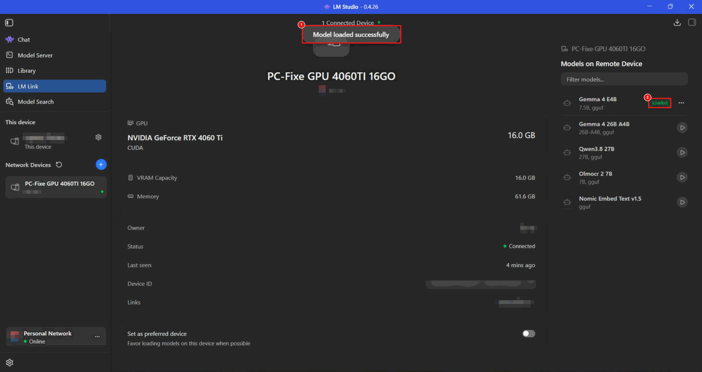
*Figure 14 — ① message « Model loaded successfully » ; ② badge **Loaded**.*

Le bouton **…** à droite du badge ouvre le menu du modèle, qui contient **Eject** ([section 8](#8-éjecter-le-modèle)).

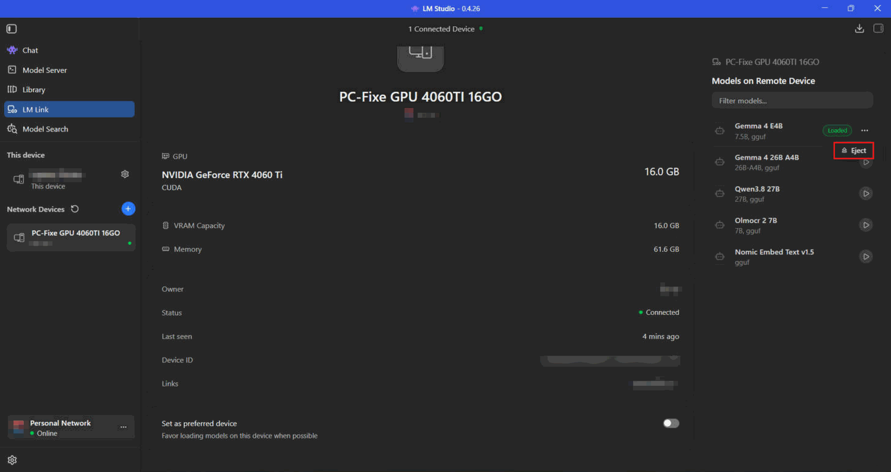
*Figure 15 — Menu **…** du modèle chargé : entrée **Eject**.*

### 6.2 Réglages au chargement : contexte et déchargement automatique

Essai : charger le même modèle avec un **contexte de 16384** (au lieu de 8192) et le **déchargement automatique** activé.

1. Saisir `16384` dans **Context Length**.
2. Cocher **Auto Unload If Idle (TTL)** : un champ de durée apparaît, réglé sur **60 minutes**.
3. Constater la nouvelle estimation : **9,66 Go** au lieu de 9,26 Go.
4. Cliquer sur **Load Model**.

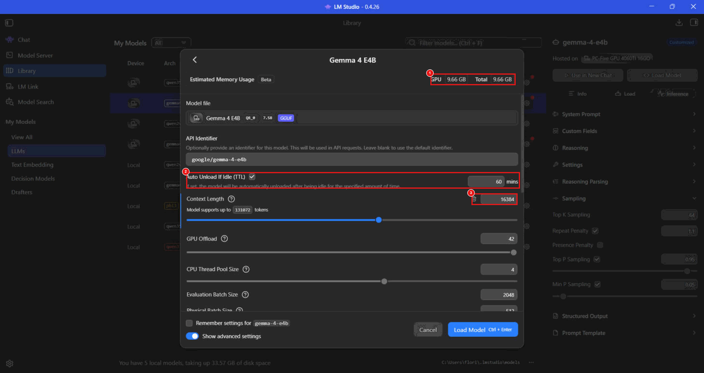
*Figure 16 — ① estimation 9,66 Go ; ② case **Auto Unload If Idle (TTL)** cochée, 60 minutes ; ③ contexte 16384.*

Vérification dans l'onglet **Model Server** : la pastille **Idle TTL 60 min** apparaît sur la ligne du modèle.

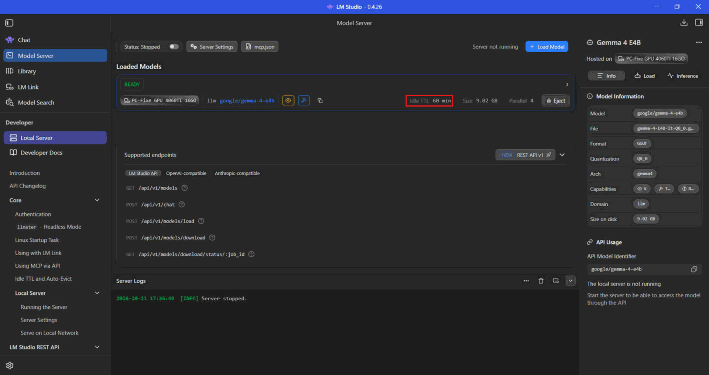
*Figure 17 — Pastille **Idle TTL 60 min** sur le modèle distant.*

Dans le panneau de droite, onglet **Load**, le contexte affiche **16384**.

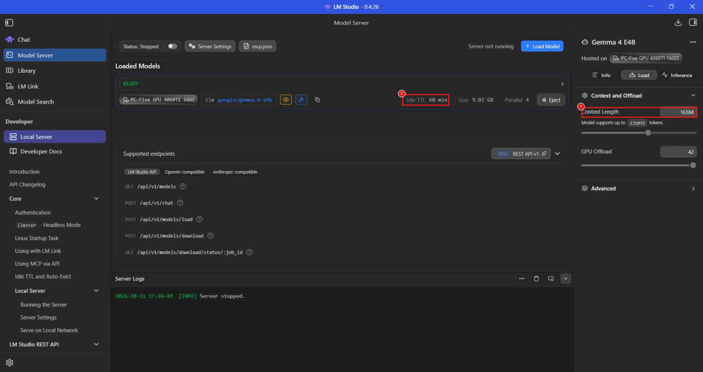
*Figure 18 — ① contexte 16384 ; ② pastille TTL.*

**Résultat** : les réglages choisis sur le client sont **appliqués au modèle de l'hôte** [Vérifié]. Comme la case « Remember settings for … » était décochée, ils **ne sont pas mémorisés** : au chargement suivant, les valeurs par défaut reviennent.

### 6.3 Réglages par défaut du modèle (bibliothèque)

L'onglet **Library** liste **tous** les modèles, locaux et distants : la colonne **Device** affiche une **icône de lien** pour un modèle distant, « **Local** » pour un modèle du client. L'engrenage d'une ligne ouvre le panneau du modèle, à droite.

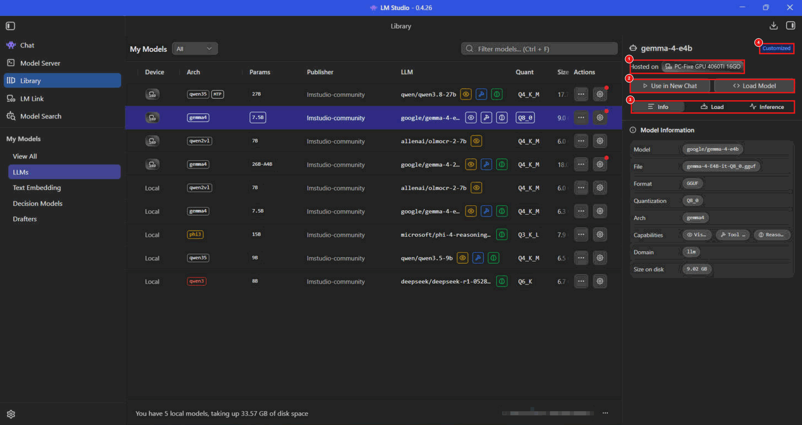
*Figure 19 — ① **Hosted on** : appareil qui héberge le modèle ; ② **Use in New Chat** et **Load Model** ; ③ onglets **Info**, **Load**, **Inference** ; ④ étiquette **Customized** (le modèle a des réglages personnalisés).*

**Onglet Load** : longueur de contexte et déchargement GPU par défaut, section **Advanced** pour les réglages avancés.

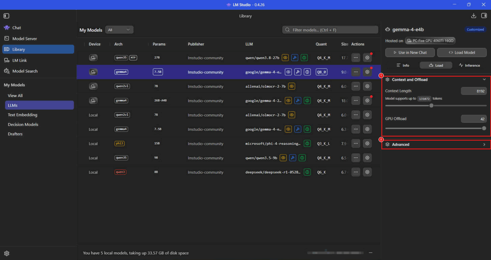
*Figure 20 — Réglages de chargement par défaut d'un modèle distant.*

**Onglet Inference** : réglages de génération par défaut, en huit sections.

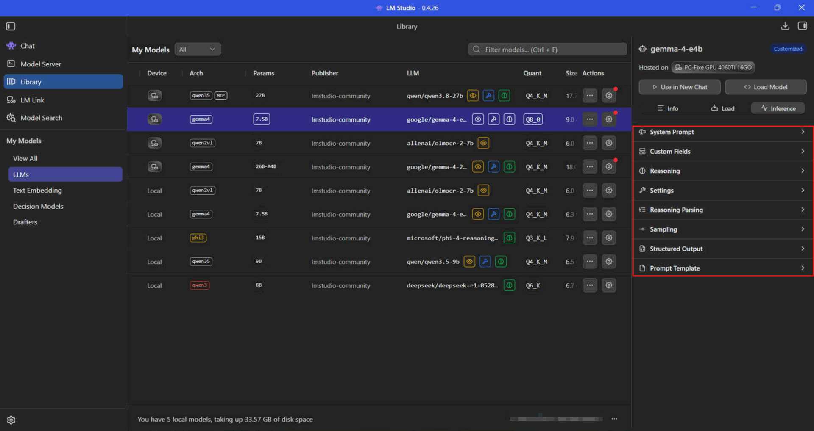
*Figure 21 — Réglages d'inférence par défaut.*

| Section | Rôle |
|---|---|
| *System Prompt* | Consigne donnée au modèle avant chaque conversation |
| *Custom Fields* | Champs personnalisés propres au modèle |
| *Reasoning* | Réglages de la phase de réflexion |
| *Settings* | Réglages généraux de génération |
| *Reasoning Parsing* | Séparation entre la réflexion et la réponse |
| *Sampling* | Choix des mots (aléatoire des réponses) |
| *Structured Output* | Forcer un format de réponse (par exemple JSON) |
| *Prompt Template* | Modèle de mise en forme du prompt |

Valeurs relevées dans *Sampling* (non modifiées) [Vérifié] : *Top K* 64 ; *Repeat Penalty* 1,1 (activé) ; *Presence Penalty* désactivé ; *Top P* 0,95 (activé) ; *Min P* 0,05 (activé). Voir [Manuel 04](04-parametrer-l-inference.md) et [Manuel 14](14-personnaliser-les-modeles.md).

### 6.4 Réglages par conversation (Chat)

Dans l'onglet **Chat**, le panneau de droite regroupe les paramètres de la conversation en cours : bascule entre outils (marteau) et paramètres du modèle (curseurs), **Preset** (enregistrer un ensemble de réglages sous un nom), sections *System Prompt*, *Custom Fields*, *Reasoning*, *Settings*, *Sampling*, *Structured Output*.

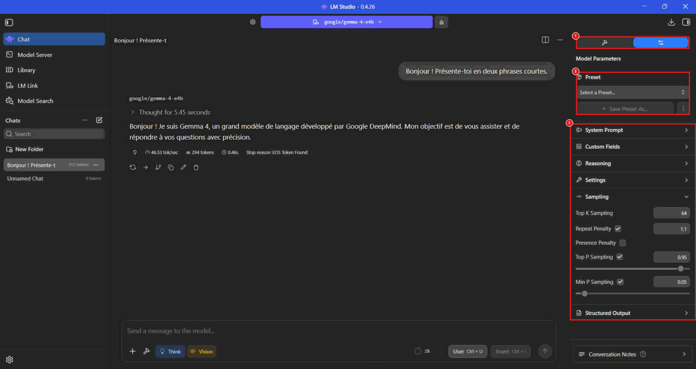
*Figure 22 — ① bascule outils / paramètres ; ② **Preset** ; ③ sections de réglage.*

**Essai** : déplier *System Prompt*, saisir « Tu es un pirate. Réponds toujours en une seule phrase courte, avec un vocabulaire de pirate. », puis poser « Quelle est la capitale de la France ? ». Le panneau affiche **Unsaved Preset** (consigne non enregistrée ; **Discard unsaved** l'annule). Réponse : « Parbleu, c'est Paris qui est la capitale de cette terre ! »

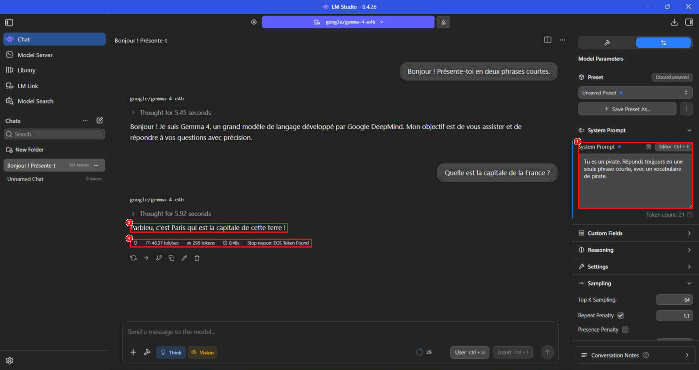
*Figure 23 — ① consigne système active ; ② réponse en vocabulaire de pirate ; ③ vitesse **46,37 jetons par seconde**.*

**Résultat** : les réglages du chat agissent sur le modèle de l'hôte ; la vitesse reste celle du premier essai [Vérifié].

### 6.5 Ce qui ne se règle pas depuis le client

- **Télécharger un modèle sur l'hôte** : l'onglet **Model Search** n'offre **pas de choix d'appareil** ; le bouton **Download** indique la taille du fichier **pour le client**. Rien n'a été téléchargé pendant l'essai. Pour ajouter un modèle à l'hôte, passer par LM Studio **sur l'hôte** [Vérifié].

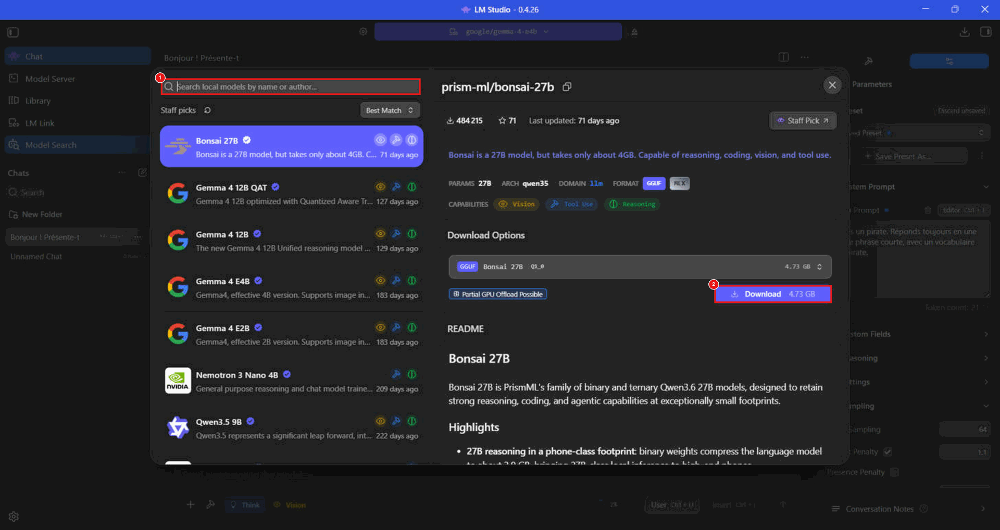
*Figure 24 — Recherche de modèles : aucun choix d'appareil de destination ; ② bouton **Download** pour le client.*

- **Partage des modèles** : l'interrupteur « Allow loading models on this machine » se règle sur la machine concernée ([section 4.3](#43-régler-cet-appareil)).

---

## 7. Discuter avec le modèle distant et vérifier où il tourne

### 7.1 Choisir le modèle

Dans l'onglet **Chat**, `Ctrl + L` (ou la barre « Select a model to load ») ouvre le sélecteur.

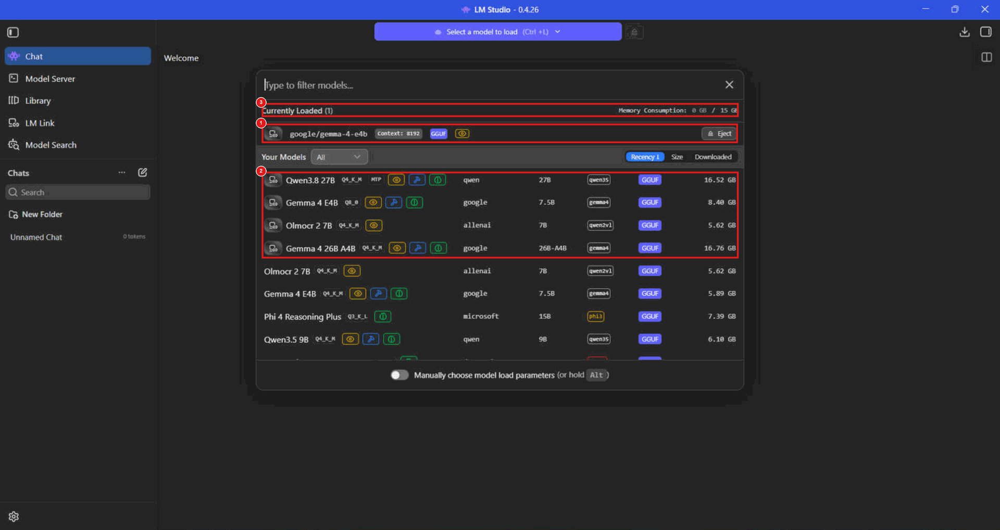
*Figure 25 — ① **Currently Loaded** : le modèle chargé sur l'hôte, avec l'icône de lien ; ② les modèles de l'hôte, reconnaissables à l'**icône de lien** devant leur nom (ceux du client n'en ont pas) ; ③ **Memory Consumption : 0 GB / 15 GB** : mémoire utilisée **sur le client**, restée à zéro.*

Cliquer sur la ligne du modèle chargé : la barre du haut affiche son nom avec l'icône de lien, et l'icône d'éjection à côté.

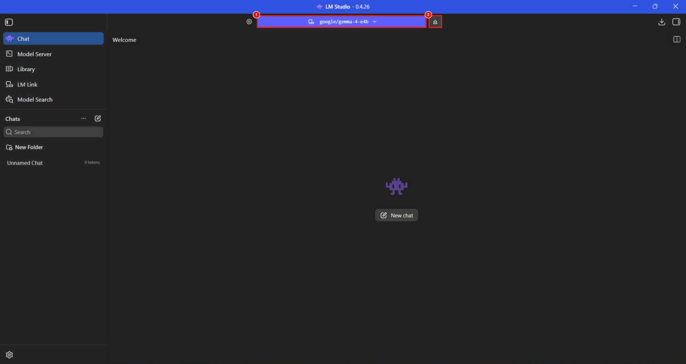
*Figure 26 — ① nom du modèle avec l'icône de lien ; ② icône d'éjection.*

Puis **New chat**, saisie du message dans la zone du bas, envoi par `Entrée`. **Piège** : un modèle local et un modèle distant peuvent porter le **même nom** ; repérer l'**icône de lien**.

### 7.2 Lire la réponse

Message de l'essai : « Bonjour ! Présente-toi en deux phrases courtes. »

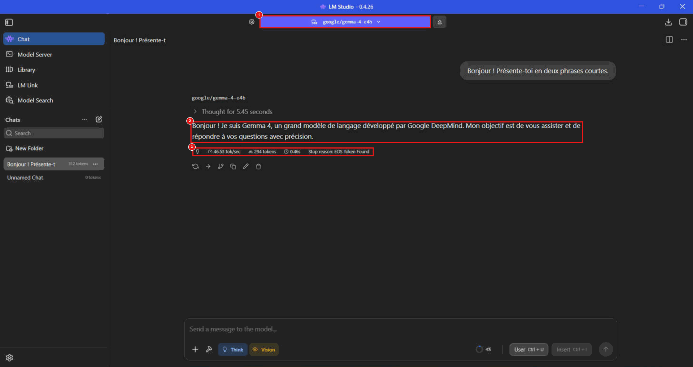
*Figure 27 — ① barre du modèle avec l'icône de lien ; ② réponse (bloc « Thought for 5.45 seconds » replié : phase de réflexion) ; ③ statistiques de génération.*

| Mesure | Valeur [Vérifié, 11 octobre 2026] |
|---|---|
| Vitesse | **46,53 jetons par seconde** |
| Longueur | 294 jetons (réflexion comprise) |
| Délai avant le premier mot | **0,46 s** |
| Arrêt | « EOS Token Found » : fin normale de la réponse |

**Comparaison** : le même modèle (*Gemma 4 E4B*, quantification Q8_0), exécuté **localement sur l'hôte**, génère à environ **45 à 47 jetons par seconde** (mesures de ce poste, [Manuel 15](15-performances-gpu-dedie.md)) : **aucune perte de vitesse mesurable** liée au réseau sur ce trajet [Vérifié pour une réponse courte ; longs textes et réseaux plus lents : **[À tester]**].

### 7.3 Vérifier que le modèle tourne sur l'hôte

Le nom du modèle est **identique** sur le client et sur l'hôte ; la preuve se lit dans l'onglet **Model Server**.

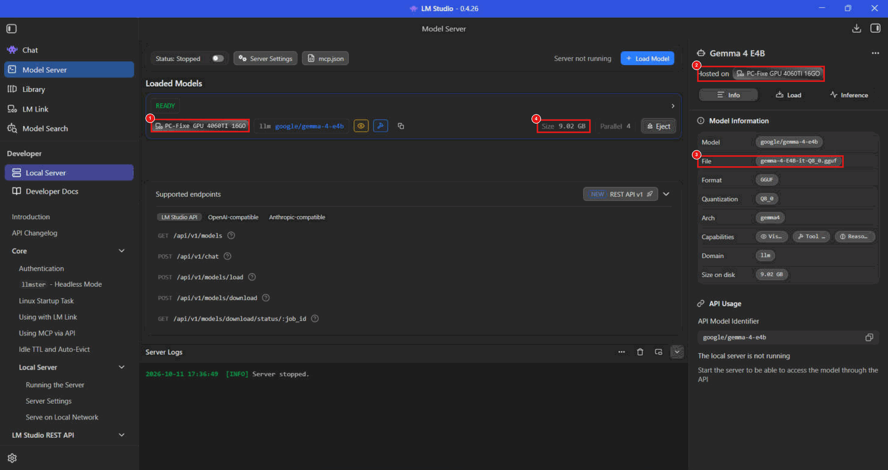
*Figure 28 — ① badge du nom de l'hôte sur la ligne du modèle ; ② « Hosted on » ; ③ fichier `gemma-4-E4B-it-Q8_0.gguf` ; ④ taille 9,02 Go.*

| Repère | Ce qu'il montre |
|---|---|
| ① | Badge « PC-Fixe GPU 4060TI 16GO » sur la ligne du modèle chargé |
| ② | « Hosted on PC-Fixe GPU 4060TI 16GO » |
| ③ | Fichier utilisé : `gemma-4-E4B-it-Q8_0.gguf` |
| ④ | Taille : 9,02 Go |

Indices supplémentaires :

- le client possède aussi un *Gemma 4 E4B*, mais en **Q4_K_M** (5,89 Go) ; le fichier utilisé est en **Q8_0** : c'est celui de l'hôte ;
- la mémoire consommée sur le client reste à **0 Go** (figure 25) ;
- à l'éjection depuis le chat, LM Studio affiche « You are about to unload a model loaded on PC-Fixe GPU 4060TI 16GO » ([section 8](#8-éjecter-le-modèle)) ;
- sur cette page, le **serveur local du client est arrêté** (« Status: Stopped ») : **le chat fonctionne sans lui**.

**Contrôle côté hôte** : le Gestionnaire des tâches (onglet *Performance*, *GPU*) doit montrer environ 9 Go de mémoire vidéo occupés par LM Studio pendant le chargement [À tester : non relevé pendant l'essai ; après éjection, l'hôte indique **aucun modèle chargé** avec `lms ps`, vérifié le 11 octobre 2026].

---

## 8. Éjecter le modèle

Un modèle chargé **occupe de la mémoire vidéo sur l'hôte** même sans discussion en cours, ce qui **bloque aussi les jeux** et autres usages de la carte. Il faut l'**éjecter** après usage ; sinon, le déchargement automatique (TTL) s'en charge s'il a été activé ([section 6.2](#62-réglages-au-chargement--contexte-et-déchargement-automatique)).

Trois endroits permettent l'éjection :

- le bouton **Eject** de l'onglet **Model Server** (immédiat) ;
- l'entrée **Eject** du menu **…** dans la fiche de l'hôte (figure 15) ;
- l'icône d'éjection à droite de la barre de modèle du **Chat** (avec confirmation).

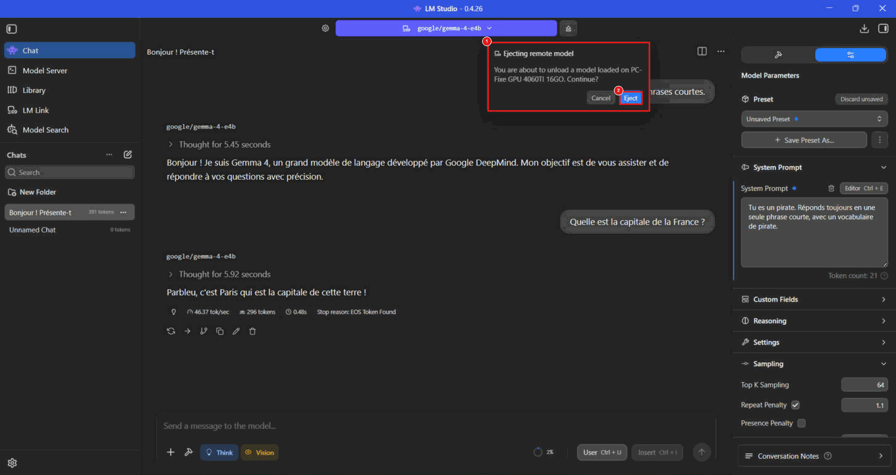
*Figure 29 — ① message « Ejecting remote model. You are about to unload a model loaded on PC-Fixe GPU 4060TI 16GO. Continue? » ; ② **Eject** pour confirmer, **Cancel** pour annuler.*

Après confirmation, la barre du chat revient à « Select a model to load » ; le bouton **Reload last used model** (`Ctrl + R`) relance le modèle.

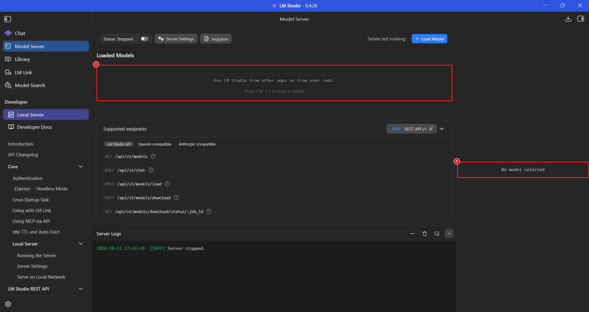
*Figure 30 — **Model Server** après éjection : ① liste « Loaded Models » vide ; ② panneau de droite « No model selected ».*

Retour sur la page LM Link : l'hôte reste **connecté** et ses modèles restent **disponibles**, sans badge « Loaded ».

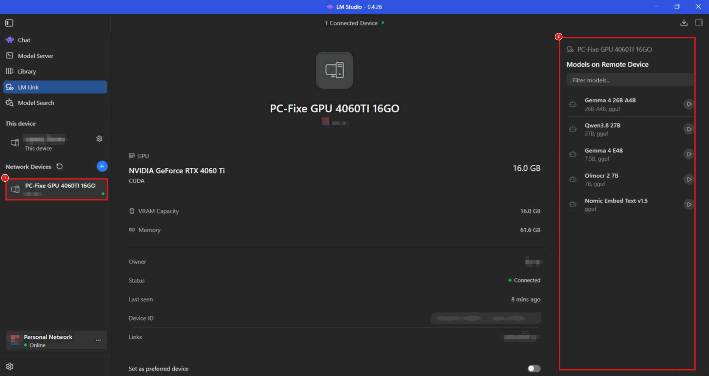
*Figure 31 — Page LM Link après éjection : ① l'hôte, toujours connecté ; ② ses modèles, sans badge « Loaded ».* [Vérifié]

---

## 9. API, outils de code et Bionic

### 9.1 Dans l'application

Le sélecteur de modèle et la bibliothèque listent **les modèles locaux et ceux des appareils liés**. Un modèle présent sur plusieurs machines apparaît **une fois par appareil**, avec le nom de l'appareil ([sections 6.3 et 7.1](#63-réglages-par-défaut-du-modèle-bibliothèque)) [Vérifié].

### 9.2 Par le serveur local, l'API et les SDK

Un appareil peut envoyer ses requêtes à **`localhost:1234`** et les faire exécuter par une machine distante : il suffit d'indiquer la **clé du modèle** comme d'habitude ; si le modèle se trouve sur un appareil du lien, il est servi par lui. Les requêtes vers `localhost` continuent de fonctionner normalement [Source ; **non exécuté** depuis le portable].

```bash
# Sur l'appareil qui consomme : démarrer le serveur local
lms server start --port 1234
# Puis appeler l'API comme d'habitude, avec la clé d'un modèle présent sur l'appareil distant
```

### 9.3 Choisir l'appareil : l'appareil préféré

Quand le même modèle existe sur plusieurs appareils, le chargement par l'API ou les SDK utilise l'**appareil préféré** [Source] :

- **Interface** : page LM Link → sélectionner l'appareil → activer **Set as preferred device** (figure 6).
- **Ligne de commande** : `lms link set-preferred-device` (liste interactive) ou `lms link set-preferred-device <identifiant>` (l'identifiant figure dans `lms link status`).
- Le réglage est **propre à chaque machine** : chaque appareil choisit **indépendamment** la machine qu'il préfère.

La documentation ne précise **pas** le comportement quand l'appareil préféré est hors ligne ou ne possède pas le modèle [À tester].

### 9.4 Outils de code

Les assistants de code utilisent le serveur local ; le modèle tourne ailleurs [Source ; non exécuté] :

```bash
lms server start --port 1234

# Claude Code (exemple de la documentation ; remplacer le nom de modèle par un modèle présent sur l'appareil distant)
export ANTHROPIC_BASE_URL=http://localhost:1234
export ANTHROPIC_AUTH_TOKEN=lmstudio
claude --model qwen3-8b

# Codex
codex --oss -m qwen3-8b
```

Les réglages détaillés de chaque outil figurent au [Manuel 13](13-integrations-outils-tiers.md). **Contexte et vitesse** : celle de la **machine distante** compte ; la latence réseau s'ajoute ([section 12](#12-limites-constatées-ou-annoncées)).

### 9.5 Dans Bionic

Les modèles **Remote** apparaissent dans le sélecteur de modèle d'une session **tant que l'appareil lié est disponible** et partage ses modèles locaux ; ils disparaissent si la machine distante est hors ligne. À considérer pour le choix : vitesse et mémoire de la machine distante, prise en charge des outils et des images par le modèle [Source ; [Manuel Bionic 04](../bionic/04-modeles.md)]. Le comportement d'une session ouverte quand l'appareil disparaît n'est **pas** documenté [À tester]. **Bionic et LM Studio ne se lancent pas ensemble** ([Manuel Bionic 01](../bionic/01-presentation-installation.md)) : le protocole de la [section 13](#13-résultats-de-lessai-et-ce-qui-reste-à-vérifier) prévoit l'essai.

---

## 10. Les commandes `lms link`

**Aide observée** [Vérifié, 0.4.26] : `lms link --help` liste cinq sous-commandes.

| Commande | Rôle (aide de la commande) | Détails de la documentation |
|---|---|---|
| `lms link enable` | Activer LM Link sur cet appareil | Exige un compte : exécuter `lms login` d'abord ; attend la connexion et affiche la marche à suivre en cas de problème |
| `lms link disable` | Désactiver LM Link sur cet appareil | Équivalent de l'interrupteur « Enable LM Link » |
| `lms link status` | Afficher l'état de LM Link | Nom de l'appareil, état de connexion, **appareils connectés et modèles qu'ils ont chargés** ; option `--json` pour les scripts |
| `lms link set-device-name` | Nommer l'appareil local | `lms link set-device-name "<nom>"` ; effet immédiat, visible des pairs |
| `lms link set-preferred-device` | Choisir l'appareil préféré pour la résolution des modèles | Liste interactive, ou identifiant en argument |

**Sorties observées sur l'hôte** [Vérifié, 11 octobre 2026 ; noms masqués] :

Avant l'arrivée du portable, `lms link status` répond :

```text
This device: <nom de l'hôte>
Status: Online

Found 0 devices:
```

Après l'essai, le portable étant éteint :

```text
This device: <nom de l'hôte>
Status: Online

Found 1 device:

  - <nom du portable>
    Status: disconnected
    Identifier: <identifiant de 32 caractères hexadécimaux>
```

Avec `--json` : un objet `status` (« online »), `issues` (liste, vide), `deviceIdentifier`, `deviceName` et `peers`, liste dont chaque élément contient `deviceIdentifier`, `deviceName`, `status` (« disconnected » ici) et `loadedModels` (liste des modèles chargés sur le pair, vide ici). L'appareil **reste mémorisé** après son arrêt, avec l'état « disconnected ».

> **Écart levé** — Avant la connexion dans l'interface, `lms link status` répondait déjà « Online » (connexion de la ligne de commande) alors que la page graphique proposait encore « Login & Enable LM Link » : la **ligne de commande et l'interface se connectent séparément** sur un même poste [Vérifié par la séquence des constats ; origine exacte non documentée].

---

## 11. Sécurité et confidentialité

| Question | Réponse de la documentation | Statut |
|---|---|---|
| Les appareils sont-ils exposés sur Internet ? | **Non** : aucun port n'est ouvert vers Internet ; connexions chiffrées de bout en bout | [Source] |
| Que voit le serveur de LM Studio ? | Il aide **seulement** les appareils à se **trouver** ; il ne voit ni les conversations ni les listes de modèles (celles-ci transitent par la connexion chiffrée) ; rien n'est envoyé au serveur « hormis la liste des appareils » | [Source] |
| Les appareils liés peuvent-ils autre chose que LM Studio ? | **Non** : le lien ne sert qu'à l'accès aux modèles et à l'API ; il n'expose ni le système, ni les fichiers, ni d'autres services | [Source] |
| Compatibilité avec un Tailscale existant ? | LM Link **coexiste** avec un Tailscale déjà installé sans interférence ; en revanche, **réutiliser** un réseau Tailscale existant n'est **pas** possible : LM Link crée **son** réseau et en contrôle les règles d'accès | [Source] |
| Effets sur la machine ? | Fonctionne en **espace utilisateur** ; ne modifie pas les réglages globaux de l'appareil | [Source] |

**Points de vigilance propres à ce manuel** :

- **Le prompt est lu par la machine distante** : avec un modèle distant, le texte envoyé (consignes, fichiers collés) est **traité par l'appareil qui héberge le modèle**. Choisir un lien **entre appareils de confiance** [Estimation : conséquence directe du principe].
- **Le compte est la clé d'accès** : toute personne connectée au **même compte** voit les mêmes appareils [Vérifié : le nom du compte s'affiche dans la fiche de l'appareil]. Protéger le compte ; ne pas connecter d'appareil non maîtrisé.
- **Captures** : les identifiants d'appareil, le nom du compte et le nom du client apparaissent sur les écrans d'origine ; **les flouter avant toute publication** (c'est fait pour les figures de ce manuel).
- **Partage** : l'interrupteur « Allow loading models on this machine » contrôle ce que les autres appareils voient ([section 4.3](#43-régler-cet-appareil)).
- **Serveur local et jetons** : le serveur local reste soumis aux règles du [Manuel 11](11-securiser-le-serveur.md) ; un outil branché sur `localhost:1234` qui utilise un modèle distant **n'ajoute pas** d'exposition réseau directe, mais l'authentification par jeton reste à activer si le serveur est ouvert au réseau local.
- Rester **hors ligne** (aucune connexion à un compte) suffit pour **ne rien exposer** : la fonction est inactive tant qu'aucun compte n'est connecté.

---

## 12. Limites constatées ou annoncées

| Limite | Détail | Statut |
|---|---|---|
| **Préversion** | Accès par lots ; offres et prix non définitifs | [Source] |
| **Internet obligatoire** | Pas de fonctionnement hors ligne, même entre deux machines d'un même réseau local | [Source] |
| **Hôte éteint ou LM Studio fermé** | Les modèles distants **disparaissent** de la liste ; l'appareil reste affiché « disconnected » | [Vérifié] |
| **Mémoire vidéo de l'hôte** | Un modèle chargé y reste **tant qu'il n'est pas éjecté** ; un contexte long augmente la mémoire utilisée ; l'estimation ([figure 13](#61-lancer-le-chargement)) est calculée pour l'hôte | [Vérifié] |
| **Téléchargement** | Impossible de choisir l'hôte comme destination depuis le client | [Vérifié] |
| **Latence et débit** | Vitesse mesurée identique à l'exécution locale sur un modèle de 9 Go ; **réseaux lents ou longs textes non mesurés** | [Vérifié ; À tester] |
| **Modèles en double** | Un même modèle sur plusieurs machines apparaît plusieurs fois (une entrée par appareil) ; même nom entre local et distant | [Vérifié] |
| **Mobile** | Délais de reconnexion après mise en arrière-plan ; pas de lien Locally ↔ Locally | [Source] |
| **Réseau Tailscale existant** | Ne peut pas être réutilisé pour LM Link | [Source] |
| **Systèmes pris en charge, nombre d'appareils** | Non précisés | [À tester] |

---

## 13. Résultats de l'essai et ce qui reste à vérifier

### 13.1 Réalisé le 11 octobre 2026

| Étape | Résultat |
|---|---|
| Page LM Link avant connexion | Réussi (figure 1) |
| Connexion au compte par le navigateur | Réussi (saisie faite par l'utilisateur) |
| Détection de l'hôte | Réussi : *Connected*, 4060 Ti, 16 Go, 61,6 Go de mémoire vive |
| Liste des modèles distants | Réussi : 5 modèles |
| Réglages de l'appareil local | Consultés, non modifiés |
| Assistant d'ajout (*Computer*, *Headless*, *iPhone ou iPad*) | Consultés, **non exécutés** |
| Chargement d'un modèle distant (*Gemma 4 E4B*) | Réussi, **environ 15 s** |
| Chargement avec contexte 16384 et TTL 60 min | Réussi, réglages **vérifiés sur l'hôte** |
| Bibliothèque : modèles distants, réglages *Load* et *Inference* | Consultés, non modifiés |
| Choix du modèle distant dans le chat | Réussi |
| Question et réponse | Réussi : **46,53 jetons par seconde**, premier mot en 0,46 s |
| Consigne système sur le modèle distant | Réussi : 46,37 jetons par seconde |
| Confirmation que l'hôte calcule | Réussi (section 7.3) |
| Éjection depuis *Model Server* et depuis le chat | Réussi |
| `lms link status` côté hôte | Réussi : le portable est listé (« disconnected » après arrêt) |

### 13.2 Reste à vérifier

Protocole pour deux machines du même compte ; chaque ligne se remplit avec la valeur réelle et se date.

| N° | Action | Résultat attendu (documentation) | Résultat constaté |
|---|---|---|---|
| 1 | Gros modèles de l'hôte (*Qwen3.8 27B*, 16,52 Go ; *Gemma 4 26B A4B*, 16,76 Go : fichiers **supérieurs** à la mémoire vidéo de 16 Go) : chargement depuis le client | Chargement partiel en mémoire vive de l'hôte ou refus : à observer, avec la vitesse ([Manuel 15](15-performances-gpu-dedie.md)) | — |
| 2 | *Olmocr 2 7B* et *Nomic Embed Text v1.5* : chargement et usage | Chargement normal | — |
| 3 | **Set as preferred device** sur le client, même modèle sur les deux machines, appel de l'API | Une seule copie utilisée : celle de l'appareil préféré (puis `lms link set-preferred-device`) | — |
| 4 | Client : `lms server start --port 1234`, puis requête API avec la clé du modèle distant | Réponse servie par l'hôte | — |
| 5 | Client : outil de code (Claude Code, Codex) sur `localhost:1234` avec un modèle distant | Réponse servie par l'hôte | — |
| 6 | Arrêter LM Studio sur l'hôte pendant une conversation | Le client signale l'hôte « disconnected » ; comportement de la conversation en cours à noter | — |
| 7 | Bionic sur le client (LM Studio fermé) : sélecteur de modèle | Entrée **Remote** pour le modèle de l'hôte | — |
| 8 | **Manage on web** (menu du réseau) | Page de gestion du réseau sur le site de LM Studio | — |
| 9 | Ajouter un **deuxième** appareil, puis un serveur sans écran (`llmster`), puis un iPhone | Apparition automatique dans la liste | — |
| 10 | Couper Internet **après** l'établissement du lien | Comportement à noter (la documentation annonce Internet obligatoire) | — |
| 11 | Désactiver LM Link (interrupteur ou `lms link disable`) | L'appareil quitte le lien ; il n'apparaît plus | — |

Mesures à relever en plus : débit réseau utilisé, vitesse d'un long texte, mémoire vidéo de l'hôte pendant le chargement (Gestionnaire des tâches).

---

## 14. Dépannage

| Symptôme | Cause probable | Action |
|---|---|---|
| Page LM Link : « Login & Enable LM Link » | Aucun compte connecté **dans l'interface** (la ligne de commande peut déjà être connectée) | Se connecter ([section 3](#3-activer-lm-link-et-se-connecter)) |
| Aucun appareil dans `lms link status` (« Found 0 devices ») | Un seul appareil activé, ou comptes différents | Activer LM Link sur le second appareil **avec le même compte** |
| Appareil « disconnected » | Application arrêtée ou machine éteinte ; ou arrêt sans prévenir le serveur de découverte | Vérifier que LM Studio ou `llmster` tourne sur la machine ; si le problème persiste, contacter le support (adresse indiquée par la FAQ officielle) |
| Le modèle distant n'apparaît pas | Hôte éteint ou LM Studio fermé ; partage de modèles désactivé | Vérifier l'hôte et l'interrupteur « Allow loading models on this machine » ; actualiser la liste (flèche circulaire) |
| Le mauvais exemplaire d'un modèle est utilisé | Même modèle sur plusieurs machines | Repérer l'**icône de lien** ; définir l'**appareil préféré** (section 9.3) |
| La carte graphique de l'hôte reste occupée | Modèle non éjecté | Éjecter ([section 8](#8-éjecter-le-modèle)) ou activer le TTL ([section 6.2](#62-réglages-au-chargement--contexte-et-déchargement-automatique)) |
| Impossible de réutiliser un réseau Tailscale | Limite annoncée | LM Link crée son propre réseau ; laisser le Tailscale existant à part |
| `lms link enable` n'aboutit pas | Compte non connecté en ligne de commande | `lms login` puis relancer ; lire le message de marche à suivre affiché |
| Désactiver complètement | — | *Settings → LM Link →* « Enable LM Link » désactivé, ou `lms link disable` |

---

## 15. Sources

Pages officielles consultées le 11 octobre 2026 (contenu résumé et reformulé) :

- Présentation : <https://lmstudio.ai/link>
- Vue d'ensemble : <https://lmstudio.ai/docs/lmlink>
- Mise en place d'un lien : <https://lmstudio.ai/docs/lmlink/basics>
- Ajouter un appareil : <https://lmstudio.ai/docs/lmlink/basics/add-device>
- Appareil préféré : <https://lmstudio.ai/docs/lmlink/basics/preferred-device>
- Questions fréquentes : <https://lmstudio.ai/docs/lmlink/basics/faq>
- LM Link dans Locally : <https://lmstudio.ai/docs/lmlink/lmlink-in-locally>
- Utilisation par l'API : <https://lmstudio.ai/docs/developer/core/lmlink>
- Intégrations d'outils de code : <https://lmstudio.ai/docs/integrations/lmlink>
- Commandes `lms link` : <https://lmstudio.ai/docs/cli/link/link-enable>, `link-status`, `link-set-device-name`, `link-set-preferred-device`
- Modèles distants dans Bionic : <https://lmstudio.ai/docs/bionic/models>
- Offres de Bionic : <https://lmstudio.ai/pricing>

Résultats bruts de l'essai : [outils/resultats/lm_link/](../../outils/resultats/lm_link/).
