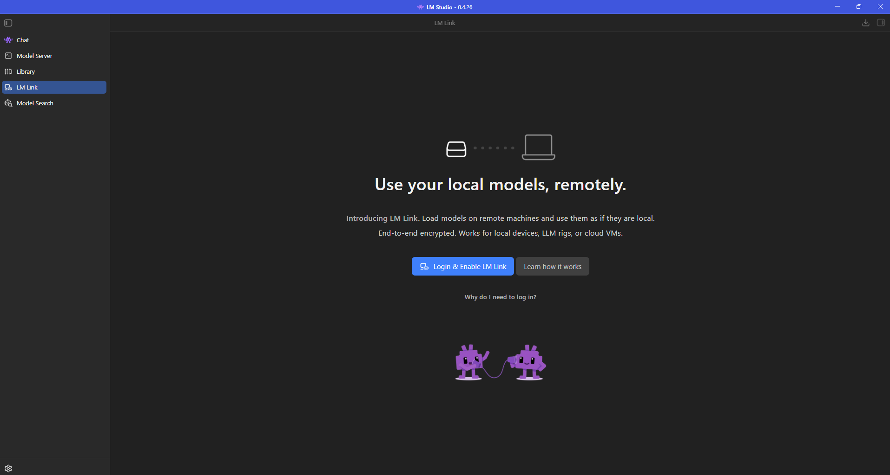

# Manuel 17 — LM Link : utiliser des modèles locaux à distance

> **Objet** : utiliser, depuis un appareil, des modèles chargés sur un **autre** appareil (poste puissant, serveur sans écran, machine virtuelle) comme s'ils étaient locaux : principe, mise en place, usage dans l'interface, l'API et les outils de code, sécurité, limites.
> **Prérequis** : [Manuel 01](01-prise-en-main.md) (installation), [Manuel 06](06-serveur-local-et-api.md) (serveur local), [Manuel 07](07-cli-lms.md) (commande `lms`).
> **Version décrite** : LM Studio **0.4.26** (build 4), Windows 11, interface en anglais ; documentation officielle consultée le **11 octobre 2026**.
> **Statut des informations** : **[Source]** documentation officielle de LM Studio (liste des pages en fin de manuel) ; **[Vérifié]** observé sur le poste de test (écran LM Link non connecté, aide et sortie de `lms link`) ; **[Estimation]** déduction ; **[À tester]** non exécuté.
> **Précautions** : **aucun compte n'a été créé et aucune connexion n'a été effectuée** pour ce manuel (règle du projet). **L'appairage de deux appareils n'a donc pas été essayé** : les sections 3 à 6 reposent sur la documentation officielle ; la section 9 fournit un protocole pour les vérifier sur deux machines.

---

## Sommaire

1. [Principe](#1-principe)
2. [Disponibilité et prérequis](#2-disponibilité-et-prérequis)
3. [Mettre en place un lien (appareils avec interface)](#3-mettre-en-place-un-lien-appareils-avec-interface)
4. [Ajouter une machine sans interface (`llmster`)](#4-ajouter-une-machine-sans-interface-llmster)
5. [Utiliser les modèles distants](#5-utiliser-les-modèles-distants)
6. [Les commandes `lms link`](#6-les-commandes-lms-link)
7. [Sécurité et confidentialité](#7-sécurité-et-confidentialité)
8. [Limites constatées ou annoncées](#8-limites-constatées-ou-annoncées)
9. [Protocole de vérification sur deux machines](#9-protocole-de-vérification-sur-deux-machines)
10. [Dépannage](#10-dépannage)
11. [Sources](#11-sources)

---

## 1. Principe

### Essentiel

**LM Link** relie plusieurs appareils d'un **même compte** LM Studio dans un réseau privé chiffré, appelé **lien** (*link*). Les modèles chargés sur un appareil deviennent utilisables depuis les autres « comme s'ils étaient locaux » [Source].

| Notion | Définition |
|---|---|
| **Lien** (*link*) | Réseau privé de bout en bout chiffré, propre au compte ; créé automatiquement la première fois que la fonction est ouverte |
| **Appareil** (*device*) | Machine qui exécute LM Studio (avec interface) ou `llmster` (sans interface) |
| **Modèle distant** (*remote model*) | Modèle chargé sur un autre appareil du lien ; le **calcul** s'y effectue |
| **Appareil préféré** (*preferred device*) | Appareil utilisé en priorité quand le même modèle existe sur plusieurs machines |

- **Qui calcule quoi** : la génération s'exécute sur l'**appareil distant** ; la **conversation reste** sur l'appareil où elle est saisie [Source].
- **Technologie** : réseau maillé (*mesh*) privé construit avec **Tailscale** (service de réseau privé virtuel) ; le serveur de LM Studio ne sert qu'à la **découverte** des appareils [Source].
- **Usages cités** : laisser tourner une carte graphique de joueur pendant une absence ; mutualiser un serveur d'inférence dans une équipe ; utiliser depuis un portable ou un téléphone un gros modèle hébergé ailleurs [Source].


*Figure 1 — Page **LM Link** (barre latérale, entre *Library* et *Model Search*) avant connexion : ① titre « Use your local models, remotely. », ② texte de présentation (« End-to-end encrypted. Works for local devices, LLM rigs, or cloud VMs. »), ③ **Login & Enable LM Link**, ④ **Learn how it works**, ⑤ **Why do I need to log in?**.* [Vérifié, 0.4.26]

### Pour aller plus loin

- Le principe rappelle un **serveur d'inférence distant**, mais **sans ouvrir de port** ni configurer de réseau : l'appairage passe par le compte.
- LM Link ne remplace pas le **serveur local** ([Manuel 06](06-serveur-local-et-api.md)) : il s'y **greffe**. Un outil qui parle à `localhost:1234` peut utiliser un modèle distant sans modification ([section 5](#5-utiliser-les-modèles-distants)).

---

## 2. Disponibilité et prérequis

| Point | Constat | Statut |
|---|---|---|
| **Statut du produit** | **Préversion** (*Preview*) ; accès déployé **par lots**, demande d'accès par formulaire sur la page de présentation | [Source] |
| **Prix** | **Gratuit pendant la préversion** ; offres gratuite et payante annoncées pour la disponibilité générale ; la formule gratuite est utilisable en entreprise dans ses limites d'appareils et d'utilisateurs ; contact dédié pour un déploiement en entreprise | [Source] |
| **Limite de la formule gratuite de Bionic** | La page des prix de Bionic (consultée le 11 octobre 2026) range **LM Link pour 5 appareils au plus** dans la formule **Free** ; Bionic+ et Pro reprennent « tout ce que contient Free » sans annoncer d'autre limite ([Manuel Bionic 10, offres et prix](../bionic/10-securite-compte-api.md#offres-et-prix)) | [Source] |
| **Compte** | Une **connexion à un compte LM Studio est requise** : elle associe les appareils au compte et permet leur découverte (l'écran propose « Why do I need to log in? ») | [Source ; écran vérifié] |
| **Logiciel** | LM Studio **ou** `llmster` installé sur **chaque** appareil | [Source] |
| **Réseau** | Connexion Internet **nécessaire** ; le lien ne fonctionne pas hors ligne | [Source] |
| **Systèmes** | Appareils locaux, serveurs, stations d'inférence, machines virtuelles cloud ; liste de systèmes d'exploitation **non publiée** sur les pages consultées | [Source ; À tester] |
| **Mobile** | iPhone et iPad via l'application **Locally** (même compte) | [Source] |
| **Nombre d'appareils et de liens** | Limites **non indiquées** | [À tester] |

**Constat local** [Vérifié, 11 octobre 2026] : la page LM Link de LM Studio 0.4.26 affiche « Login & Enable LM Link » ; la fonction n'est donc pas activée dans l'interface de ce poste. Les captures du manuel 01 (version 0.4.25) montraient « Sign in required ».

---

## 3. Mettre en place un lien (appareils avec interface)

### Essentiel

Procédure officielle pour un appareil avec interface [Source ; **non exécutée**, compte requis] :

1. **Installer LM Studio** sur chaque appareil (page de téléchargement du site officiel).
2. Cliquer sur **LM Link** dans la barre latérale (icône au-dessus de l'engrenage des réglages) puis **suivre les étapes** : **se connecter** au compte (étape obligatoire, ouverture du navigateur), puis activer la fonction.
3. **Au premier usage, un lien est créé automatiquement** pour le compte : aucune étape de création ni de nom de lien n'est décrite.
4. Ajouter **un second appareil** : répéter l'opération sur l'autre machine, avec **le même compte**. Les appareils se **connectent automatiquement** entre eux.

> **Évolution à noter** — L'interface observée en 0.4.25 décrivait trois étapes (*Se connecter → Créer un Link → Ajouter un autre appareil*) ([Manuel Bionic 03](../bionic/03-reglages.md#9-appareils--lm-link)). La documentation actuelle parle d'un lien **provisionné automatiquement**. L'écran de la 0.4.26 ne montre que « Login & Enable LM Link » : l'étape « Créer un Link » semble avoir disparu [Estimation].

### Pour aller plus loin

- **Nom de l'appareil** : par défaut, le nom de la machine ; modifiable dans la page LM Link ou par `lms link set-device-name "<nom>"` ([section 6](#6-les-commandes-lms-link)). Les autres appareils voient ce nom : le choisir **explicite** (ex. « Station-RTX »).
- **Désactiver** : *Settings → LM Link →* désactiver « **Enable LM Link** », ou `lms link disable` [Source].

---

## 4. Ajouter une machine sans interface (`llmster`)

Pour un serveur, une station distante ou une machine virtuelle sans écran [Source ; **non exécutée** : exécution d'un script distant, connexion à un compte].

| Étape | Commande | Rôle |
|---|---|---|
| 1 | `curl -fsSL https://lmstudio.ai/install.sh \| bash` | Installe `llmster` (cible Linux ; sous Windows, voir le [Manuel 16, section 5](16-sdk-et-plugins.md#5-le-mode-sans-interface--llmster)) |
| 2 | `lms login` | Se connecte au compte ; **suivre les instructions affichées** dans le terminal |
| 3 | `lms link enable` | Active LM Link sur cette machine ; la commande **attend la connexion** et indique la marche à suivre en cas de problème |
| 4 | — | La machine **apparaît automatiquement** dans la page LM Link des autres appareils |

Ensuite, charger un modèle sur la machine (`lms load …`, [Manuel 07](07-cli-lms.md)) : il devient disponible pour les autres appareils.

---

## 5. Utiliser les modèles distants

### 5.1 Dans l'application

Le **sélecteur de modèle** (chargeur) liste **les modèles locaux et les modèles des appareils liés**. Un modèle présent sur plusieurs machines apparaît **une fois par appareil**, avec le **nom de l'appareil** en étiquette. Les mêmes réglages de chargement sont disponibles, dans l'interface comme avec `lms` [Source ; non exécuté].

### 5.2 Par le serveur local, l'API et les SDK

Un appareil peut envoyer ses requêtes à **`localhost:1234`** et les faire exécuter par une machine distante : il suffit d'indiquer la **clé du modèle** comme d'habitude ; si le modèle se trouve sur un appareil du lien, il est servi par lui. Les requêtes vers `localhost` continuent de fonctionner normalement [Source].

```bash
# Sur l'appareil qui consomme : démarrer le serveur local
lms server start --port 1234
# Puis appeler l'API comme d'habitude, avec la clé d'un modèle présent sur l'appareil distant
```

### 5.3 Choisir l'appareil : l'appareil préféré

Quand le même modèle existe sur plusieurs appareils, le chargement par l'API ou les SDK utilise l'**appareil préféré** [Source] :

- **Interface** : page LM Link → sélectionner l'appareil → activer **Set as preferred device**.
- **Ligne de commande** : `lms link set-preferred-device` (liste interactive) ou `lms link set-preferred-device <identifiant>` (l'identifiant figure dans `lms link status`).
- Le réglage est **propre à chaque machine** : chaque appareil choisit **indépendamment** la machine qu'il préfère.

La documentation ne précise **pas** le comportement quand l'appareil préféré est hors ligne ou ne possède pas le modèle [À tester].

### 5.4 Outils de code

Les assistants de code utilisent le serveur local ; le modèle tourne ailleurs [Source ; non exécuté] :

```bash
lms server start --port 1234

# Claude Code (exemple de la documentation ; remplacer le nom de modèle par un modèle présent sur l'appareil distant)
export ANTHROPIC_BASE_URL=http://localhost:1234
export ANTHROPIC_AUTH_TOKEN=lmstudio
claude --model qwen3-8b

# Codex
codex --oss -m qwen3-8b
```

Les réglages détaillés de chaque outil figurent au [Manuel 13](13-integrations-outils-tiers.md). **Contexte et vitesse** : celle de la **machine distante** compte ; la latence réseau s'ajoute ([section 8](#8-limites-constatées-ou-annoncées)).

### 5.5 Dans Bionic

Les modèles **Remote** apparaissent dans le sélecteur de modèle d'une session **tant que l'appareil lié est disponible** et partage ses modèles locaux ; ils disparaissent si la machine distante est hors ligne. À considérer pour le choix : vitesse et mémoire de la machine distante, prise en charge des outils et des images par le modèle [Source ; [Manuel Bionic 04](../bionic/04-modeles.md)]. Le comportement d'une session ouverte quand l'appareil disparaît n'est **pas** documenté [À tester].

### 5.6 Depuis un iPhone ou un iPad (Locally)

Prérequis : LM Studio sur un ordinateur avec LM Link activé, **même compte** dans l'application **Locally** (App Store), Internet. Étapes : installer LM Studio ; se connecter et activer LM Link ; installer Locally ; s'y connecter avec le même compte et y activer LM Link. Limites annoncées : la connexion a des **délais après mise en arrière-plan** de Locally (reconnexion parfois lente) ; **pas de lien entre deux applications Locally** (le lien relie LM Studio sur ordinateur à Locally sur mobile) [Source ; non exécuté].

---

## 6. Les commandes `lms link`

**Aide observée** [Vérifié, 0.4.26] : `lms link --help` liste cinq sous-commandes.

| Commande | Rôle (aide de la commande) | Détails de la documentation |
|---|---|---|
| `lms link enable` | Activer LM Link sur cet appareil | Exige un compte : exécuter `lms login` d'abord ; attend la connexion et affiche la marche à suivre en cas de problème |
| `lms link disable` | Désactiver LM Link sur cet appareil | Équivalent de l'interrupteur « Enable LM Link » |
| `lms link status` | Afficher l'état de LM Link | Nom de l'appareil, état de connexion, **appareils connectés et modèles qu'ils ont chargés** ; option `--json` pour les scripts |
| `lms link set-device-name` | Nommer l'appareil local | `lms link set-device-name "<nom>"` ; effet immédiat, visible des pairs |
| `lms link set-preferred-device` | Choisir l'appareil préféré pour la résolution des modèles | Liste interactive, ou identifiant en argument |

**Sortie observée** de `lms link status` sur le poste de test [Vérifié, 11 octobre 2026 ; nom de machine masqué ; commande de lecture seule] :

```text
This device: <nom de la machine>
Status: Online

Found 0 devices:
```

Avec `--json` : un objet contenant `status` (« online »), `issues` (liste, vide), `peers` (liste, vide), `deviceIdentifier` (identifiant de 32 caractères hexadécimaux) et `deviceName`. **Aucun pair** n'étant relié, la partie « appareils et modèles » **n'a pas pu être observée** [À tester].

> **À noter** — `lms link status` répond « Online » alors que la page graphique propose encore « Login & Enable LM Link » : l'état de la **ligne de commande** et celui de l'**interface** ne coïncident pas sur ce poste. L'origine (session de connexion distincte, fonction non activée côté interface) n'a pas été élucidée [À tester]. Le compte de la ligne de commande n'a **pas** été modifié pendant ce travail.

---

## 7. Sécurité et confidentialité

| Question | Réponse de la documentation | Statut |
|---|---|---|
| Les appareils sont-ils exposés sur Internet ? | **Non** : aucun port n'est ouvert vers Internet ; connexions chiffrées de bout en bout | [Source] |
| Que voit le serveur de LM Studio ? | Il aide **seulement** les appareils à se **trouver** ; il ne voit ni les conversations ni les listes de modèles (celles-ci transitent par la connexion chiffrée) ; rien n'est envoyé au serveur « hormis la liste des appareils » | [Source] |
| Les appareils liés peuvent-ils autre chose que LM Studio ? | **Non** : le lien ne sert qu'à l'accès aux modèles et à l'API ; il n'expose ni le système, ni les fichiers, ni d'autres services | [Source] |
| Compatibilité avec un Tailscale existant ? | LM Link **coexiste** avec un Tailscale déjà installé sans interférence (usage séparé) ; en revanche, **réutiliser** un réseau Tailscale existant n'est **pas** possible : LM Link crée **son** réseau et en contrôle les règles d'accès | [Source] |
| Effets sur la machine ? | Fonctionne en **espace utilisateur** ; ne modifie pas les réglages globaux de l'appareil | [Source] |

**Points de vigilance propres à ce manuel** :

- **Le prompt est lu par la machine distante** : avec un modèle distant, le texte envoyé (consignes, fichiers collés) est **traité par l'appareil qui héberge le modèle**. Choisir un lien **entre appareils de confiance** [Estimation : conséquence directe du principe].
- Le **compte** devient la clé d'accès au lien : protéger le compte, ne pas connecter d'appareil non maîtrisé.
- **Interface locale et jetons** : le serveur local reste soumis aux règles du [Manuel 11](11-securiser-le-serveur.md) ; un outil branché sur `localhost:1234` qui utilise un modèle distant **n'ajoute pas** d'exposition réseau directe, mais l'authentification par jeton reste à activer si le serveur est ouvert au réseau local.
- Rester **hors ligne** (aucune connexion à un compte) suffit pour **ne rien exposer** : la fonction est inactive par défaut.

---

## 8. Limites constatées ou annoncées

| Limite | Détail | Statut |
|---|---|---|
| **Préversion** | Accès par lots ; offres et prix non définitifs | [Source] |
| **Internet obligatoire** | Pas de fonctionnement hors ligne, même entre deux machines d'un même réseau local | [Source] |
| **Latence et débit** | La vitesse dépend de la **machine distante** et du **réseau** ; non mesurée ici | [À tester] |
| **Appareil « déconnecté »** | Peut s'afficher quand une machine s'arrête sans prévenir le serveur de découverte | [Source] |
| **Modèles en double** | Un même modèle sur plusieurs machines apparaît plusieurs fois (une entrée par appareil) | [Source] |
| **Mobile** | Délais de reconnexion après mise en arrière-plan ; pas de lien Locally ↔ Locally | [Source] |
| **Réseau Tailscale existant** | Ne peut pas être réutilisé pour LM Link | [Source] |
| **Systèmes pris en charge, nombre d'appareils** | Non précisés | [À tester] |

---

## 9. Protocole de vérification sur deux machines

À exécuter avec **deux** appareils du même compte (ex. portable + station). Chaque ligne se remplit avec la valeur réelle et se date. **Aucun résultat ci-dessous n'a été obtenu** : les colonnes sont vides par construction.

| N° | Action | Résultat attendu (documentation) | Résultat constaté |
|---|---|---|---|
| 1 | Sur la station : page LM Link → se connecter → activer | L'appareil apparaît ; le lien existe | — |
| 2 | Sur le portable : même opération, même compte | Les deux appareils se voient sans autre action | — |
| 3 | `lms link status` sur chaque machine | Nom, état et pair affichés ; modèles chargés du pair listés | — |
| 4 | Charger un modèle sur la station | Il apparaît dans le sélecteur du portable, étiqueté du nom de la station | — |
| 5 | Dans le chat du portable : envoyer une question au modèle distant | Réponse produite ; **vérifier** que la station calcule (GPU actif) et relever la vitesse en jetons par seconde | — |
| 6 | Portable : `lms server start --port 1234` puis requête API avec la clé du modèle distant | Réponse servie par la station | — |
| 7 | Charger le **même** modèle sur les deux machines ; appeler l'API | Une seule copie utilisée : celle de l'appareil préféré (puis changer de préférence : `lms link set-preferred-device`) | — |
| 8 | Arrêter LM Studio sur la station | Le portable la signale « disconnected » ; ses modèles disparaissent du sélecteur | — |
| 9 | Bionic sur le portable (LM Studio fermé) : sélecteur de modèle | Entrée **Remote** pour le modèle de la station | — |
| 10 | Désactiver LM Link (interrupteur ou `lms link disable`) | L'appareil quitte le lien ; la station n'apparaît plus | — |

Mesures à relever en plus : **latence** du premier jeton, **débit** de génération comparé au même modèle chargé localement, **débit** réseau utilisé, comportement avec **Internet coupé** après l'établissement du lien.

---

## 10. Dépannage

| Symptôme | Cause probable | Action |
|---|---|---|
| Page LM Link : « Login & Enable LM Link » | Aucun compte connecté dans l'interface | Se connecter (compte requis) ; vérifier ensuite `lms link status` |
| Aucun appareil dans `lms link status` (« Found 0 devices ») | Un seul appareil activé, ou comptes différents | Activer LM Link sur le second appareil **avec le même compte** |
| Appareil « disconnected » | Application arrêtée ou plantée sans prévenir le serveur de découverte | Vérifier que LM Studio ou `llmster` tourne sur la machine ; si le problème persiste, contacter le support (adresse indiquée par la FAQ officielle) |
| Le modèle distant n'apparaît pas | Modèle non chargé ou appareil hors ligne ; partage de modèles non activé | Charger le modèle sur l'appareil distant ; contrôler `lms link status` |
| Le mauvais exemplaire d'un modèle est utilisé | Même modèle sur plusieurs machines | Définir l'**appareil préféré** (section 5.3) |
| Impossible de réutiliser un réseau Tailscale | Limite annoncée | LM Link crée son propre réseau ; laisser le Tailscale existant à part |
| `lms link enable` n'aboutit pas | Compte non connecté en ligne de commande | `lms login` puis relancer ; lire le message de marche à suivre affiché |
| Désactiver complètement | — | *Settings → LM Link →* « Enable LM Link » désactivé, ou `lms link disable` |

---

## 11. Sources

Pages officielles consultées le 11 octobre 2026 (contenu résumé et reformulé) :

- Présentation : <https://lmstudio.ai/link>
- Vue d'ensemble : <https://lmstudio.ai/docs/lmlink>
- Mise en place d'un lien : <https://lmstudio.ai/docs/lmlink/basics>
- Ajouter un appareil : <https://lmstudio.ai/docs/lmlink/basics/add-device>
- Appareil préféré : <https://lmstudio.ai/docs/lmlink/basics/preferred-device>
- Questions fréquentes : <https://lmstudio.ai/docs/lmlink/basics/faq>
- LM Link dans Locally : <https://lmstudio.ai/docs/lmlink/lmlink-in-locally>
- Utilisation par l'API : <https://lmstudio.ai/docs/developer/core/lmlink>
- Intégrations d'outils de code : <https://lmstudio.ai/docs/integrations/lmlink>
- Commandes `lms link` : <https://lmstudio.ai/docs/cli/link/link-enable>, `link-status`, `link-set-device-name`, `link-set-preferred-device`
- Modèles distants dans Bionic : <https://lmstudio.ai/docs/bionic/models>
